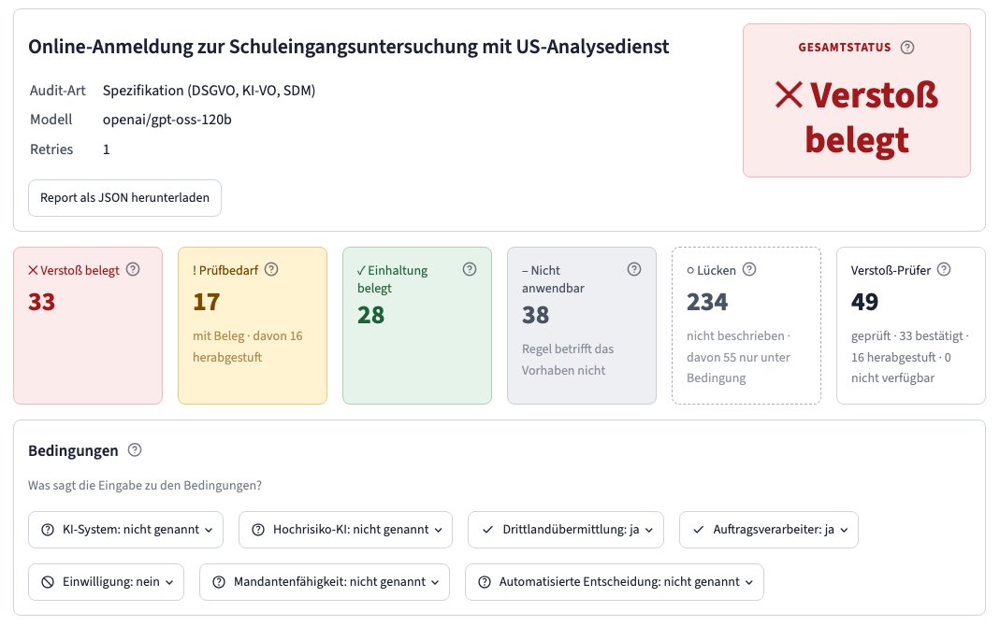
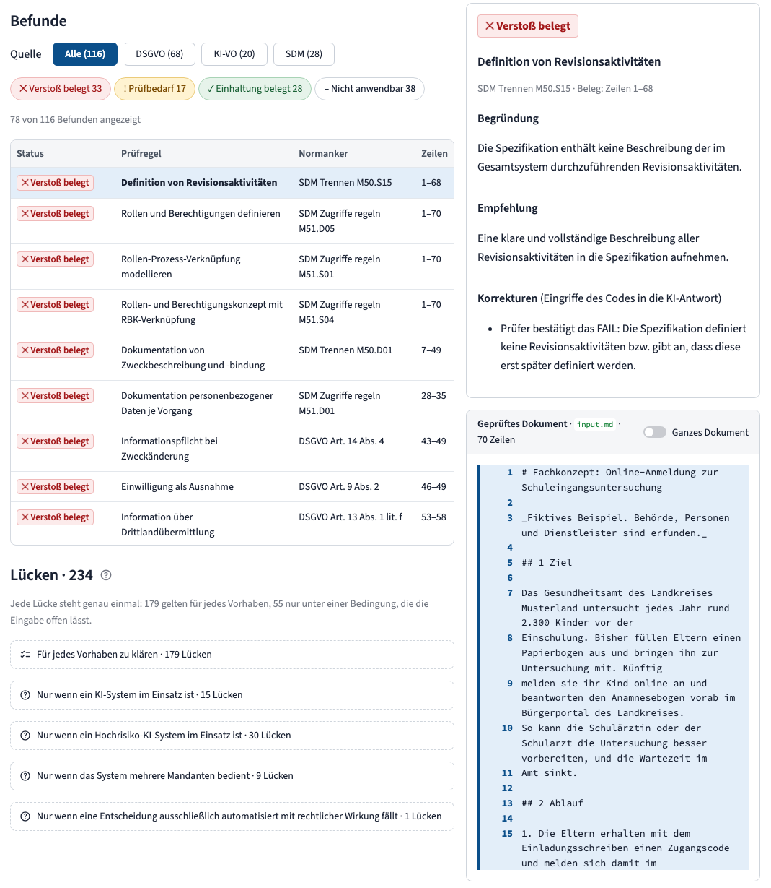
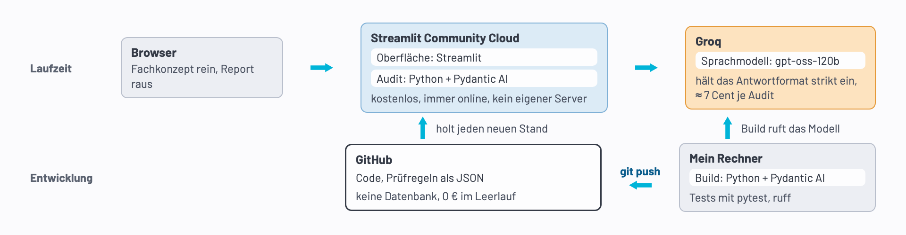

<div align="center">

# GovGuard

**Prüfassistent für Fachkonzepte von Behörden**

Prüft ein Fachkonzept gegen DSGVO, SDM und KI-Verordnung, bevor die erste Zeile Code entsteht.<br>
350 Prüfregeln, und jeder Befund zitiert wörtlich die Stelle, auf die er sich stützt.

[](https://govguard.streamlit.app/)


[Die Lösung](#die-lösung) · [Architektur](#architektur) · [Kennzahlen](#kennzahlen) · [Quickstart](#quickstart) · [Dokumentation](#dokumentation)

_English: GovGuard audits public-sector system specifications against GDPR, the German Standard Data Protection Model (SDM) and the EU AI Act, with a verbatim citation for every finding._

</div>

> [!NOTE]
> Die Galerie mit gespeicherten Audits ist frei zugänglich, nur „Audit erstellen“ braucht ein Passwort. GovGuard ist ein Prototyp: Bitte keine personenbezogenen oder vertraulichen Daten eingeben, nur erfundene.

## Das Problem

Bevor eine Behörde ein IT-System baut, beschreibt sie es in einem Fachkonzept. Ob es zu Datenschutz und KI-Verordnung passt, prüfen heute Menschen von Hand, mit Fragebögen und Formularen; automatische Prüfwerkzeuge gibt es erst für IaC (Infrastructure as Code). Ein Fehler im Fachkonzept fällt deshalb oft erst beim Bauen auf, wenn Ändern teuer ist.

## Die Lösung

Die Fachperson lädt ihr Fachkonzept hoch, nach etwa drei Minuten liegt der Audit-Report vor. Das Beispiel ist ein erfundenes Meldeportal, über das Eltern ihr Kind zur Schuleingangsuntersuchung anmelden; die Antworten wertet ein Dienst in den USA aus.



Oben steht der Gesamtstatus; der schlechteste Befund zählt. Die Kacheln zählen die Befunde je Status. Eine Lücke ist eine Pflicht, zu der das Fachkonzept nichts sagt, und der Verstoß-Prüfer zeigt, wie viele Verstöße die Zweitmeinung bestätigt oder abgeschwächt hat. Darunter die Bedingungen: Was das Fachkonzept über das Vorhaben verrät, etwa ob Daten in ein Drittland gehen. Davon hängt ab, welche Prüfregeln überhaupt gelten.



Die Befundliste lässt sich nach Quelle und Status filtern. Wer einen Befund anklickt, sieht rechts Begründung, Empfehlung und die Eingriffe des Codes in die KI-Antwort. Darunter das geprüfte Dokument mit den markierten Belegzeilen, so lässt sich jeder Befund am Original nachprüfen.

## Architektur



GovGuard hat zwei Wege: Zur Laufzeit prüft es ein Fachkonzept in der Cloud, in der Entwicklung entstehen Code und Prüfregeln auf dem eigenen Rechner. Beide treffen sich in GitHub, denn was dort liegt, ist live. In beiden Wegen urteilt das Sprachmodell, der Code bereitet vor und kontrolliert.

**Laufzeit** (obere Zeile)

- **Browser:** Die Fachperson lädt ihr Fachkonzept hoch und bekommt den Audit-Report mit Belegen zurück. Eine Galerie zeigt gespeicherte Audits.
- **Streamlit Community Cloud:** führt die Oberfläche (Streamlit) und die Audit-Engine (Python, Pydantic AI) aus, kostenlos, immer online und ohne eigenen Server. Die Audit-Engine prüft in einem festen Ablauf statt mit KI-Agenten. Der Code nummeriert jede Zeile des Fachkonzepts. Das Modell klärt den Rahmen, etwa ob Daten ins Ausland gehen, und prüft dann je 10 Regeln pro Anfrage, indem es ein festes Formular füllt: Status, Zeilennummern, Begründung. Der Code kontrolliert jede Antwort, fragt bei Fehlern einmal nach und bricht sonst ab, statt zu raten. Jeder Verstoß bekommt eine Zweitmeinung, die nur abschwächen darf. Zum Schluss schneidet der Code die Zitate aus und bildet den Gesamtstatus; der schlechteste Befund zählt.
- **Groq:** stellt das Sprachmodell gpt-oss-120b. Es hält das Antwortformat strikt ein und kostet 0,07 bis 0,10 $ je Audit, rund ein Zehntel von Claude über AWS.

**Entwicklung** (untere Zeile)

- **Eigener Rechner:** Hier läuft der Build, der die Prüfregeln einmal vorab baut. Der Code lädt die Gesetzestexte von EUR-Lex und der Datenschutzkonferenz und liest jeden Artikel aus. Das Modell bei Groq zerlegt ihn in einzelne Pflichten, wählt aus, was an einem Fachkonzept prüfbar ist, und formuliert Kriterien für Einhaltung und Verstoß. Der Code prüft jeden Entwurf, ein Mensch gibt ihn im Git-Diff frei. Tests laufen mit pytest, den Codestil prüft ruff.
- **GitHub:** hält Code und Wissensbasis. Die Wissensbasis besteht aus 350 Prüfregeln als JSON im Repo, je eine Pflicht aus DSGVO (169), SDM (116) oder KI-VO (65). Es gibt keine Datenbank und keine Vektorsuche: Jedes Audit prüft alle Regeln, denn oft ist gerade das Fehlen der Verstoß.
- **git push:** ist das ganze Deployment. Streamlit holt jeden neuen Stand von GitHub, im Leerlauf kostet GovGuard 0 €.

## Kennzahlen

| Kennzahl         | Wert                                                              |
| ---------------- | ----------------------------------------------------------------- |
| Kosten je Audit  | 0,07 bis 0,10 $                                                   |
| Dauer je Audit   | 2,5 bis 3,5 Minuten                                               |
| Stabilität       | 70 bis 94 % der Prüfregeln behalten über 3 Läufe ihren Status     |
| Erfundene Zitate | 0 in 18 Läufen                                                    |
| Tests            | 970 automatische Tests, 24 Browser-Tests mit Screenshot-Vergleich |

Gemessen in 19 Läufen über erfundene Musterfälle mit festgelegtem Soll. **Noch nicht gemessen ist die Trefferquote**, also wie viele Befunde eine Fachperson bestätigen würde. GovGuard ist darum ein Prüfassistent für Fachleute, kein Nachweis der Rechtskonformität.

## Quickstart

Voraussetzung ist [uv](https://docs.astral.sh/uv/). Die Galerie mit gespeicherten Audits läuft ohne Schlüssel und ohne AWS:

```bash
git clone https://github.com/Daniel74/GovGuard.git && cd GovGuard
uv sync
uv run streamlit run streamlit_app.py
```

Tests: `uv run pytest -q`.

### Eigene Audits

„Audit erstellen“ braucht zwei Werte: ein frei gewähltes Passwort für die Seite (`APP_PASSWORD`) und einen API-Schlüssel von Groq (`GROQ_API_KEY`, anzulegen unter [console.groq.com/keys](https://console.groq.com/keys)). Beide gehören in `.streamlit/secrets.toml`; die Datei ist von Git ausgenommen:

```toml
APP_PASSWORD = "ein-eigenes-passwort"
GROQ_API_KEY = "gsk_..."
```

Alternativ gehen Umgebungsvariablen: `APP_PASSWORD=… GROQ_API_KEY=… uv run streamlit run streamlit_app.py`. Ohne Passwort startet kein Audit. Wie in der Demo gilt: keine personenbezogenen oder vertraulichen Daten, egal wo GovGuard läuft.

### Auf Streamlit Community Cloud hosten

1. Das Repo auf GitHub forken.
2. Auf [share.streamlit.io](https://share.streamlit.io) mit GitHub anmelden und „Create app“ wählen.
3. Repo, Branch `main` und Hauptdatei `streamlit_app.py` eintragen.
4. Unter „Advanced settings“ Python 3.13 wählen und die beiden Zeilen aus `secrets.toml` in das Feld „Secrets“ kopieren.

Die Abhängigkeiten liest Streamlit aus `uv.lock`. Danach geht jeder Push auf `main` von selbst live, im Leerlauf kostet die App nichts. Den Build der Prüfregeln und alle Einstellungen beschreibt [ENTWICKLUNG](docs/ENTWICKLUNG.md).

Ohne Besuch schläft die App nach 12 Stunden ein; der GitHub-Workflow `keep-awake` öffnet sie deshalb alle 6 Stunden und weckt sie bei Bedarf, das Ergebnis steht unter „Actions“. GitHub schaltet geplante Workflows ab, wenn 60 Tage lang kein Commit kommt; dann dort „Enable workflow“ wählen.

## Roadmap

Ziel ist, die Schwankung des Modells zu senken und dafür erst messen zu können ([AUSBAU](docs/AUSBAU.md)):

- Protokoll aller Modellaufrufe, getrennte Testsets und eine Fachperson für die Trefferquote.
- Experimente mit einer Prüfregel je Aufruf, Prompt Caching und einem stärkeren Modell.
- Befunde den Behörden-Dokumenten zuordnen und Textvorschläge für jede Lücke.

Ein zweites Audit für Cloud-Architekturen (BSI, CIS, AWS) ist gebaut, wird aber nicht weiterentwickelt: Dafür gibt es schon viele Prüfwerkzeuge.

## Dokumentation

| Dokument                                    | Frage                                                    |
| ------------------------------------------- | -------------------------------------------------------- |
| [SPEC](docs/SPEC.md)                        | Was leistet GovGuard fachlich?                           |
| [FUNKTIONSWEISE](docs/FUNKTIONSWEISE.md)    | Wie arbeitet es fachlich, genug zum Nachbauen?           |
| [ARCHITECTURE](docs/ARCHITECTURE.md)        | Wie ist es gebaut, und wo irrt das Modell?               |
| [AUSBAU](docs/AUSBAU.md)                    | Was kommt als Nächstes?                                  |
| [ENTWICKLUNG](docs/ENTWICKLUNG.md)          | Wie baue, teste und erweitere ich es?                    |
| [ADRs](docs/adr/) und [CONTEXT](CONTEXT.md) | Welche Entscheidungen gelten, und was heißt ein Begriff? |

## Über das Projekt

Gebaut mit Claude Code als Programmierpartner: 76 Issues, 199 Commits, 28 Architekturentscheidungen.

Kontakt: [govguard@gmx.de](mailto:govguard@gmx.de)

## Lizenz

Code unter MIT ([LICENSE](LICENSE)). Die Wissensbasis bleibt unter den Lizenzen ihrer Quellen ([NOTICE](NOTICE)); Dateien mit BSI-Anker stehen unter CC BY-SA 4.0.
