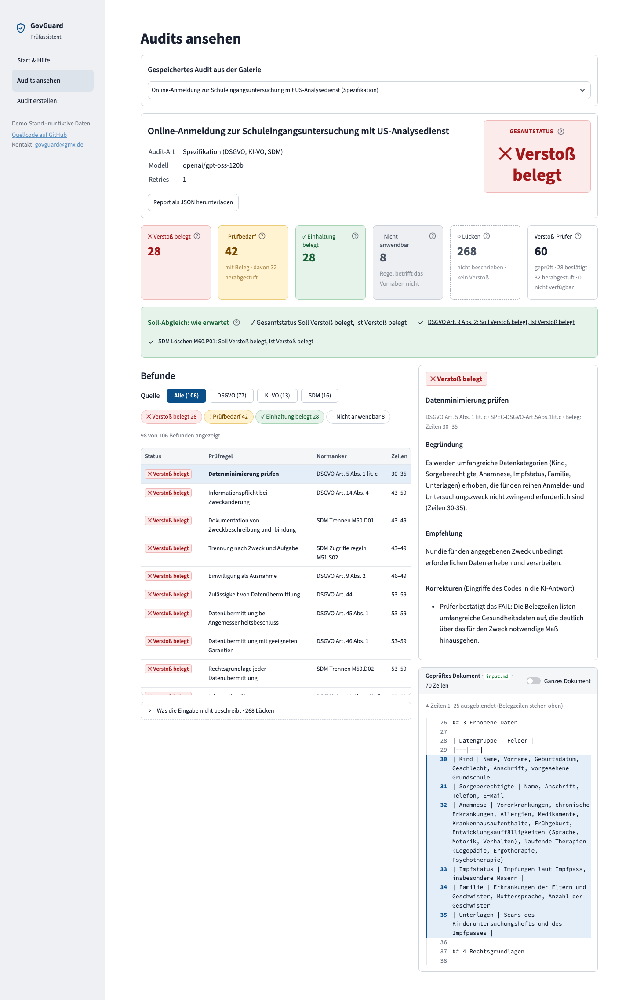
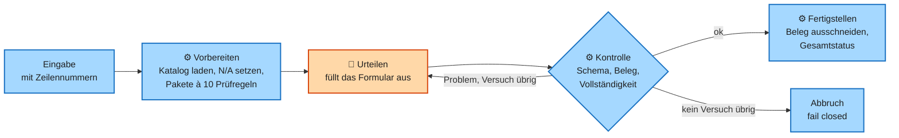

# GovGuard

GovGuard is a compliance copilot for public-sector cloud projects in Germany. It audits a specification against GDPR, the EU AI Act and the German Standard Data Protection Model (SDM), or an AWS architecture (CloudFormation JSON, whose services the code reads itself, or plain text, YAML and Terraform, where the model names the services) against BSI IT-Grundschutz (the "Grundschutz++" catalog), BSI C5 (the BSI criteria catalogue for cloud services), the CIS AWS Benchmark and AWS Foundational Security Best Practices. The result is an audit report with PASS, WARN, FAIL or N/A for every rule, and each PASS or FAIL cites the lines of the input it rests on. The language model only judges and drafts; deterministic code pins the sources, checks every draft and every answer, and fails closed on an invalid answer (no report instead of an unchecked one); otherwise it falls back to the more cautious status (WARN instead of an unproven PASS or FAIL), never to a PASS. Built as a portfolio project. It is a review assistant for specialists, not a proof of compliance, and a demo for fictitious data only.

**Deutsch:** GovGuard prüft Spezifikationen und Cloud-Architekturen von Behörden gegen DSGVO, KI-VO, SDM (Spezifikation) bzw. BSI Grundschutz++, BSI C5, CIS AWS und AWS FSBP (Architektur) und belegt jeden Verstoß und jede Einhaltung mit Zeilen aus der Eingabe.

**Live-Demo:** <https://govguard.streamlit.app/> – Die Galerie mit gespeicherten Audits ist frei, nur „Audit erstellen“ braucht ein Passwort (nur fiktive Daten).



## Was das Projekt zeigt

- **Das Modell als unzuverlässiger Partner:** Es urteilt nur im Formular; Code bereitet vor und kontrolliert (Schema, Belegzeilen, Vollständigkeit). Das ist ein fester Ablauf, kein Agent ([ADR 0021](docs/adr/0021-kein-orchestrierungs-framework.md)).
- **Reproduzierbare Wissensbasis:** 525 Prüfregeln aus gepinnten Quellen (SHA-256), ohne Vektor-Datenbank, mit Prüfungen im Code (Gates) gegen erfundene Zitate ([ADR 0011](docs/adr/0011-vollstaendiger-katalog.md)).
- **Gemessen und dokumentiert:** 19 Messläufe mit Kosten und Dauer, Doku in fünf Sichten (4+1, ein Standardmodell für Architekturdokumentation) mit Klassen-, Aktivitäts- und Sequenzdiagrammen, STRIDE (Bedrohungsliste) und OWASP (Risikoliste für Anwendungen mit Sprachmodell), 0 € Leerlaufkosten.

## Lösungsstrategie

**Kernaussage:** Jeder Modellaufruf steht zwischen zwei Code-Schichten: Der Code bereitet vor, das Modell urteilt, der Code kontrolliert.



**Legende:** Orange = Sprachmodell, blau = Code, Raute = Gate. Pfeil = Ablauf; der Pfeil zurück zum Modell ist der Retry.

**Beschreibung:**

- **Gate:** Ein Gate ist eine Prüfung im Code, die eine Antwort nur durchlässt, wenn sie eine feste Regel erfüllt (Schema, gültige Belegzeilen, ein Befund je Prüfregel).
- **Retry und fail closed:** Ein Retry stellt dem Modell die Frage noch einmal, mit dem gefundenen Problem. Fail closed heißt: Ist die Antwort auch dann ungültig, bricht das Audit ab, statt einen ungeprüften Report zu liefern. Ein unbelegtes PASS oder FAIL wird stattdessen zu WARN, nie zu PASS ([ARCHITECTURE](docs/ARCHITECTURE.md#72-die-deterministische-schale) 7.2). Der Code prüft, dass die Belegzeilen existieren, nicht, dass sie das Urteil tragen. Ein falsches PASS ist deshalb das größte Restrisiko ([ARCHITECTURE](docs/ARCHITECTURE.md#74-wo-die-schale-endet) 7.4).
- **Mehr:** [ARCHITECTURE](docs/ARCHITECTURE.md#04-drei-leitprinzipien) 0.4 und [3.3](docs/ARCHITECTURE.md#33-aktivität-spec-audit).

## Kennzahlen

Ein **Musterfall** ist eine fiktive Beispiel-Eingabe mit von Hand festgelegtem Soll-Ergebnis. Es gibt sechs (drei Spezifikationen, drei Architekturen), darunter den Selbstaudit: GovGuard prüft die eigene Spezifikation.

| Kennzahl | Wert |
|---|---|
| Prüfregeln | 350 im Spec-Katalog (DSGVO 169, SDM 116, KI-VO 65), 175 im Architektur-Katalog (AWS FSBP 105, BSI 39, CIS 20, C5 11) |
| Tests | 965 automatische Tests, dazu 24 Browser-Tests der Oberfläche (`uv run pytest -q`, `uv run pytest -m visual`) |
| Kosten je Audit | Spec 0,07 bis 0,10 $, Architektur 0,007 bis 0,018 $ (Median je Musterfall) |
| Dauer je Audit | Spec 143 bis 214,5 s, Architektur 12 bis 26,5 s (Median je Musterfall) |
| Soll erreicht | 10 von 19 Läufen; 3 von 6 Musterfällen in jedem Lauf ([QS-4](docs/ARCHITECTURE.md#73-was-die-schale-nachweislich-leistet)) |

Kosten und Dauer: Messkampagne (Issue #54), 19 Läufe über 6 Musterfälle, Groq `openai/gpt-oss-120b`, Preis 0,15 $ / 0,60 $ je Million Tokens. Die Einzelwerte stehen in [ARCHITECTURE](docs/ARCHITECTURE.md#53-ausrollen-betrieb-und-kosten) 5.3. Der Median gilt je Musterfall über die erfolgreichen Läufe (3; ein vierter Lauf beim Selbstaudit brach nach einem HTTP 400 von Groq ab, siehe [ARCHITECTURE](docs/ARCHITECTURE.md#73-was-die-schale-nachweislich-leistet) QS-2). Das Modell schwankt: Je Musterfall behalten 70 bis 99 % der Prüfregeln in allen Läufen denselben Status (Issue #54). **Nicht gemessen:** wie viele der Befunde eine Fachperson bestätigen würde (Trefferquote), und was die Handprüfung kostet. Gemessen sind nur Stabilität, Gesamtstatus und wenige Pflichtbefunde je Musterfall (ein Pflichtbefund ist ein Befund, dessen Status das Soll festlegt; [ARCHITECTURE](docs/ARCHITECTURE.md#73-was-die-schale-nachweislich-leistet) 7.3 und 7.4).

## Quickstart

Voraussetzung: [uv](https://docs.astral.sh/uv/), das Python 3.13 selbst holt. Weder AWS noch ein Schlüssel nötig, die Galerie läuft ohne.

```bash
git clone https://github.com/Daniel74/GovGuard.git && cd GovGuard
uv sync
uv run streamlit run streamlit_app.py
```

Tests: `uv run pytest -q`. Eigene Audits, Wissensbasis-Build und Screenshot-Regression stehen in [ENTWICKLUNG](docs/ENTWICKLUNG.md).

## Dokumentation

| Dokument | Frage |
|---|---|
| [SPEC](docs/SPEC.md) | Was leistet GovGuard fachlich? (GovGuard prüft sie in der Galerie selbst.) |
| [ARCHITECTURE](docs/ARCHITECTURE.md) | Wie ist es gebaut, und wo irrt das Modell? (Funktionsweise, fünf Sichten nach 4+1, Verlässlichkeit trotz Sprachmodell, Sicherheit, Standards, Referenzen) |
| [METHODIK](docs/research/METHODIK.md) | Nach welcher Methode ist es entstanden? (Stand #65, nicht mehr nachgezogen) |
| [ENTWICKLUNG](docs/ENTWICKLUNG.md) | Wie baue, teste und erweitere ich es? |
| [ADRs](docs/adr/) und [CONTEXT](CONTEXT.md) | Welche Entscheidungen gelten, und was heißt ein Begriff? |

## Lizenz

- **Code:** MIT, siehe [LICENSE](LICENSE).
- **Wissensbasis:** Sie bleibt unter den Lizenzen ihrer Quellen, siehe [NOTICE](NOTICE). Dateien mit BSI-Anker stehen unter CC BY-SA 4.0. Die Demo-UI nennt Quellen und Werkzeuge unter „Credits“ in der Seitenleiste.
