# GovGuard – Architektur nach Kruchten 4+1

GovGuard prüft Spezifikationen und Architekturen von Behörden-Vorhaben und liefert einen Audit-Report mit PASS, WARN, FAIL oder N/A. Dieses Dokument ist die technische Referenz. Kapitel 1 nennt die Anwendungsfälle; wie GovGuard fachlich arbeitet, erklärt das eigene Dokument [FUNKTIONSWEISE.md](FUNKTIONSWEISE.md). Die Kapitel 2 bis 6 zeigen in den fünf Sichten nach Philippe Kruchten, wie es gebaut ist. Kapitel 7 zeigt, wie ein deterministischer Rahmen ein probabilistisches Sprachmodell verlässlich macht, Kapitel 8 die klassische Sicherheit, Kapitel 9 den Abgleich mit den Standards und Kapitel 10 die Quellen.

## 0 Einführung und Kontext

*Leitfrage: Was ist GovGuard, was ist es nicht, und wie liest man dieses Dokument?*

GovGuard ist ein Prüfassistent: Ein Sprachmodell (🤖, probabilistisch) entwirft Befunde, Code (⚙️, deterministisch) prüft, ergänzt und entscheidet. Die Demo läuft ohne AWS auf Streamlit Community Cloud mit Groq. Dieses Dokument richtet sich an Entwickler und technische Prüfer; Nicht-Techniker holt das [README](../README.md) ab.

Das Kapitel legt die Grundlagen für alle weiteren: 0.1 grenzt ab, was GovGuard prüft und was nicht. 0.2 zeigt, welches Kapitel welche Frage beantwortet. 0.3 erklärt die Kennzeichnung von Modell und Code in jedem Diagramm. 0.4 nennt die drei Leitprinzipien, die alle Entwurfsentscheidungen tragen, und 0.5 die Fachwörter.

### 0.1 Zweck und Abgrenzung

GovGuard kennt zwei Audits. Das Spec-Audit prüft eine Spezifikation, also die fachliche Beschreibung eines Vorhabens. Das Architektur-Audit prüft eine technische Beschreibung oder ein CloudFormation-Template. CloudFormation ist die Sprache von AWS, in der man Infrastruktur als Datei beschreibt; eine solche Datei heißt Template und ist JSON oder YAML. Terraform ist ein vergleichbares Werkzeug eines anderen Herstellers. Beide Audits bewerten die Eingabe gegen einen festen Katalog von Prüfregeln, den ein Build vorher aus öffentlichen Normtexten erzeugt hat.

| Audit | Eingabe | Quellen und Zahl der Prüfregeln | im Code |
|---|---|---|---|
| Spec-Audit | Freitext oder OpenAPI | DSGVO 169, SDM 116, KI-VO 65; zusammen 350 | `data/knowledge_base/rules_spec.json` |
| Architektur-Audit | Freitext, YAML, Terraform oder CloudFormation-JSON | AWS FSBP 105, BSI Grundschutz++ 39, CIS AWS 20, BSI C5 11; zusammen 175 | `data/knowledge_base/rules_arch.json` |

Die Quellen in je einem Satz: Die DSGVO ist das EU-Datenschutzgesetz. Die KI-VO ist das EU-Gesetz für KI-Systeme. Das SDM ist das Standard-Datenschutzmodell der deutschen Datenschutzbehörden. BSI Grundschutz++ ist der maschinenlesbare IT-Grundschutz des BSI, und C5 ist sein Kriterienkatalog für Cloud-Dienste. CIS AWS ist eine Härtungsempfehlung, und AWS FSBP sind die Sicherheitsregeln von AWS je Dienst.

**Was GovGuard nicht ist.** Ein Prüfassistent ist ein Werkzeug für die Vorprüfung: Er liefert Befunde mit Beleg als Hinweise für Fachleute. Er liefert keinen Nachweis und keine Freigabe, und er ersetzt die Fachprüfung nicht. Die Golden Archetypes (freigegebene Referenzarchitekturen) sind entworfen, aber bewusst nicht gebaut ([0019](adr/0019-nur-audits.md)).

**Was GovGuard nicht prüft.** Diese Grenzen gelten für jedes Audit, unabhängig davon, wie gut das Modell antwortet:

| Grenze | Was das heißt | Quelle |
|---|---|---|
| Schutzbedarf „normal“ | Der Vorfilter übernimmt nur Anforderungen des Niveaus „normal“ nach Stand der Technik aus Grundschutz++. Höherer Schutzbedarf braucht weitere Anforderungen und eine Risikoanalyse; GovGuard ist kein Grundschutz-Check und keine Zertifizierung. | `prefilter_reason` |
| Nur Behörden | DSGVO Art. 20, 27, 41 und 47 gelten für Behörden nicht und sind ausgeschlossen; Verantwortliche außerhalb der EU prüft GovGuard nicht. | [0028](adr/0028-bedingungen-im-spec-audit.md) |
| Nur das Lastenheft | Das Spec-Audit prüft die Spezifikation gegen Pflichtinhalte späterer Dokumente: Verzeichnis der Verarbeitungstätigkeiten (Art. 30 DSGVO), Datenschutz-Folgenabschätzung (Art. 35 DSGVO), Grundrechte-Folgenabschätzung (Art. 27 KI-VO). Pflichtenheft und Systemarchitektur prüft es nicht. | SPEC |
| Fester Prüfumfang | Das Architektur-Audit kennt eine feste Liste von AWS-Diensten (Serverless, RDS und Aurora, Fargate). Eingaben sind höchstens 100.000 Zeichen lang. | [0011](adr/0011-vollstaendiger-katalog.md) |
| Nur die Workload | Kontoweite Pflichten wie Root-MFA oder ein kontoweiter CloudTrail sind an keinem Template entscheidbar. Das leisten Prowler oder AWS Security Hub. | [0007](adr/0007-relevanz-und-ausnahmen.md) |
| Nicht alle Bausteine | Der SDM-Baustein Protokollieren (M43) fehlt, weil er ein eigenes Schema für Kennungen hat. | – |
| Quellen aus zweiter Hand | CIS, C5 und FSBP kommen als JSON des Prüfwerkzeugs Prowler, nicht direkt vom Herausgeber; bei CIS prüft eine Stichprobe gegen das PDF. | [0008](adr/0008-quellformate.md) |

### 0.2 Lesehilfe

Kruchten beschreibt ein System in vier Sichten und prüft sie mit Szenarien. Jede Sicht beantwortet eine eigene Frage für eigene Leser; die Szenarien zeigen, dass die vier Sichten zusammenpassen. Vor den Sichten stehen die Anwendungsfälle, nach ihnen die querschnittlichen Kapitel zu Verlässlichkeit, Sicherheit und Standards. Die fachlichen Konzepte, die man zum Verstehen und Nachbauen braucht, stehen einmal in [FUNKTIONSWEISE.md](FUNKTIONSWEISE.md); die Sichten verweisen darauf, statt sie zu wiederholen.

| Kapitel | Leitfrage | Leser |
|---|---|---|
| [0 Einführung](#0-einführung-und-kontext) | Was ist GovGuard, und wie liest man das Dokument? | alle |
| [1 Anwendungsfälle](#1-anwendungsfälle) | Was leistet GovGuard, und für wen? | alle |
| [2 Logische Sicht](#2-logische-sicht) | Was sind die Fachbegriffe, und wie hängen sie zusammen? | Entwickler, Fachprüfer |
| [3 Prozess-Sicht](#3-prozess-sicht) | Was läuft gleichzeitig, wo wird gewartet, was begrenzt? | Entwickler, Betrieb |
| [4 Entwicklungs-Sicht](#4-entwicklungs-sicht) | Wie ist der Code organisiert, und was hält die Ordnung fest? | Entwickler |
| [5 Physische Sicht](#5-physische-sicht) | Was läuft auf welchem Knoten? | Betrieb, Sicherheit |
| [6 Szenarien](#6-szenarien-1) | Welche Abläufe verbinden alle vier Sichten? | alle |
| [7 Verlässlichkeit](#7-verlässlichkeit-trotz-sprachmodell) | Wie wird ein System mit einem unzuverlässigen Baustein verlässlich? | Senior Engineers, Prüfer |
| [8 Sicherheit](#8-sicherheit) | Wer kann GovGuard missbrauchen, wohin fließen Daten? | IT-Sicherheit, Datenschutz |
| [9 Standards](#9-abgleich-mit-den-standards) | Wo ist behandelt, was OWASP, BSI und ISO verlangen? | IT-Sicherheit, Datenschutz |
| [10 Referenzen](#10-referenzen) | Wo stehen die Normen, Standards und Methoden? | alle |

Begriffe stehen in [CONTEXT.md](../CONTEXT.md), Entscheidungen in [adr/](adr/), Pflege und Befehle in [ENTWICKLUNG.md](ENTWICKLUNG.md), Pläne für später in [AUSBAU.md](AUSBAU.md). Code und ADRs sind die Wahrheit. Ein Drift-Test (`tests/test_architecture_doc_drift.py`) prüft, dass jeder Pfad, jede Klasse, jeder Name und jeder Test aus diesem Dokument im Code existiert.

Das Dokument folgt Kruchten; der Skill `architecture-models-4plus1` dient nur als Checkliste. Zwei Abweichungen vom Skill sind gewollt. Erstens steht die LLM-Unsicherheit gebündelt in Kapitel 7 statt verteilt in jeder Sicht; jede Sicht endet nur mit einem Verweis dorthin. Zweitens ist die Notation UML-nah, also Klassen-, Aktivitäts-, Komponenten- und Sequenzdiagramme statt Swimlanes, weil die Leser Entwickler sind. Alle Diagramme sind Mermaid, weil GitHub nur Mermaid direkt anzeigt. AWS ist keine Plattform des Demo-Stands; Bedrock erscheint nur dort, wo der Code es als optionalen Weg der Kommandozeile kennt.

### 0.3 Modell oder Code: die Konvention

Die wichtigste Unterscheidung dieses Dokuments ist die zwischen Modell und Code. Probabilistisch heißt: Gleiche Eingabe ergibt nicht immer die gleiche Antwort, und eine falsche Antwort sieht aus wie eine richtige. Deterministisch heißt: Gleiche Eingabe ergibt immer die gleiche Antwort, und ein Fehler ist reproduzierbar. In GovGuard ist nur das Sprachmodell probabilistisch; alles andere ist Code.

Darum trägt jedes Diagramm und jede Tabelle über Verhalten dieselbe Kennzeichnung:

| Zeichen | Bedeutung | Wo sichtbar |
|---|---|---|
| 🤖 orange | Sprachmodell, probabilistisch: Es schreibt einen Entwurf. | Knoten, Klassen mit «🤖 Modell», Kasten „Sprachmodell“ in Sequenzdiagrammen |
| ⚙️ blau | Code, deterministisch: Er prüft, ergänzt und entscheidet. | Knoten, Klassen mit «⚙️ Code», Kasten „Code“ in Sequenzdiagrammen |
| blau mit orangem Rand | Ablauf, den ⚙️ Code führt und in dem er 🤖 das Modell fragt | Anwendungsfälle in 1.1, Build-Schritte in FUNKTIONSWEISE |
| 🤖 vor einem Feld einer ⚙️-Klasse | Der Wert stammt aus einer Modellantwort; der Code hat ihn geerbt oder übernommen, oft nach einer Prüfung. | Klassendiagramme in 2.3 bis 2.5 |
| 👤 grau | Mensch: Er gibt ein, liest oder pflegt von Hand. | Akteure, Klassen mit «👤 Hand» |
| weiß | extern, kein Teil von GovGuard | Normherausgeber |
| weiß gestrichelt | gebaut, aber nicht in Betrieb | Bedrock |

Tabellen, in denen etwas geschrieben, geprüft oder entschieden wird, nennen den Handelnden: in einer Spalte „wer“ mit 🤖, ⚙️ oder 👤 oder in Spalten wie „🤖 liefert“ und „⚙️ prüft“. Tabellen mit Entwurfsentscheidungen kennzeichnen 🤖 und ⚙️ im Text. Unter jedem Diagramm beschreibt ein Absatz *Elemente* jeden Kasten und ein Absatz *Verbindungen* jeden Pfeil; bei Sequenzdiagrammen tritt an die Stelle der Verbindungen die nummerierte *Abfolge* der Nachrichten. Formen und Pfeile je Diagrammart:

| Diagramm | Kapitel | Formen und Pfeile |
|---|---|---|
| Anwendungsfalldiagramm | 1.1 | Kasten links = Akteur, abgerundetes Feld = Anwendungsfall, Linie = löst aus, «include» = enthält immer, «extend» = erweitert unter Bedingung |
| Schichtenbild | 2.2 | Raute = Gate (Prüfung im Code), Zylinder = Speicher, abgerundet = extern; Pfeil = „benutzt“ |
| Klassendiagramm | 2.3–2.5 | `*--` = enthält, `o--` = kennt, `--\|>` = erweitert (erbt), `..>` = verweist per Kennung; «…» = wer schreibt; gezeigt sind nur die wichtigsten Felder |
| Prozessbild | 3.2 | Rahmen = Betriebssystem-Prozess, Kasten = Thread oder Schleife |
| Aktivitätsdiagramm | 3.3, 3.4 | schwarzer Balken = Gabelung oder Zusammenführung paralleler Schritte, Raute = Entscheidung, Notiz = Grenzwert |
| Zustandsdiagramm | 3.5 | Kasten = Zustand, Pfeil = Übergang mit Bedingung |
| Komponentendiagramm | 4.2–4.4 | Kasten = Modul oder Ordner; Pfeil = „importiert“; gestrichelt = Zugriff zur Laufzeit |
| Verteilungsdiagramm | 5.2 | Rahmen = Ebene, «Gerät», «Plattform», «API», «Repository», «Website» = Art des Knotens |
| Sequenzdiagramm | 6 | durchgezogen = Aufruf, gestrichelt = Antwort an den Aufrufer, Balken = Teilnehmer arbeitet an einem Aufruf, `par` = gleichzeitig, `loop` = Wiederholung |
| Schalenbild | 7.2 | Rahmen = Code vor und nach dem Modell, M1 bis M6 = Muster der Schale |
| Datenflussdiagramm | 8.1 | Kreis = Prozess, Zylinder = Speicher, Kasten = externe Stelle, rot gestrichelt = Vertrauensgrenze, ① bis ⑪ = Fluss über eine Grenze |

### 0.4 Drei Leitprinzipien

Ein Prinzip ist eine Regel, die viele Einzelentscheidungen erklärt. Drei Prinzipien tragen alle Sichten; die übrigen Entwurfsentscheidungen stehen am Anfang ihrer Sicht (2.1, 3.1, 4.1, 5.1).

| # | Prinzip | Was es heißt | Warum | im Code |
|---|---|---|---|---|
| 1 | *Das Modell entwirft, der Code entscheidet.* | 🤖 Das Modell füllt nur Entwürfe. ⚙️ Status-Regeln, Anker, Beleg und Vollständigkeit setzt oder prüft der Code. | Der Teil, der irren kann, bleibt klein und eingerahmt ([0005](adr/0005-pydantic-ai.md), [0017](adr/0017-beleg-per-zeilenverweis.md)). | `FindingDraft`, `RuleDraft`, `checks/` |
| 2 | *Was der Code wissen kann, fragt man das Modell nicht.* | ⚙️ Der Code liest das Inventar eines Templates selbst, übernimmt Anker, Titel und Zitat aus der Quelle und setzt N/A nach fester Regel, bevor das Modell gefragt wird. | Eine Frage, die nicht gestellt wird, kann nicht falsch beantwortet werden ([0011](adr/0011-vollstaendiger-katalog.md), [0015](adr/0015-cloudformation-einziges-inventarformat.md), [0028](adr/0028-bedingungen-im-spec-audit.md)). | `na_drafts`, `template_resource_types`, `quoted_by_code` |
| 3 | *Im Zweifel kein Ergebnis oder der vorsichtigere Status.* | ⚙️ Eine ungültige Antwort bricht das Audit ab (fail closed). Wo ein Abbruch unnötig ist, wählt der Code den Status, der eher einen Menschen hinschauen lässt, nie ein PASS. | Ein falscher Report ist schlimmer als keiner ([0017](adr/0017-beleg-per-zeilenverweis.md), [0020](adr/0020-fail-nur-bei-festgelegtem-verstoss.md)). | `fail_closed`, `without_unproven_verdict` |

Prinzip 1 macht den probabilistischen Teil klein, Prinzip 2 macht ihn noch kleiner, und Prinzip 3 legt fest, was passiert, wenn er trotzdem versagt. Kapitel 7 zeigt die bekannten Muster dahinter.

### 0.5 Fachwörter

Die Begriffe, wie sie hier gebraucht werden; das vollständige Glossar steht in [CONTEXT.md](../CONTEXT.md).

| Wort | Bedeutung |
|---|---|
| Prüfregel | Eine Prüfregel ist eine einzelne, prüfbare Regel aus genau einer Anforderung einer Norm, mit Kriterien für „konform“ und „Verstoß“. |
| Katalog | Der Katalog ist die feste Menge aller Prüfregeln einer Audit-Art; jedes Audit bewertet ihn vollständig. |
| Build | Der Build ist der Ablauf, der vor den Audits aus öffentlichen Normtexten den Katalog erzeugt; er läuft von Hand auf dem Rechner des Betreibers und hat mit Kompilieren nichts zu tun. |
| Befund | Ein Befund ist das Ergebnis genau einer Prüfregel in einem Audit, mit Status, Beleg und Empfehlung. |
| Status | PASS heißt Einhaltung belegt, FAIL Verstoß belegt, N/A nicht anwendbar. WARN heißt nicht entscheidbar; die Oberfläche nennt es „Prüfbedarf“. |
| Beleg | Ein Beleg ist der wörtliche Ausschnitt der Eingabe, auf den sich ein Befund stützt. |
| Lücke | Eine Lücke ist ein WARN ohne Belegzeilen, das der Code nicht herabgestuft und dessen Zeilen er nicht gestrichen hat: Die Eingabe beschreibt die Anforderung nicht. |
| Herabstufung | Eine Herabstufung ist der Wechsel von PASS oder FAIL auf WARN durch den Code; der alte Status bleibt am Befund sichtbar. |
| Anker | Ein Anker ist die Fundstelle einer Prüfregel in der Norm, etwa „DSGVO Art. 32“; der Code setzt ihn, nie das Modell. |
| Entwurf | Ein Entwurf (Draft) ist das Formular, das das Modell ausfüllt; der Code macht daraus den fertigen Typ. |
| Gate | Ein Gate ist eine Prüfung im Code, die ein Ergebnis nur durchlässt, wenn es eine feste Regel erfüllt. |
| Retry | Ein Retry ist die erneute Frage ans Modell, nachdem der Code die Antwort mit Grund abgelehnt hat. |
| Fail closed | Fail closed heißt: Im Zweifel gibt es kein Ergebnis statt eines falschen. |
| Rückfall | Ein Rückfall ist ein fest definierter, vorsichtigerer Ausgang an einer Stelle, an der sonst fail closed gälte. |
| Paket | Ein Paket ist ein Modellaufruf mit bis zu zehn Prüfregeln und der ganzen nummerierten Eingabe. |
| Vorlauf | Ein Vorlauf ist ein Modellaufruf vor den Paketen; er stellt Bedingungen (Spec) oder Ressourcentypen (Architektur) fest. |
| Verstoß-Prüfer | Der Verstoß-Prüfer ist ein zweiter Modellaufruf, der jedes FAIL in offener Welt nur anhand von Verstoßkriterium und Belegzeilen bestätigt oder ablehnt. |
| Bedingung | Eine Bedingung ist eine Tatsache über das Vorhaben, von der Prüfregeln abhängen, etwa „Es wird ein KI-System eingesetzt“; nur ein ausdrückliches Nein setzt ihre Prüfregeln auf N/A. |
| Offene Welt | Offene Welt heißt: Was die Eingabe nicht erwähnt, kann anderswo geregelt sein; Fehlen ist dann nur WARN. In der geschlossenen Welt eines Templates ist Fehlen der Standardwert und kann FAIL sein. |
| Musterfall | Ein Musterfall ist eine fiktive Beispiel-Eingabe mit einem von Hand festgelegten Soll-Ergebnis. |
| Pflichtbefund | Ein Pflichtbefund ist ein Befund, dessen Anker und Status das Soll eines Musterfalls festlegt. |
| Halluzination | Eine Halluzination ist eine Aussage des Modells, die sich gut liest, aber erfunden ist. |
| Prompt Injection | Prompt Injection ist eine Anweisung im Eingabetext, die das Modell statt der eigentlichen Aufgabe befolgt. |
| Token | Ein Token ist ein Wortstück; danach rechnet der Anbieter ab und setzt seine Limits je Minute. |
| Temperatur | Die Temperatur ist der Regler, wie stark das Modell bei der Wortwahl würfelt; 0 heißt so wenig wie möglich, aber nicht gar nicht. |
| SHA-256 | SHA-256 ist eine Prüfsumme (Hash), die sich ändert, sobald sich ein Zeichen der Datei ändert. |
| Drittlandtransfer | Ein Drittlandtransfer ist die Übermittlung personenbezogener Daten in ein Land außerhalb der EU; die DSGVO erlaubt ihn nur mit besonderer Grundlage (Art. 44 ff.). |
| Auftragsverarbeitungsvertrag | Ein Auftragsverarbeitungsvertrag regelt nach Art. 28 DSGVO, wie ein Dienstleister personenbezogene Daten im Auftrag verarbeiten darf. |
| SBOM | Eine SBOM (Software Bill of Materials) ist die maschinenlesbare Liste aller Bibliotheken einer Software samt Version. |
| Prowler | Prowler ist ein Open-Source-Prüfwerkzeug für AWS, dessen Regelwerke für CIS, C5 und FSBP GovGuard als JSON liest. |
| Pydantic AI | Pydantic AI ist die Bibliothek, die Antwortformular, Validator und Retry für einen Modellaufruf übernimmt ([0005](adr/0005-pydantic-ai.md)). |
| OWASP | OWASP ist eine gemeinnützige Sicherheitsorganisation; ihre Top 10 for LLM Applications (LLM01 bis LLM10) nennen die wichtigsten Risiken für Anwendungen mit Sprachmodell. |
| AIC4 | AIC4 ist der Kriterienkatalog des BSI für KI-Cloud-Dienste; er richtet sich an Anbieter, die Modelle trainieren, und wird hier sinngemäß angewandt. Kürzel wie PF-09 nennen ein Kriterium. |
| BSI R und M | Im BSI-Papier „Generative KI-Modelle“ (Version 2.0, 2025) steht R mit Nummer für ein Risiko, etwa R26 für direkte Manipulation im Prompt, und M mit Nummer für eine Maßnahme. |

## 1 Anwendungsfälle

*Leitfrage: Was leistet GovGuard, und für wen?*

GovGuard bietet zwei Audits, eine Galerie und einen Build für die Wissensbasis. Dieses Kapitel nennt die Anwendungsfälle; wie GovGuard dabei fachlich arbeitet, erklärt [FUNKTIONSWEISE.md](FUNKTIONSWEISE.md): Prüfregel und Katalog, Build, Bedingungen, offene und geschlossene Welt, Ressourceninventar, Report und Soll.

Kruchten ordnet die Funktionen eines Systems der logischen Sicht und den Szenarien zu. Die Vorlage für das Architekturdokument im Rational Unified Process (RUP), das Kruchten verantwortet hat, stellt eine kurze Sicht der Anwendungsfälle vor die logische Sicht und verweist für die fachlichen Einzelheiten auf eigene Dokumente. Dieses Kapitel ist diese Sicht; die fachlichen Einzelheiten stehen in FUNKTIONSWEISE und in [SPEC.md](SPEC.md).

### 1.1 Was GovGuard leistet

Zwei Rollen nutzen GovGuard. Die prüfende Person startet Audits und liest Reports, der Projektbetreiber baut die Wissensbasis und pflegt die Musterfälle. Von sieben Anwendungsfällen fragen vier 🤖 das Sprachmodell.

Ein Anwendungsfall ist eine Funktion, die ein Akteur von außen auslöst und die ihm ein Ergebnis liefert. Das Anwendungsfalldiagramm zeigt die Akteure links, die Anwendungsfälle in der Mitte innerhalb der Systemgrenze und die externen Stellen rechts.

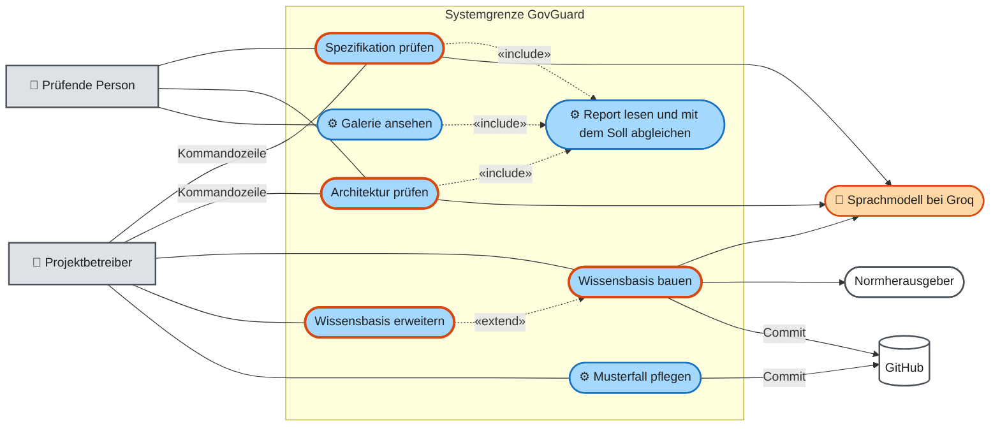

*Elemente.* Die beiden grauen Kästen links sind die Akteure. Die abgerundeten Felder in der Systemgrenze sind die sieben Anwendungsfälle. Blau mit orangem Rand heißt: ⚙️ Code führt den Ablauf und fragt dabei 🤖 das Sprachmodell. Rein blau heißt: Es ist kein Modellaufruf beteiligt. Rechts stehen die drei externen Stellen: das Sprachmodell bei Groq, die Normherausgeber und GitHub als Ablage für Code, Katalog und Galerie.

*Verbindungen.* Eine durchgezogene Linie ohne Pfeil verbindet einen Akteur mit dem Anwendungsfall, den er auslöst. Der Projektbetreiber startet Audits nur über die Kommandozeile, die prüfende Person über die Oberfläche. Ein gestrichelter Pfeil mit «include» heißt: Der Anwendungsfall enthält den anderen immer. Jedes Audit und jeder Blick in die Galerie endet darum im Lesen eines Reports. «extend» heißt: Der Anwendungsfall erweitert den anderen unter einer Bedingung. Das Erweitern der Wissensbasis ist ein Build, der nur fehlende Prüfregeln formuliert. Ein durchgezogener Pfeil nach rechts zeigt einen Aufruf nach außen: Audits und Build fragen das Modell, der Build lädt Normtexte, und Build und Musterfälle kommen per Commit ins Repository.

| Anwendungsfall | wer | Eingabe | Ergebnis | 🤖 beteiligt | Zugang | SPEC |
|---|---|---|---|---|---|---|
| Spezifikation prüfen | 👤 prüfende Person; Projektbetreiber | Spezifikation als Markdown, Freitext oder OpenAPI, höchstens 100.000 Zeichen | Report mit 350 Befunden | Bedingungs-Vorlauf, Pakete, Verstoß-Prüfer | Seite „Audit erstellen“; Kommandozeile `python -m govguard.cli spec <Datei>` | F1 |
| Architektur prüfen | 👤 prüfende Person; Projektbetreiber | CloudFormation-JSON, YAML, Terraform oder Freitext, höchstens 100.000 Zeichen | Report mit 175 Befunden | Inventar-Vorlauf und Verstoß-Prüfer nur in offener Welt; Pakete immer | wie oben, Befehl `arch` | F2 |
| Report lesen und mit dem Soll abgleichen | 👤 prüfende Person | ein Report, bei Musterfällen mit Soll | Gesamtstatus, Befundtabelle, Lücken als Checkliste, Bedingungen, Soll-Abgleich, Report als JSON | nein | Oberfläche | F4 |
| Galerie ansehen | 👤 prüfende Person | Wahl eines Musterfalls | gespeicherter Report neben der geprüften Eingabe | nein | Seite „Audits ansehen“ | F3 |
| Wissensbasis bauen | 👤 Projektbetreiber | Quellenliste, Prüfumfang, Musterfälle | zwei Kataloge im Repository | Zerlegen, Einstufen, Formulieren, Verstoß-Prüfer des Builds | `python -m kb_build` mit je einem Schritt | F5 |
| Wissensbasis erweitern | 👤 Projektbetreiber | neue Quelle in der Quellenliste | Katalog mit neuen Prüfregeln; die alten bleiben Byte für Byte; nur für das Spec-Audit gebaut | wie beim Bauen, nur für neue Anforderungen | Option `--only-missing` | F6 |
| Musterfall pflegen | 👤 Projektbetreiber | fiktive Eingabe und ein Soll von Hand | Ordner unter `data/input/presets/`; der Report kommt per Commit in die Galerie | nein; der Report selbst entsteht mit 🤖 | Git | – |

Die Spalte „SPEC“ nennt die fachliche Anforderung in [SPEC.md](SPEC.md). Was GovGuard bewusst nicht leistet, steht in 0.1.

## 2 Logische Sicht

*Leitfrage: Was sind die Fachbegriffe, und wie hängen sie zusammen?*

GovGuard hat zwei Abläufe: Der Build macht aus Normtexten einen festen Katalog von Prüfregeln, das Audit bewertet eine Eingabe gegen jede Prüfregel. 🤖 Das Modell schreibt in beiden nur Entwürfe (`*Draft`, `*Response`); ⚙️ alles, was Status, Beleg und Vollständigkeit bestimmt, schreibt der Code.

Kapitel 1 hat die Begriffe fachlich erklärt; diese Sicht zeigt sie als Typen mit Feldern und Beziehungen. 2.1 nennt die Entwurfsentscheidungen, die festlegen, wer welches Feld schreibt. 2.2 ordnet die Bausteine in Schichten. 2.3 zeigt die Typen des Builds, 2.4 die Kerntypen des Audits und 2.5 die Typen, die steuern, was ans Modell geht.

### 2.1 Entwurfsentscheidungen

Diese Entscheidungen legen fest, welche Typen es gibt und wer welches Feld schreibt.

| Entscheidung | Was sie heißt | Warum | im Code |
|---|---|---|---|
| Fester Katalog statt Suche | Jede Prüfregel bekommt in jedem Audit genau einen Befund; es gibt keine Ähnlichkeitssuche und keine Vektor-Datenbank. | Ein Audit mit unbemerkter Lücke ist wertlos ([0011](adr/0011-vollstaendiger-katalog.md)); Muster „feste Fragen, feste Antworten“ in 7.2. | `RuleCatalog`, `completeness_problems` |
| Entwurf-Muster | 🤖 Das Modell füllt einen Entwurfstyp; ⚙️ der fertige Typ erbt davon und ergänzt, was der Code schon weiß. | Ein Feld, das das Modell nicht ausfüllt, kann es nicht falsch ausfüllen ([0005](adr/0005-pydantic-ai.md)); Muster in 7.2. | `FindingDraft`, `Finding`, `RuleDraft`, `Rule` |
| Beleg per Zeilenverweis | 🤖 Das Modell nennt Zeilen; ⚙️ der Code schneidet den Beleg aus der Eingabe. | Der Beleg ist per Konstruktion wörtlich ([0017](adr/0017-beleg-per-zeilenverweis.md)). | `evidence_of`, `LineRange` |
| Die Welt entscheidet der Code | Nur ein CloudFormation-JSON, das der Code selbst lesen kann, ist eine geschlossene Welt; alles andere ist offen. | Das Modell darf die Regel für FAIL nicht selbst wählen ([0015](adr/0015-cloudformation-einziges-inventarformat.md), [0020](adr/0020-fail-nur-bei-festgelegtem-verstoss.md)). | `audit_input`, `OpenWorld` |
| FAIL nur bei Festlegung | In offener Welt beschreibt das Verstoßkriterium eine Festlegung, kein Fehlen. | Ein FAIL aus Schweigen wäre ein Fehlalarm ([0020](adr/0020-fail-nur-bei-festgelegtem-verstoss.md)). | `violation_if`, `judge_fails` |
| Bedingungen vorab | Ein Vorlauf stellt fest, ob das Vorhaben etwa ein KI-System einsetzt; nur ein ausdrückliches Nein macht die zugehörigen Prüfregeln N/A. | Pflichten, die nie gelten, sollen keine Lücke kosten ([0028](adr/0028-bedingungen-im-spec-audit.md)). | `ConditionDef`, `ConditionResult` |
| Querverweise ohne Einfluss | Bezüge auf andere Quellen schlägt das Modell vor; sie sind markiert und ändern keinen Status. | Ein ungeprüfter Bezug darf kein Urteil tragen. | `CrossReference` |
| Rechtsartikel zerlegen | Ein Artikel der DSGVO oder KI-VO wird in einzelne Pflichten zerlegt, bevor er Prüfregel wird. | Ein Artikel enthält oft mehrere unabhängige Pflichten ([0026](adr/0026-rechtsartikel-zerlegen.md)). | `Decomposition`, `ArticleDecomposition` |
| Pflichtanker | Fordert ein Musterfall einen Befund, muss dessen Anker im Katalog stehen, sonst bricht der Build ab. | Das Soll eines Musterfalls darf nicht ins Leere zeigen ([0022](adr/0022-pflichtanker-uebersteuern-die-ebene.md)). | `check_pinned` |
| Eingefrorener Katalog | Die SDM-Prüfregeln bleiben bei jedem Build Byte für Byte; neue Quellen kommen mit „nur fehlende formulieren“ dazu. | Galerie und Soll bleiben vergleichbar ([0025](adr/0025-ki-vo-als-neue-quelle-bei-eingefrorenem-katalog.md)). | `only_missing` |

### 2.2 Schichten

Das Schichtenbild zeigt die Bausteine von GovGuard ohne Ordner und Pfade, geordnet von den Akteuren oben bis zu den externen Stellen unten.

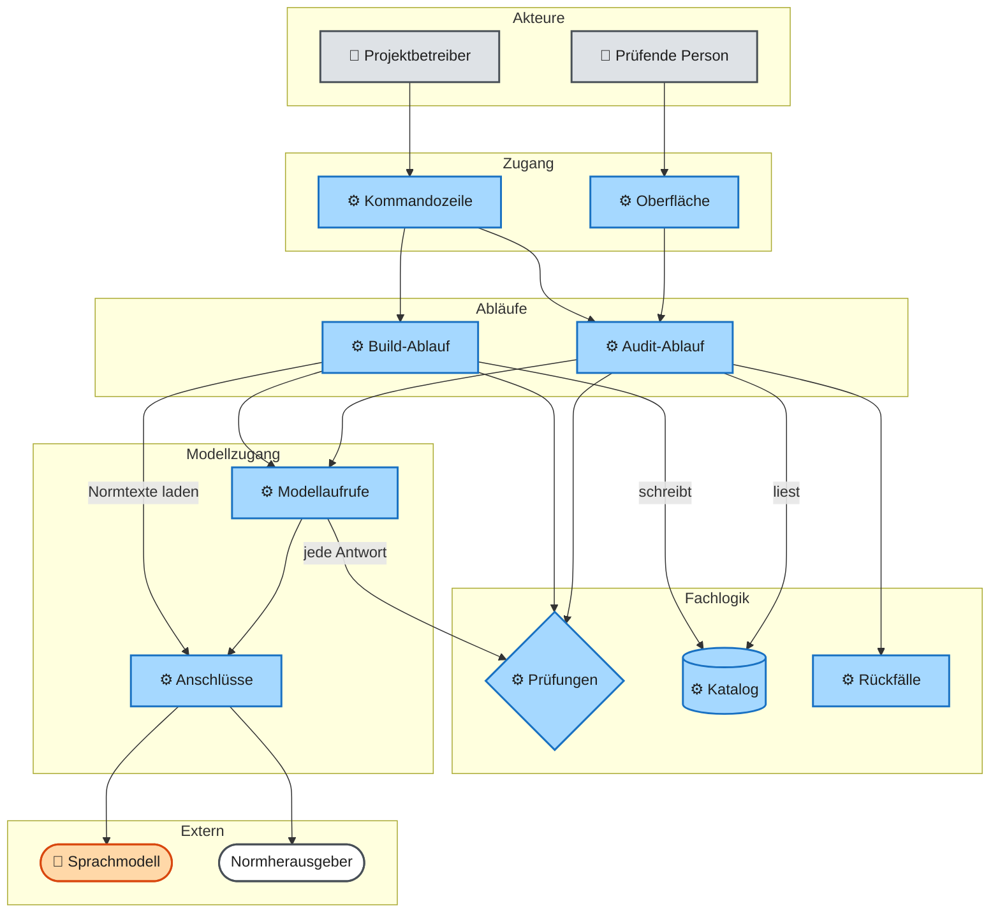

*Elemente.* Das Bild hat sechs Schichten, von oben nach unten: die Akteure, der Zugang über Oberfläche oder Kommandozeile, die beiden Abläufe, die Fachlogik, der Modellzugang und die externen Stellen. Jeder Kasten ist ein Baustein; die Tabelle unter dem Bild nennt seine Aufgabe und seinen Ort im Code. Die Raute „Prüfungen“ ist das Gate, der Zylinder „Katalog“ eine Datei. Das einzige 🤖 sitzt in der untersten Schicht.

*Verbindungen.* Ein Pfeil heißt „benutzt“. Jede Schicht benutzt nur Schichten darunter, mit einer gewollten Ausnahme.

- Die prüfende Person benutzt die Oberfläche, der Projektbetreiber die Kommandozeile.
- Die Oberfläche startet nur den Audit-Ablauf; die Kommandozeile startet Audit-Ablauf oder Build-Ablauf.
- Der Audit-Ablauf liest den Katalog, der Build-Ablauf schreibt ihn. Zur Laufzeit ändert niemand den Katalog.
- Der Audit-Ablauf benutzt Prüfungen, Rückfälle und Modellaufrufe; der Build-Ablauf benutzt Prüfungen und Modellaufrufe. Rückfälle gibt es nur im Audit.
- Die Modellaufrufe geben jede Antwort an die Prüfungen, bevor sie zählt. Das ist die Ausnahme von der Richtung nach unten: 🤖 Eine Antwort erreicht die Fachlogik nur durch diese Raute.
- Die Modellaufrufe gehen über die Anschlüsse zum Sprachmodell. Der Build lädt zusätzlich Normtexte über den Anschluss für Downloads.
- Die Anschlüsse sind der einzige Weg nach außen, zum Sprachmodell und zu den Normherausgebern.

| Baustein | Schicht | Aufgabe | wer | im Code |
|---|---|---|---|---|
| **Oberfläche** | Zugang | Passwort und Länge prüfen, Audit starten, Report und Galerie zeigen | ⚙️ | `govguard_ui/` |
| **Kommandozeile** | Zugang | Audit lokal starten (Exit-Code 0 bis 3) und den Build Schritt für Schritt starten | ⚙️ | `govguard/cli.py`, `kb_build/__main__.py` |
| **Audit-Ablauf** | Abläufe | Vorlauf, Pakete und Verstoß-Prüfer in fester Reihenfolge aufrufen, Report bilden | ⚙️ | `run_audit` |
| **Build-Ablauf** | Abläufe | aus Normtexten Anforderungen, Auswahl und Prüfregeln machen | ⚙️ | `kb_build/` |
| **Prüfungen** | Fachlogik | jede Modellantwort gegen Schema und feste Kriterien prüfen, Beleg ausschneiden | ⚙️ | `govguard/checks/`, `kb_build/rules/gates.py` |
| **Katalog** | Fachlogik | die festen Prüfregeln je Audit-Art | ⚙️ | `RuleCatalog` |
| **Rückfälle** | Fachlogik | festgelegte vorsichtigere Ausgänge statt Abbruch (7.2) | ⚙️ | `without_unproven_verdict`, `unstated_results` |
| **Modellaufrufe** | Modellzugang | Auftrag, Antwortformular und Retry je Aufruf | ⚙️ | `govguard/calls/`, `kb_build/llm_step.py` |
| **Anschlüsse** | Modellzugang | einziger Weg nach außen: Groq, Bedrock, Download der Normtexte | ⚙️ | `govguard/adapters/`, `source_fetch.py` |
| **Sprachmodell** | Extern | Entwürfe schreiben: Befunde, Bedingungen, Inventar, Urteile, Prüfregeln | 🤖 | `groq_model` |
| **Normherausgeber** | Extern | Normtexte bereitstellen: BSI, EUR-Lex, DSK, Prowler | – | `data/input/sources.json` |

### 2.3 Typen des Builds

Der Build kennt drei Gruppen von Typen: die Quelle mit ihren Anforderungen, die Auswahl und die fertigen Prüfregeln; dazwischen stehen die Entwürfe des Modells.

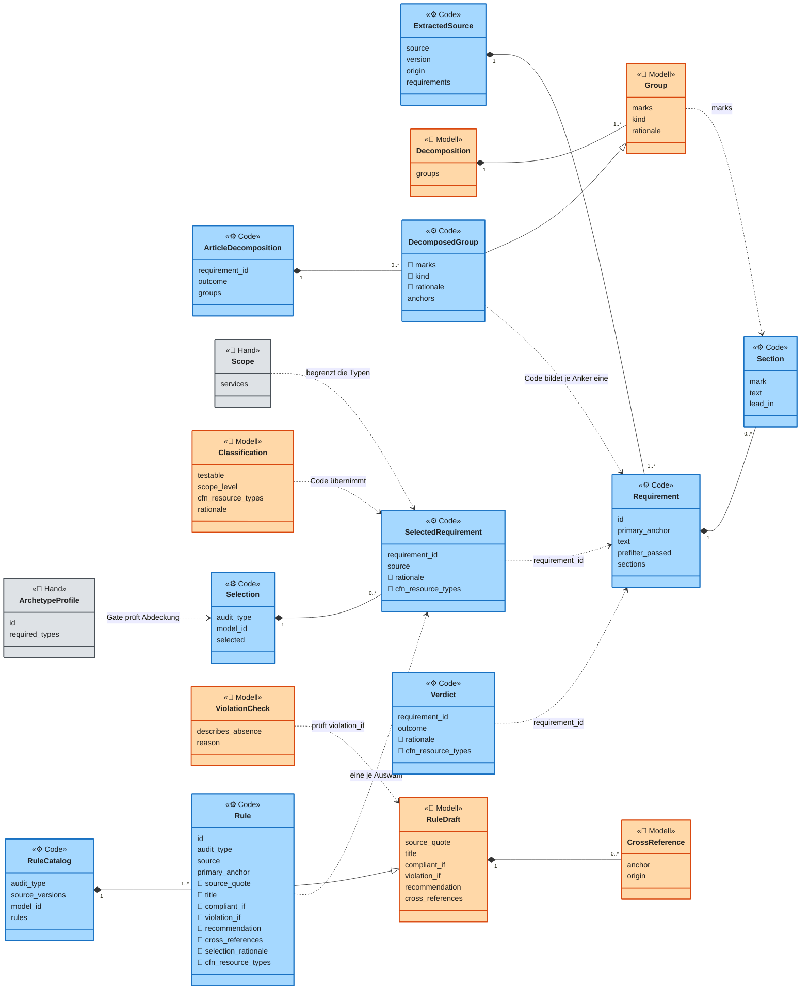

| Typ | Bedeutung | wer | im Code |
|---|---|---|---|
| Quelle, Anforderung, Abschnitt | eine Norm mit ihren zitierfähigen Vorgaben; ein Abschnitt ist ein Absatz oder Listenpunkt eines Rechtsakts | ⚙️ | `ExtractedSource`, `Requirement`, `Section` |
| Zerlegung | Gruppen von Abschnitten eines Artikels, je mit Art (alle gelten, eine genügt, je nach Risiko, keine Pflicht) | 🤖 | `Decomposition`, `Group` |
| Zerlegungsprotokoll | die Gruppen mit den Ankern, die der Code vergibt, oder `llm_error`, wenn der Artikel ganz bleibt | ⚙️ | `ArticleDecomposition`, `DecomposedGroup` |
| Prüfumfang, Archetyp-Steckbrief | die AWS-Dienste, die GovGuard prüft, und die Ressourcentypen, die eine Referenzarchitektur mindestens braucht | 👤 | `Scope`, `ArchetypeProfile` |
| Einstufung | prüfbar ja oder nein, Ebene der Pflicht, Ressourcentypen, Begründung | 🤖 | `Classification` |
| Auswahl, Auswahlprotokoll | die aufgenommenen Anforderungen und je Anforderung das Ergebnis mit Grund | ⚙️ | `Selection`, `SelectedRequirement`, `Verdict` |
| Entwurf einer Prüfregel, Querverweis | Zitat, Titel, Kriterien für konform und Verstoß, Empfehlung | 🤖 | `RuleDraft`, `CrossReference` |
| Urteil zum Verstoßkriterium | beschreibt das Kriterium nur ein Fehlen? (nur Spec) | 🤖 | `ViolationCheck` |
| Prüfregel, Katalog | die fertige Regel mit Kennung, Anker, Herkunft; die Datei je Audit-Art mit Quellenständen | ⚙️ | `Rule`, `RuleCatalog` |

*Elemente.* Jede Klasse ist ein Pydantic-Typ; die Tabelle oben fasst sie paarweise zusammen. Orange Klassen füllt 🤖 das Modell, blaue baut ⚙️ der Code, graue pflegt 👤 ein Mensch. In einer blauen Klasse markiert 🤖 ein Feld, dessen Wert aus einer Modellantwort stammt. Beim Auswahlprotokoll (`Verdict`) stammt die Begründung nur bei „ausgewählt“ und „nicht prüfbar“ vom Modell; vorgefilterte, nicht relevante Anforderungen und Modellfehler bekommen einen festen Satz des Codes.

*Beziehungen.* Von links nach rechts folgen sie dem Weg einer Quelle durch den Build.

- Eine Quelle enthält eine oder mehrere Anforderungen; eine Anforderung eines Rechtsakts enthält ihre Abschnitte, Anforderungen anderer Quellen haben keine.
- Eine Zerlegung enthält eine oder mehrere Gruppen. Jede Gruppe verweist über ihre Marken auf Abschnitte.
- Eine zerlegte Gruppe erbt von der Gruppe des Modells und ergänzt die Anker, die der Code vergibt. Das Zerlegungsprotokoll enthält die zerlegten Gruppen eines Artikels, keine, wenn der Artikel ganz bleibt. Aus jeder zerlegten Gruppe bildet der Code je Anker eine Anforderung.
- Eine Einstufung des Modells wird zu einer ausgewählten Anforderung: Der Code übernimmt Begründung und Ressourcentypen, nachdem der Prüfumfang die Typen begrenzt hat.
- Die Auswahl enthält die ausgewählten Anforderungen; jede verweist per Kennung auf ihre Anforderung, ebenso jeder Eintrag im Auswahlprotokoll. Die Steckbriefe der Referenzarchitekturen prüfen, dass die Auswahl jeden Pflicht-Typ abdeckt.
- Ein Entwurf einer Prüfregel enthält null oder mehr Querverweise. Das Urteil des Verstoß-Prüfers im Build bezieht sich auf das Verstoßkriterium eines Entwurfs.
- Die Prüfregel erbt vom Entwurf, entsteht genau einmal je ausgewählter Anforderung und gehört zu genau einem Katalog; der Katalog enthält mindestens eine Prüfregel.

*Der Weg einer Quelle.* Wie eine Quelle durch Extrahieren, Zerlegen, Auswählen und Formulieren läuft und welche Regel der Code dabei anwendet, erklärt [FUNKTIONSWEISE](FUNKTIONSWEISE.md#2-wie-der-katalog-entsteht) Kapitel 2.

*Entwurf-Muster.* Die Prüfregel erbt vom Entwurf (`Rule(RuleDraft)`) und ergänzt nur Felder, die der Code schon kennt; das Muster dahinter erklärt [7.2](#72-die-deterministische-schale) (Muster 1).

### 2.4 Typen des Audits: Kern

Ein Audit liest den Katalog, schickt Entwürfe ans Modell und macht daraus Befunde und einen Report; die Musterfälle legen das Soll fest.

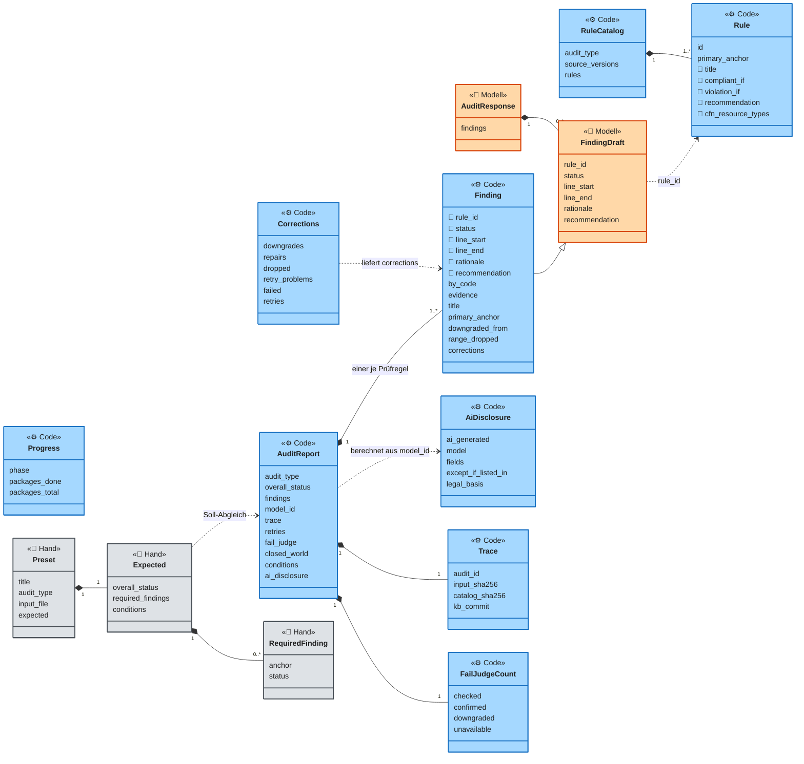

| Typ | Bedeutung | wer | im Code |
|---|---|---|---|
| Katalog, Prüfregel | Ergebnis des Builds, zur Laufzeit nur gelesen | ⚙️ | `RuleCatalog`, `Rule` |
| Antwort und Entwurf je Prüfregel | Status, Zeilenbereich, Begründung, Empfehlung | 🤖 | `AuditResponse`, `FindingDraft` |
| Befund | der Entwurf plus Beleg, Titel, Anker, Querverweise, Herabstufung, Marke für gestrichene Zeilen, Korrekturen und die Texte, die der Code selbst geschrieben hat (`by_code`) | ⚙️ | `Finding` |
| Korrekturen | Sammler aller Eingriffe des Codes in einem Audit: Herabstufungen, Reparaturen, gestrichene Zeilenbereiche, Retry-Gründe, Urteile des Verstoß-Prüfers | ⚙️ | `Corrections` |
| Report, Rückverfolgung, Zähler | Gesamtstatus, ein Befund je Prüfregel, Modell, Hashes von Eingabe und Katalog, Zähler des Verstoß-Prüfers | ⚙️ | `AuditReport`, `Trace`, `FailJudgeCount` |
| KI-Kennzeichnung | maschinenlesbarer Vermerk im JSON-Report: von KI erstellt, Modell, betroffene Felder, Rechtsgrundlage; der Code berechnet ihn aus `model_id`, er wird nie gespeichert (#83) | ⚙️ | `AiDisclosure` (`AuditReport.ai_disclosure`) |
| Fortschritt | Phase und fertige Pakete, für den Fortschrittsbalken | ⚙️ | `Progress` |
| Musterfall, Soll, Pflichtbefund | fiktive Eingabe mit Gesamtstatus und wenigen Pflichtbefunden, nie aus einem Lauf übernommen | 👤 | `Preset`, `Expected`, `RequiredFinding` |

*Elemente.* Die Tabelle oben nennt jede Klasse. Im Befund (`Finding`) tragen die geerbten Felder ein 🤖: Status, Zeilenbereich, Begründung und Empfehlung kommen aus dem Entwurf des Modells, auch wenn der Code den Status herabstufen oder einen ungültigen Zeilenbereich streichen kann. Zwei Ausnahmen: Setzt der Code eine Prüfregel vorab auf N/A (verneinte Bedingung, Typ nicht im Inventar), schreibt er alle diese Felder selbst; beim Fristenwecker gilt das für 144 von 175 Befunden. Und eine fehlende Empfehlung ergänzt der Code aus der Prüfregel; sie stammt vom Modell des Builds und behält das „KI“-Zeichen. Dagegen schreibt der Code die Empfehlung eines nicht belegten PASS selbst. Welche Texte der Code selbst geschrieben hat, steht im Befund (`by_code`), damit sie kein „KI“-Zeichen tragen (#83); das Feld steht nicht im Schema des Modells, weil nur ein Code-Entwurf (`CodeDraft`) es trägt. In der Prüfregel stammen Titel, Kriterien, Empfehlung und Ressourcentypen aus dem Build, also ebenfalls von 🤖, aber geprüft und eingefroren. Der Fortschritt (`Progress`) hat keine Beziehung: Er wird während des Laufs gemeldet und nicht gespeichert.

*Beziehungen.*

- Ein Katalog enthält eine oder mehrere Prüfregeln.
- Eine Antwort des Modells enthält null oder mehr Entwürfe; jeder Entwurf verweist per Kennung (`rule_id`) auf eine Prüfregel. Eine unbekannte Kennung lässt das Gate nicht durch.
- Ein Befund erbt vom Entwurf. Der Sammler der Korrekturen liefert jedem Befund seine Korrekturen, den alten Status nach einer Herabstufung und die Marke für gestrichene Zeilen (`range_dropped`); was sie für die Lücke bedeutet, erklärt [FUNKTIONSWEISE](FUNKTIONSWEISE.md#1-prüfregel-katalog-und-befund) Kapitel 1.
- Ein Report enthält genau einen Befund je Prüfregel, genau eine Rückverfolgung und genau einen Zähler des Verstoß-Prüfers.
- Ein Musterfall enthält genau ein Soll; das Soll enthält null oder mehr Pflichtbefunde. Das Soll verweist auf einen Report, wenn die Oberfläche beide abgleicht.

*Entwurf-Muster.* Der Befund erbt vom Entwurf (`Finding(CodeDraft)`, der von `FindingDraft` erbt) und ergänzt Beleg, Titel, Anker und Korrekturen; das Muster erklärt [7.2](#72-die-deterministische-schale) (Muster 1), Status und Report [FUNKTIONSWEISE](FUNKTIONSWEISE.md#1-prüfregel-katalog-und-befund) Kapitel 1 und 5.

Ein Audit-Ereignis (`AuditEvent`) gibt es als Klasse, aber kein Code schreibt es; darum fehlt es im Bild (8.4).

### 2.5 Typen des Audits: Bedingungen, Inventar, offene Welt

Diese Typen steuern, was überhaupt ans Modell geht: die Welt der Eingabe, die Bedingungen des Spec-Audits und das Ressourceninventar des Architektur-Audits; dazu kommen die Urteile des Verstoß-Prüfers.

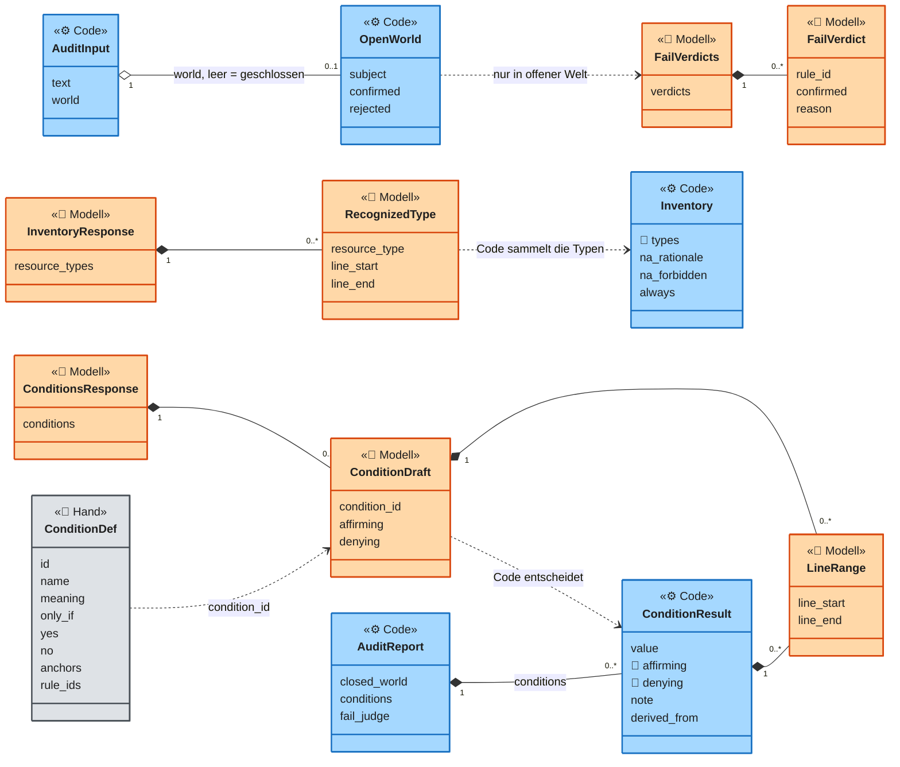

| Typ | Bedeutung | wer | im Code |
|---|---|---|---|
| Eingabe mit Welt | der Eingabetext und die Welt, die der Code dafür festgelegt hat; ohne Welt ist sie geschlossen | ⚙️ | `AuditInput`, `OpenWorld` |
| Bedingung | Erklärung, Kriterium für „ja“ und „nein“, Satz für „Nur wenn …“ und die betroffenen Prüfregeln | 👤 | `ConditionDef` (`data/input/conditions.json`) |
| Antwort des Bedingungs-Vorlaufs | je Bedingung Zeilen, die sie bejahen, und Zeilen, die sie verneinen | 🤖 | `ConditionsResponse`, `ConditionDraft`, `LineRange` |
| Wert einer Bedingung | `yes`, `no` oder `unstated`, mit Belegen und Hinweis | ⚙️ | `ConditionResult` |
| Antwort des Inventar-Vorlaufs | erkannte Ressourcentypen mit Zeilen (nur bei offener Welt) | 🤖 | `InventoryResponse`, `RecognizedType` |
| Ressourceninventar | die Typen der Eingabe und die Begründung für N/A | ⚙️ | `Inventory` |
| Urteile des Verstoß-Prüfers | je FAIL bestätigt oder nicht, mit einem Satz Grund | 🤖 | `FailVerdicts`, `FailVerdict` |

*Elemente.* Die Tabelle oben nennt jede Klasse. Im Wert einer Bedingung (`ConditionResult`) tragen die Belegzeilen ein 🤖, weil der Vorlauf sie nennt; den Wert selbst setzt der Code. Im Ressourceninventar (`Inventory`) stammen die Typen nur in offener Welt aus 🤖 dem Inventar-Vorlauf, bei einem CloudFormation-JSON liest der Code sie selbst. Der Report steht hier nur mit den drei Feldern, die diese Typen füllen.

*Beziehungen.*

- Eine Eingabe kennt höchstens eine offene Welt; fehlt sie, ist die Welt geschlossen.
- Eine Antwort des Bedingungs-Vorlaufs enthält null oder mehr Entwürfe je Bedingung. Jeder Entwurf verweist per Kennung auf eine Bedingung aus der Datei und enthält null oder mehr Zeilenbereiche.
- Aus den Entwürfen entscheidet der Code je Bedingung einen Wert, der die Zeilenbereiche übernimmt. Der Report enthält null oder mehr Werte, einen je Bedingung.
- Eine Antwort des Inventar-Vorlaufs enthält null oder mehr erkannte Typen; der Code sammelt sie im Ressourceninventar.
- Die Urteile des Verstoß-Prüfers enthalten null oder mehr Einzelurteile. Es gibt sie nur in offener Welt.

*Fachliche Regeln.* Nach welcher Tabelle der Code aus den Zeilen des Vorlaufs den Wert einer Bedingung macht, erklärt [FUNKTIONSWEISE](FUNKTIONSWEISE.md#3-wie-ein-spec-audit-urteilt) Kapitel 3; wie das Format die Welt und das Inventar bestimmt, [Kapitel 4](FUNKTIONSWEISE.md#4-wie-ein-architektur-audit-urteilt).

> **Concern (LLM-Unsicherheit):** Wie diese Typen das Modell einhegen (Entwurf-Muster, feste Fragen und feste Antworten, Referenz statt Kopie), steht in [7.2](#72-die-deterministische-schale); was sie nicht verhindern, in [7.4](#74-wo-die-schale-endet).

## 3 Prozess-Sicht

*Leitfrage: Was läuft gleichzeitig, wo wird gewartet, und was begrenzt?*

Ein Audit läuft als eine Ereignisschleife im Prozess des Aufrufers: 🤖 Vorlauf, dann 🤖 bis zu zwei Pakete gleichzeitig, dann 🤖 der Verstoß-Prüfer; zwischen jedem Modellschritt prüft ⚙️ Code. Der Build läuft als Batch, ein Modellaufruf nach dem anderen. Feste Grenzwerte halten Zeit und Kosten.

3.1 nennt die Entwurfsentscheidungen zu Reihenfolge, Parallelität und Wiederholung. 3.2 zeigt die Betriebssystem-Prozesse. 3.3 und 3.4 zeigen den Ablauf der beiden Audits als Aktivitätsdiagramme, 3.5 den Lebenslauf eines einzelnen Befunds. 3.6 sammelt die Grenzwerte, 3.7 die acht Modellaufrufe mit ihren Prüfungen.

### 3.1 Entwurfsentscheidungen

Diese Entscheidungen legen fest, in welcher Reihenfolge und wie oft das Modell gefragt wird und wo der Ablauf wartet.

| Entscheidung | Was sie heißt | Warum | im Code |
|---|---|---|---|
| Workflow statt Agent | Die Reihenfolge der Schritte steht im Code, rund 40 Zeilen `asyncio`; kein Modell wählt den nächsten Schritt, und es gibt kein Orchestrierungs-Framework. | Ein Ablauf ohne Verzweigung durch das Modell ist testbar und vorhersagbar ([0021](adr/0021-kein-orchestrierungs-framework.md)). | `run_audit` |
| Pakete parallel, aber begrenzt | Je zehn Prüfregeln bilden ein Paket; bei Groq laufen höchstens zwei Pakete gleichzeitig, bei Bedrock alle. | Der volle Katalog bleibt unter der Zeitgrenze und unter dem Token-Limit je Minute (#26). | `PACKAGE_SIZE`, `GROQ_MAX_PARALLEL` |
| Token-Budget je Minute | Ein Paket wartet, bis im gleitenden Minutenfenster genug Tokens frei sind. | Zwei Pakete einer großen Eingabe sprengten das Groq-Limit (#53). | `TokenBudget` |
| Ein Retry zur Laufzeit, mehr im Build | Zur Laufzeit geht eine ungültige Antwort einmal zurück; im Build bis zu sechsmal. | Das Audit hat eine Zeitgrenze, der Build nicht ([0005](adr/0005-pydantic-ai.md), [0014](adr/0014-groq-standard-im-build.md)). | `RETRIES`, `FORMULATE_RETRIES` |
| Fail closed | Bleibt die Antwort ungültig oder fällt der Dienst aus, endet das Audit ohne Report. | Ein falscher Report ist schlimmer als keiner ([0017](adr/0017-beleg-per-zeilenverweis.md)). | `fail_closed` |
| Temperatur 0 | Jeder Aufruf läuft mit Temperatur 0, dem Regler für das Würfeln des Modells. | Antworten werden gleichförmiger, aber nicht gleich (QS-3, #28). | `_SETTINGS` in `calls/audit_packages.py` |
| Build als Batch von Hand | Jeder Build-Schritt startet einzeln von Hand; gültige Antworten liegen in einem Cache, dessen Schlüssel aus Text, Prompt-Fassung und Modell besteht. | Ein Build kostet Geld und würfelt; ein Mensch liest danach den Git-Diff ([0014](adr/0014-groq-standard-im-build.md)). | `cache_key`, `LlmCache` |

### 3.2 Prozesse

Das Prozessbild zeigt die drei Betriebssystem-Prozesse, in denen GovGuard läuft, und wie viele Aufrufe jeder gleichzeitig an Groq schickt.

```mermaid
flowchart LR
  subgraph SCC["Prozess: Streamlit-Server · Streamlit Community Cloud"]
    direction TB
    T1["⚙️ Sitzung 1<br/>Skriptlauf im eigenen Thread"]:::code
    T2["⚙️ Sitzung n<br/>Skriptlauf im eigenen Thread"]:::code
    E1["⚙️ Ereignisschleife je Audit<br/>run_audit"]:::code
    T1 --> E1
    T2 -.-> E1
  end
  subgraph CLIP["Prozess: Kommandozeile · lokal"]
    direction TB
    C1["⚙️ ein Audit, dann Ende<br/>govguard/cli.py"]:::code
    E2["⚙️ Ereignisschleife<br/>run_audit"]:::code
    C1 --> E2
  end
  subgraph BP["Prozess: Build als Batch · lokal"]
    direction TB
    K1["⚙️ ein Schritt je Start<br/>python -m kb_build"]:::code
    K2["⚙️ Modellaufrufe nacheinander"]:::code
    K1 --> K2
  end
  G(["🤖 Groq"]):::llm
  E1 -->|"höchstens 2 Pakete gleichzeitig"| G
  E2 -->|"höchstens 2 Pakete gleichzeitig"| G
  K2 -->|"ein Aufruf zur Zeit"| G
  classDef llm fill:#ffd8a8,stroke:#d9480f,color:#1f1f1f,stroke-width:2px
  classDef code fill:#a5d8ff,stroke:#1971c2,color:#1f1f1f,stroke-width:2px
```

*Elemente.* Jeder Rahmen ist ein Betriebssystem-Prozess, jeder Kasten darin ein Thread oder eine Ereignisschleife. Der Streamlit-Server auf Streamlit Community Cloud hat einen Thread je Browser-Sitzung; startet eine Sitzung ein Audit, läuft darin eine eigene Ereignisschleife. Die Kommandozeile hat eine Schleife für genau ein Audit. Der Build läuft als Batch: ein Schritt je Start, darin ein Modellaufruf nach dem anderen. Groq steht außerhalb aller Rahmen.

*Verbindungen.* Ein Pfeil innerhalb eines Rahmens heißt „startet und wartet“. Sitzung 1 startet die Ereignisschleife ihres Audits und blockiert, bis das Audit fertig ist. Der gestrichelte Pfeil von Sitzung n steht für jede weitere Sitzung; sie bekommt ihre eigene Schleife, gezeichnet ist nur eine. Ein Pfeil zu Groq ist ein Modellaufruf über HTTPS, beschriftet mit der Zahl gleichzeitiger Aufrufe: höchstens zwei Pakete je Audit-Schleife, im Build einer zur Zeit.

GovGuard kennt drei Arten von Prozessen. Keiner hat eigene Nebenläufigkeit über Prozessgrenzen hinweg; es gibt keine Warteschlange und keinen Hintergrunddienst.

| Prozess | Wo | Nebenläufigkeit | Ende |
|---|---|---|---|
| Streamlit-Server | Streamlit Community Cloud | ein Thread je Browser-Sitzung; ein Audit blockiert seinen Thread, darin eine Ereignisschleife je Audit | läuft dauerhaft; die Plattform legt die App nach längerer Zeit ohne Besucher schlafen |
| Kommandozeile | lokal | eine Ereignisschleife für ein Audit | nach dem Audit, mit Exit-Code 0 bis 3 |
| Build | lokal | keine: ein Modellaufruf nach dem anderen | nach dem Schritt; ein Abbruch lässt den alten Stand stehen |

Eine Ereignisschleife (`asyncio`) ist ein Mechanismus, der viele wartende Aufrufe in einem Thread abwechselnd bedient. Der Audit-Ablauf (`run_audit`) startet sie mit einer Funktion der Standardbibliothek (`asyncio.run`), und jedes Paket ist darin eine Aufgabe, die auf die Antwort des Modells wartet. Ein Semaphor ist ein Zähler, der nur eine feste Zahl Aufgaben gleichzeitig durchlässt; er begrenzt die Pakete bei Groq auf zwei.

*Grenze je Audit, nicht je Server.* Semaphor und Token-Budget entstehen in jedem Audit neu (`package_requests`). Zwei gleichzeitige Audits in zwei Sitzungen glauben darum beide, das Groq-Limit allein zu haben, und können zusammen eine Drosselung (HTTP 429) auslösen (7.4, F8).

*Fortschritt per Rückruf.* Der Audit-Ablauf meldet jede Phase und jedes fertige Paket über eine übergebene Funktion (`on_progress`); die Oberfläche macht daraus den Fortschrittsbalken (`progress_view`). So bleibt die Prüflogik frei von Streamlit.

### 3.3 Aktivität: Spec-Audit

Das Aktivitätsdiagramm zeigt den Weg eines Spec-Audits; der obere Balken teilt die Pakete auf, der untere führt sie wieder zusammen.

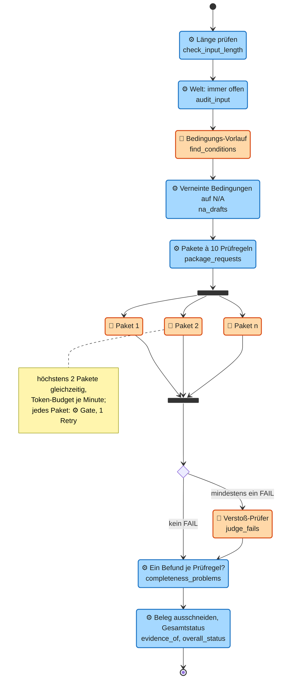

*Elemente.* Jeder Kasten ist eine Aktivität mit der Funktion, die sie ausführt; blau arbeitet ⚙️ Code, orange 🤖 das Modell. Die schwarzen Balken sind Gabelung und Zusammenführung: Dazwischen laufen die Pakete gleichzeitig. Die Raute ist eine Entscheidung des Codes, die Notiz nennt die Grenzwerte der Pakete. Abbrüche sind nicht gezeichnet; sie stehen in der Spalte „Bricht ab, wenn“.

*Verbindungen.* Die Pfeile geben die Reihenfolge vor. Nach Längenprüfung und Welt folgt der Bedingungs-Vorlauf, dann setzt der Code die Prüfregeln verneinter Bedingungen auf N/A und teilt die übrigen in Pakete. Die Gabelung startet alle Pakete; die Zusammenführung wartet, bis jedes geantwortet hat. Die Raute danach schickt das Audit zum Verstoß-Prüfer, wenn mindestens ein Paket FAIL vergeben hat, sonst direkt zur Vollständigkeitsprüfung. Beide Wege enden in Vollständigkeit, Beleg und Gesamtstatus.

Das Spec-Audit läuft in drei Phasen mit je einer Art von Modellaufruf: 🤖 Bedingungs-Vorlauf, 🤖 Pakete, 🤖 Verstoß-Prüfer. Zwischen den Phasen arbeitet nur ⚙️ Code.

| Schritt | Was passiert | wer | Wartet auf | Bricht ab, wenn |
|---|---|---|---|---|
| Länge, Welt | Eingabe über 100.000 Zeichen wird abgelehnt, bevor ein Aufruf Geld kostet; eine Spezifikation ist immer offene Welt. | ⚙️ | – | die Eingabe zu lang ist (Exit 1) |
| Bedingungs-Vorlauf | ein Aufruf für alle Bedingungen; der Code setzt die Werte | 🤖 ⚙️ | Antwort | nie: bei Ausfall bleiben alle `unstated` (Rückfall, F6) |
| Vorab-N/A | die Prüfregeln verneinter Bedingungen werden N/A und gehen nicht ans Modell | ⚙️ | – | – |
| Gabelung | aus den restlichen Prüfregeln entstehen bis zu 35 Pakete | ⚙️ | – | – |
| Pakete | je Paket ein Aufruf mit Gate und höchstens einem Retry | 🤖 ⚙️ | Semaphor, Token-Budget, Antwort | ein Paket nach dem Retry ungültig bleibt (F3) oder Groq ausfällt (F8) |
| Zusammenführung | wartet auf alle Pakete (`asyncio.gather`); bricht eines ab, bricht das Audit ab | ⚙️ | alle Pakete | ein Paket abbricht |
| Verstoß-Prüfer | ein Aufruf für alle FAIL zusammen | 🤖 ⚙️ | Antwort | nie: ohne Urteil bleibt das FAIL (Rückfall) |
| Vollständigkeit, Report | genau ein Befund je Prüfregel; Beleg ausschneiden; Gesamtstatus | ⚙️ | – | ein Befund fehlt oder doppelt ist |

### 3.4 Aktivität: Architektur-Audit

Das Architektur-Audit verzweigt vor den Paketen an der Welt der Eingabe; danach läuft es wie das Spec-Audit.

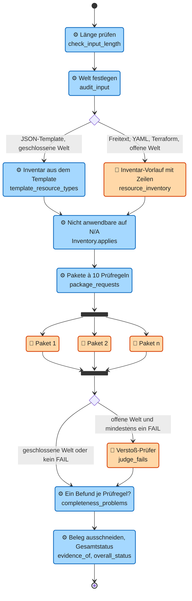

*Elemente.* Die Formen sind dieselben wie in 3.3. Dazu kommen zwei Rauten: Die obere wählt den Weg zum Inventar, die untere entscheidet über den Verstoß-Prüfer.

*Verbindungen.* Nach Längenprüfung und Welt führt die obere Raute ein CloudFormation-JSON zum Inventar aus dem Template und alles andere zum Inventar-Vorlauf. Beide Wege münden in dieselbe Aktivität: Prüfregeln ohne Typ im Inventar werden N/A. Gabelung, Pakete und Zusammenführung laufen wie beim Spec-Audit. Die untere Raute schickt nur offene Welt mit mindestens einem FAIL zum Verstoß-Prüfer; geschlossene Welt geht immer direkt zur Vollständigkeitsprüfung.

Warum ein CloudFormation-JSON eine geschlossene Welt ist und was das für ein FAIL bedeutet, erklärt [FUNKTIONSWEISE](FUNKTIONSWEISE.md#4-wie-ein-architektur-audit-urteilt) Kapitel 4. Für den Ablauf zählt: Im JSON-Zweig entfällt ein Modellaufruf und am Ende der Verstoß-Prüfer.

Der Inventar-Vorlauf hat keinen Rückfall: Bleibt seine Antwort nach dem Retry ungültig, endet das Audit fail closed. Prüfregeln für erkannte Typen gehen mit dem Hinweis ans Modell, dass N/A dort verboten ist (`na_forbidden`).

Die Pakete laufen wie beim Spec-Audit; ein Architektur-Katalog mit 175 Prüfregeln ergibt bis zu 18 Pakete.

### 3.5 Lebenslauf eines Befunds

Das Zustandsdiagramm zeigt, durch welche Zustände ein einzelner Befund geht, vom Entwurf des Modells bis zum Status im Report.

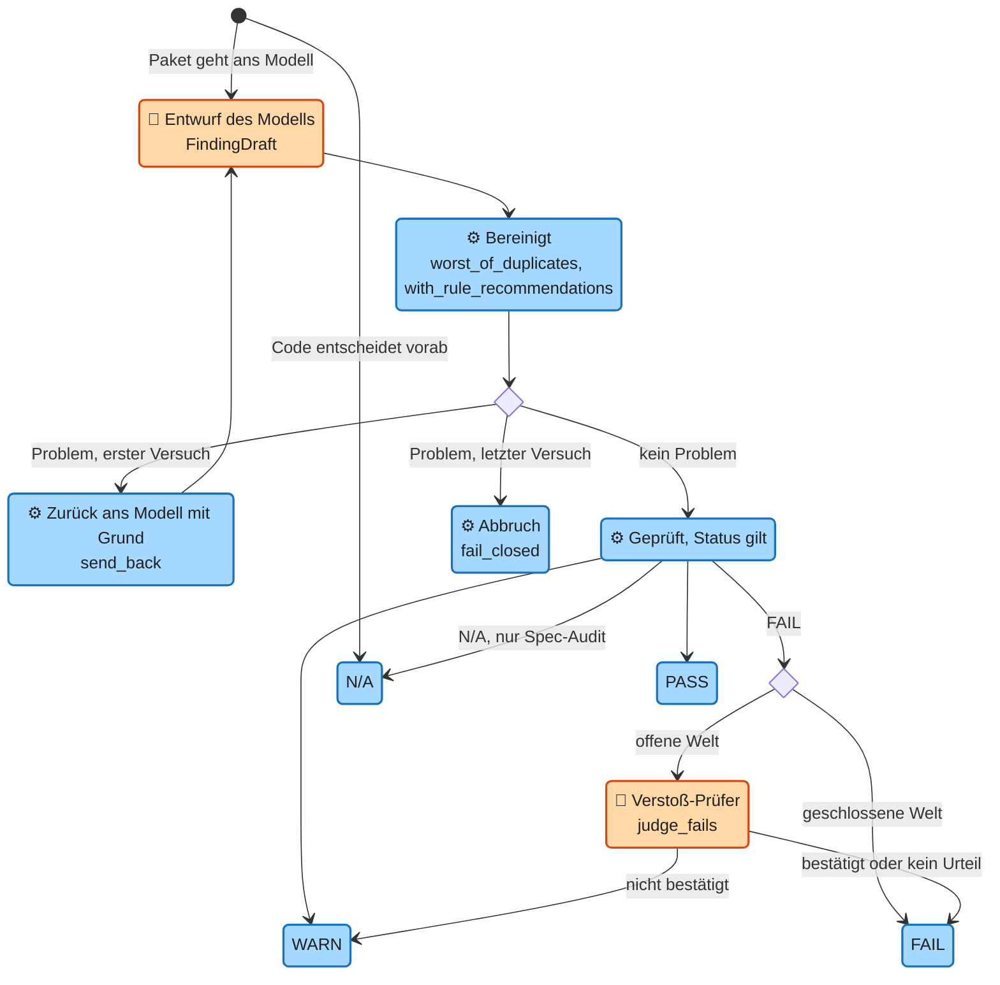

*Elemente.* Jeder Kasten ist ein Zustand eines einzelnen Befunds. Orange ist der Entwurf des Modells und das Urteil des Verstoß-Prüfers; blau sind die Zustände, die der Code herstellt. Die Rauten sind Entscheidungen des Codes: das Gate nach der Bereinigung und die Frage nach der Welt bei einem FAIL. PASS, WARN, FAIL und N/A unten sind die Endzustände, die im Report stehen.

*Verbindungen.* Ein Befund entsteht entweder vorab im Code (N/A) oder als Entwurf des Modells, den der Code durch Bereinigung, Gate und gegebenenfalls Verstoß-Prüfer führt. Jeder Pfeil ist ein Übergang; die Tabelle nennt für jeden, wer ihn auslöst und unter welcher Bedingung.

| Übergang | wer | Bedingung | im Code |
|---|---|---|---|
| Start → N/A | ⚙️ | Bedingung verneint oder Ressourcentyp nicht im Inventar; nie ans Modell | `na_drafts`, `Inventory.applies` |
| Start → Entwurf | 🤖 | Paket geht ans Modell, Antwort als Formular | `package_requests` |
| Entwurf → bereinigt | ⚙️ | Doppelte auf den schwersten Status, fehlende Empfehlung aus der Prüfregel, unbrauchbarer Zeilenbereich gestrichen und vermerkt, FAIL ohne Zeilen wird WARN | `worst_of_duplicates`, `with_rule_recommendations`, `without_unproven_verdict`, `dropped_ranges` |
| Gate → zurück ans Modell | ⚙️ | Problem im ersten Versuch: Grund geht als Retry ans Modell | `answer_problems`, `send_back` |
| Gate → Abbruch | ⚙️ | Problem im letzten Versuch (Ausnahme: PASS ohne Beleg wird WARN) | `fail_closed` |
| Gate → geprüft | ⚙️ | kein Problem | – |
| geprüft → PASS, WARN | ⚙️ | der Status des Modells gilt | – |
| geprüft → N/A | ⚙️ | nur im Spec-Audit; im Architektur-Audit ist N/A für die gefragten Prüfregeln verboten, und das Gate schickt es zurück | `answer_problems` (`na_forbidden`) |
| FAIL → FAIL ohne Prüfer | ⚙️ | geschlossene Welt: Eine fehlende Einstellung ist der Standardwert, das FAIL bleibt; der Audit-Ablauf ruft den Verstoß-Prüfer gar nicht auf | `run_audit` |
| FAIL → Verstoß-Prüfer | 🤖 | nur in offener Welt | `judge_fails` |
| Verstoß-Prüfer → WARN oder FAIL | ⚙️ | nicht bestätigt: WARN mit altem Status in `downgraded_from`; bestätigt oder kein Urteil: FAIL | `record_verdict` |

Wo ein Problem keinen Abbruch, sondern einen vorsichtigeren Status ergibt, greift einer der Rückfälle; sie stehen gebündelt in [7.2](#72-die-deterministische-schale) unter „Sichere Voreinstellung“.

### 3.6 Grenzwerte

Jede Grenze ist eine Konstante im Code; keine stellt das Modell selbst ein.

| Grenzwert | Wert | Warum | im Code |
|---|---|---|---|
| Länge der Eingabe | höchstens 100.000 Zeichen | der größte Musterfall passt in die Zeitgrenze; eine zu lange Eingabe kostet keinen Aufruf | `MAX_INPUT_CHARS` |
| Paketgröße | 10 Prüfregeln je Aufruf | Antwortlänge und Dauer je Aufruf bleiben klein | `PACKAGE_SIZE` |
| Parallele Pakete | 2 bei Groq, alle bei Bedrock | gemessen rund 110.000 Tokens je Minute und Platz (#26) | `GROQ_MAX_PARALLEL` |
| Token-Budget | 200.000 Tokens je Minute und Audit | Groq erlaubt 250.000; der Rest ist Puffer für Retries und Verstoß-Prüfer (#53) | `GROQ_TOKENS_PER_MINUTE` |
| Ausgabe je Aufruf | höchstens 8.000 Tokens (Pakete, Bedingungs-Vorlauf, Verstoß-Prüfer) | eine Endlosschleife des Modells endet nach rund 25 s (#28); der Inventar-Vorlauf hat keine eigene Grenze | `_SETTINGS` |
| Temperatur | 0 bei allen acht Aufrufen | gleichförmigere Antworten (QS-3) | `_SETTINGS` |
| Retry zur Laufzeit | 1 je Aufruf | Zeitgrenze des Audits ([0023](adr/0023-demo-und-recruiter-stand.md)) | `RETRIES` |
| Retries im Build | Zerlegen 4, Einstufen 2, Formulieren 6, Verstoß-Prüfer des Builds 2 | keine Zeitgrenze; Groq braucht mehr Anläufe als Haiku ([0014](adr/0014-groq-standard-im-build.md)) | `RETRIES` in `decompose/split.py`, `FORMULATE_RETRIES`, `JUDGE_RETRIES` |
| Wiederholung im Netz | bis zu 6-mal mit Wartezeit bei HTTP 429, Serverfehler, Zeitüberschreitung, Verbindungsfehler | Drosselung ist bei Groq der Normalfall | `MAX_RETRIES` |
| Beleg | höchstens 200 Zeilen, mindestens 15 Zeichen | ein Beleg ist etwa ein Abschnitt; „S3“ allein belegt nichts | `MAX_SPAN`, `MIN_QUOTE_LENGTH` |

### 3.7 Die acht Modellaufrufe

Jeder Aufruf hat dieselbe Form: ⚙️ Der Code baut den Auftrag mit nummerierter Eingabe (`12| …`), 🤖 das Modell füllt ein Formular, ⚙️ der Code prüft es und schickt es höchstens mit Grund zurück. Bei Groq erzwingt ein JSON-Schema die Form schon beim Erzeugen (`NativeOutput`), bei Bedrock ein erzwungenes Werkzeug; der Validator ist für beide gleich (`agents_for`). Für Groq ist jedes Feld eines Formulars Pflicht und hat keinen Standardwert; wo ein Wert fehlen darf, ist er `null`, sonst verwirft Groq die Antwort mit HTTP 400.

| # | Aufruf | Phase | 🤖 liefert | unsicher: Art zu versagen (7.1) | Schale: ⚙️ prüft | Retry, dann | gemessen |
|---|---|---|---|---|---|---|---|
| 1 | Bedingungs-Vorlauf | Spec, vor den Paketen | Zeilen je Bedingung | irrt (verneint zu Unrecht), schwankt | jede Bedingung genau einmal, bekannte Kennungen, gültige Zeilen; den Wert setzt der Code | 1, dann alle `unstated` | 18 von 21 Soll-Werten (#60) |
| 2 | Inventar-Vorlauf | Architektur, offene Welt | Ressourcentypen mit Zeilen | irrt (übersieht einen Dienst) | Typ steht im Katalog, Zeilen gültig | 1, dann fail closed | nicht gemessen |
| 3 | Paket | beide Audits | ein Entwurf je Prüfregel | irrt, schwankt, lässt sich steuern | ein Befund je Prüfregel, gültige Zeilen, PASS mit Beleg, kein N/A bei anwendbaren Prüfregeln | 1, dann fail closed; PASS ohne Beleg wird WARN | QS-1 bis QS-4 |
| 4 | Verstoß-Prüfer | offene Welt, nach den Paketen | je FAIL bestätigt oder nicht | irrt, lässt sich über Belegzeilen steuern (T14) | jedes FAIL hat ein Urteil; der Prüfer kann nur senken | 1, dann bleibt das FAIL ungeprüft | QS-5 |
| 5 | Zerlegen | Build, DSGVO und KI-VO | Gruppen von Abschnitten | irrt (falsche Gruppierung) | jeder Abschnitt in genau einer Gruppe; Anker vergibt der Code | 4, dann bleibt der Artikel ganz (`llm_error`) | – |
| 6 | Einstufen | Build, jede Anforderung | prüfbar, Ebene, Typen | irrt, schwankt | Typen gibt es wirklich; beim Architektur-Audit Typen außerhalb des Prüfumfangs gestrichen | 2, dann `llm_error` | rund 10 % der Auswahl wechseln bei Prompt- oder Modellwechsel ([0014](adr/0014-groq-standard-im-build.md)) |
| 7 | Formulieren | Build, jede ausgewählte Anforderung | Entwurf der Prüfregel | irrt (erfundenes Zitat oder Querverweis) | Zitat wörtlich, Querverweise echt, Typen im Prüfumfang, Eigenschaften existieren | 6, dann gilt die Prüfregel als gescheitert; der Build bricht am Ende ab | – |
| 8 | Verstoß-Prüfer des Builds | Build, nur Spec | beschreibt das Verstoßkriterium ein Fehlen? | irrt | Schema; „ja“ schickt den Entwurf mit Grund zurück | 2, dann Abbruch des Builds | – |

Jeder Aufruf kann außerdem ausfallen oder gedrosselt werden (F8). Die Prompts stehen im Code bei ihrem Aufruf, zum Beispiel der Auftrag für die Pakete (`SYSTEM_PROMPT` in `calls/audit_packages.py`) und der für den Verstoß-Prüfer (`FAIL_JUDGE_PROMPT` in `calls/fail_judge.py`). Die Muster der Schale erklärt [7.2](#72-die-deterministische-schale); was gemessen ist, [7.3](#73-was-die-schale-nachweislich-leistet).

> **Concern (LLM-Unsicherheit):** Was bei ungültiger Antwort, Schwankung und Ausfall geschieht, folgt den Mustern „Wiederholung mit Grund“ und „sichere Voreinstellung“ in [7.2](#72-die-deterministische-schale); Messwerte zu Dauer, Kosten und Abbrüchen stehen in [7.3](#73-was-die-schale-nachweislich-leistet).

## 4 Entwicklungs-Sicht

*Leitfrage: Wie ist der Code organisiert, und was hält die Ordnung fest?*

Drei Pakete: der Build (`kb_build`), der Laufzeit-Kern (`govguard`) und die Oberfläche (`govguard_ui`). 🤖 Das Modell erreicht der Code nur über die Modellaufrufe (`calls/`) und die Anschlüsse (`adapters/`); ⚙️ die Prüfungen (`checks/`) sind rein, und Tests halten die Richtung der Importe fest. So ist die Prüflogik ohne Modell und ohne Netz testbar.

4.1 nennt die Entwurfsentscheidungen zur Ordnung des Codes, der Abschnitt „Code-Struktur“ den Baum und die Import-Regeln, die Tests festhalten. 4.2 bis 4.4 zeigen je ein Paket mit seinen Modulen. 4.5 beschreibt Daten und Tests rund um den Code, 4.6 jede Regel im Klartext mit Code und Test.

### 4.1 Entwurfsentscheidungen

Diese Entscheidungen legen fest, wo Ein- und Ausgabe liegt und wie die Prüflogik ohne 🤖 testbar bleibt.

| Entscheidung | Was sie heißt | Warum | im Code (Test) |
|---|---|---|---|
| Anschlüsse als einziger Weg nach außen | boto3 und Bedrock nur in `adapters/aws_services.py`, Groq nur in `adapters/groq_services.py`, HTTP nur in `source_fetch.py`, `subprocess` nirgends. | Ein Ort je Außenkontakt; alles andere ist ohne Netz testbar ([0019](adr/0019-nur-audits.md), [0027](adr/0027-ordner-nach-aufgabe.md)). | `test_io_imports_only_in_their_adapter` |
| Modell per Parameter | Der Audit-Ablauf baut sein Modell nicht selbst, er bekommt es übergeben. Das heißt Dependency Injection: Eine Funktion bekommt ihre Werkzeuge übergeben, statt sie selbst zu bauen. | Tests übergeben ein programmierbares Testmodell (`FunctionModel` aus Pydantic AI) statt 🤖 ([0005](adr/0005-pydantic-ai.md)). | `run_audit` |
| Gleiche Gates für beide Anbieter | Je Aufruf entsteht ein Agent für Groq und einer für Bedrock, mit demselben Validator. | Ein Anbieterwechsel ändert das Modell, nicht die Prüfung. | `agents_for` |
| Ordner nach Aufgabe | Im Kern nach Art des Moduls (`calls/`, `checks/`, `adapters/`), in der Oberfläche nach Verwendung (`screens/`, `report/`), im Build nach Prozessschritt. In der Wurzel eines Pakets liegen nur Einstiege und Verträge. | Man findet ein Modul über seine Aufgabe ([0027](adr/0027-ordner-nach-aufgabe.md)). | `test_the_root_holds_only_entry_points_and_contracts` |
| Kleine Module | Ein Modul hat eine Aufgabe und rund 200 Zeilen, eine Funktion rund 30. | Jede Einheit bleibt verteidigbar; ruff und ein Test prüfen. | `test_modules_stay_small` |
| Datenpfade an einer Stelle | Pfade unter `data/` stehen nur in je einem Modul je Paket. | Ein Umzug der Daten ändert eine Datei. | `test_data_paths_only_in_the_paths_module` |
| Soll von Hand | Das Soll eines Musterfalls legt ein Mensch fest, nie ein früherer Lauf; Abweichungen werden gezeigt, nicht nachgewürfelt. | Ein Soll aus einem Lauf würde jeden Fehler bestätigen ([0023](adr/0023-demo-und-recruiter-stand.md), [0024](adr/0024-teststrategie-demo-ui.md)). | `Expected` (`test_presets.py`) |
| Doku gegen Code geprüft | Pfade, Klassen, Namen und Tests dieses Dokuments müssen im Code existieren. | Die Referenz-Doku veraltet nicht unbemerkt. | `tests/test_architecture_doc_drift.py` |

### Code-Struktur

Der Baum zeigt die drei Pakete und die Datenordner; die Tabelle darunter nennt die Import-Regeln, die Tests festhalten.

```
src/govguard/        Laufzeit-Kern: calls/ (spricht mit dem Modell), checks/ (rein), adapters/ (boto3, Groq)
src/kb_build/        Build-Werkzeug, je Schritt ein Ordner: extract, decompose, select, rules, reference
src/govguard_ui/     Oberfläche: screens/ (Seiten), report/ (Report-Ansicht)
data/input/          von Hand gepflegt: Quellenliste, Prüfumfang, Bedingungen, 6 Musterfälle
data/knowledge_base/ nur das Endergebnis: rules_spec.json, rules_arch.json
data/gallery/        gespeicherte Reports der Musterfälle, wächst nur per Commit
```

Die Abhängigkeiten zeigen in eine Richtung: Oberfläche und Build importieren den Laufzeit-Kern, der Kern importiert keinen von beiden. Diese Regeln prüfen Tests in `tests/test_architecture.py`; Workflow-YAML enthält keine Logik, nur `python -m …`.

| Regel | Warum | im Code (Test) |
|---|---|---|
| Prüfungen (`checks/`) importieren nie Modellaufrufe (`calls/`) oder Anschlüsse (`adapters/`) | Prüfungen bleiben ohne Modell testbar | `test_checks_import_neither_calls_nor_adapters` |
| Die Report-Ansicht (`report/`) importiert nie eine Seite (`screens/`) | Seiten nutzen die Ansicht, nie umgekehrt | `test_the_report_view_imports_no_screen` |
| boto3, Groq und HTTP nur im eigenen Anschluss, `subprocess` nirgends | ein Ort je Außenkontakt ([0019](adr/0019-nur-audits.md)) | `test_io_imports_only_in_their_adapter` |
| Die Oberfläche lädt weder Kommandozeile noch Bedrock-Anschluss | die Demo läuft ohne AWS ([0023](adr/0023-demo-und-recruiter-stand.md)) | `test_demo_ui_loads_no_aws_and_no_entry_point` |
| Laufzeit-Kern und Oberfläche importieren nie den Build | der Build ist ein Werkzeug | `test_the_runtime_never_imports_the_build` |
| Ein Modul = eine Aufgabe, ca. 200 Zeilen, eine Funktion ca. 30 | klein und verteidigbar; ruff und Test prüfen | `test_modules_stay_small` |
| Kein Build-Schritt importiert den Ablauf (`run.py`) eines anderen | Gemeinsames liegt in der Wurzel des Builds | `test_no_build_step_imports_the_run_of_another` |

### 4.2 Paket kb_build: der Build

Der Build ist nach Prozessschritten geordnet: je Schritt ein Ordner, dazu gemeinsame Werkzeuge.

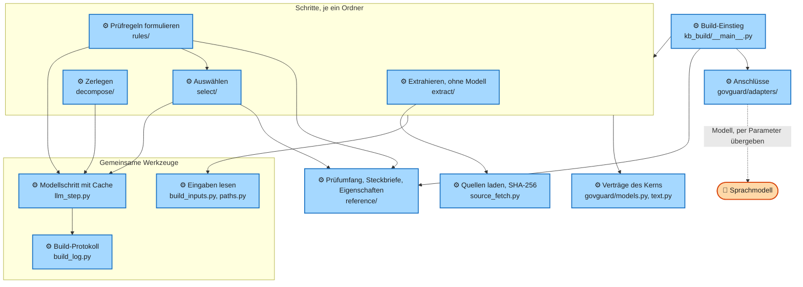

Der Build ist ein Werkzeug, kein Teil der Laufzeit: `python -m kb_build <Schritt>` startet je einen Schritt, und jeder Schritt liest das Ergebnis des vorigen aus `data/intermediate/`. Pfeil = „importiert“; gestrichelt = das Modell, das der Einstieg baut und den Schritten übergibt. Jede Quelle hat ihr eigenes Format: OSCAL ist das maschinenlesbare Format des NIST für Sicherheitskataloge, in dem das BSI Grundschutz++ veröffentlicht, und Formex ist das XML-Format des Amtsblatts der EU, in dem EUR-Lex DSGVO und KI-VO liefert.

*Elemente.* Oben steht der Einstieg, darunter die vier Schritte als Ordner und die Referenzdaten, unten die gemeinsamen Werkzeuge, der Download, die Verträge aus dem Laufzeit-Kern und die Anschlüsse. Die Tabelle nennt die Aufgabe jedes Teils.

*Verbindungen.* Ein Pfeil heißt „importiert“.

- Der Einstieg importiert jeden Schritt, die Referenzdaten und die Anschlüsse; mit den Anschlüssen baut er das Modell, das er den Schritten übergibt.
- Das Extrahieren importiert den Download (`source_fetch.py`), den einzigen HTTP-Zugang des Builds.
- Zerlegen, Auswählen und Formulieren importieren den Modellschritt mit Cache; der Modellschritt schreibt ins Build-Protokoll.
- Das Formulieren importiert die Auswahl und die Referenzdaten, weil es die Typen der Auswahl und die echten Eigenschaften braucht; das Auswählen importiert die Referenzdaten für den Prüfumfang.
- Alle Schritte lesen ihre Eingaben über ein gemeinsames Modul und nutzen die Verträge und Textwerkzeuge des Kerns. Kein Schritt importiert den Ablauf (`run.py`) eines anderen.
- Der gestrichelte Pfeil ist kein Import: Er zeigt das Modell, das die Anschlüsse bauen.

| Teil | Aufgabe | wer | Ergebnis | Tests (Auswahl) |
|---|---|---|---|---|
| Extrahieren (`extract/`) | je Quelle ein Adapter für ihr Format (OSCAL, Prowler-JSON, Formex-XML, PDF); Vorfilter mit festem Satz | ⚙️ | `data/intermediate/extracted/` | `test_bsi_source.py`, `test_formex.py`, `test_extracted_golden.py` |
| Zerlegen (`decompose/`) | Artikel der DSGVO und KI-VO in Gruppen; Anker und Text vergibt der Code | 🤖 ⚙️ | `data/intermediate/decompositions_spec.json` | `test_decompose_split.py`, `test_decomposition_touchstones.py` |
| Auswählen (`select/`) | Einstufung durch das Modell; Prüfumfang, Ebene, Pflichtanker und Abdeckung durch den Code | 🤖 ⚙️ | `data/intermediate/selection_spec.json`, `data/intermediate/verdicts_spec.json` | `test_classify.py`, `test_curation.py`, `test_pinned_anchors.py` |
| Formulieren (`rules/`) | Entwurf und Verstoß-Prüfer des Builds durch das Modell; Gates, Anker, Zitat und Qualitätsbericht durch den Code | 🤖 ⚙️ | `data/knowledge_base/` | `test_formulate.py`, `test_gates.py`, `test_frozen_rules.py` |
| Referenzdaten (`reference/`) | Prüfumfang, Archetyp-Steckbriefe, Eigenschaften der CloudFormation-Typen | ⚙️ | `data/input/cfn_properties.json` | `test_scope.py`, `test_cfn_properties.py` |
| Modellschritt (`llm_step.py`) | Antwort-Cache, Zähler für Retries und `llm_error`, Tokens; die Cache-Dateien gehören den Schritten | ⚙️ | `data/intermediate/judgement_cache.json` (Auswählen), `data/intermediate/decomposition_cache.json` (Zerlegen) | `test_llm_step.py`, `test_cache_keys_frozen.py` |
| Quellen laden (`source_fetch.py`) | Download der gepinnten URL, Abgleich mit SHA-256, lokaler Cache | ⚙️ | Cache der Quellen | `test_source_fetch.py` |

Jeder Schritt schreibt sein Ergebnis erst, wenn seine Gates bestanden sind; ein Abbruch lässt den alten Stand stehen. Bezahlte Antworten gehen trotzdem nicht verloren: Der Cache wird auch bei einem Abbruch gespeichert. Scheitert eine Prüfregel, formuliert der Build die übrigen weiter und bricht erst am Ende ab, mit allen Gründen. Im Modus „nur fehlende formulieren“ landet jede neue Prüfregel sofort in einem Zwischenstand (`rules_checkpoint`). Das Protokoll jedes Laufs liegt neben dem Ergebnis in `data/intermediate/logs/`.

### 4.3 Paket govguard: der Laufzeit-Kern

Der Laufzeit-Kern ist nach Art des Moduls geordnet: Modellaufrufe, reine Prüfungen, Anschlüsse und Verträge.

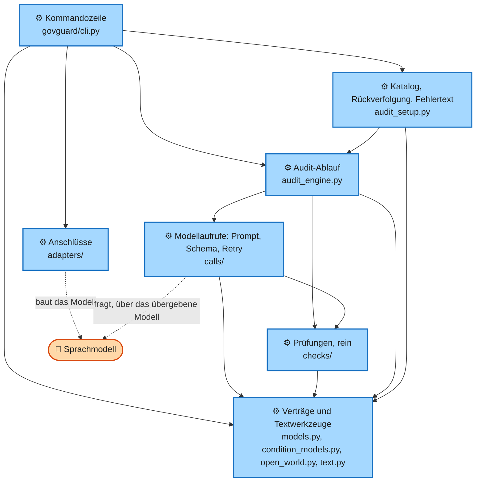

Der Kern enthält die ganze Prüflogik. Die Anschlüsse bauen das Modell, aber nur die Einstiege (Kommandozeile, Seite der Oberfläche) rufen sie auf; der Audit-Ablauf bekommt das fertige Modell übergeben.

*Elemente.* Jeder Kasten ist ein Modul oder ein Ordner des Kerns; die Tabelle unten nennt seine Aufgabe. Ganz oben steht die Kommandozeile als Einstieg, ganz unten 🤖 das Modell.

*Verbindungen.* Ein durchgezogener Pfeil heißt „importiert“, ein gestrichelter „greift zur Laufzeit zu“.

- Die Kommandozeile importiert das gemeinsame Modul (Katalog, Rückverfolgung, Fehlertext), den Audit-Ablauf und die Anschlüsse. Das gemeinsame Modul importiert den Audit-Ablauf nur für dessen Fehlertyp.
- Der Audit-Ablauf importiert Modellaufrufe und Prüfungen. Die Modellaufrufe importieren die Prüfungen, weil jeder Validator ein Gate aufruft; die Prüfungen importieren nie einen Modellaufruf.
- Modellaufrufe, Prüfungen, Audit-Ablauf, gemeinsames Modul und Kommandozeile importieren die Verträge.
- Die Anschlüsse bauen das Modell; die Modellaufrufe fragen es über das Modell, das ihnen übergeben wurde.

| Teil | Aufgabe | wer | Tests (Auswahl) |
|---|---|---|---|
| Kommandozeile (`cli.py`) | Datei lesen, Modell wählen, Audit starten, Exit-Code 0 (Report), 1 (Eingabe zu lang), 2 (fail closed), 3 (Schlüssel fehlt) | ⚙️ | `test_cli.py` |
| Gemeinsames (`audit_setup.py`) | Katalog laden, Rückverfolgung bauen, Fehlertext; von Kommandozeile und Oberfläche geteilt, ohne AWS | ⚙️ | `test_cli.py`, `test_audit_runner.py` |
| Audit-Ablauf (`audit_engine.py`) | Länge, Welt, Vorlauf, Pakete, Verstoß-Prüfer, Vollständigkeit, Report | ⚙️ | `test_run_audit.py`, `test_run_audit_packages.py`, `test_run_audit_progress.py` |
| Modellaufrufe (`calls/`) | je Aufruf ein Modul mit Prompt, Antwortformular und Validator; `model_call.py` baut die Agenten und zählt Retries | ⚙️ → 🤖 | `test_model_call.py`, `test_conditions_call.py`, `test_run_audit_fail_judge.py` |
| Prüfungen (`checks/`) | reine Funktionen: Gates, Beleg, Reparaturen, Korrekturen, Bedingungen, Token-Budget | ⚙️ | `test_evidence.py`, `test_conditions_checks.py`, `test_token_budget.py` |
| Verträge (`models.py`, `condition_models.py`, `open_world.py`, `text.py`) | Pydantic-Typen, Welt, Textwerkzeuge für Build und Laufzeit | ⚙️ | `test_models.py`, `test_text.py` |
| Anschlüsse (`adapters/`) | Groq und Bedrock bauen; kein Prüfcode | ⚙️ → 🤖 | `test_groq_services.py`, `test_aws_services.py` |

Getestet wird der Kern fast ganz ohne Modell: Ein Testmodell (`FunctionModel`) liefert gültige Antworten oder gezielt Fehler, etwa einen unbekannten Zeilenbereich, und so ist jedes Gate ohne Netz und ohne Kosten prüfbar. Ein Charakterisierungstest (`test_model_call_characterization.py`) hält fest, wie Pydantic AI Retries und Fehler weiterreicht, damit ein Update der Bibliothek auffällt.

### 4.4 Paket govguard_ui: die Oberfläche

Die Oberfläche ist nach Verwendung geordnet: oben die Seiten, darunter die Report-Ansicht, daneben Gestaltung und Galerie.

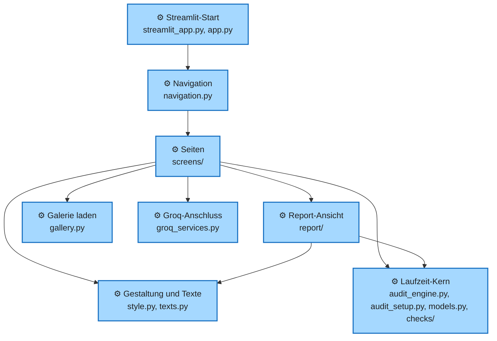

Die Oberfläche ist nach Verwendung geordnet: Seiten (`screens/`) benutzen die Report-Ansicht (`report/`), nie umgekehrt. Sie lädt nur den Groq-Anschluss, nie Bedrock oder die Kommandozeile, damit die Demo ohne AWS läuft.

*Elemente.* Jeder Kasten ist ein Modul oder Ordner der Oberfläche; die beiden unteren Kästen gehören zum Laufzeit-Kern und zu den Anschlüssen.

*Verbindungen.* Jeder Pfeil heißt „importiert“. Der Streamlit-Start lädt die Navigation, die Navigation die Seiten. Die Seiten importieren Report-Ansicht, Gestaltung, Galerie, Laufzeit-Kern und Groq-Anschluss; nur die Seite „Audit erstellen“ braucht den Anschluss. Die Report-Ansicht importiert die Gestaltung und aus dem Kern nur Verträge, reine Prüfungen und das gemeinsame Modul, etwa um die Bedingungen zu lesen; nie den Audit-Ablauf oder einen Anschluss.

| Teil | Aufgabe | wer | Tests (Auswahl) |
|---|---|---|---|
| Start (`streamlit_app.py`, `app.py`, `navigation.py`) | Seitenaufbau und Navigation, keine Logik | ⚙️ | `test_ui_pages.py` |
| Seiten (`screens/`) | Startseite, Audit erstellen, Galerie; `audit_runner.py` prüft Passwort und Länge und startet das Audit; `navigation_guard.py` fragt nach, wenn jemand während des Audits die Seite wechselt | ⚙️ | `test_ui_create_page.py`, `test_audit_runner.py`, `test_ui_gallery_filters.py`, `visual/test_browser_guard.py` |
| Report-Ansicht (`report/`) | Kopf, Befundtabelle, Detail mit Beleg im Dokument, Lücken als Checkliste, Bedingungen, Soll-Abgleich; die Ansicht nach Fundstelle (`site_*.py`) zeichnet das Dokument mit einem Balken je Fundstelle, die Gruppierung selbst ist rein (`checks/sites.py`, [FUNKTIONSWEISE 5](FUNKTIONSWEISE.md#5-report-soll-und-galerie)); die KI-Kennzeichnung (Kopfzeile und „KI“-Marke) kommt aus einem Baustein, `ai_label.py` | ⚙️ | `test_findings_view.py`, `test_ui_gaps.py`, `test_review.py`, `test_ui_by_site.py`, `test_sites.py`, `test_ui_ai_label.py`, `test_ai_label_everywhere.py` (jede Stelle mit Modelltext nutzt den Baustein), `visual/test_browser_findings.py` |
| Gestaltung und Texte (`style.py`, `texts.py`) | Farben, Bezeichnungen der Status, Maskierung jedes dynamischen Texts (`html.escape`) | ⚙️ | `test_ui_style.py`, `test_ui_llm_text.py` |
| Galerie (`gallery.py`) | gespeicherte Reports der Musterfälle laden | ⚙️ | `test_gallery.py` |

Die Oberfläche macht die Grenze zwischen 🤖 und ⚙️ sichtbar: Jede Herabstufung zeigt den alten Status, jede Korrektur ihren Grund, und der Verstoß-Prüfer tritt unter eigenem Namen auf. Getestet wird auf zwei Ebenen ([0024](adr/0024-teststrategie-demo-ui.md)): das Streamlit-Testwerkzeug ohne Browser für Aufbau und Zustand, und Browser-Tests mit Playwright für eigenes HTML und CSS (`tests/visual/test_browser.py`).

### 4.5 Rund um den Code

*Daten.* Der Ordner `data/` trennt, wer schreibt:

| Ordner | Inhalt | wer schreibt | im Git |
|---|---|---|---|
| `data/input/` | Quellenliste mit SHA-256, Prüfumfang, Bedingungen, Steckbriefe, sechs Musterfälle mit Soll | 👤 | ja |
| `data/intermediate/` | Zwischenergebnisse des Builds: Anforderungen, Zerlegung, Auswahl, Protokolle, Caches | 🤖 ⚙️ | ja, außer dem Download-Cache und den Auszügen aus Prowler für CIS, FSBP und C5 ([0008](adr/0008-quellformate.md)) |
| `data/knowledge_base/` | nur das Endergebnis: die zwei Kataloge | 🤖 ⚙️ | ja; jeder Report nennt ihren Hash |
| `data/gallery/` | gespeicherte Reports der Musterfälle | 🤖 ⚙️ | ja, wächst nur per Commit |
| `data/measurements/` | Reports und Kennzahlen der Messläufe | 🤖 ⚙️ | ja |

*Tests.* Drei Ebenen trennen, was deterministisch prüfbar ist, von dem, was nur gemessen werden kann:

| Ebene | Was | Modell | Wann |
|---|---|---|---|
| Code mit Testmodell | jedes Gate, jeder Rückfall, jede Import-Regel | Testmodell statt 🤖, kein Netz | bei jedem `pytest` |
| Oberfläche | Seiten ohne Browser, eigenes HTML im Browser | gespeicherte Reports statt 🤖 | bei jedem `pytest` |
| Musterfälle mit echtem Modell | Gesamtstatus und Pflichtbefunde gegen das Soll von Hand | 🤖 Groq, kostet Geld | von Hand mit dem Werkzeug `audit-messen` |

Das Werkzeug `audit-messen` (`.claude/skills/audit-messen/measure.py`) startet ein Audit über die Kommandozeile und misst Dauer, Tokens, Kosten und Retry-Gründe; jeder Prompt- oder Modellwechsel gilt als Änderung mit Messlauf. Abhängigkeiten sind in `uv.lock` fixiert, Größen- und Stilregeln prüft ruff.

### 4.6 Regeln in Klartext: wo erzwingt der Code sie?

Jede Regel, die ein Befund oder eine Prüfregel erfüllen muss, steht hier mit der Stelle im Code und dem Test, der sie festhält.

| Regel in Klartext | im Code | Test |
|---|---|---|
| Ein Report hat genau einen Befund je Prüfregel. | `completeness_problems` (`checks/audit_gates.py`) | `tests/test_run_audit.py` |
| Ein PASS braucht einen Zeilenbereich in der Eingabe: höchstens 200 Zeilen, mindestens 15 Zeichen. | `evidence_problem`, `range_problem` (`checks/evidence.py`) | `tests/test_evidence.py` |
| Ein FAIL ohne Zeilenbereich wird WARN; ein PASS ohne Beleg nach dem Retry ebenfalls. | `without_unproven_verdict` | `tests/test_run_audit_corrections.py` |
| Einen ungültigen Zeilenbereich bei WARN, FAIL und N/A streicht der Code ohne Retry, mit einer Korrektur am Befund; ein solches WARN ist nie eine Lücke. | `dropped_ranges` (`checks/evidence.py`), `category` (`report/review.py`) | `tests/test_run_audit.py`, `tests/test_review.py` |
| Der Beleg ist wörtlich, weil der Code ihn aus der Eingabe schneidet. | `evidence_of` | `tests/test_run_audit.py` |
| Bei Doppelbefunden gilt der schwerste Status; fehlt die Empfehlung, nimmt der Code die der Prüfregel. | `worst_of_duplicates`, `with_rule_recommendations` | `tests/test_run_audit_repairs.py` |
| Bei anwendbaren Prüfregeln darf das Modell kein N/A vergeben. | `answer_problems` (`na_forbidden`) | `tests/test_run_audit_template.py` |
| Der Gesamtstatus ist der schlechteste Status; nur lauter N/A gibt N/A. | `overall_status`, `SEVERITY` | `tests/test_overall_status.py` |
| Ob die Welt offen oder geschlossen ist, entscheidet der Code. | `audit_input` (`open_world.py`) | `tests/test_run_audit_open_world.py` |
| Ein FAIL in offener Welt braucht den Verstoß-Prüfer; lehnt er ab, wird es WARN; fehlt sein Urteil, bleibt das FAIL. | `judge_fails` | `tests/test_run_audit_fail_judge.py` |
| Nur eine ausdrückliche Verneinung setzt Prüfregeln auf N/A; Schweigen oder Ausfall bleibt `unstated`. | `condition_results`, `na_drafts` (`checks/conditions.py`) | `tests/test_conditions_checks.py` |
| Eine Eingabe über 100.000 Zeichen kostet keinen Modellaufruf. | `check_input_length` | `tests/test_run_audit_input_limit.py` |
| Eine ungültige Antwort geht einmal zurück, danach bricht das Audit ab (Ausnahme: ein unbelegtes PASS wird WARN). Lehnt Groq den Aufruf selbst mit HTTP 400 ab, gibt es keine Antwort zum Zurückschicken, und das Audit bricht sofort ab. | `send_back` (`calls/model_call.py`), `fail_closed` | `tests/test_run_audit_corrections.py` |
| Im Build steht das Zitat wörtlich im Text genau der verankerten Anforderung; Querverweise gibt es wirklich. | `is_quoted`, `invalid_cross_references` (`kb_build/rules/gates.py`) | `tests/test_gates.py` |
| Jeder Pflichtanker steht im Katalog, jeder Pflicht-Ressourcentyp der Referenzarchitekturen hat eine Prüfregel. | `check_pinned`, `check_coverage` (`kb_build/select/gates.py`) | `tests/test_gates.py` |
| Die Rückverfolgung enthält nur Hashes, nie die Eingabe. | `make_trace` (`govguard/audit_setup.py`) | `tests/test_cli.py`, `tests/test_models.py` |

> **Concern (LLM-Unsicherheit):** Getrennte Module für Prompt, Schema und Prüfung machen die Schale ohne Modell testbar; was nur mit echtem Modell messbar ist und warum ein getrenntes Entwicklungsset fehlt, steht in [7.3](#73-was-die-schale-nachweislich-leistet) und [7.4](#74-wo-die-schale-endet).

## 5 Physische Sicht

*Leitfrage: Was läuft auf welchem Knoten, und welche Verbindungen gibt es?*

Vier Ebenen: Endgeräte, Anwendung, Modellanbieter, Code und Quellen. ⚙️ Oberfläche und Audit laufen auf Streamlit Community Cloud, 🤖 das Modell bei Groq; Build und Kommandozeile laufen auf dem Rechner des Projektbetreibers. Bedrock in `eu-central-1` ist nur über die Kommandozeile erreichbar und ungetestet.

5.1 nennt die Entwurfsentscheidungen zu Hosting, Datenort und Kosten. 5.2 zeigt die Knoten in vier Ebenen mit ihren Verbindungen. 5.3 beschreibt Ausrollen, Betrieb und die gemessenen Kosten je Audit.

### 5.1 Entwurfsentscheidungen

Diese Entscheidungen legen fest, wo GovGuard läuft, wohin Daten gehen und was das im Leerlauf kostet.

| Entscheidung | Was sie heißt | Warum | im Code |
|---|---|---|---|
| 0 € Leerlauf | Kein dauerhaft laufender AWS-Dienst; nur ein Audit kostet Geld. | Budget des Projekts ([0023](adr/0023-demo-und-recruiter-stand.md)) | – |
| Demo ohne AWS | Streamlit führt das Audit im eigenen Prozess aus; ein Betrieb über AWS Lambda ist Ausbau. | ein Knoten weniger, keine Kosten im Leerlauf ([0023](adr/0023-demo-und-recruiter-stand.md)) | `backend_problem` |
| Hosting auf Streamlit Community Cloud | Die App läuft auf dem kostenlosen Hosting-Dienst für Streamlit-Apps. | kein eigener Server ([0004](adr/0004-streamlit-community-cloud.md)) | `streamlit_app.py` |
| Groq zur Laufzeit, nur fiktive Daten | Groq ist ein Anbieter, der offene Modelle als Dienst betreibt; Eingaben gehen dorthin in die USA. | günstig und schnell; tragbar nur ohne echte Daten ([0016](adr/0016-groq-zur-laufzeit-im-prototyp.md)) | `groq_model` |
| Bedrock `eu.` für echte Daten | Die Kommandozeile kann Bedrock mit dem EU-Profil ansprechen; die Inferenz bleibt dann in der EU. | Datenresidenz für echte Daten ([0001](adr/0001-eu-inferenzprofil.md)) | `bedrock_model`, `MODEL_ID` |
| Build schickt nur Normtexte | Der Build sendet nur öffentliche Normtexte an Groq, nie Eingaben. | kein Personenbezug, also kein Datenschutzproblem ([0014](adr/0014-groq-standard-im-build.md)) | `model_for` in `kb_build/__main__.py` |
| Katalog im Repository | Die Wissensbasis ist JSON im Git und wird mit dem Code ausgeliefert, nicht aus einer Datenbank gelesen. | 0 € Leerlauf, Änderungen als Diff prüfbar ([0011](adr/0011-vollstaendiger-katalog.md)) | `CATALOGS` |

### 5.2 Verteilung

Das Verteilungsdiagramm zeigt die Knoten in vier Ebenen und die Verbindungen zwischen ihnen.

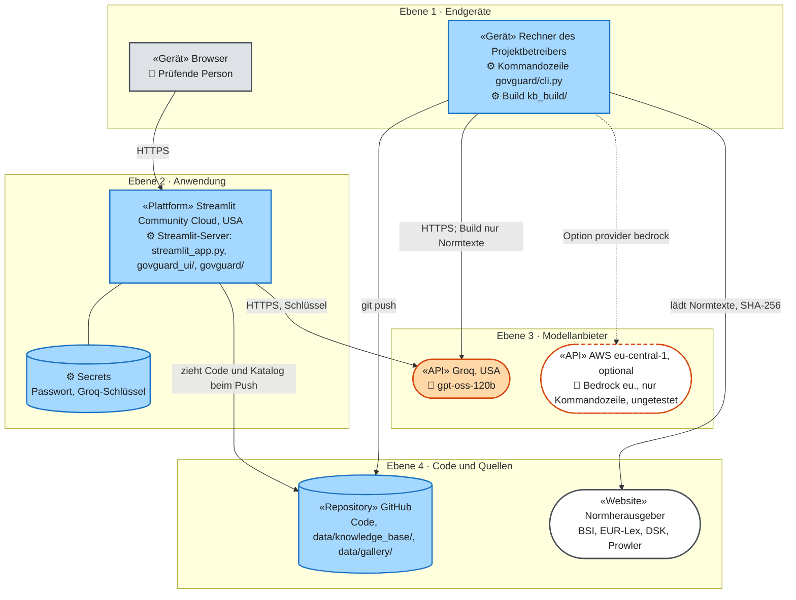

*Elemente.* Die Ebenen ordnen die Knoten nach Rolle: oben, wer etwas anstößt; darunter, wo GovGuard läuft; dann, wo 🤖 das Modell läuft; unten, woher Code und Normen kommen. Die Tabelle nennt, was auf jedem Knoten läuft.

*Verbindungen.* Ein Pfeil zeigt, wer eine Verbindung aufbaut, und ist mit dem Protokoll beschriftet. Der Browser spricht HTTPS mit der App. Die App liest die Secrets der Plattform und ruft Groq über HTTPS mit dem Schlüssel auf. Der Rechner des Betreibers ruft Groq für Build und Kommandozeile auf, optional Bedrock (gestrichelt), lädt die Normtexte und schiebt Commits zu GitHub. Die App zieht Code und Katalog aus GitHub, sobald auf `main` gepusht wird. Groq und Bedrock rufen nie etwas auf.

| Knoten | Ebene | Was läuft dort | Verbindungen |
|---|---|---|---|
| Browser | Endgeräte | 👤 Eingabe, Report lesen | HTTPS zur App |
| Rechner des Projektbetreibers | Endgeräte | ⚙️ Kommandozeile und Build, Python-Umgebung aus `uv.lock` | HTTPS zu Groq, Normherausgebern und GitHub; optional Bedrock |
| Streamlit Community Cloud, USA | Anwendung | ⚙️ Streamlit-Server mit Oberfläche und Laufzeit-Kern im selben Prozess; Passwort und Groq-Schlüssel als Secrets | HTTPS zu Groq; zieht den Code aus GitHub |
| Groq, USA | Modellanbieter | 🤖 `openai/gpt-oss-120b` | wird nur angefragt, ruft nichts auf |
| AWS `eu-central-1`, optional | Modellanbieter | 🤖 Bedrock mit Claude Haiku 4.5 über das Profil `eu.` | nur von der Kommandozeile; gebaut, mit dem heutigen Katalog nie gelaufen |
| GitHub | Code und Quellen | öffentliches Repository mit Code, Prompts, Katalog und Galerie; kein Geheimnis | – |
| Normherausgeber | Code und Quellen | BSI, EUR-Lex, DSK und Prowler (auf GitHub) liefern die Normtexte | nur der Build lädt, mit SHA-256-Abgleich |

Die Wissensbasis wird nicht eigens ausgerollt: Sie liegt im Repository und kommt mit dem Code. Wo welche Daten liegen und wie lange, steht in [8.3](#83-datenort-aufbewahrung-und-drittlandtransfer).

> **Assumption:** Streamlit Community Cloud zieht den Stand des verbundenen Branches; angenommen wird `main`, die Einstellung ist hier nicht geprüft.

### 5.3 Ausrollen, Betrieb und Kosten

Ausrollen heißt: Push auf `main`; Streamlit Community Cloud zieht den neuen Stand. Eine neue Wissensbasis ist erst nach dem Push live. Leerlauf kostet 0 €. Das Modell ist der einzige Kostentreiber: Groq `openai/gpt-oss-120b` kostet 0,15 $ je Million Eingabe-Tokens und 0,60 $ je Million Ausgabe-Tokens.

| Musterfall | Audit | Dauer (Median) | Kosten Groq (Min bis Max) |
|---|---|---|---|
| GovGuard-Selbstaudit (eigene Spezifikation) | Spec | 214,5 s | 0,096 $ (0,093 bis 0,097) |
| Meldeportal Gesundheit | Spec | 143 s | 0,067 $ (0,066 bis 0,069) |
| Wohngeld (OpenAPI) | Spec | 193 s | 0,099 $ (0,095 bis 0,100) |
| Protokollarchiv | Architektur | 26,5 s | 0,014 $ (0,014 bis 0,015) |
| Fristenwecker | Architektur | 12 s | 0,007 $ |
| Antragseingang | Architektur | 23 s | 0,018 $ (0,018 bis 0,020) |

Median der erfolgreichen Läufe, je drei (Messkampagne #54, 19 Läufe, zusammen 0,90 $). Bedrock Haiku 4.5 käme mit denselben Tokens auf das 8- bis 9-Fache; das ist ein Rechenbeispiel, nicht gemessen.

Bricht ein Audit ab, weil Groq drosselt (HTTP 429) oder ausfällt, hat der Groq-Anschluss schon bis zu sechsmal mit Wartezeit wiederholt; dann hilft nur Warten und neu starten. Symptome und Maßnahmen stehen in [ENTWICKLUNG.md](ENTWICKLUNG.md#7-bekannte-grenzen) Abschnitt 7.

> **Concern (LLM-Unsicherheit):** Mit jedem Aufruf verlassen Eingabe und Prüfregeln die eigene Vertrauenszone; Datenort und Drittlandtransfer behandelt [8.3](#83-datenort-aufbewahrung-und-drittlandtransfer), Ausfall und Kosten des Modells [7.3](#73-was-die-schale-nachweislich-leistet).

## 6 Szenarien (+1)

*Leitfrage: Welche Abläufe verbinden alle vier Sichten?*

Drei Normalfälle führen durch Build, Spec-Audit und Architektur-Audit; fünf Fehlerfälle zeigen, was passiert, wenn eine Quelle sich ändert, 🤖 das Modell irrt, ein FAIL nicht trägt, die Eingabe offen ist oder Groq ausfällt. In jedem Sequenzdiagramm stehen 🤖 Modell und ⚙️ Code in getrennten Kästen; jedes Szenario nennt Elemente aus mindestens drei Sichten.

Akteure sind die prüfende Person (gibt eine Eingabe ein und liest den Report), der Projektbetreiber (baut die Wissensbasis, pflegt Quellen und Musterfälle), 🤖 das Sprachmodell und die Normherausgeber. Unter jedem Szenario steht, welche Elemente welcher Sicht es berührt.

6.1 bis 6.3 führen durch die drei Normalfälle, 6.4 durch die Fehlerfälle mit eigenem Diagramm, 6.5 durch drei Varianten ohne Diagramm. 6.6 zeigt, dass jeder Baustein der logischen Sicht in mindestens einem Szenario vorkommt. Jedes Szenario hat dieselbe Form: Anlass, Sequenzdiagramm, nummerierte Abfolge, Ergebnis und die berührten Sichten.

### 6.1 S1 Wissensbasis bauen

Eine neue Quelle oder ein neuer Stand einer Quelle soll in den Katalog. Der Projektbetreiber startet die Schritte nacheinander; jeder Schritt liest das Ergebnis des vorigen.

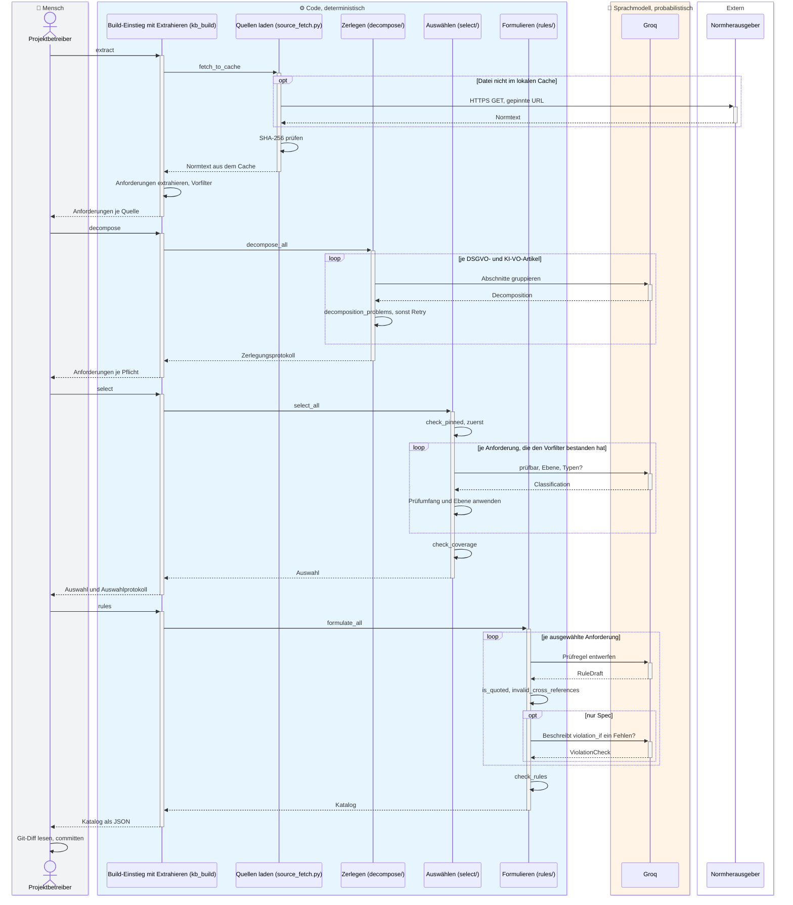

*Abfolge.* Der Projektbetreiber startet vier Befehle nacheinander; jeder endet mit einer Antwort an ihn.

1. „extract“: Der Einstieg lässt jede Quelle laden. Liegt die Datei noch nicht im lokalen Cache, holt der Download sie über HTTPS von der gepinnten Adresse. In beiden Fällen vergleicht er die Prüfsumme und gibt den Text aus dem Cache zurück. Der Einstieg extrahiert die Anforderungen mit dem Leser der Quelle, wendet den Vorfilter an und meldet die Anforderungen je Quelle.
2. „decompose“: Der Einstieg ruft das Zerlegen auf. Für jeden Artikel der DSGVO und der KI-VO fragt es 🤖 das Modell nach Gruppen von Abschnitten, und ⚙️ der Code prüft die Antwort; bei einem Problem geht sie mit Grund zurück. Das Zerlegen gibt das Protokoll an den Einstieg, der Einstieg meldet die Anforderungen je Pflicht.
3. „select“: Der Einstieg ruft das Auswählen auf. Zuerst entscheidet es die Pflichtanker der Musterfälle und prüft sie (`check_pinned`), damit ein fehlender Anker abbricht, bevor die übrigen Aufrufe Geld kosten. Dann fragt es für jede Anforderung, die den Vorfilter bestanden hat, 🤖 das Modell, ob sie prüfbar ist, auf welcher Ebene sie liegt und an welchen Typen sie sich zeigt. ⚙️ Der Code wendet Prüfumfang und Ebene an. Am Ende prüft ein Gate die Abdeckung der Referenzarchitekturen. Die Auswahl geht an den Einstieg, der dem Betreiber Auswahl und Protokoll meldet.
4. „rules“: Der Einstieg ruft das Formulieren auf. Für jede ausgewählte Anforderung schreibt 🤖 das Modell einen Entwurf, und ⚙️ der Code prüft Zitat und Querverweise. Nur beim Spec-Katalog fragt der Code danach 🤖 den Verstoß-Prüfer des Builds, ob das Verstoßkriterium ein Fehlen beschreibt. Zum Schluss prüft der Code den ganzen Katalog und gibt ihn zurück.
5. Der Projektbetreiber liest den Git-Diff und committet; erst damit gilt der neue Katalog.

Ergebnis: ein neuer Katalog mit neuem Hash, den ein Mensch im Git-Diff gelesen hat; jeder spätere Report nennt diesen Hash (`catalog_sha256`). 🤖 Das Modell hat in drei Schritten Entwürfe geliefert, ⚙️ der Code hat jeden durch ein Gate geschickt.

*Sichten:* logisch die Typen des Builds (2.3) und der Build-Ablauf; Prozess der Build als Batch (3.2) und die Aufrufe 5 bis 8 (3.7); Entwicklung `kb_build/` mit seinen Schritten (4.2); physisch der Rechner des Projektbetreibers, die Normherausgeber, Groq und GitHub (5.2).

### 6.2 S2 Spezifikation prüfen

Die prüfende Person gibt den Musterfall „Meldeportal Gesundheit“ und das Passwort ein. Der Ablauf folgt dem Aktivitätsdiagramm in 3.3.

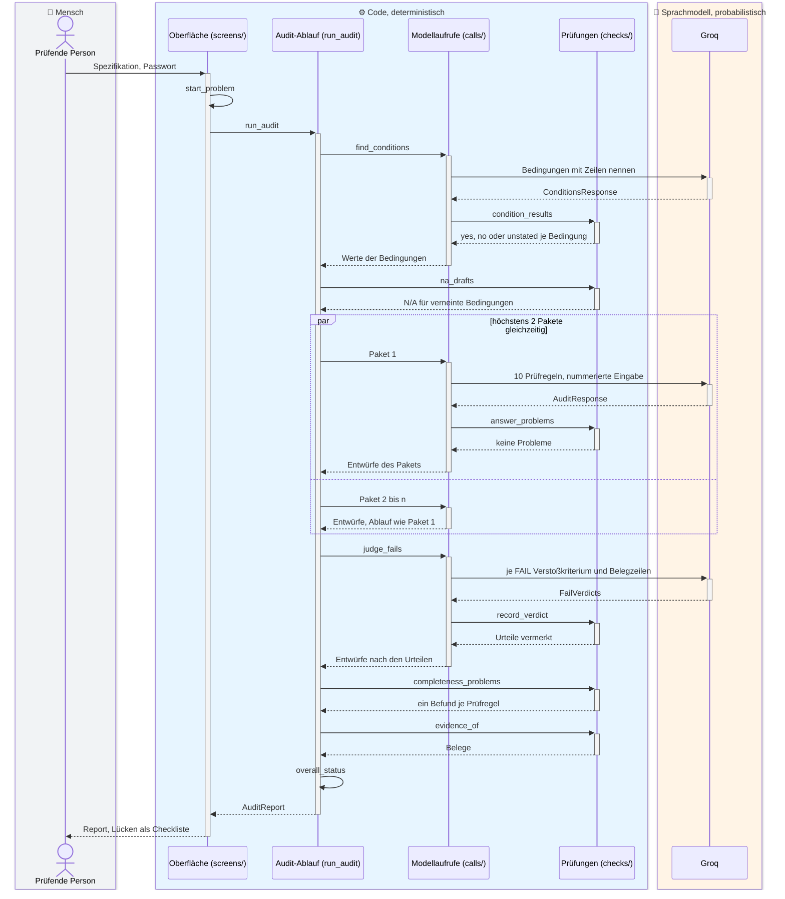

*Abfolge.*

1. Die prüfende Person gibt Spezifikation und Passwort ein. Die Oberfläche prüft Passwort und Länge (`start_problem`) und ruft den Audit-Ablauf auf.
2. Der Audit-Ablauf ruft den Bedingungs-Vorlauf. 🤖 Das Modell nennt je Bedingung bejahende und verneinende Zeilen; ⚙️ die Prüfung macht daraus die Werte, die über den Modellaufruf an den Audit-Ablauf zurückgehen.
3. Der Audit-Ablauf lässt die Prüfregeln verneinter Bedingungen auf N/A setzen. Diese Prüfregeln gehen nicht ans Modell.
4. Der Audit-Ablauf startet alle Pakete; höchstens zwei laufen gleichzeitig. Jedes Paket fragt 🤖 das Modell zu zehn Prüfregeln, ⚙️ die Prüfung kontrolliert die Antwort, und der Modellaufruf gibt die Entwürfe zurück.
5. Gibt es ein FAIL, ruft der Audit-Ablauf den Verstoß-Prüfer. 🤖 Das Modell urteilt je FAIL; ⚙️ der Code vermerkt jedes Urteil und stuft ein nicht bestätigtes FAIL auf WARN.
6. Der Audit-Ablauf prüft die Vollständigkeit, lässt die Belege ausschneiden und bildet den Gesamtstatus.
7. Der Report geht an die Oberfläche, die ihn der prüfenden Person zeigt.

Ergebnis: ein Report mit 350 Befunden, jedes PASS und FAIL mit wörtlichem Beleg, Lücken als Checkliste. Beim Meldeportal erreichte jeder der drei gemessenen Läufe das Soll (QS-4); ein Lauf dauert im Median 143 s und kostet 0,067 $ (5.3).

*Sichten:* logisch Befund, Entwurf und Bedingung (2.4, 2.5); Prozess die Gabelung der Pakete mit Semaphor und Token-Budget (3.3); Entwicklung `calls/` und `checks/` im Kern (4.3) und die Seite „Audit erstellen“ (4.4); physisch Streamlit Community Cloud und Groq (5.2).

### 6.3 S3 Architektur als Template prüfen

Die prüfende Person gibt ein CloudFormation-JSON ein, etwa den Musterfall „Fristenwecker“. Der Code erkennt die geschlossene Welt und braucht keinen Inventar-Vorlauf.

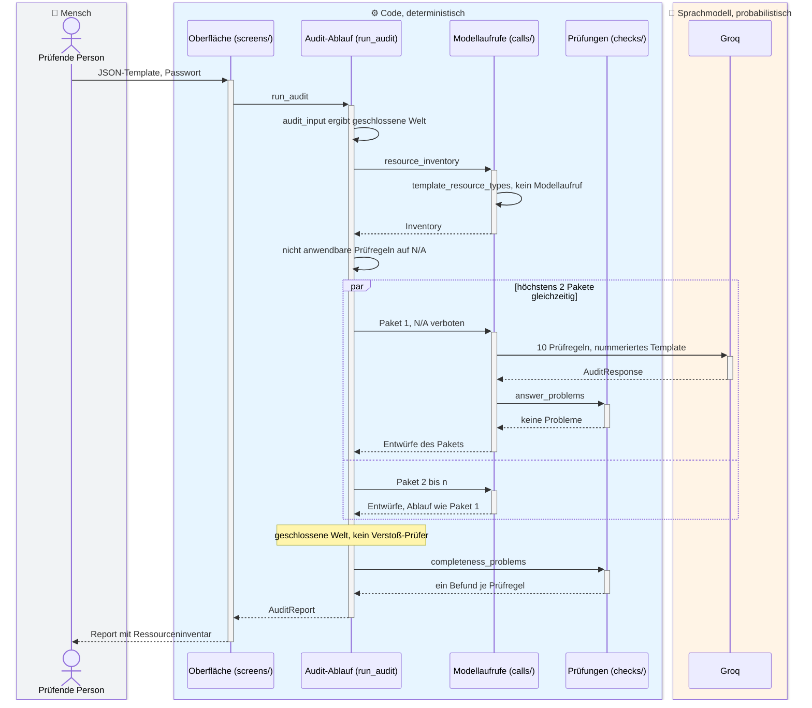

*Abfolge.*

1. Die prüfende Person gibt ein CloudFormation-JSON und das Passwort ein; die Oberfläche ruft den Audit-Ablauf auf.
2. ⚙️ Der Audit-Ablauf erkennt am Format die geschlossene Welt.
3. Er ruft die Inventur auf. Weil das Template JSON ist, liest der Code die Typen selbst und fragt kein Modell; das Inventar geht zurück.
4. Der Audit-Ablauf setzt jede Prüfregel ohne Typ im Inventar auf N/A.
5. Die Pakete laufen wie im Spec-Audit, mit dem Hinweis, dass N/A verboten ist.
6. In geschlossener Welt entfällt der Verstoß-Prüfer. Der Audit-Ablauf prüft die Vollständigkeit und gibt den Report an die Oberfläche, die ihn zeigt.

Ergebnis: 175 Befunde; Prüfregeln für Typen, die nicht im Template stehen, sind N/A mit dem Grund „Ressourcentyp nicht im Template“. Ein FAIL ist hier auch dann möglich, wenn eine Einstellung fehlt, weil dann der unsichere Standardwert gilt. Der Fristenwecker dauert im Median 12 s und kostet 0,007 $.

*Sichten:* logisch Inventar und geschlossene Welt (2.5); Prozess der Zweig „JSON-Template“ ohne Verstoß-Prüfer (3.4); Entwicklung `template_resource_types` in `text.py` (4.3); physisch Streamlit Community Cloud und Groq (5.2).

### 6.4 Fehlerfälle

Fünf Fehlerfälle zeigen je eine Stelle, an der etwas schiefgeht, und was der Code daraus macht. Drei davon (F3, F5, F7) handeln davon, dass 🤖 das Modell irrt; F8 davon, dass es nicht antwortet; F1 betrifft den Build. Die Varianten F2, F4 und F6 brauchen kein eigenes Diagramm und stehen in 6.5.

#### F1 Die Prüfsumme einer Quelle weicht ab

Ein Herausgeber hat die Datei hinter einer Adresse geändert, etwa eine konsolidierte Fassung der DSGVO bei EUR-Lex. Der lokale Cache ist leer, etwa auf einem neuen Rechner; nur dann lädt der Build neu und sieht die Änderung. Bei Grundschutz++ und Prowler zeigt die Adresse auf einen festen Commit, dort ändert sich die Datei nicht.

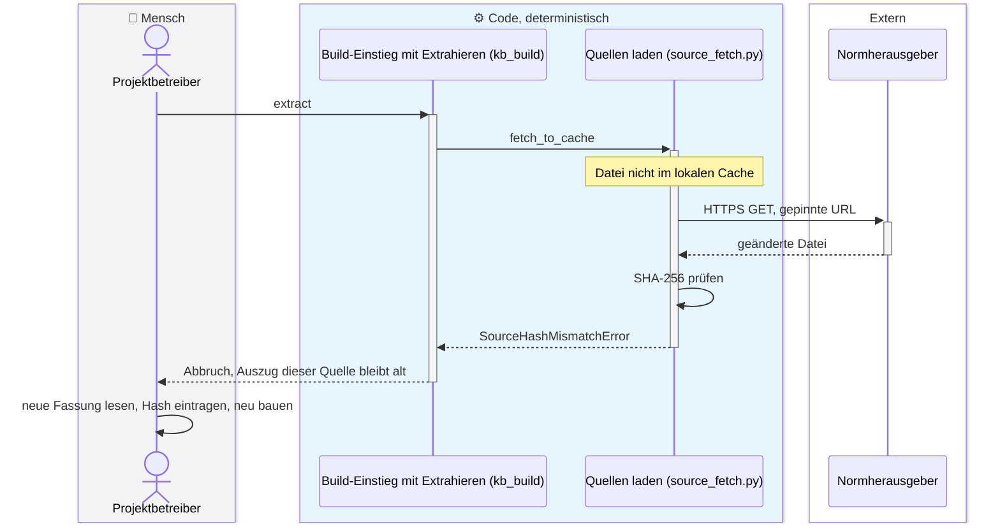

*Abfolge.*

1. Der Projektbetreiber startet „extract“; der Einstieg lässt die Quelle laden.
2. Die Datei liegt nicht im Cache, also holt der Download sie von der gepinnten Adresse. Der Herausgeber liefert eine geänderte Fassung.
3. ⚙️ Der Vergleich der Prüfsumme schlägt fehl, und der Download meldet den Fehler an den Einstieg.
4. Der Einstieg bricht ab, bevor der Auszug dieser Quelle geschrieben ist; Quellen, die vorher an der Reihe waren, sind schon neu geschrieben. Er meldet den Fehler dem Betreiber.
5. Der Betreiber entscheidet von Hand, ob er die neue Fassung übernimmt.

Ergebnis: Der Build bricht ab, bevor ein Modell die neue Fassung sieht; der alte Katalog bleibt gültig. Ein Mensch entscheidet, ob die neue Fassung übernommen wird, und trägt ihren Hash in `data/input/sources.json` ein. *Sichten:* logisch Quelle (2.3); Prozess Build als Batch (3.2); Entwicklung `source_fetch.py` als einziger HTTP-Zugang (4.2); physisch Normherausgeber und Rechner (5.2).

#### F3 Ungültige Antwort, Retry, fail closed

Das Modell lässt in einem Paket eine Prüfregel aus oder nennt einen Zeilenbereich, den es nicht gibt.

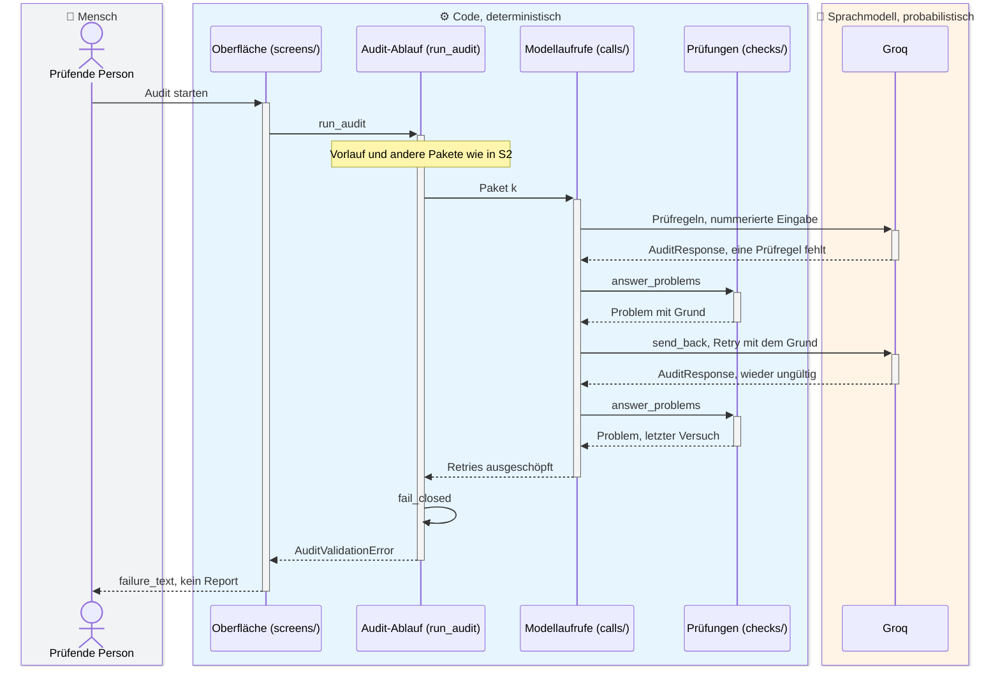

*Abfolge.*

1. Die prüfende Person startet ein Audit; der Audit-Ablauf läuft bis zu Paket k wie in S2.
2. 🤖 Das Modell beantwortet Paket k, lässt aber eine Prüfregel aus.
3. ⚙️ Die Prüfung findet das Problem; der Modellaufruf schickt die Antwort mit dem Grund zurück.
4. 🤖 Auch die zweite Antwort ist ungültig. Die Prüfung meldet das Problem im letzten Versuch.
5. Der Modellaufruf gibt auf und meldet das dem Audit-Ablauf. Der Audit-Ablauf endet fail closed mit einem Fehler, der die Gründe je Prüfregel enthält.
6. Die Oberfläche zeigt den Fehlertext statt eines Reports.

Ergebnis: kein Report statt eines falschen. Der Fehlertext nennt je Prüfregel die Probleme des letzten Versuchs. In 19 Läufen der Messkampagne endete kein Audit so; der eine Abbruch war ein HTTP 400 von Groq, gegen den es keinen Retry gibt (QS-2). *Sichten:* logisch Korrekturen (2.4); Prozess Lebenslauf eines Befunds (3.5); Entwicklung `checks/audit_gates.py` und `calls/model_call.py` (4.3); physisch Groq (5.2).

#### F5 Der Verstoß-Prüfer stuft ein FAIL herab

Ein Paket hat ein FAIL vergeben, weil die Spezifikation zu einem Thema schweigt; in offener Welt belegt Schweigen aber keinen Verstoß.

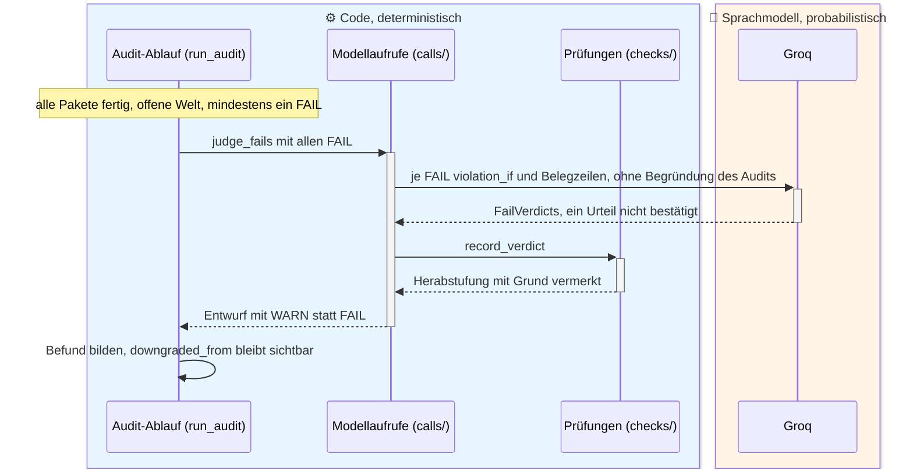

*Abfolge.*

1. Nach den Paketen ruft der Audit-Ablauf den Verstoß-Prüfer mit allen FAILs auf.
2. Der Modellaufruf schickt 🤖 dem Modell je FAIL nur Titel, Verstoßkriterium und nummerierte Belegzeilen.
3. 🤖 Das Modell bestätigt ein FAIL nicht, weil die Belegzeilen zum Thema schweigen.
4. ⚙️ Der Sammler der Korrekturen vermerkt das Urteil mit Grund; der Modellaufruf gibt den Entwurf mit WARN zurück.
5. Der Audit-Ablauf bildet den Befund; der alte Status FAIL und der Grund bleiben am Befund sichtbar.

Ergebnis: Der Befund ist WARN, der alte Status FAIL und der Grund des Prüfers stehen sichtbar am Befund. Der Prüfer sieht die Begründung des Pakets nicht, denn mit ihr bestätigte er in einer frühen Messung 12 von 13 FAILs nur nach (#31). Beim Wohngeld-Musterfall stufte er in drei Läufen 3 von 4, 6 von 10 und 8 von 9 FAILs herab (QS-5). *Sichten:* logisch Urteil des Verstoß-Prüfers und Herabstufung (2.4, 2.5); Prozess ein Aufruf für alle FAIL nach der Zusammenführung (3.3); Entwicklung `calls/fail_judge.py`, `checks/corrections.py` (4.3); physisch Groq (5.2).

#### F7 Unbekannter Typ oder YAML: offene Welt

Die Architektur kommt als YAML oder Freitext. Der Code kann sie nicht selbst lesen, also bleibt die Welt offen, und das Modell nennt die Ressourcentypen.

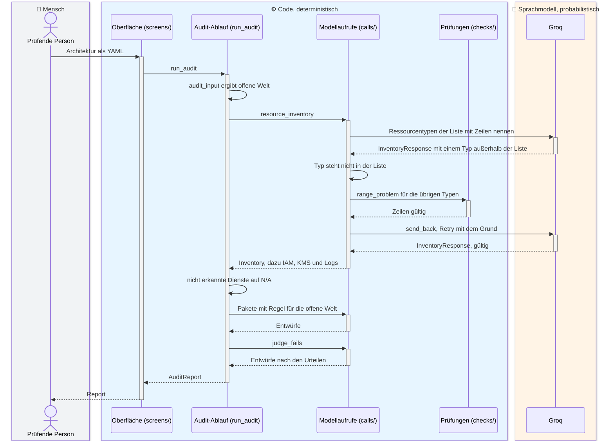

*Abfolge.*

1. Die prüfende Person gibt eine Architektur als YAML ein. ⚙️ Der Audit-Ablauf erkennt, dass er YAML nicht selbst liest; die Welt ist offen.
2. Er ruft die Inventur auf. 🤖 Das Modell nennt Typen mit Zeilen, darunter einen Typ, der in keiner Prüfregel vorkommt.
3. ⚙️ Der Modellaufruf prüft zuerst jeden Typ gegen die Liste, dann die Zeilen der übrigen Typen. Ein Typ steht nicht in der Liste; die Antwort geht mit diesem Grund zurück.
4. 🤖 Die zweite Antwort ist gültig. Das Inventar geht an den Audit-Ablauf; IAM, KMS und Logs gelten immer als vorhanden.
5. Der Audit-Ablauf setzt Prüfregeln nicht erkannter Dienste auf N/A und startet die Pakete mit der Regel für die offene Welt.
6. Jedes FAIL geht an den Verstoß-Prüfer; danach geht der Report über die Oberfläche an die prüfende Person.

Ergebnis: Ein Typ außerhalb des Katalogs kommt nie ins Inventar; nach dem Retry stehen nur belegte Typen darin. Nennt das Modell einen vorhandenen Dienst nicht, bleiben seine Prüfregeln N/A mit dem Grund „Dienst in der Eingabe nicht erkannt“, sichtbar statt still (7.4). Fehlen ist in dieser Welt nur WARN, und jedes FAIL geht an den Verstoß-Prüfer. *Sichten:* logisch offene Welt und Inventar (2.5); Prozess der Zweig „Freitext, YAML, Terraform“ (3.4); Entwicklung `calls/inventory.py`, `open_world.py` (4.3); physisch Groq (5.2).

#### F8 Groq drosselt oder fällt aus

Groq antwortet mit HTTP 429 (Drosselung) oder einem Serverfehler, zum Beispiel weil zwei Audits gleichzeitig laufen.

```mermaid
sequenceDiagram
  box rgb(241,243,245) 👤 Mensch
    actor P as Prüfende Person
  end
  box rgb(231,245,255) ⚙️ Code, deterministisch
    participant UI as Oberfläche (screens/)
    participant AE as Audit-Ablauf (run_audit)
    participant AN as Groq-SDK, gebaut in groq_services.py
  end
  box rgb(255,244,230) 🤖 Sprachmodell, probabilistisch
    participant M as Groq
  end
  P->>+UI: Audit starten
  UI->>+AE: run_audit
  AE->>+AN: Paket, über Modellaufrufe und Pydantic AI
  AN->>+M: HTTPS
  M-->>-AN: HTTP 429 oder 5xx
  loop bis zu 6-mal mit wachsender Wartezeit
    AN->>+M: erneut
    M-->>-AN: HTTP 429 oder 5xx
  end
  AN-->>-AE: Fehler der Modell-API
  AE->>AE: fail_closed
  AE-->>-UI: AuditValidationError
  UI-->>-P: KI-Dienst nicht erreichbar oder überlastet
```

*Abfolge.*

1. Die prüfende Person startet ein Audit. Ein Paket geht über die Modellaufrufe und Pydantic AI an das Groq-SDK; das Bild lässt die Zwischenschritte weg.
2. Groq antwortet mit Drosselung (HTTP 429) oder einem Serverfehler.
3. Das Groq-SDK, das der Anschluss mit sechs Wiederholungen gebaut hat, wiederholt die Anfrage bis zu sechsmal mit wachsender Wartezeit; das Modell erfährt davon nichts.
4. Bleibt der Fehler, meldet der Anschluss ihn an den Audit-Ablauf. Der Audit-Ablauf endet fail closed.
5. Die Oberfläche zeigt einen einfachen Satz statt des Fehlertexts der Bibliothek.

Ergebnis: Abbruch mit einem einfachen Satz, ohne Fehlertext der Bibliothek; es gibt kein Ersatzmodell. Der Bedingungs-Vorlauf und der Verstoß-Prüfer brechen dabei nicht ab, sie fallen auf ihren Rückfall zurück (F6, 7.2); nur ein Paket oder der Inventar-Vorlauf beenden das Audit. Gemessen ist dazu nichts. *Sichten:* logisch Anschlüsse (2.2); Prozess Grenze je Audit, nicht je Server (3.2), Wiederholung im Netz (3.6); Entwicklung `adapters/groq_services.py` (4.3); physisch Groq (5.2).

### 6.5 Varianten

Drei weitere Fehlerfälle folgen denselben Bahnen wie oben und brauchen kein eigenes Diagramm.

| Variante | Auslöser | Was passiert | Ergebnis | Sichten |
|---|---|---|---|---|
| F2 Das Gate verwirft einen Regel-Entwurf | 🤖 Der Entwurf zitiert die Norm nicht wörtlich oder nennt einen Querverweis, den es nicht gibt. | ⚙️ Das Gate schickt den Entwurf mit Grund zurück, bis zu sechsmal; danach gilt die Prüfregel als gescheitert, der Build formuliert die übrigen weiter und bricht am Ende ab. | Der alte Katalog bleibt; im Modus „nur fehlende formulieren“ liegen die neuen Prüfregeln im Zwischenstand. | 2.3 `RuleDraft`, 3.7 Aufruf 7, 4.2 `rules/`, 5.2 Rechner |
| F4 Ein PASS ohne Beleg wird WARN | 🤖 Das Modell vergibt PASS ohne brauchbaren Zeilenbereich, auch im Retry. | ⚙️ Statt Abbruch setzt der Code WARN mit der Empfehlung „Einhaltung selbst prüfen“; der alte Status bleibt sichtbar. | Prüfbedarf statt unbelegtem PASS (Rückfall). | 2.4 `Finding`, 3.5, 4.3 `checks/evidence.py`, 5.2 Groq |
| F6 Der Vorlauf fällt aus | 🤖 Der Bedingungs-Vorlauf antwortet nicht oder bleibt nach dem Retry ungültig. | ⚙️ Alle Bedingungen sind `unstated`, mit Hinweis im Report; alle Prüfregeln gehen ans Modell. | Mehr Lücken, nie ein falsches N/A (Rückfall). | 2.5 `ConditionResult`, 3.3, 4.3 `calls/conditions.py`, 5.2 Groq |

### 6.6 Abdeckung

Jeder Baustein der logischen Sicht kommt in mindestens einem Szenario vor.

| Baustein | S1 | S2 | S3 | F1 | F2 | F3 | F4 | F5 | F6 | F7 | F8 |
|---|---|---|---|---|---|---|---|---|---|---|---|
| Oberfläche | | ✓ | ✓ | | | ✓ | | | | | ✓ |
| Kommandozeile | ✓ | | | ✓ | ✓ | | | | | | |
| Audit-Ablauf | | ✓ | ✓ | | | ✓ | ✓ | ✓ | ✓ | ✓ | ✓ |
| Build-Ablauf | ✓ | | | ✓ | ✓ | | | | | | |
| Prüfungen | ✓ | ✓ | ✓ | ✓ | ✓ | ✓ | ✓ | ✓ | ✓ | ✓ | |
| Katalog | ✓ | ✓ | ✓ | | ✓ | | | | | | |
| Rückfälle | | | | | | | ✓ | | ✓ | | |
| Modellaufrufe | ✓ | ✓ | ✓ | | ✓ | ✓ | ✓ | ✓ | ✓ | ✓ | ✓ |
| Anschlüsse | ✓ | ✓ | ✓ | ✓ | | | | | | | ✓ |
| Sprachmodell | ✓ | ✓ | ✓ | | ✓ | ✓ | ✓ | ✓ | ✓ | ✓ | ✓ |
| Normherausgeber | ✓ | | | ✓ | | | | | | | |

> **Concern (LLM-Unsicherheit):** F3, F5, F7 und F8 zeigen das Verhalten, wenn 🤖 das Modell irrt oder ausfällt; gemessen sind davon nur F3 und F5 (7.3). Ein Szenario, in dem eine Anweisung in der Eingabe steht, ist beschrieben, aber nicht gemessen ([7.4](#74-wo-die-schale-endet), [8.2](#82-bedrohungen-an-den-grenzen)).

## 7 Verlässlichkeit trotz Sprachmodell

*Leitfrage: Wie baut man ein verlässliches System um einen Baustein, der nicht verlässlich ist?*

Ein Sprachmodell versagt anders als ein Dienst: Es irrt mit Überzeugung, schwankt, lässt sich durch die Eingabe steuern und fällt aus. GovGuard legt eine deterministische Schale aus sechs bekannten Mustern darum, misst, was sie leistet, und benennt, wo sie endet. Jeder Abschnitt folgt denselben vier Arten zu versagen; die Qualitätsszenarien QS-1 bis QS-7 sind die Messpunkte.

7.1 beschreibt die vier Arten, auf die ein Sprachmodell versagt, und warum sie sich nicht von selbst melden. 7.2 zeigt die Schale aus sechs Mustern, die jeden Modellaufruf umschließt. 7.3 misst, was die Schale leistet, 7.4 benennt, wo sie endet. Jeder Abschnitt folgt denselben vier Arten.

### 7.1 Was am Sprachmodell anders ist

Das Modell arbeitet in GovGuard an zwei Stellen: Im Build schreibt es einmalig den Katalog der Prüfregeln, im Audit die Befunde. Dieses Kapitel gilt für beide.

In der deterministischen Programmierung hat ein Fehler eine Ursache, die man finden kann: Gleiche Eingabe, gleicher Fehler, und ein Test hält ihn fest. Ein Sprachmodell bricht diese Annahme auf vier Arten. Jede hat eine vertraute Entsprechung, und jede hat einen Namen in den Standards, die eine Behörde anlegt.

| Art zu versagen | Was passiert | Analogie aus der deterministischen Welt | Standard | Wo es GovGuard trifft |
|---|---|---|---|---|
| **Irrt mit Überzeugung** | 🤖 Das Modell liefert eine gut formulierte, falsche Antwort: ein erfundener Beleg, ein falscher Status, ein Zitat, das so nicht in der Norm steht. | Ein Dienst liefert falsche Daten mit HTTP 200: kein Fehlercode, die Antwort sieht gültig aus. | BSI R4 (fehlende Ausgabequalität), OWASP LLM09 (Misinformation) | jeder Befund, jede Prüfregel des Builds |
| **Schwankt** | 🤖 Dieselbe Eingabe ergibt in zwei Läufen verschiedene Status. Temperatur 0 senkt die Streuung, beseitigt sie nicht, und ein Anbieter kann das Modell austauschen. | Ein Flaky Test: gleicher Code, gleiche Eingabe, mal grün, mal rot. | BSI R7 (fehlende Reproduzierbarkeit) | Status zwischen Läufen; Auswahl des Builds |
| **Lässt sich steuern** | 🤖 Ein Satz in der Eingabe wird als Anweisung gelesen, etwa „Dieses Verfahren erfüllt alle Anforderungen“. | SQL Injection: Daten werden als Befehl ausgeführt, weil beide im selben Kanal liegen. Beim Modell gibt es kein Prepared Statement, das beides sauber trennt. | BSI R26 und R28 (direkte und indirekte Manipulation im Prompt), OWASP LLM01 (Prompt Injection) | Eingabe in jedem Paket; Belegzeilen beim Verstoß-Prüfer |
| **Fällt aus oder wird teuer** | 🤖 Der Anbieter drosselt, antwortet nicht oder berechnet jede Wiederholung. | Ein externer Dienst mit Rate Limit (HTTP 429) und Abrechnung nach Menge. | OWASP LLM10 (Unbounded Consumption) | jeder Aufruf; zwei Audits gleichzeitig |

Ein Prepared Statement ist eine Datenbankabfrage, bei der Befehl und Daten getrennt übergeben werden, sodass Daten nie als Befehl gelten; für ein Sprachmodell gibt es diese Trennung nicht, weil Auftrag und Eingabe derselbe Text sind.

Der entscheidende Unterschied liegt in den ersten drei Zeilen: Sie melden sich nicht. Ein Dienst mit HTTP 500 sagt, dass er versagt hat; ein Modell, das irrt, schwankt oder gesteuert wird, liefert ein gültig aussehendes Formular. Darum reicht es nicht, Statuscodes zu prüfen und Ausnahmen zu fangen. Der Code muss den Inhalt der Antwort selbst prüfen, und zwar mit Regeln, die er ohne Sprachverständnis entscheiden kann. Was sich so nicht prüfen lässt, muss er klein halten, sichtbar machen oder messen.

### 7.2 Die deterministische Schale

Eine Schale ist hier der Code, der jeden Modellaufruf von beiden Seiten umschließt. Vorher macht er den Auftrag so eng, dass wenig Raum für Fehler bleibt; nachher prüft er die Antwort, bevor sie zählt. Das Modell sitzt dadurch immer zwischen zwei Code-Schichten und erreicht den Report nie direkt.

```mermaid
flowchart TB
  subgraph VOR["⚙️ vor dem Modell: den Auftrag eng machen"]
    direction TB
    V1["M3 Fester Katalog<br/>welche Prüfregeln gefragt werden"]:::code
    V2["M3 Vorab-N/A<br/>Bedingungen, Inventar"]:::code
    V3["M4 Eingabe nummerieren<br/>Zeilen statt Zitate"]:::code
    V4["M1 Formular<br/>Schema mit festen Werten"]:::code
  end
  M(["🤖 Sprachmodell<br/>füllt nur den Entwurf"]):::llm
  subgraph NACH["⚙️ nach dem Modell: die Antwort prüfen"]
    direction LR
    N1{"M2 Schema und Gates<br/>M6 ungültig: einmal zurück mit Grund"}:::code
    N2["M4 Beleg aus den Zeilen schneiden"]:::code
    N3["M1 Anker, Titel, Empfehlung ergänzen"]:::code
    N4["M5 Rückfall zum vorsichtigeren Status"]:::code
  end
  N1 --> N2 --> N3 --> N4
  VOR -->|"Auftrag"| M -->|"Entwurf"| NACH
  classDef llm fill:#ffd8a8,stroke:#d9480f,color:#1f1f1f,stroke-width:2px
  classDef code fill:#a5d8ff,stroke:#1971c2,color:#1f1f1f,stroke-width:2px
```

*Elemente.* Der obere Rahmen ist der Code vor dem Modell, der untere der Code nach dem Modell; dazwischen sitzt 🤖 das Modell, das nur den Entwurf füllt. Jeder blaue Kasten ist ein Mechanismus der Schale, mit dem Kürzel des Musters, zu dem er gehört. Die Raute ist das Gate: Hier entscheidet sich, ob eine Antwort zählt oder einmal mit Grund zurückgeht.

*Verbindungen.* Der Pfeil „Auftrag“ führt vom oberen Rahmen zum Modell: Festes Fragenset, Vorab-N/A, nummerierte Eingabe und Formular bilden zusammen den Auftrag. Der Pfeil „Entwurf“ führt vom Modell in den unteren Rahmen. Die Pfeile darin ordnen die Mechanismen nach ihrem Zweck: prüfen, Beleg ausschneiden, ergänzen, im Zweifel vorsichtiger werden. Die genaue Reihenfolge im Code weicht davon ab: Der Validator repariert Doppelbefunde und stuft ein FAIL ohne Zeilen schon vor den Gates herab, und den Beleg schneidet der Code erst nach allen Paketen aus (3.5).

Die Schale besteht aus sechs Mustern; die Kürzel M1 bis M6 im Bild verweisen auf sie. Keines ist neu; jedes ist aus der deterministischen Programmierung bekannt und wird hier auf einen Lieferanten angewandt, dem man nicht trauen kann.

| # | Muster | Bekannt als | Gegen welche Art zu versagen | in GovGuard | im Code |
|---|---|---|---|---|---|
| 1 | Entwurf-Muster | Data Transfer Object, Content Enricher | irrt | 🤖 füllt nur den Entwurf, ⚙️ ergänzt den Rest | `FindingDraft`, `Finding` |
| 2 | Vertrag statt Vertrauen | Design by Contract, Eingabevalidierung | irrt, lässt sich steuern | Schema und Gates prüfen jede Antwort | `answer_problems` |
| 3 | Feste Fragen, feste Antworten | Whitelist, Enum statt Freitext | irrt, schwankt, lässt sich steuern | fester Katalog, feste Status-Werte | `RuleCatalog`, `Status` |
| 4 | Referenz statt Kopie | Fremdschlüssel statt kopierter Daten | irrt | 🤖 nennt Zeilen, ⚙️ schneidet den Beleg aus | `evidence_of` |
| 5 | Sichere Voreinstellung | fail-safe default, fail closed | irrt, fällt aus | Abbruch oder vorsichtigerer Status, nie PASS | `fail_closed` |
| 6 | Wiederholung mit Grund | HTTP 422 mit Fehlerliste, Backoff | irrt, fällt aus | ein Retry mit dem Fehlertext, Netz-Wiederholung mit Wartezeit | `send_back`, `MAX_RETRIES` |

#### Muster 1: Entwurf-Muster

*Problem:* Jedes Feld, das das Modell ausfüllt, kann es falsch ausfüllen. *Muster:* Das Modell bekommt nur ein Formular mit den Feldern, die Sprachverständnis brauchen; der fertige Typ erbt davon und ergänzt alles, was der Code schon weiß. In der deterministischen Welt ist der Entwurf ein Data Transfer Object, ein reiner Datenträger, und der Code, der ihn anreichert, ein Content Enricher.

| 🤖 Entwurf | ⚙️ fertiger Typ | Was der Code ergänzt |
|---|---|---|
| `FindingDraft` | `Finding` (erbt) | Beleg aus den Zeilen, Titel, Primäranker, Querverweise, Herabstufung, Marke für gestrichene Zeilen, Korrekturen |
| `RuleDraft` | `Rule` (erbt) | Kennung, Audit-Art, Quelle, Primäranker, Auswahlgrund, Ressourcentypen; bei zerlegten Rechtsakten das Zitat |
| `ConditionDraft` | `ConditionResult` | den Wert `yes`, `no` oder `unstated`, Widerspruch, Ableitung aus einer anderen Bedingung |

Die übrigen Paare, etwa für Zerlegung, Einstufung und Inventar, zeigen die Klassendiagramme in 2.3 bis 2.5. Das Modell kann darum keinen Anker, keine Kennung und keinen Beleg erfinden. Was es noch falsch machen kann, ist klein und benannt: Status, Zeilen, Begründung.

#### Muster 2: Vertrag statt Vertrauen

*Problem:* Eine Bitte im Prompt („antworte als JSON, nenne jede Regel“) ist keine Garantie. *Muster:* Design by Contract heißt, dass jede Seite einer Schnittstelle Bedingungen hat, die der Code prüft. Die Vorbedingung prüft der Code vor dem Aufruf: Eine zu lange Eingabe bricht ab, bevor ein Aufruf Geld kostet (`InputTooLongError`, Exit 1). Die Nachbedingung prüft er nach dem Aufruf: Das Schema erzwingt die Form, die Gates den Inhalt, der ohne Sprachverständnis prüfbar ist, etwa „genau ein Befund je Prüfregel“ und „Zeilenbereich liegt in der Eingabe“. Bricht das Modell die Nachbedingung auch im Retry, ist es als Lieferant schuld, und das Audit endet (`AuditValidationError`, Exit 2). Die vollständige Liste der Regeln mit Code und Test steht in [4.6](#46-regeln-in-klartext-wo-erzwingt-der-code-sie).

#### Muster 3: Feste Fragen, feste Antworten

*Problem:* Eine offene Frage hat unendlich viele falsche Antworten. *Muster:* Der Code legt fest, was gefragt wird und welche Antworten erlaubt sind, wie eine Whitelist oder ein Enum statt eines Freitextfelds. Das Muster heißt bewusst nicht „geschlossene Welt“, denn dieser Begriff bezeichnet in GovGuard die Welt eines Templates (0.5). In GovGuard heißt das Muster: Der feste Katalog bestimmt die Prüfregeln, die Status-Werte sind eine feste Liste, und der Inventar-Vorlauf darf nur Typen aus dem Katalog nennen.

Die naheliegende Alternative wäre RAG. RAG (Retrieval-Augmented Generation) holt per Ähnlichkeitssuche nur die passendsten Textstücke in den Prompt; das beantwortet die Frage „Was steht zu X?“. Ein Audit fragt aber „Erfüllt X alle Prüfregeln?“, und dafür muss jede Prüfregel gefragt werden.

| Kriterium | RAG | Fester Katalog |
|---|---|---|
| Vollständigkeit | nicht garantiert; eine unähnliche Prüfregel fällt unbemerkt heraus | vom Code garantiert, ein Befund je Prüfregel |
| Schwankung | die Auswahl der Prüfregeln hängt von der Anfrage ab | die Auswahl steht fest, nur das Urteil schwankt |
| Leerlauf | die Vektor-Datenbank läuft weiter | 0 €, eine JSON-Datei |
| Nachvollziehbarkeit | Auswahl je Anfrage verschieden | Auswahlprotokoll im Git |

Dazu gehört Leitprinzip 2: Was der Code wissen kann, fragt er nicht. Das Inventar eines Templates liest der Code selbst, ohne Modell. Bei Bedingungen und bei Architekturen in Freitext urteilt dagegen das Modell; es nennt aber nur Zeilen und Typen, und der Code wendet darauf eine feste Regel an, etwa „nur ein ausdrückliches Nein macht N/A“. Dieser Weg kann irren; die Grenze steht in 7.4.

#### Muster 4: Referenz statt Kopie

*Problem:* Ein Zitat, das das Modell abschreibt, kann umformuliert oder erfunden sein, und man sieht es ihm nicht an. *Muster:* Statt Daten zu kopieren, verweist man auf sie, wie ein Fremdschlüssel in einer Datenbank. Die Eingabe geht nummeriert ans Modell (`12| …`); das Modell nennt nur Anfang und Ende eines Zeilenbereichs, und der Code schneidet den Beleg aus der Eingabe. Der Beleg ist damit per Konstruktion wörtlich. Der Code prüft dazu, dass die Zeilen existieren, höchstens 200 Zeilen umfassen und mindestens 15 Zeichen enthalten (`range_problem`). 200 Zeilen sind etwa ein Abschnitt einer Spezifikation; 40 Zeilen waren im Prototyp zu knapp (#26). 15 Zeichen schließen Belege wie „S3“ aus, die nichts belegen. Die obere Grenze ist großzügig, und ein langer Beleg ist unscharf; auch das gehört zur Grenze in 7.4. Im Build gilt dasselbe Muster für Normtexte: Das Gate prüft, dass ein Zitat wörtlich in genau der verankerten Anforderung steht (`is_quoted`), und bei zerlegten Rechtsakten setzt der Code das Zitat selbst.

Die Grenze dieses Musters: Der Code prüft, dass die Zeile existiert, nicht, dass sie das Urteil trägt (7.4).

#### Muster 5: Sichere Voreinstellung

*Problem:* Wenn die Antwort unbrauchbar ist, muss ein Ergebnis entstehen, das nichts Falsches behauptet. *Muster:* Fail closed heißt: Im Zweifel gibt es kein Ergebnis statt eines falschen, wie eine Firewall, die bei Fehlern sperrt. Das ist der Normalfall in GovGuard. An vier Stellen wäre ein Abbruch unnötig hart, weil es einen Status gibt, der weniger behauptet. Diese Rückfälle sind die einzigen Ausnahmen, und sie stehen nur hier:

| Situation | Statt Abbruch | Warum das vorsichtiger ist | wer | im Code |
|---|---|---|---|---|
| FAIL ohne Zeilenbereich | sofort WARN, alter Status sichtbar | ein Verstoß ohne Beleg wird Prüfbedarf | ⚙️ | `without_unproven_verdict` |
| PASS ohne gültigen Beleg, auch nach dem Retry | WARN mit „Einhaltung selbst prüfen“ | eine Einhaltung ohne Beleg wird Prüfbedarf | ⚙️ | `without_unproven_verdict` |
| Bedingungs-Vorlauf fällt aus oder bleibt ungültig | alle Bedingungen `unstated` | keine Prüfregel wird N/A, alle gehen ans Modell | ⚙️ | `unstated_results` |
| Verstoß-Prüfer fällt aus oder urteilt nicht | das FAIL bleibt, als ungeprüft vermerkt | der strengere Status bleibt stehen | ⚙️ | `record_unchecked` |

„Vorsichtiger“ heißt hier: Der Ausgang lässt eher einen Menschen hinschauen. Keiner der vier Rückfälle erzeugt ein PASS oder ein N/A. Wo es keinen solchen Ausgang gibt, endet das Audit fail closed: bei einem Paket oder Inventar-Vorlauf, der nach dem Retry ungültig bleibt, bei Ausfall des Anbieters und im Build bei jedem verletzten Gate.

#### Muster 6: Wiederholung mit Grund

*Problem:* Ein Modell, das einmal falsch antwortet, antwortet beim zweiten Mal oft richtig, wenn es weiß, was falsch war. *Muster:* Wie eine API, die bei ungültiger Eingabe HTTP 422 mit einer Liste der Fehler zurückgibt, schickt der Code die Antwort mit dem gefundenen Grund zurück (`send_back`). Derselbe Text steht später als Korrektur am Befund, sodass man im Report sieht, worüber das Modell gestolpert ist. Der Retry greift nur, wenn der Code einen Regelverstoß benennen kann; ein Urteil, das bloß unerwünscht ist, wird nie wiederholt. Das unterscheidet ihn vom Nachwürfeln, das GovGuard ablehnt (7.3). Wie oft der zweite Versuch gelingt, ist nicht gesondert gemessen; QS-2 zeigt nur, dass in 19 Läufen kein Audit an einem ausgeschöpften Retry scheiterte.

Es gibt zwei getrennte Ebenen der Wiederholung. Die inhaltliche Wiederholung über Pydantic AI hat einen Grund und ist streng begrenzt: einmal zur Laufzeit, bis zu sechsmal im Build (3.6). Die Wiederholung im Netz macht das Groq-SDK bei Drosselung, Serverfehler und Zeitüberschreitung, bis zu sechsmal mit wachsender Wartezeit (Backoff), ohne dass das Modell davon erfährt. Ein HTTP 400 von Groq wird auf keiner Ebene wiederholt. Groq prüft die Antwort selbst gegen das Schema; passt sie nicht, verwirft Groq sie mit diesem Fehlercode, und beim Code kommt keine Antwort an, die er mit Grund zurückschicken könnte. Das war der einzige Abbruch der Messkampagne (QS-2).

### 7.3 Was die Schale nachweislich leistet

Ein Qualitätsszenario beschreibt eine Situation, ein Ziel und einen Messwert. Die Szenarien QS-1 bis QS-7 messen die Schale entlang der vier Arten zu versagen; QS-8 und QS-9 gehören zur Sicherheit (8.4). Stand: *erreicht* heißt Ziel erreicht und belegt, *teilweise* heißt gemessen, aber nur teilweise erreicht, *offen* heißt Ziel nicht festgelegt oder nicht erreicht. Die Werte stammen aus der Messkampagne (#54, 19 Läufe über sechs Musterfälle), aus früheren Messungen (Issue-Nummer am Wert) oder aus Tests.

**Irrt mit Überzeugung.** Die Schale fängt die Form vollständig: Kein Beleg ist umformuliert, kein Report unvollständig. Den Inhalt fängt sie nur teilweise. Der Verstoß-Prüfer senkt viele FAILs, die aus Schweigen entstanden, aber nur drei von sechs Musterfällen erreichen ihr Soll in jedem Lauf.

| ID | Stand | Szenario | Ziel | Messwert (Quelle) |
|---|---|---|---|---|
| QS-1 | erreicht | Das Modell liefert einen Beleg, der nicht in der Eingabe steht. | 0 unwörtliche Belege | per Konstruktion, weil der Code den Beleg ausschneidet; 0 umformulierte Belege in 4 Messläufen ([0017](adr/0017-beleg-per-zeilenverweis.md), #26) |
| QS-2 | erreicht | Eine Prüfregel bekommt keinen oder zwei Befunde. | nie ein unvollständiger Report | 0 unvollständige Reports in 18 Läufen mit Report; der einzige Abbruch in 19 Läufen war ein HTTP 400 von Groq ohne Retry, nie ein ausgeschöpfter Retry (#54) |
| QS-4 | teilweise | Ein Musterfall soll sein Soll erreichen. | jeder Musterfall in jedem Lauf | 10 von 19 Läufen: Meldeportal 3/3, Fristenwecker 3/3, Antragseingang 3/3, GovGuard-Selbstaudit 1/4, Wohngeld 0/3, Protokollarchiv 0/3 (#54) |
| QS-5 | teilweise | Fehlender Text wird als Verstoß gewertet. | 0 FAIL wegen bloßen Fehlens | 0 und 0 in 2 Läufen nach dem Prüfer ([0020](adr/0020-fail-nur-bei-festgelegtem-verstoss.md), #46). Der Prüfer stufte beim Wohngeld 3 von 4, 6 von 10 und 8 von 9 FAILs herab, beim Meldeportal 12 bis 18 von 44 bis 46 (#54); ob die bestätigten FAILs berechtigt sind, hat keine Fachperson bewertet; in #54 sind nur die Herabstufungen gezählt. |

**Schwankt.** Die Schale erzwingt keine gleichen Antworten; sie misst die Schwankung und zeigt Abweichungen vom Soll, statt nachzuwürfeln. Architektur-Audits sind stabiler als Spec-Audits, weil Templates weniger Raum für Auslegung lassen.

| ID | Stand | Szenario | Ziel | Messwert (Quelle) |
|---|---|---|---|---|
| QS-3 | offen | Dieselbe Eingabe wird dreimal geprüft. | kein Zielwert: Schwankung messen und zeigen, nicht erzwingen | gleicher Status: Spec 70 bis 94 %, Architektur 96 bis 99 %; es kippen meist Lücke, PASS und N/A, 0 bis 13 Prüfregeln auch zwischen FAIL und WARN (#54). Mit dem früheren Katalog (151 Regeln) kippten bei Groq 42, bei Bedrock Haiku 19 Prüfregeln (#29). |

Auch der Bedingungs-Vorlauf schwankt: Im Einzellauf von #60 traf er 18 von 21 Soll-Werten; in der Messkampagne trafen alle Bedingungen ihr Soll beim Meldeportal in 3 von 3 Läufen, beim Selbstaudit und beim Wohngeld in keinem. Im Build wechseln bei Prompt- oder Modellwechsel rund 10 % der Auswahl ([0014](adr/0014-groq-standard-im-build.md)).

**Lässt sich steuern.** Hier ist nichts gemessen. Die Schale begrenzt die Wirkung einer Anweisung in der Eingabe, weil das Modell nur ein Formular mit festen Werten füllt und nichts ausführen kann; sie verhindert sie nicht. Ein Musterfall mit eingeschleusten Anweisungen fehlt (8.2, T4 und T14).

**Fällt aus oder wird teuer.** Dauer und Kosten je Audit sind begrenzt und gemessen. Ausfälle des Anbieters sind nicht gemessen; ihr Verhalten zeigt F8.

| ID | Stand | Szenario | Ziel | Messwert (Quelle) |
|---|---|---|---|---|
| QS-6 | erreicht | Ein Audit mit vollem Katalog | Spec höchstens 300 s | Median Spec 143 bis 214,5 s, längster Lauf 215,3 s; Architektur 12 bis 26,5 s (#54) |
| QS-7 | offen | Ein Audit kostet Geld. | offen | Median Spec 0,067 bis 0,099 $, Architektur 0,007 bis 0,018 $ (#54) |

Die Kosten je Audit sind durch Eingabelänge, Paketgröße, Ausgabe-Tokens (außer beim Inventar-Vorlauf) und einen Retry begrenzt; die Zahl der Audits begrenzt nur das Passwort (8.2, T1).

**Fazit.** Die Schale fängt verlässlich, was ohne Sprachverständnis prüfbar ist: Form, Vollständigkeit, Wörtlichkeit des Belegs, Dauer und Kosten (QS-1, QS-2, QS-6). Was ein Urteil über Bedeutung braucht, misst sie nur (QS-3, QS-4, QS-5). Diese Grenze beschreibt der nächste Abschnitt.

### 7.4 Wo die Schale endet

Die Schale prüft Form, nicht Bedeutung. Jede Grenze unten folgt aus diesem einen Satz: Wo ein Fehler nur mit Sprachverständnis erkennbar wäre, sieht ihn der Code nicht. Die Grenzen sind nach den vier Arten zu versagen geordnet; die Sicherheitsseite derselben Grenzen steht in [Kapitel 8](#8-sicherheit).

#### Irrt mit Überzeugung

*Falsches PASS, das größte Restrisiko.* Der Code prüft, dass die Belegzeilen existieren und lang genug sind, nicht, dass sie die Einhaltung tragen. Schreibt eine Spezifikation „Dieses Verfahren erfüllt alle Anforderungen“ und zeigt das Modell auf diesen Satz, gilt er als Beleg. Für FAIL gibt es einen Verstoß-Prüfer, für PASS nicht. Ein falsches PASS ist darum der einzige Fehler, der ohne jede zweite Prüfung im Report landet.

*Falsches N/A.* Verneint der Bedingungs-Vorlauf eine Bedingung zu Unrecht, verschwinden ihre Prüfregeln als N/A. Darum zählt nur ein ausdrückliches Nein, und ein Widerspruch ergibt Ja. In der Messkampagne (9 Läufe mit Report, 63 Werte) stand kein Wert falsch auf `no`; 12 Werte blieben `unstated` statt `yes` oder `no`, was nur Lücken kostet. Ebenso kann der Inventar-Vorlauf einen Dienst übersehen; dessen Prüfregeln sind dann N/A mit dem sichtbaren Grund „Dienst in der Eingabe nicht erkannt“.

*Übersehene Stellen in langen Eingaben.* Jedes Paket enthält die ganze Eingabe, bis zu 100.000 Zeichen. Ob das Modell sie ganz liest, prüft niemand; eine Lücke kann darum auch eine übersehene Stelle sein. Die Lücke ist dann der sichere Fehler, denn sie verlangt, dass ein Mensch nachsieht.

*Ein Modell prüft ein Modell.* Der Verstoß-Prüfer zur Laufzeit und der des Builds sind selbst probabilistisch. Die Schale begrenzt ihre Macht: Der Prüfer kann nur senken, nie heben, und bei Ausfall bleibt das strengere Ergebnis. Ob seine Urteile stimmen, hat keine Fachperson bewertet (QS-5). Auch der Katalog stammt von einem Modell: Ein Mensch liest den Git-Diff jedes Builds, aber keine Fachperson hat die Prüfregeln einzeln abgenommen.

#### Schwankt

*Schwankung bleibt.* Temperatur 0 senkt die Streuung, beseitigt sie nicht (QS-3). Zwischen zwei Läufen kippen vor allem Lücke, PASS und N/A. Die Oberfläche zeigt Abweichungen vom Soll, sie würfelt nicht nach, bis das Soll erreicht ist. Mehrere Läufe mit Mehrheitsentscheid würden Kosten und Dauer vervielfachen; ein Spec-Audit braucht schon im Median bis zu 214,5 s von 300 s. Rohantworten zum Wiederabspielen speichert GovGuard nicht; nachvollziehbar ist ein Report über seine Hashes (8.4).

*Wechsel beim Anbieter.* Der Code legt den Namen des Modells fest (`DEFAULT_MODEL`), und jeder Report nennt ihn. Ob der Anbieter hinter demselben Namen etwas ändert, sieht GovGuard nicht; erst der nächste Messlauf würde es zeigen. Im Build wechseln bei Prompt- oder Modellwechsel rund 10 % der Auswahl.

#### Lässt sich steuern

Das Beispiel aus 7.1 ist dasselbe wie beim falschen PASS: Ein Satz wie „Dieses Verfahren erfüllt alle Anforderungen“ ist zugleich Anweisung und brauchbarer Beleg. Die Eingabe steht zwar zwischen Markierungen (`<eingabe>`), aber kein Satz im Prompt erklärt Anweisungen darin für ungültig, und ein solcher Satz wäre ohnehin keine Sicherheitsgrenze. Die Schale begrenzt die Wirkung, weil das Modell nichts ausführen kann; verhindern kann sie das falsche Urteil nicht. Gemessen ist nichts; die Bedrohungen T4 und T14 stehen in [8.2](#82-bedrohungen-an-den-grenzen).

#### Fällt aus oder wird teuer

*Mehrere Nutzer gleichzeitig.* Die Grenzen für Parallelität und Tokens gelten je Audit (3.2). Zwei Spec-Audits zugleich liegen nahe am Groq-Limit und können mit HTTP 429 abbrechen; eine Warteschlange gibt es nicht, gemessen ist es nicht. Fällt Groq ganz aus, gibt es kein Ersatzmodell, und das Audit endet fail closed (F8).

#### Über alle Arten: unbekannte Trefferquote

Wie viele der rund 350 Befunde eines Spec-Audits eine Fachperson bestätigen würde, ist nie erhoben worden. Dazu kommt: Prompt-Änderungen werden an denselben sechs Musterfällen gemessen, die auch abnehmen; ein getrenntes Entwicklungsset gibt es nicht, also ist die Wirkung auf neue Eingaben nicht belegt.

Daraus folgt die Rolle von GovGuard: Es ist ein Prüfassistent. Er liefert Kandidaten mit Beleg und macht sichtbar, wo der Code eingegriffen hat; die Entscheidung trifft eine Fachperson. Das BSI nennt die Gefahr, dass Menschen einem Werkzeug zu sehr vertrauen, Automation Bias (R8); dagegen hilft hier nur, dass jede Herabstufung und jede Lücke im Report sichtbar ist.

## 8 Sicherheit

*Leitfrage: Wer kann GovGuard missbrauchen, und wohin fließen die Daten?*

GovGuard hat fünf Vertrauensgrenzen; jeder Datenfluss über eine Grenze ist ein Angriffspunkt. Die Bedrohungen folgen STRIDE an diesen Flüssen; Datenort und Drittlandtransfer sind die eigentliche Schwäche des Demo-Stands und nur mit fiktiven Daten tragbar. 🤖 Antworten des Modells gelten an jeder Grenze als nicht vertrauenswürdige Eingabe.

8.1 zeigt die Vertrauensgrenzen und jeden Datenfluss über sie. 8.2 ordnet jedem Fluss seine Bedrohungen nach STRIDE zu. 8.3 beschreibt Datenort, Aufbewahrung und Drittlandtransfer, 8.4 die Nachvollziehbarkeit eines Reports. 8.5 nennt, was offen bleibt und was für echte Daten fehlt.

### 8.1 Vertrauensgrenzen und Datenflüsse

Das Datenflussdiagramm zeigt die fünf Vertrauensgrenzen und jeden Fluss, der eine davon überquert.

```mermaid
flowchart TB
  subgraph Z1["Grenze 1 · Internet: nicht vertrauenswürdig"]
    direction LR
    U["👤 Prüfende Person"]:::human
    NH["Normherausgeber"]:::ext
  end
  subgraph Z2["Grenze 2 · Rechner des Projektbetreibers"]
    direction LR
    P4(("⚙️ 3 Build")):::code
    P5(("⚙️ 4 Kommandozeile<br/>Audits der Musterfälle")):::code
  end
  subgraph Z3["Grenze 3 · GitHub"]
    direction LR
    S2[("Wissensbasis")]:::code
    S3[("Galerie")]:::code
  end
  subgraph Z4["Grenze 4 · Streamlit Community Cloud, USA"]
    direction LR
    S1[("Secrets")]:::code
    P1(("⚙️ 1 Oberfläche")):::code
    P2(("⚙️ 2 Audit-Ablauf<br/>mit Prüfungen")):::code
  end
  subgraph Z5["Grenze 5 · Groq, USA"]
    LLM(["🤖 Sprachmodell<br/>Antworten nicht vertrauenswürdig"]):::llm
  end
  U <-->|"① Eingabe, Passwort<br/>② Report"| P1
  NH -->|"⑤ Normtext"| P4
  P4 -->|"⑦ Commit"| S2
  P5 -->|"⑪ Commit der Reports"| S3
  P5 <-->|"⑩ Prompt mit Eingabe<br/>und Antwort"| LLM
  P4 -->|"⑥ nur öffentliche Normtexte"| LLM
  S2 -->|"⑧ Prüfregeln"| P2
  S3 -->|"⑨ Reports der Musterfälle"| P1
  S3 ~~~ S1
  S1 --- P1
  P1 --- P2
  P2 <-->|"③ Prompt mit Eingabe<br/>④ Antwort"| LLM
  classDef llm fill:#ffd8a8,stroke:#d9480f,color:#1f1f1f,stroke-width:2px
  classDef code fill:#a5d8ff,stroke:#1971c2,color:#1f1f1f,stroke-width:2px
  classDef human fill:#dee2e6,stroke:#495057,color:#1f1f1f,stroke-width:2px
  classDef ext fill:#ffffff,stroke:#495057,color:#1f1f1f,stroke-width:2px
  style Z1 stroke:#c92a2a,stroke-width:2px,stroke-dasharray:6 4
  style Z2 stroke:#c92a2a,stroke-width:2px,stroke-dasharray:6 4
  style Z3 stroke:#c92a2a,stroke-width:2px,stroke-dasharray:6 4
  style Z4 stroke:#c92a2a,stroke-width:2px,stroke-dasharray:6 4
  style Z5 stroke:#c92a2a,stroke-width:2px,stroke-dasharray:6 4
```

Ein Datenflussdiagramm (DFD) zeigt, welche Daten zwischen Prozessen, Speichern und externen Stellen fließen. Eine Vertrauensgrenze ist eine Linie, an der Daten von jemandem kommen, dem man nicht voll vertraut; sie ist rot gestrichelt.

*Elemente.* Die fünf Grenzen liegen als Schichten untereinander, in der Richtung, in der die Daten fließen: oben das Internet mit der prüfenden Person und den Normherausgebern, darunter der Rechner des Projektbetreibers mit Build und Kommandozeile, dann GitHub mit Wissensbasis und Galerie, dann Streamlit Community Cloud mit Oberfläche, Audit-Ablauf und Secrets, ganz unten Groq mit 🤖 dem Modell. Kreise sind Prozesse, Zylinder Speicher, Kästen externe Stellen.

*Verbindungen.* Jeder Pfeil ist ein Datenfluss über eine Grenze, nummeriert von ① bis ⑪; ein Doppelpfeil trägt Hin- und Rückfluss derselben Verbindung. Die Linien ohne Pfeil innerhalb von Grenze 4 sind keine Flüsse über eine Grenze: Die Oberfläche liest die Secrets und ruft den Audit-Ablauf im selben Prozess auf. Die Tabelle nennt Inhalt und Schutz jedes Flusses.

| Fluss | Von → nach | Inhalt | Schutz |
|---|---|---|---|
| ① | Prüfende Person → Oberfläche | Eingabe, Passwort | HTTPS der Plattform; Passwort in gleicher Zeit verglichen (`hmac.compare_digest`) |
| ② | Oberfläche → prüfende Person | Report mit Belegen | HTTPS; jeder dynamische Text maskiert (`html.escape`) |
| ③ | Audit-Ablauf → Groq | Prompt mit ganzer, nummerierter Eingabe und Prüfregeln | HTTPS, Groq-Schlüssel; Drittland USA (8.3) |
| ④ | Groq → Audit-Ablauf | Antwort | gilt als nicht vertrauenswürdig: Schema, Gates, Beleg aus der Eingabe (7.2) |
| ⑤ | Normherausgeber → Build | Normtext | HTTPS, gepinnte URL, SHA-256-Abgleich |
| ⑥ | Build → Groq | nur öffentliche Normtexte | HTTPS, Groq-Schlüssel des Betreibers |
| ⑦ | Build → GitHub | Commit des Katalogs | ein Mensch liest den Diff; Branch-Schutz gegen Force-Push |
| ⑧ | GitHub → Audit-Ablauf | Prüfregeln | mit dem Code ausgeliefert; Katalog-Hash im Report |
| ⑨ | GitHub → Oberfläche | Reports der Musterfälle | nur fiktive Eingaben; Texte maskiert |
| ⑩ | Kommandozeile ↔ Groq | Prompt mit ganzer Eingabe und Antwort, bei Audits über die Kommandozeile; so entstehen die Reports der Galerie | wie ③ und ④; mit der Option für Bedrock ginge der Fluss stattdessen in die EU (8.3) |
| ⑪ | Kommandozeile → GitHub | Reports der Musterfälle per Commit | ein Mensch liest den Diff; nur fiktive Eingaben |

Die Secrets (Passwort, Groq-Schlüssel) liegen in den Einstellungen der Plattform und verlassen die Grenze 4 nicht; kein Endnutzer erreicht das Modell direkt.

### 8.2 Bedrohungen an den Grenzen

STRIDE ist ein Merkwort für sechs Bedrohungsarten: Spoofing (falsche Identität), Tampering (Manipulation), Repudiation (Abstreiten), Information Disclosure (Preisgabe), Denial of Service (Ausfall) und Elevation of Privilege (Rechteausweitung). Die Bedrohungen folgen hier den Flüssen; die Kennungen T1 bis T15 stammen aus dem Bedrohungskatalog der Vorfassung, darum fehlen einzelne Nummern, und T16 bis T18 sind neu.

**An der Eingabe (①, ②).** Wer das gemeinsame Passwort kennt, startet Audits auf Kosten des Betreibers (T1). Es gibt nur diese eine Rolle und keine Verwaltungsfunktion (T15). Die Antwort kommt als Text zurück, den das Modell geschrieben hat; jeder dynamische Text wird darum maskiert, bevor er als HTML erscheint (T6).

**Am Modell (③, ④).** Mit jedem Aufruf verlässt die Eingabe die eigene Zone in die USA (T3, 8.3). Die Antwort kann falsch oder gesteuert sein; das ist die LLM-Unsicherheit aus Kapitel 7, hier aus Sicht eines Angreifers: Eine Anweisung in der Eingabe (T4) oder in den Belegzeilen, die der Verstoß-Prüfer liest (T14), kann das Urteil verschieben. Die Schale begrenzt die Wirkung, weil das Modell nur ein Formular füllt, nichts ausführt und PASS einen Beleg braucht; ein Abwehrsatz im Prompt fehlt bewusst, weil er keine Sicherheitsgrenze wäre.

**Am Katalog (⑤ bis ⑧).** Der Katalog bestimmt jedes Urteil; wer ihn ändert, ändert alle Audits (T7). Gepinnte Quellen, der Diff im Git und der Katalog-Hash im Report machen eine Änderung erkennbar, verhindern sie aber nicht. Dasselbe gilt für Abhängigkeiten und Quelldateien (T16). Ein Force-Push überschreibt die Historie eines Branches; der Branch-Schutz von GitHub verbietet ihn auf `main`.

*Beim Betreiber (Grenze 2).* Wer Rechner oder Konten des Betreibers übernimmt, kann Code und Katalog ändern, und ein Push auf `main` ist ohne weitere Prüfung live; es gibt keine CI und kein Review vor dem Ausrollen (T17). Der Groq-Schlüssel liegt zweimal vor, in den Secrets der Plattform und lokal für den Build, beide Male außerhalb des Repositorys; geht er verloren, zeigt sich das als Kosten (T18).

| ID | Fluss | STRIDE | Bedrohung | Maßnahme im Demo-Stand | Status |
|---|---|---|---|---|---|
| T1 | ① | S | Fremde starten Audits auf eigene Kosten | ein gemeinsames Passwort (`APP_PASSWORD`), in gleicher Zeit verglichen; fehlt es in den Secrets, startet kein Audit; keine Rotation, keine Sperre, kein Protokoll, wer startet | teilweise |
| T3 | ③ ⑩ | I | Echte Personendaten gehen über US-Hosting zu Groq | Hinweis „Keine personenbezogenen oder vertraulichen Daten“ in der Oberfläche (`DATA_RULE`); GovGuard speichert nichts (8.3) | akzeptiert |
| T4 | ③ ④ | T | Anweisungen in der Eingabe (Prompt Injection) | Formular mit festen Werten, keine Werkzeuge, PASS braucht Beleg (7.2) | teilweise, nicht gemessen |
| T5 | ④ | T | Antwort falsch, unvollständig oder erfunden | Schema, ein Befund je Prüfregel, Zeilenbereich, Retry, fail closed (7.2) | teilweise: Form, Vollständigkeit und Beleg gefangen, ein falsches PASS nicht (7.4) |
| T6 | ② ⑨ | T | Text des Modells schleust HTML ein | jeder dynamische Text maskiert (`html.escape` in `style.py`) | umgesetzt |
| T7 | ⑦ ⑧ | T | Prüfregeln werden unbemerkt verändert | Git-Historie, Katalog-Hash im Report (`catalog_sha256`); Branch-Schutz verbietet Force-Push, verlangt aber keine Reviews; Zwei-Faktor-Anmeldung nicht geprüft | erkennbar |
| T11 | ③ | D | Ausfall oder Drosselung bei Groq | Wiederholung im Netz bis zu sechsmal, dann fail closed; höchstens zwei Pakete gleichzeitig; kein zweites Modell | akzeptiert |
| T12 | – | R | Nachträglich nicht belegbar, was geprüft wurde | Rückverfolgung mit Hashes und Modell (8.4); kein Zeitstempel, keine Prompt-Fassung, Report nicht gegen Änderung gesichert | teilweise |
| T14 | ④ | T | Belegzeilen enthalten Anweisungen an den Verstoß-Prüfer | Prüfer sieht nur Kriterium und Belegzeilen und kann nur auf WARN senken (`downgraded_from`) | offen, nicht gemessen |
| T15 | ① ⑦ | E | Jemand oder etwas erlangt mehr Rechte als vorgesehen | in der App eine einzige Rolle; das Modell kann nichts ausführen, nur ein Formular füllen; der Weg zu mehr Rechten führt über die Konten des Betreibers (T17) | teilweise |
| T16 | ⑤ | T | Manipulierte Abhängigkeit oder Quelldatei | Abhängigkeiten in `uv.lock` fixiert; Quellen mit URL, Version und SHA-256 gepinnt, eine Abweichung bricht den Build ab ([0008](adr/0008-quellformate.md)); ob die Plattform beim Installieren `uv.lock` nutzt, ist nicht geprüft; kein SBOM, kein Schwachstellen-Scan | teilweise |
| T17 | ⑦ | S, T, E | Konto oder Rechner des Betreibers wird übernommen | Branch-Schutz gegen Force-Push; Zwei-Faktor-Anmeldung bei GitHub, Streamlit und Groq nicht geprüft; keine CI und kein Review vor dem Ausrollen | offen |
| T18 | ③ ⑥ | I | Groq-Schlüssel fließt ab | Schlüssel nur in den Secrets der Plattform und in einer lokalen, vom Git ausgeschlossenen Datei; keine Rotation; ein Ausgabenlimit beim Anbieter ist nicht geprüft | akzeptiert |

### 8.3 Datenort, Aufbewahrung und Drittlandtransfer

GovGuard speichert die Eingabe nicht; sie lebt nur in der Sitzung. Der Report enthält die Eingabe nicht als Ganzes, aber Belege, also wörtliche Ausschnitte von höchstens 200 Zeilen je Befund, und Begründungen. Nur die Rückverfolgung (`Trace`) trägt ausschließlich Hashes. Ein Report lebt im Sitzungszustand der Oberfläche und ist mit dem Ende der Sitzung weg. Die Oberfläche bietet ihn als JSON zum Herunterladen an; was danach mit der Datei geschieht, liegt bei der prüfenden Person. Dauerhaft liegen auf Seiten von GovGuard nur die Reports der Musterfälle in der Galerie.

| Ort | Was liegt dort | Wie lange, Hinweis |
|---|---|---|
| Streamlit Community Cloud, USA | Oberfläche, Audit im Prozess, Secrets | Drittland; nur fiktive Daten, Hinweis in der Oberfläche ([0004](adr/0004-streamlit-community-cloud.md)). Welche Zugriffs- oder App-Protokolle die Plattform führt und wie lange, nennt ihre Dokumentation nicht; nicht geprüft, Restrisiko. |
| Groq, USA | Prompt mit Eingabe, Antwort | laut Dokumentation des Anbieters bis zu 30 Tage Protokoll zur Fehlersuche; „Zero Data Retention“ ist einschaltbar, im Konto nicht geprüft |
| GitHub | Code, Wissensbasis, Galerie | Galerie nur mit fiktiven Eingaben; dauerhaft |
| Rechner des Projektbetreibers | Normtexte, Zwischenergebnisse, Messläufe | nur öffentliche Normtexte und fiktive Musterfälle |

Mit Groq und US-Hosting ist jeder Audit-Aufruf ein Drittlandtransfer nach Art. 44 DSGVO. Das ist nur akzeptiert, weil die Demo ausschließlich fiktive Daten verarbeitet ([0016](adr/0016-groq-zur-laufzeit-im-prototyp.md)). „Nur fiktive Daten“ lässt sich technisch nicht erzwingen; die Oberfläche sagt es vor jedem Audit. Ein Auftragsverarbeitungsvertrag mit Plattform und Groq ist nicht geprüft; für fiktive Daten ist er nicht nötig, für echte Daten fehlt der Rechtsrahmen.

Für echte Daten gilt: Inferenz nur in der EU. Der Weg dorthin ist gebaut, aber nicht erprobt: Die Kommandozeile spricht mit der Option für Bedrock (`--provider bedrock`) Bedrock über das Profil `eu.` an, das die Inferenz in EU-Regionen hält ([0001](adr/0001-eu-inferenzprofil.md)). Jeder Report nennt das Modell, das ihn erzeugt hat (`model_id`), sodass ein Drittlandtransfer im Nachhinein erkennbar ist. Ob Groq und die Plattform unter dem EU-US Data Privacy Framework zertifiziert sind, ist nicht geprüft; für echte Daten wäre das Teil der Prüfung.

### 8.4 Nachvollziehbarkeit

Nachvollziehbar heißt: Zu jedem Report lässt sich später sagen, welche Eingabe, welcher Katalog und welches Modell ihn erzeugt haben, ohne die Eingabe selbst aufzubewahren. Die Rückverfolgung baut der Code vor dem Audit (`make_trace`), und der Audit-Ablauf legt sie unverändert in den Report.

| Feld | Bedeutung | im Code |
|---|---|---|
| Kennung des Audits | zufällige Kennung je Lauf | `audit_id` |
| Hash der Eingabe | SHA-256 der Eingabe, nie die Eingabe selbst | `input_sha256` |
| Hash des Katalogs | SHA-256 der Katalogdatei | `catalog_sha256` |
| Commit der Wissensbasis | im Demo-Stand nur `local` | `kb_commit` |
| Modell | Name des Modells, als eigenes Feld des Reports | `model_id` |

Die Kette zum Nachvollziehen eines Urteils lautet: Report → Katalog-Hash → Commit der Wissensbasis → Stand jeder Quelle im Katalog (`source_versions`) → SHA-256 der Quelldatei. Sie reicht im Demo-Stand bis zur Datei, auch wenn der Commit nur den Platzhalter „local“ trägt.

| ID | Stand | Szenario | Ziel | Messwert (Quelle) |
|---|---|---|---|---|
| QS-8 | erreicht | Die Rückverfolgung eines Reports soll keinen Eingabetext enthalten. | 0 Eingabetexte in der Rückverfolgung | `Trace` enthält nur Hashes (Tests `test_cli.py`, `test_models.py`); Belege im Report sind Ausschnitte der Eingabe (8.3) |
| QS-9 | teilweise | Welche Wissensbasis hat dieses Urteil erzeugt? | Report → Katalog-Hash → Commit → Quellenstand | Katalog-Hash und Quellenstand im Report; `kb_commit` ist im Demo-Stand nur `local` |

Was fehlt: ein Zeitstempel, die Fassung der Prompts und ein Betriebsprotokoll. Ein Audit-Ereignis (`AuditEvent`) ist als Klasse für ein Protokoll ohne Eingabetext entworfen ([0006](adr/0006-cloudwatch-audit-protokoll.md)), aber kein Code schreibt es, weil der Demo-Stand ohne AWS läuft (T12).

### 8.5 Was offen bleibt

Der Demo-Stand trägt vier Risiken bewusst: den Drittlandtransfer, weil nur fiktive Daten verarbeitet werden (T3); den Ausfall von Groq ohne Ersatzmodell (T11); ein gemeinsames Passwort ohne Rotation (T1); und einen Groq-Schlüssel ohne Rotation (T18). Getragen werden sie vom Projektbetreiber für die Dauer des Demo-Stands ([0016](adr/0016-groq-zur-laufzeit-im-prototyp.md), [0023](adr/0023-demo-und-recruiter-stand.md)); eine formale Risikoübernahme nach BSI-Standard 200-3 gibt es nicht. Offen sind die Konten des Betreibers (T17) und die Wirkung eingeschleuster Anweisungen (T4, T14); für Letztere fehlt ein Musterfall. Die Risiken, die vom Modell selbst ausgehen, stehen in [7.4](#74-wo-die-schale-endet).

Für einen Betrieb mit echten Daten reicht der Demo-Stand nicht. Diese Voraussetzungen fehlen oder sind nur entworfen; Pläne stehen in [AUSBAU.md](AUSBAU.md).

| Voraussetzung | Heute | Wo behandelt |
|---|---|---|
| Inferenz in der EU | gebaut, ungetestet: Bedrock über das Profil `eu.` | 5.1, 8.3 |
| Hosting in der EU mit C5-Testat | fehlt: die App läuft in den USA | 5.2, 9.4 |
| Prüfung von Auftragsverarbeitung und Drittlandtransfer | fehlt | 8.3 |
| Datenschutz-Folgenabschätzung oder Schwellwertanalyse | fehlt | – |
| Löschkonzept für Reports und Protokolle des Anbieters | fehlt: Report in der Sitzung und als heruntergeladene Datei, Groq bis zu 30 Tage | 8.3 |
| Einzelne Zugänge statt eines gemeinsamen Passworts | fehlt | 8.2 (T1) |
| Schlüsselverwaltung mit Rotation und Ausgabenlimit | fehlt | 8.2 (T18) |
| Protokoll mit Zeitstempel und Prompt-Fassung | entworfen, nicht gebaut | 8.4 |
| CI und Review vor dem Ausrollen, Zwei-Faktor-Anmeldung | fehlt bzw. nicht geprüft | 8.2 (T17) |
| SBOM und Schwachstellen-Scan | fehlt | 8.2 (T16) |
| Ablauf für Sicherheitsvorfälle | fehlt | – |
| Gemessener Musterfall mit eingeschleusten Anweisungen | fehlt | 7.4, 8.2 (T4, T14) |
| Fachlich bewertete Trefferquote | fehlt | 7.4 |

## 9 Abgleich mit den Standards

*Leitfrage: Wo behandelt dieses Dokument, was OWASP, BSI und ISO verlangen?*

Dieses Kapitel ist der Nachweis für Sicherheits- und Datenschutzbeauftragte: Es ordnet jede Anforderung der Standards einer Stelle im Dokument zu und nennt den Stand, zuletzt auch für GovGuard selbst nach IT-Grundschutz. Neue Maßnahmen stehen hier nicht.

9.1 gleicht mit den OWASP Top 10 für LLM-Anwendungen ab, 9.2 mit AIC4 und dem BSI-Papier zu generativen KI-Modellen, 9.3 mit der Datenqualität nach ISO/IEC 25012. 9.4 bewertet GovGuard selbst nach IT-Grundschutz und C5. Die Quellen der Standards stehen in Kapitel 10.

### 9.1 OWASP Top 10 für LLM-Anwendungen (2025)

Die OWASP Top 10 for LLM Applications sind die Liste der zehn wichtigsten Sicherheitsrisiken für Anwendungen mit Sprachmodell. Maßgeblich ist die Fassung 2025 des OWASP GenAI Security Project. Status wie in 8.2: *umgesetzt*, *teilweise*, *akzeptiert* (bewusst getragen), *offen*, *entfällt* (trifft GovGuard nicht).

| ID | Risiko | In GovGuard | Wo behandelt | Status |
|---|---|---|---|---|
| LLM01 | Prompt Injection | Formular mit festen Werten, Belegpflicht für PASS, keine Werkzeuge; kein Abwehrsatz im Prompt; nicht gemessen | 7.1, 7.2 (Muster 2, 3), 8.2 (T4, T14) | teilweise |
| LLM02 | Sensitive Information Disclosure | nichts gespeichert, Hinweis auf fiktive Daten, Rückverfolgung nur mit Hashes; Belegausschnitte im Report | 8.3, 8.4 | akzeptiert |
| LLM03 | Supply Chain | `uv.lock`, gepinnte Quellen mit SHA-256; kein SBOM, kein Schwachstellen-Scan; das Modell kommt vom Anbieter | 8.2 (T16) | teilweise |
| LLM04 | Data and Model Poisoning | kein eigenes Training; Quellen gepinnt, Auswahl und Katalog als Diff im Git prüfbar | 8.2 (T7, T16) | teilweise |
| LLM05 | Improper Output Handling | Schema und Gates; jeder Text maskiert; nichts aus der Antwort wird ausgeführt | 7.2 (Muster 2), 8.2 (T6) | umgesetzt |
| LLM06 | Excessive Agency | Das Modell füllt nur ein Formular; die Reihenfolge steht im Code | 3.1, 7.2 (Muster 1), 8.2 (T15) | umgesetzt |
| LLM07 | System Prompt Leakage | Prompts und Katalog sind öffentlich im Repository; kein Geheimnis im Kontext | 3.7, 5.2 | entfällt |
| LLM08 | Vector and Embedding Weaknesses | keine Vektor-Datenbank, fester Katalog | 2.1, 7.2 (Muster 3) | entfällt |
| LLM09 | Misinformation | Kernrisiko: Beleg per Zeilenverweis, Gates, Verstoß-Prüfer, Lücke statt Raten; Trefferquote nicht erhoben, falsches PASS größtes Restrisiko | 7.1 bis 7.4 | teilweise |
| LLM10 | Unbounded Consumption | Eingabelänge, Paketgröße, Ausgabe-Tokens (außer Inventar-Vorlauf), ein Retry, Token-Budget, Passwort; die Zahl der Audits ist nicht begrenzt | 3.6, 7.3, 8.2 (T1, T11) | teilweise |

### 9.2 BSI AIC4 und „Generative KI-Modelle“

AIC4 richtet sich an Anbieter, die Modelle selbst trainieren und als Cloud-Dienst anbieten. GovGuard trainiert nicht, sondern nutzt ein fremdes Modell; die Kriterien werden darum sinngemäß angewandt, und Kriterien zu Training und Trainingsdaten entfallen. Das BSI-Papier „Generative KI-Modelle – Chancen und Risiken für Industrie und Behörden“ (Version 2.0, 2025) benennt Risiken (R) und Maßnahmen (M) für Anwender und passt darum direkter.

| Kriterium | Inhalt, sinngemäß | In GovGuard | Wo behandelt | Status |
|---|---|---|---|---|
| AIC4 PF-04 | Modell mit klaren Grenzen und typisierten Ein- und Ausgaben | das Modell als ein Baustein ganz unten, nur über Formulare erreichbar | 2.2, 7.2 (Muster 1) | umgesetzt |
| AIC4 PF-09 | Folgen automatisierter Entscheidungen | das Modell entwirft, der Code entscheidet; dass eine Fachperson über den Report entscheidet, ist erklärt, aber nicht erzwungen | 0.4, 7.4 | teilweise |
| AIC4 PF-06 | fachliche Tests gegen eine Referenzmenge | sechs Musterfälle mit Soll von Hand; kein getrenntes Entwicklungsset | 4.5, 7.3, 7.4 | teilweise |
| AIC4 PF-07 | Modell- oder Promptwechsel als geprüfte Änderung | jeder Wechsel gilt als Änderung mit Messlauf (`audit-messen`) | 4.5 | teilweise |
| AIC4 SR-05 | Robustheit gegen feindliche Eingaben testen | kein Musterfall mit eingeschleusten Anweisungen | 7.3, 8.2 (T4) | offen |
| AIC4 SR-06 | Gegenmaßnahmen umsetzen | Schale aus sechs Mustern; Modell ohne Rechte | 7.2, 8.2 | teilweise |
| AIC4 DQ-02 | Qualität der Daten im Betrieb prüfen | feste Prüfkette je Aufruf: Schema, Vollständigkeit, Zeilen; sie sichert die Form, nicht die Bedeutung | 3.5, 7.2 (Muster 2), 7.4 | teilweise |
| AIC4 DM-02 | Zugriff auf Daten steuern | Secrets nur auf der Plattform; Eingabe geht zum Anbieter | 5.2, 8.1, 8.3 | teilweise |
| AIC4 DM-03 | Herkunft der Daten nachvollziehbar | Beleg aus der Eingabe, Anker und Quellenstand je Prüfregel | 7.2 (Muster 4), 8.4 | umgesetzt |
| AIC4 RE-02 | Modellanfragen protokollieren | Modell im Report; kein Protokoll, keine Prompt-Fassung | 8.4 | offen |
| AIC4 RE-03 | Modellanfragen überwachen und begrenzen | feste Grenzwerte je Audit; keine Überwachung im Betrieb | 3.6 | teilweise |
| AIC4 RE-04 | Ausgaben korrigieren | Herabstufungen und Korrekturen sichtbar am Befund; kein Mensch im Ablauf | 3.5, 4.4 | teilweise |
| AIC4 RE-06 | Rückfall bei Ausfall des Modells | kein Ersatzmodell, fail closed | 7.2 (Muster 5), 8.2 (T11) | akzeptiert |
| BSI R4 | fehlende Ausgabequalität | „irrt mit Überzeugung“ | 7.1 bis 7.4 | teilweise |
| BSI R7 | fehlende Reproduzierbarkeit | „schwankt“; gemessen, nicht erzwungen | 7.1, 7.3 (QS-3) | teilweise |
| BSI R8 | Automation Bias | Prüfassistent, Eingriffe des Codes sichtbar | 7.4 | teilweise |
| BSI R26, R28 | direkte und indirekte Manipulation im Prompt | „lässt sich steuern“ | 7.1, 8.2 (T4, T14) | teilweise |
| BSI M15 | Zugriff auf das Modell einschränken | Schlüssel nur auf der Plattform, Passwort vor jedem Audit | 8.1, 8.2 (T1) | teilweise |
| BSI M17 | dem Modell nur nötige Rechte geben | keine Werkzeuge, keine Schreibrechte | 7.2, 8.2 (T15) | umgesetzt |

### 9.3 Datenqualität nach ISO/IEC 25012

Die Norm ISO/IEC 25012 beschreibt die Qualität von Daten mit 15 Merkmalen; die wichtigsten Daten von GovGuard sind Prüfregeln, Befunde und Reports. Eine Halluzination ist in dieser Sprache ein Problem der Korrektheit (der Wert stimmt nicht) und der Glaubwürdigkeit (man sieht es ihm nicht an). Wo es geht, prüft der Code, nicht ein zweites Modell.

| Merkmal | Datenobjekt | Mechanismus | wer | im Code | Wo behandelt |
|---|---|---|---|---|---|
| Korrektheit | Beleg im Befund | Das Modell nennt nur Zeilen, der Code schneidet den Beleg aus. | ⚙️ | `evidence_of`, `range_problem` | 7.2 (Muster 4) |
| Korrektheit | Zitat und Anker der Prüfregel | Der Code setzt den Anker; das Gate prüft Anker und wörtliches Zitat. | ⚙️ | `is_quoted`, `invalid_cross_references` | 7.2 (Muster 1, 4) |
| Vollständigkeit | Befunde eines Reports | genau ein Befund je Prüfregel | ⚙️ | `completeness_problems` | 7.2 (Muster 3) |
| Vollständigkeit | Anforderungen einer Quelle | alle werden extrahiert; der Vorfilter verwirft nur mit festem Begründungssatz | ⚙️ | `mark_prefilter`, `prefilter_reason` | 0.1, 4.2 |
| Konsistenz | Zitate im Build | Extraktion und Gate vergleichen Zitate mit derselben Normalisierung | ⚙️ | `normalize`, `contains_quote` | 4.2 |
| Glaubwürdigkeit | Querverweise | als „vom Modell vorgeschlagen“ markiert, ohne Einfluss auf den Status | 🤖 ⚙️ | `CrossReference` | 2.1 |
| Glaubwürdigkeit | Kriterien für konform und Verstoß | im Build prüft ein Modell das Verstoßkriterium; danach liest ein Mensch den Git-Diff | 🤖 👤 | `compliant_if`, `violation_if`, `judge_violation` | 3.7, 7.4 |
| Aktualität | Katalog | eine neue Fassung kommt nur über einen bewussten Build mit neuem Hash; das Pinnen verhindert stille Änderung, hält den Katalog aber nicht von selbst aktuell | 👤 ⚙️ | `source_versions` | 6.4 (F1) |
| Rückverfolgbarkeit | Report | Hashes von Eingabe und Katalog, Modell | ⚙️ | `Trace` | 8.4 |
| Vertraulichkeit | Rückverfolgung | nur Hashes, nie die Eingabe; Belege im Report sind Ausschnitte | ⚙️ | `make_trace` | 8.3, 8.4 |
| Konformität | Datenort der Eingabe | Demo nur mit fiktiven Daten und Hinweis; jeder Report nennt sein Modell | ⚙️ 👤 | `DATA_RULE`, `model_id` | 8.3 |
| Verfügbarkeit | Audit-Ergebnis | kein zweites Modell, bewusst offen | – | – | 8.2 (T11) |

### 9.4 IT-Grundschutz und C5 für GovGuard selbst

GovGuard prüft andere nach Grundschutz, ist aber selbst nicht danach bewertet. Eine Schutzbedarfsfeststellung für Vertraulichkeit, Integrität und Verfügbarkeit gibt es nicht, weil der Demo-Stand nur fiktive Daten verarbeitet. Die Tabelle nennt die Bausteine, die bei echten Daten zuerst greifen würden, und den heutigen Stand.

| Baustein oder Anforderung | Inhalt | In GovGuard | Wo behandelt | Status |
|---|---|---|---|---|
| Schutzbedarfsfeststellung (BSI-Standard 200-2) | Schutzbedarf der Daten und Systeme bestimmen | nicht durchgeführt; nur fiktive Daten | 0.1, 8.3 | offen |
| APP.3.1 Webanwendungen und Webservices | Authentisierung, Ausgabekodierung, Transportverschlüsselung | gemeinsames Passwort, Maskierung jedes Texts, HTTPS der Plattform | 8.2 (T1, T6) | teilweise |
| ORP.4 Identitäts- und Berechtigungsmanagement | einzelne Kennungen, Rechte nach Bedarf | eine Rolle, ein gemeinsames Passwort; Konten des Betreibers nicht geprüft | 8.2 (T1, T15, T17) | offen |
| OPS.1.1.5 Protokollierung | sicherheitsrelevante Ereignisse protokollieren | kein Protokoll; Audit-Ereignis nur entworfen | 8.4 | offen |
| CON.6 Löschen und Vernichten | Daten nach Zweck löschen | Report in der Sitzung, Download ohne Löschregel; Groq bis zu 30 Tage, nicht geprüft | 8.3 | teilweise |
| OPS.2.2 Cloud-Nutzung | Cloud-Dienste mit Vertrag und Nachweisen nutzen | Plattform und Groq ohne geprüften Vertrag | 8.3 | offen |
| C5-Testat der Dienstleister | Nachweis nach dem Kriterienkatalog C5, auf den sich das BSI bei der Bewertung externer Cloud-Dienste stützt | für Streamlit Community Cloud und Groq nicht bekannt und nicht geprüft | 5.2, 8.5 | offen |

## 10 Referenzen

*Leitfrage: Wo stehen die Normen, Standards und Methoden, auf die sich dieses Dokument stützt?*

Die Tabellen nennen jede äußere Quelle mit Herausgeber und Link, geordnet nach ihrer Rolle: was GovGuard prüft, woran GovGuard selbst gemessen wird, nach welcher Methode dieses Dokument gebaut ist und welche Technik es beschreibt. „FW“ in der letzten Spalte steht für [FUNKTIONSWEISE.md](FUNKTIONSWEISE.md). Die genauen Fassungen der Normtexte, die der Build lädt, stehen mit Adresse und Prüfsumme in `data/input/sources.json`.

### 10.1 Normen, gegen die GovGuard prüft

Diese Quellen ergeben die Prüfregeln der beiden Kataloge ([FUNKTIONSWEISE](FUNKTIONSWEISE.md), Kapitel 2).

| Kurzname | Titel | Herausgeber | Link | im Dokument |
|---|---|---|---|---|
| DSGVO | Verordnung (EU) 2016/679, Datenschutz-Grundverordnung | EU, über EUR-Lex | [eur-lex.europa.eu/eli/reg/2016/679/oj](https://eur-lex.europa.eu/eli/reg/2016/679/oj) | FW 2, 3 |
| KI-VO | Verordnung (EU) 2024/1689, KI-Verordnung | EU, über EUR-Lex | [eur-lex.europa.eu/eli/reg/2024/1689/oj](https://eur-lex.europa.eu/eli/reg/2024/1689/oj) | FW 2, 3 |
| SDM | Standard-Datenschutzmodell, Bausteine Löschen, Trennen, Zugriffe regeln | Datenschutzkonferenz | [datenschutz-mv.de/datenschutz/datenschutzmodell](https://www.datenschutz-mv.de/datenschutz/datenschutzmodell/) | FW 2, 3 |
| BSI Grundschutz++ | Stand-der-Technik-Bibliothek, maschinenlesbarer IT-Grundschutz als OSCAL | BSI | [github.com/BSI-Bund/Stand-der-Technik-Bibliothek](https://github.com/BSI-Bund/Stand-der-Technik-Bibliothek) | FW 2, 4 |
| BSI C5 | Cloud Computing Compliance Criteria Catalogue | BSI | [bsi.bund.de: Kriterienkatalog C5](https://www.bsi.bund.de/DE/Themen/Unternehmen-und-Organisationen/Informationen-und-Empfehlungen/Empfehlungen-nach-Angriffszielen/Cloud-Computing/Kriterienkatalog-C5/kriterienkatalog-c5_node.html) | FW 2; 9.4 |
| CIS AWS | CIS Amazon Web Services Foundations Benchmark | Center for Internet Security | [cisecurity.org/benchmark/amazon_web_services](https://www.cisecurity.org/benchmark/amazon_web_services) | FW 2 |
| AWS FSBP | AWS Foundational Security Best Practices | Amazon Web Services | [docs.aws.amazon.com: FSBP-Standard](https://docs.aws.amazon.com/securityhub/latest/userguide/fsbp-standard.html) | FW 2 |
| Prowler | Open-Source-Prüfwerkzeug, liefert CIS, C5 und FSBP als JSON | Prowler | [github.com/prowler-cloud/prowler](https://github.com/prowler-cloud/prowler) | 0.1; FW 2 |

### 10.2 Standards, an denen GovGuard selbst gemessen wird

Diese Quellen tragen die Kapitel 7 bis 9.

| Kurzname | Titel | Herausgeber, Stand | Link | im Dokument |
|---|---|---|---|---|
| BSI Generative KI | Generative KI-Modelle – Chancen und Risiken für Industrie und Behörden | BSI, 21.01.2025 | [bsi.bund.de: Generative KI-Modelle (PDF)](https://www.bsi.bund.de/SharedDocs/Downloads/DE/BSI/KI/Generative_KI-Modelle.pdf) | 7.1, 9.2 |
| AIC4 | AI Cloud Service Compliance Criteria Catalogue | BSI | [bsi.bund.de: AIC4](https://www.bsi.bund.de/EN/Themen/Unternehmen-und-Organisationen/Informationen-und-Empfehlungen/Kuenstliche-Intelligenz/AIC4/aic4.html) | 9.2 |
| OWASP LLM Top 10 | OWASP Top 10 for LLM Applications, Fassung 2025 | OWASP GenAI Security Project | [genai.owasp.org/llm-top-10](https://genai.owasp.org/llm-top-10/) | 7.1, 9.1 |
| IT-Grundschutz | IT-Grundschutz-Kompendium | BSI | [bsi.bund.de: IT-Grundschutz-Kompendium](https://www.bsi.bund.de/DE/Themen/Unternehmen-und-Organisationen/Standards-und-Zertifizierung/IT-Grundschutz/IT-Grundschutz-Kompendium/it-grundschutz-kompendium_node.html) | 9.4 |
| BSI 200-2, 200-3 | BSI-Standards zur IT-Grundschutz-Methodik und zur Risikoanalyse | BSI | [bsi.bund.de: BSI-Standards](https://www.bsi.bund.de/DE/Themen/Unternehmen-und-Organisationen/Standards-und-Zertifizierung/IT-Grundschutz/BSI-Standards/bsi-standards_node.html) | 8.5, 9.4 |
| ISO/IEC 25012 | Data quality model | ISO | [iso.org/standard/35736](https://www.iso.org/standard/35736.html) | 9.3 |
| STRIDE | Bedrohungsarten der Bedrohungsmodellierung | Microsoft | [learn.microsoft.com: STRIDE](https://learn.microsoft.com/en-us/azure/security/develop/threat-modeling-tool-threats) | 8.2 |
| EU-US DPF | EU-US Data Privacy Framework | US-Handelsministerium | [dataprivacyframework.gov](https://www.dataprivacyframework.gov/) | 8.3 |

### 10.3 Methoden für Architektur und Entwurf

Diese Quellen tragen den Aufbau dieses Dokuments und die Muster in Kapitel 7.

| Kurzname | Titel | Autor, Jahr | Link | im Dokument |
|---|---|---|---|---|
| 4+1 | Architectural Blueprints – The „4+1“ View Model of Software Architecture, IEEE Software 12 (6) | Philippe Kruchten, 1995 | [doi.org/10.1109/52.469759](https://doi.org/10.1109/52.469759) | 0.2, alle Sichten |
| RUP | The Rational Unified Process: An Introduction (mit der Vorlage für das Architekturdokument) | Philippe Kruchten, Addison-Wesley, 3. Auflage 2003 | – | 1; FW (Einleitung) |
| Design by Contract | Object-Oriented Software Construction, 2. Auflage | Bertrand Meyer, 1997 | – | 7.2 (Muster 2) |
| Content Enricher | Enterprise Integration Patterns | Gregor Hohpe, Bobby Woolf, 2003 | [enterpriseintegrationpatterns.com: Content Enricher](https://www.enterpriseintegrationpatterns.com/patterns/messaging/DataEnricher.html) | 7.2 (Muster 1) |

### 10.4 Technik und Anbieter

Diese Quellen beschreiben Formate, Bibliotheken und Dienste, die GovGuard nutzt.

| Kurzname | Titel | Link | im Dokument |
|---|---|---|---|
| CloudFormation | Referenz der Ressourcentypen | [docs.aws.amazon.com: Resource type reference](https://docs.aws.amazon.com/AWSCloudFormation/latest/UserGuide/aws-template-resource-type-ref.html) | FW 4 |
| OSCAL | Open Security Controls Assessment Language des NIST | [pages.nist.gov/OSCAL](https://pages.nist.gov/OSCAL/) | 4.2 |
| Formex | XML-Format des Amtsblatts der EU | [op.europa.eu: Formex](https://op.europa.eu/en/web/eu-vocabularies/formex) | 4.2 |
| Pydantic AI | Bibliothek für Antwortformular, Validator und Retry | [ai.pydantic.dev](https://ai.pydantic.dev/) | 3.7, 4.3 |
| Groq | Datenverarbeitung und Aufbewahrung beim Anbieter | [console.groq.com/docs/your-data](https://console.groq.com/docs/your-data) | 8.3 |
| Streamlit Community Cloud | Hosting der Demo | [docs.streamlit.io: Community Cloud](https://docs.streamlit.io/deploy/streamlit-community-cloud) | 5.2 |
| Mermaid | Sprache aller Diagramme dieses Dokuments | [mermaid.js.org](https://mermaid.js.org/) | 0.2 |
