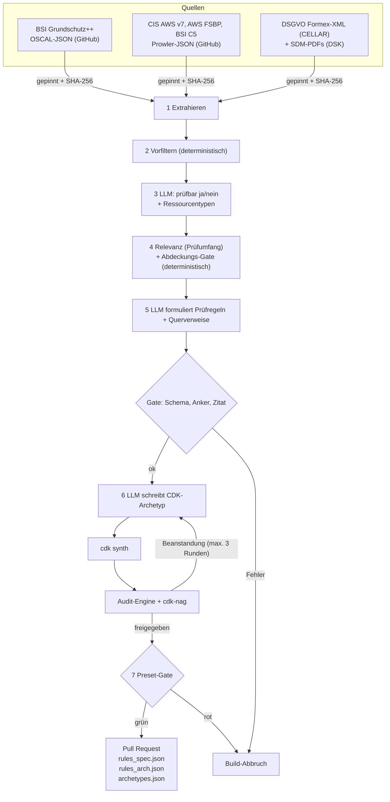
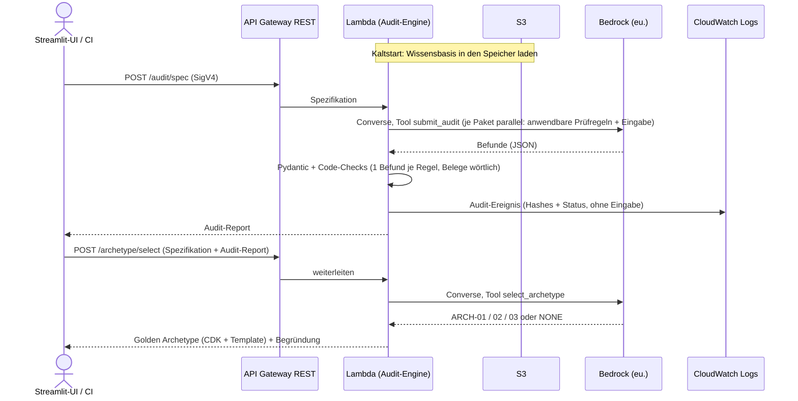
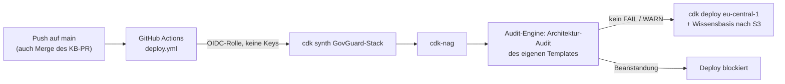
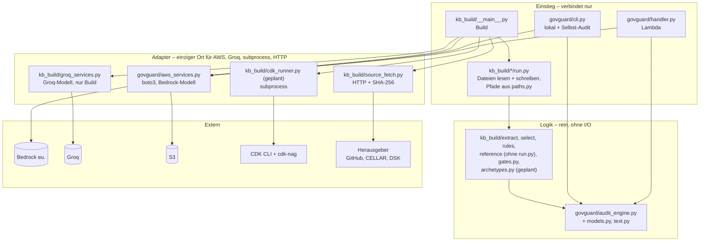

# GovGuard – Big Picture

GovGuard hat zwei Betriebsarten: **Build-Zeit** (Wissensbasis und Golden Archetypes erzeugen) und **Laufzeit** (Audits beantworten). Beide nutzen dieselbe **Audit-Engine**. Begriffe: [CONTEXT.md](../CONTEXT.md), Anforderungen: [SPEC.md](SPEC.md).

## Arbeitsteilung LLM ↔ Code

Testfrage für jede Aufgabe: **Gibt es genau eine richtige Antwort, die sich ohne Sprachverständnis ermitteln lässt?** Ja → Code. Nein → LLM, und danach prüft der Code das Ergebnis.

| Code (deterministisch) | LLM (probabilistisch) |
|---|---|
| zählen, sortieren, nachschlagen, vergleichen | verstehen, bewerten, formulieren |
| Vorfilter, Relevanz, Abdeckung, N/A über das Ressourceninventar | „Ist diese Anforderung prüfbar, und welche Ressourcentypen betrifft sie?“ |
| Primäranker, Querverweis-IDs prüfen, Archetyp-Dateien laden | Prüfregel-Kriterien und Empfehlungen formulieren |
| Zitat steht wörtlich in Quelle/Eingabe? Jede Prüfregel genau ein Befund? | „Verstößt diese Spezifikation gegen Art. 9?“ |
| Gesamtstatus = schlechtester Einzelstatus; N/A, wenn der Ressourcentyp im Template fehlt | Archetyp aus geschlossener Liste wählen |

Das LLM sitzt immer **zwischen zwei Code-Schichten**: Der Code bereitet vor (filtern, auswählen), das LLM urteilt, und der Code kontrolliert (Schema, Vollständigkeit, Zitate). Was der Code schon weiß, erzeugt das LLM nicht. Das hält den Anteil klein, der halluzinieren kann.

## 1. Build-Zeit – Wissensbasis erzeugen (manueller Workflow `build-kb.yml`)



Die Rauten sind **Gates**: automatische Prüfpunkte, an denen Code das Ergebnis des LLM kontrolliert. Fällt etwas durch, bricht der Build ab, und die alte Wissensbasis bleibt aktiv.

Das Build-Skript lädt jede Quelle vom Herausgeber, wie in `data/input/sources.json` festgelegt, und bricht ab, wenn die SHA-256-Prüfsumme nicht stimmt. Quelldateien liegen nie im Repo (ADR 0008). Dann siebt es die Quellen in zwei Stufen: Ein deterministischer Vorfilter wirft offensichtlich Irrelevantes weg, dann entscheidet das LLM je Anforderung, ob sie an einer Spezifikation oder an einem CloudFormation-Template prüfbar ist, und nennt bei Architektur die betroffenen Ressourcentypen. Der Code behält alles, was prüfbar ist und einen Dienst im Prüfumfang betrifft, ohne Obergrenze; jede Entscheidung steht mit Begründung im Auswahlprotokoll (ADR 0011). Erst danach formuliert das LLM daraus Prüfregeln.

Das erste Gate prüft jede Prüfregel in drei Punkten:

| Prüfung | Frage | Schützt vor |
|---|---|---|
| Schema | Passt das JSON zum Pydantic-Modell `Rule` (Pflichtfelder, Typen, erlaubte Werte)? | unvollständigen oder kaputten Regeln |
| Anker | Gibt es Primäranker und Querverweise wirklich in der Quelle (1.3)? | erfundenen Fundstellen, z. B. „DET.3.99“ |
| Zitat | Steht `source_quote` wörtlich im Text der verankerten Anforderung (1.3)? | erfundenem oder umformuliertem Normtext |

Den Primäranker setzt zwar der Code, der Check sichert aber die Extraktion ab. Querverweise schlägt dagegen das LLM vor; hier fängt der Check erfundene IDs ab.

Danach entstehen die Golden Archetypes. Das LLM schreibt CDK-Code, `cdk synth` macht daraus ein CloudFormation-Template, und unsere Audit-Engine sowie cdk-nag prüfen dieses Template. Bei Beanstandungen korrigiert das LLM, höchstens dreimal.

Zum Schluss müssen die 5 Presets ihr festgelegtes Soll-Ergebnis liefern. Nur wenn alle Gates grün sind, öffnet der Workflow einen Pull Request mit der neuen Wissensbasis. Nach S3 gelangt sie erst nach dem Merge, über den normalen Deploy (Abschnitt 3). Jeder Fehler bricht den Build ab, und die alte Version bleibt aktiv.

Der Workflow startet nur manuell: Er kostet viele LLM-Aufrufe, liefert bei jedem Lauf leicht andere Texte, und die Quellen ändern sich selten. Sobald es Archetypen gibt, laufen Kuration und Archetypen immer zusammen, weil die Archetypen gegen die aktuellen Prüfregeln freigegeben werden (1.4). Die Archetypen haben Priorität B (FAHRPLAN).

### 1.1 Sieben: Vorfilter, LLM, Relevanz

Jede Quelle durchläuft dieselben Stufen; nur die Parameter unterscheiden sich. Leitsatz: **Das LLM urteilt, der Code wählt aus.** Eine Obergrenze gibt es nicht (ADR 0011).

| Quelle | Einheit (Anforderung) | ① Vorfilter (Code) | ② LLM-Frage (ja/nein + Begründung) |
|---|---|---|---|
| BSI Grundschutz++ | Control im OSCAL-Katalog, z. B. `DET.3.1` | `modal_verb` ∈ MUSS, SOLLTE, `sec_level` = normal-SdT, Praktik ∈ DLS, BER, DET, KONF, BES, ARCH | „An einer Architektur aus Diensten des Prüfumfangs prüfbar? Welche Ressourcentypen?“ |
| BSI C5:2025 | Kriterium, z. B. `CRY-03.01B` | Bereiche OPS, IAM, CRY, COS, PSS | wie BSI Grundschutz++ |
| CIS AWS v7 | Empfehlung, z. B. `3.1.4` | Kapitel 2 IAM, 3 Storage, 4 Logging, 6 Networking (Security Groups für Aurora) | wie BSI Grundschutz++ |
| AWS FSBP | Control, z. B. `SNS.1` | Dienst (`Service`) gehört zum Prüfumfang, z. B. Lambda, ECS, ECR, ELB, RDS; EC2 wegen der VPC-Controls, Instanzen und Classic LB sortiert die Relevanz aus | wie BSI Grundschutz++ |
| DSGVO | Artikel | Kapitel II–V (Art. 5–49) | „An einer Spezifikation prüfbar?“ |
| SDM | Maßnahme, z. B. `M60.D01` | Bausteine Löschen (M60), Trennen (M50), Zugriffe regeln (M51); alle Ebenen (Daten, Systeme, Prozesse), denn Löschfristen stehen auf Ebene P | „An einer Spezifikation prüfbar?“ |

- **① Vorfilter:** reiner Code auf Metadaten (OSCAL-Props, Kapitel, Bereiche, Dienste, Maßnahmen-IDs). Er ist billig, reproduzierbar und wirft Organisatorisches früh weg. Für jede verworfene Anforderung schreibt er einen festen Begründungssatz ins Auswahlprotokoll.
- **② LLM:** bekommt **eine** Anforderung und den Prüfumfang und antwortet nur ja/nein mit Begründung, bei Architektur zusätzlich mit `cfn_resource_types` (per Tool-Choice, siehe 2.1). Es zählt nicht und wählt nicht aus. Das Urteil wird gecacht (Text-Hash, Prompt-Version, `model_id`); ein neuer Lauf fragt nur neue oder geänderte Anforderungen.
- **Relevanz (Code, nur Architektur):** Es bleiben nur Anforderungen, deren erster (wichtigster) `cfn_resource_type` im Prüfumfang liegt (`data/input/scope.json`): Serverless-Dienste, dazu RDS/Aurora und Fargate (ECS) mit dem, was beide brauchen: VPC-Typen, ECR und ELBv2. Kontoweite Pflichten wie Root-MFA oder CloudTrail fallen damit heraus, denn sie sind an keinem Template entscheidbar.
- **Aufnahme:** Jede prüfbare und relevante Anforderung kommt in den Bounded Catalog. Das Auswahlprotokoll (`verdicts_*.json`) hält für jede Anforderung Ergebnis und Begründung fest (SPEC). Die Liste der aufgenommenen (`selection_spec.json`, `selection_arch.json`) liegt versioniert im Repo; Änderungen zwischen zwei Builds zeigt der Git-Diff.
- **Gates:** Die Pflichtanker der Presets müssen aufgenommen sein, und jede Komponente der Archetypen (Pflicht-Ressourcentypen, 1.4) braucht mindestens eine Prüfregel. Sonst bricht der Build ab.

### 1.2 Prüfregel-Schema

Aus jeder ausgewählten Anforderung formuliert das LLM genau eine Prüfregel (Pydantic-Modell `Rule`). Feldnamen sind englisch, Inhalte deutsch. Beispiel:

```json
{
  "id": "ARCH-CIS-3.1.4",
  "audit_type": "architecture",
  "source": "CIS",
  "primary_anchor": "CIS AWS v7.0.0 3.1.4",
  "source_quote": "Ensure that S3 is configured with 'Block Public Access' enabled",
  "title": "S3 Block Public Access aktiv",
  "compliant_if": "Jeder S3-Bucket hat alle vier Block-Public-Access-Einstellungen aktiv.",
  "violation_if": "Ein Bucket deaktiviert mindestens eine Einstellung.",
  "recommendation": "Am Bucket BlockPublicAccess.BLOCK_ALL setzen.",
  "cfn_resource_types": ["AWS::S3::Bucket"],
  "selection_rationale": "Direkt an der Bucket-Konfiguration im Template prüfbar.",
  "cross_references": [{ "anchor": "BSI GS++ …", "origin": "ai_suggested" }]
}
```

| Feld | Herkunft | Zweck |
|---|---|---|
| `id`, `audit_type`, `source`, `primary_anchor` | Code | Identität und Herkunft – das LLM erfindet hier nichts |
| `source_quote` | LLM, vom Code geprüft | Wörtlicher Auszug aus der Quelle (siehe 1.3) |
| `title`, `compliant_if`, `violation_if`, `recommendation` | LLM | Prüfbare Kriterien für PASS/FAIL und die Abhilfe |
| `cfn_resource_types` | LLM aus Stufe ②, nur Architektur | Für welche CloudFormation-Typen die Regel gilt: Relevanz und N/A durch den Code (siehe 1.1, 2) |
| `selection_rationale` | LLM aus Stufe ② | Warum die Anforderung prüfbar ist |
| `cross_references` | LLM, vom Code geprüft | Bezug auf eine andere Quelle; nur `ai_suggested` (KI-vorgeschlagen), ohne Einfluss auf den Status |

### 1.3 Primäranker

Der Primäranker ist die **eine** Anforderung, aus der eine Prüfregel stammt. Ihn setzt der Code, nicht das LLM, denn er kennt die ID aus Stufe ①. Das Gate prüft zwei Dinge:

| Quelle | Format | Existenz-Check |
|---|---|---|
| BSI | `BSI GS++ DET.3.1` + Commit-SHA des Katalogs | ID existiert im Katalog-JSON |
| CIS | `CIS AWS v7.0.0 3.1.4` | `Id` existiert im Prowler-JSON (fester Commit) |
| DSGVO | `DSGVO Art. 32` (optional Abs./lit.) | `ARTICLE IDENTIFIER="032"` existiert im Formex-XML |
| SDM | `SDM Löschen M60.D01` | Maßnahmen-ID steht im Baustein-Text |
| C5 | `BSI C5 CRY-03.01B` | `Id` existiert im Prowler-JSON (fester Commit) |
| FSBP | `AWS FSBP SNS.1` | `Id` existiert im Prowler-JSON (fester Commit) |

Zusätzlich muss das `source_quote` **wörtlich** im Text genau der verankerten Anforderung stehen. Verglichen wird nach Entfernen von EUR-Lex-Markern wie „►C2“ und **ohne Leerzeichen**, denn pypdf zerteilt Wörter (SDM `M60.S06`: „Protokollie rung“). Der Beleg zur Laufzeit nutzt bewusst dieselbe Funktion (DESIGN 3): Zitat statt Behauptung. Dass ein Treffer dabei über Wortgrenzen gehen kann, nehmen wir in Kauf, denn die Zeichenfolge muss trotzdem lückenlos stimmen. Ist der ganze Text kürzer als 15 Zeichen (SDM `M60.P03`: „Löschkonzept“), muss das Zitat den ganzen Text umfassen. Querverweise müssen existieren und zu einer **anderen** Quelle gehören.

Dieselben Prüfungen laufen schon beim Formulieren als Validator: Das LLM bekommt den Fehler zurück und hat zwei Wiederholungen. Bei Architektur-Regeln prüft er zusätzlich, ob die Kriterien einen Ressourcentyp der Regel nennen und keine vagen Wörter wie „erforderlich“ enthalten. Bleibt ein Entwurf ungültig, bricht der Build ab.

### 1.4 Soll-Ergebnis der Golden Archetypes

Für Presets legt ein Mensch das Soll fest. Für Archetypen ist es **vollautomatisch** und besteht aus drei Bedingungen, die alle erfüllt sein müssen:

1. **Struktur-Soll:** Das Template enthält die Pflicht-Ressourcentypen aus dem Steckbrief des Archetyps (deterministischer Check).
2. **Compliance-Soll:** Jede Architektur-Prüfregel ist PASS oder N/A. N/A setzt hier nur der Code, wenn keiner ihrer `cfn_resource_types` im Template vorkommt (Abschnitt 2). Kommt einer vor, ist N/A **verboten**. So kann das LLM eine unbequeme Regel nicht wegdefinieren.
3. **cdk-nag:** Das Regelpaket AwsSolutions meldet keine Errors außer Ausnahmen aus `data/input/nag_allowlist.json` (ADR 0007). Die Ausnahmen wendet der Code an; der Archetyp-Code darf kein `Validations.of(...).acknowledge(...)` enthalten (Code-Check, cdk-nag 3).

Jeder Archetyp ist eine End-to-End-Kette ab API Gateway mit IAM-Auth; das Portal der Behörde liegt außerhalb (ADR 0009).

| Archetyp | Solutions Constructs | Pflicht-Ressourcentypen |
|---|---|---|
| ARCH-01 Sync REST | `aws-apigateway-lambda`, `aws-lambda-dynamodb` | `AWS::ApiGateway::RestApi`, `AWS::Lambda::Function`, `AWS::DynamoDB::Table` |
| ARCH-02 Antragseingang | `aws-apigateway-lambda`, `aws-lambda-sqs`, `aws-sqs-lambda`, `aws-lambda-s3` | `AWS::ApiGateway::RestApi`, `AWS::Lambda::Function`, `AWS::SQS::Queue`, `AWS::S3::Bucket` |
| ARCH-03 Audit-Log-Archiv | `aws-apigateway-lambda`, `aws-lambda-kinesisfirehose`, `aws-kinesisfirehose-s3` | `AWS::ApiGateway::RestApi`, `AWS::Lambda::Function`, `AWS::KinesisFirehose::DeliveryStream`, `AWS::S3::Bucket` mit `ObjectLockEnabled` |

Startliste der Ausnahmen (Spike mit cdk-nag 3.0.2 und Solutions Constructs 2.105):

| Regel | Ressource | Begründung |
|---|---|---|
| AwsSolutions-COG4 | API-Methoden aller Archetypen | IAM-Auth (SigV4) für Maschine-zu-Maschine statt Cognito-Login; auch im GovGuard-Stack (ADR 0004) |
| AwsSolutions-IAM4 | `BucketNotificationsHandler` (altes ARCH-02 mit `aws-s3-sqs`) | CDK-interne Hilfs-Lambda für S3-Notifications; die verwaltete Policy erlaubt nur Logs. Wird gestrichen, wenn #7 zeigt, dass sie nicht mehr greift (ADR 0009) |
| AwsSolutions-IAM5 | Firehose-Policy `bucket/*` (ARCH-03) | Objektnamen entstehen zur Laufzeit; Rechte auf genau einen Bucket, nur Schreiben |

Die Steckbriefe (Zweck, Constructs, Pflicht-Typen, `resource_types`) sind die einzige feste Vorgabe an das LLM. Die Pflicht-Typen sind die Komponenten für das Abdeckungs-Gate (1.1); `resource_types` sind die Pflicht-Typen plus die Unterressourcen, die jeder serverless CDK-Entwurf mitbringt: `AWS::IAM::Role`, `AWS::IAM::Policy`, `AWS::KMS::Key`, `AWS::Logs::LogGroup`, `AWS::ApiGateway::Stage`, `AWS::ApiGateway::Method` und bei S3-Archetypen `AWS::S3::BucketPolicy`. EC2 gehört nicht dazu: Wir beschränken uns auf serverless. Die Liste ist eine Annahme, bis #7 echte Templates synthetisiert; dann prüfen wir sie dagegen. Sie stammen aus [Behörden Cloud-Referenzarchitekturen Analyse](research/Behörden%20Cloud-Referenzarchitekturen%20Analyse.md). ARCH-01 nutzt DynamoDB statt Aurora (wie das Construct-Mapping im Research-Dokument): DynamoDB On-Demand kostet im Leerlauf 0 €.

## 2. Laufzeit – ein Audit



Beim Kaltstart lädt die Lambda-Funktion die Wissensbasis einmal aus S3 in den Speicher, weitere Aufrufe nutzen sie direkt. Zuerst bestimmt sie das Ressourceninventar der Eingabe: bei CloudFormation und Terraform der Code, bei Freitext ein LLM-Vorlauf mit Beleg je Dienst. Jede Prüfregel ohne passenden Ressourcentyp setzt der Code auf N/A; IAM, KMS und Logs streicht er nie. Die anwendbaren Prüfregeln gehen in Paketen à ca. 10 parallel mit der Eingabe an Bedrock (ADR 0011). Das Modell muss über das erzwungene Tool `submit_audit` antworten (Tool-Choice), es kann also nur strukturiertes JSON liefern, keinen Freitext.

Danach prüft der Code, nicht das Modell, das Ergebnis. Pydantic validiert das Schema, und zusätzlich muss jede Prüfregel genau einen Befund haben und jeder Beleg wörtlich in der Eingabe stehen. Erst dann wird der Gesamtstatus berechnet.

Hat das Spec-Audit kein FAIL, kann der Client in einem zweiten Aufruf einen Golden Archetype anfordern. Das Modell wählt dann nur aus einer geschlossenen Liste: ARCH-01, -02, -03 oder `NONE` (keiner). Das Architektur-Audit (`POST /audit/architecture`) läuft genauso wie das Spec-Audit ab, nur mit den Prüfregeln aus BSI Grundschutz++, BSI C5, CIS und FSBP.

### 2.1 Tool-Choice – wie das Modell zur Struktur gezwungen wird

Die Bedrock Converse API erlaubt, dem Modell „Tools“ anzubieten. Jedes Tool hat einen Namen und ein JSON-Schema für seine Eingabe. Mit `toolChoice` erzwingen wir ein Tool. Das Modell darf dann nicht frei antworten, sondern muss dieses Tool mit schema-konformen Argumenten „aufrufen“. Wir führen dabei nichts aus. **Das Tool ist ein Formular**, und seine Argumente sind unser Ergebnis.

Den Aufruf baut Pydantic AI (ADR 0005): Aus dem Draft-Modell entsteht das Tool-Schema, und weil es nur dieses eine Ausgabe-Tool gibt, sendet das Framework `toolChoice: any`, also „ein Tool ist Pflicht“.

```python
# aws_services.py – einziger Ort mit boto3
model = BedrockConverseModel("eu.anthropic.claude-haiku-4-5-20251001-v1:0")   # EU-Profil, ADR 0001

# audit_engine.py – rein, bekommt das Modell übergeben
audit_agent = Agent(
    output_type=ToolOutput(AuditResponse, name="submit_audit",
                           description="Gib genau einen Befund je Prüfregel ab."),
    instructions=SYSTEM_PROMPT,     # Rolle + Regeln für PASS/WARN/FAIL/N/A
    deps_type=AuditDeps,            # Katalog + Eingabe für die Code-Checks
    retries=1,                      # genau ein Retry, 29-s-Timeout
)
result = audit_agent.run_sync(catalog_and_input, model=model, deps=deps)
```

| Tool | Schema (vereinfacht) | Wo |
|---|---|---|
| `classify_requirement` | `testable: bool`, `rationale: str`, `cfn_resource_types: [str]` (nur Architektur) | Build, Stufe ② |
| `formulate_rule` | LLM-Felder der Prüfregel (siehe 1.2) | Build, Stufe 5 |
| `submit_audit` | `findings: [{rule_id, status: PASS\|WARN\|FAIL\|N/A, evidence, rationale, recommendation}]` | Laufzeit, beide Audits |
| `select_archetype` | `archetype: ARCH-01\|ARCH-02\|ARCH-03\|NONE`, `rationale: str` | Laufzeit, Archetyp-Auswahl |

- **Enums schließen die Antwortmenge:** Das Modell kann keinen Status „OK“ und keinen Archetyp „ARCH-09“ erfinden.
- **Tool-Choice ist kein Beweis:** Das Modell kann trotzdem falsche Werte liefern. Deshalb validiert danach Pydantic, und der Code prüft Vollständigkeit und Belege (`@agent.output_validator`). Bei Fehlern schickt Pydantic AI die Fehlermeldung einmal zurück ans Modell, danach HTTP 502.
- **Was der Code weiß, fragt man das Modell nicht:** Primäranker, Querverweise und Gesamtstatus ergänzt der Code aus der Wissensbasis. Das Modell liefert nur Status, Beleg und Begründung.
- **Modellwahl:** Haiku 4.5 unterstützt erzwungene Tools; Opus 5.5, Sonnet 5.5 und Fable 5.1 lehnen `toolChoice` = `any` bzw. `tool` laut Anthropic-Doku mit HTTP 400 ab. Achtung: Kann ein Modell kein Erzwingen, fällt Pydantic AI still auf `auto` zurück – darum bleibt Haiku 4.5 gesetzt.

## 3. Deployment – GovGuard prüft sich selbst



GovGuard wird selbst mit CDK beschrieben und über GitHub Actions ausgerollt. Die Pipeline meldet sich per OIDC bei AWS an und erhält kurzlebige Rechte, es liegen also keine dauerhaften Zugangsschlüssel in GitHub.

Vor jedem Deploy durchläuft der eigene Stack dieselben zwei Prüfungen wie die Golden Archetypes. Erst prüft cdk-nag deterministisch, mit denselben Ausnahmen, dann prüft die Audit-Engine das Template gegen die Architektur-Prüfregeln. Ein FAIL oder WARN blockiert das Deployment, außer bei einer Ausnahme aus der Allowlist (ADR 0011).

So beweist GovGuard an sich selbst, dass seine Regeln erfüllbar sind (Dogfooding).

Es gibt nur **einen Weg in die Produktion**: `deploy.yml`. Er lädt auch die Wissensbasis aus dem Repo nach S3. Darum liegen die Regeln schon vor dem ersten Deploy bereit, und das Selbst-Audit nutzt immer dieselbe Version, die danach live geht.

## Komponenten

| Komponente | Aufgabe | Technik |
|---|---|---|
| Build-Skript | Wissensbasis und Archetypen erzeugen | Python-Paket `kb_build`, CDK CLI |
| Audit-Engine | Prompt bauen, Bedrock aufrufen, Befunde validieren | Python-Modul, Pydantic, Pydantic AI |
| API | 3 Endpunkte, IAM-Auth, Throttling | API Gateway REST + Lambda |
| Wissensbasis | Prüfregeln und Golden Archetypes | JSON in `data/knowledge_base/` (versioniert), per Deploy nach S3 |
| UI | Eingabe, Ampel, Download | Streamlit Community Cloud (ADR 0004) |
| Audit-Protokoll | ein Ereignis je Aufruf, für Auditoren | CloudWatch Logs, KMS, 365 Tage (ADR 0006) |
| Build-Workflow | manuell: Build-Skript ausführen, PR öffnen | GitHub Actions `build-kb.yml` |
| Deploy-Workflow | bei Push: Selbst-Audit, Deploy, Wissensbasis nach S3 | GitHub Actions `deploy.yml`, CDK |

## Code-Struktur

Ein- und Ausgabe (AWS, externe Programme) und Prüflogik liegen in getrennten Dateien. So bleibt der Kern ohne AWS und ohne CDK testbar. Pfeil = „importiert bzw. ruft auf“.



Von der Logik führt **kein Pfeil** zu den Adaptern. Der Einstieg reicht die Adapter hinein, etwa das Bedrock-Modell (Dependency Injection); Tests reichen Fakes bzw. `TestModel` hinein.

Jeder Ordner auf oberster Ebene ist eine eigene Deployment-Einheit oder eine Datenart. `src/kb_build/` hat je Build-Kommando einen Unterordner, `data/` ist nach Herkunft getrennt:

```
src/govguard/         Laufzeit-Kern, wird zum Lambda-Paket
src/kb_build/         Build-Werkzeug: python -m kb_build (importiert govguard, nie umgekehrt)
  __main__.py         Einstieg; gates.py, paths.py (alle Datenpfade), source_fetch.py, groq_services.py
  extract/            Adapter je Quelle (bsi, cis, c5, dsgvo, fsbp, sdm, prowler), models.py, run.py
  select/             classify, curation, judgement_cache, models.py, run.py
  rules/              formulate, criteria, quality, run.py
  reference/          scope, cfn_types, cfn_properties, archetype_profiles, run.py (cfn-properties)
  cdk_runner.py       geplant: einziger Ort für subprocess
infra/                CDK-App des GovGuard-Stacks
ui/                   Streamlit-App, spricht nur per HTTP mit der API
data/input/           von Hand gepflegt: sources.json (URL, Version, SHA-256, Lizenz; ADR 0008),
                      scope.json (Prüfumfang, ADR 0011), archetype_profiles.json,
                      cfn_resource_types.json, cfn_properties.json, presets/ (5 Presets mit Soll-Ergebnis)
data/intermediate/    Zwischenergebnisse, eingecheckt fürs Review: extracted/ (cis, fsbp, c5 nur lokal),
                      judgement_cache.json, selection_*.json, verdicts_*.json; sources/ = Download-Cache, in .gitignore
data/knowledge_base/  nur das Endergebnis: rules_spec.json, rules_arch.json, archetypes.json (geplant); geht nach S3
tests/                pytest, flach
.github/workflows/    build-kb.yml, deploy.yml
```

- **Adapter für I/O:** Nur `aws_services.py` importiert boto3 und baut das Bedrock-Modell für Pydantic AI, nur `groq_services.py` baut das Groq-Modell für den Build (ADR 0014), nur `cdk_runner.py` startet Prozesse, nur `source_fetch.py` lädt Quellen aus dem Netz. Ein Test prüft alle vier.
- **Keine Logik in Klebe-Code:** Einstiegsdateien und Workflow-YAML verbinden nur. Ein Workflow meldet sich an, ruft `python -m …` auf und öffnet den PR. Derselbe Befehl läuft lokal.
- **src-Layout:** Der CDK-Stack packt mit `Code.from_asset("src/govguard")` genau den Laufzeit-Kern, ohne Build-Code, UI oder Daten.

### Neue Quelle hinzufügen

1. `data/input/sources.json`: URL, Version (Commit oder Tag), SHA-256, Lizenz (ADR 0008).
2. Adapter `src/kb_build/extract/<quelle>.py` mit `extract()` und `prefilter()`. Der Vorfilter gibt `None` zurück oder für jede verworfene Anforderung einen festen Begründungssatz (Auswahlprotokoll). Prowler-Quellen (CIS, FSBP, C5) beschreiben nur ihr `ProwlerFormat` (Anker, Titel, Text, Attribute, Vorfilter); gelesen wird im gemeinsamen Parser `prowler.py`.
3. Je ein Eintrag in `ADAPTERS` (`extract/run.py`) und `SourceName` (`models.py`). In `SELECTIONS` (`select/run.py`) kommt die Quelle zu ihrer Audit-Art.
4. Lizenz: offen → Extrakt einchecken, Vermerk in `NOTICE`; sonst Extrakt in `.gitignore` (CIS, FSBP, C5).
5. Test mit kleinem Fixture: Anzahl, Stichprobe, Vorfilter mit Begründung.

## Endpunkte

| Endpunkt | Eingabe → Ausgabe |
|---|---|
| `POST /audit/spec` | Spezifikation → Audit-Report |
| `POST /audit/architecture` | Architektur → Audit-Report |
| `POST /archetype/select` | Spezifikation + Spec-Audit-Report → Golden Archetype oder „keiner“; abgelehnt bei FAIL |

- Ein Audit wertet die anwendbaren Prüfregeln in parallelen Paketen aus (ADR 0011); Ziel bleibt das 29-s-Timeout. Reicht das nicht, lässt sich das Integrations-Timeout regionaler REST-APIs per Quota-Antrag erhöhen; Plan B ist eine Lambda Function URL.
- `/archetype/select` vertraut dem mitgesendeten Report: vertretbar, weil Archetypen öffentlich und vorab freigegeben sind.
- Scheitert die Validierung, schickt Pydantic AI die Fehlermeldung einmal zurück ans Modell (`retries=1`), danach HTTP 502.

## Kosten

Der eigene Stack verschlüsselt mit einem kundenverwalteten KMS-Schlüssel (CMK), ca. 1 $/Monat; derselbe Schlüssel schützt auch das Audit-Protokoll. Ein Audit-Ereignis (ca. 2 KB) kostet Bruchteile eines Cents. Regel: **0 € Leerlaufkosten** (CONTEXT.md): Im Leerlauf zahlen wir nur für gehaltene Daten und für Sicherheit. Satz für die Verteidigung: „Sicherheit hat einen Preis, und ich kann ihn auf den Cent beziffern.“

## Bekannte Grenzen

- **SDM ohne Protokollieren (M43):** Der Baustein V2.0 hat ein eigenes ID-Schema (`M43.21.04`) ohne Ebenen D/S und führt ungültige Maßnahmen nur durchgestrichen weiter. Er bräuchte einen eigenen Parser und fehlt bewusst; Protokollierung prüft das Architektur-Audit (BSI DET, CIS Kapitel 4).
- **CIS aus zweiter Hand:** Offiziell maschinenlesbar gibt es den Benchmark nur für CIS-Mitglieder. Wir nutzen deshalb das Prowler-JSON, und eine Stichprobe gegen das lokale PDF sichert die Texttreue ab (ADR 0008).
- **DSGVO-Einheit „Artikel“:** Art. 5 ergibt nur eine Prüfregel, obwohl er sechs Grundsätze enthält. Die Grundsätze kommen über das SDM in den Katalog; die SDM-Methode ist genau ihre Operationalisierung (Teil C, „Systematisierung der Anforderungen der DS-GVO durch die Gewährleistungsziele“).
- **Audit-Protokoll nicht revisionssicher:** CloudWatch Logs sind für Admins löschbar, und gespeichert werden nur Hashes und Status, keine Eingaben und vollständigen Reports (ADR 0006). Ein unlöschbarer Speicher für Inhalte widerspräche dem Recht auf Löschung (Art. 17 DSGVO). Die Build-Historie in Git schützt eine Branch Protection auf `main` gegen Force-Push und Löschen; der GitHub Free Plan bietet sie für öffentliche Repos an.
- **Keine kontoweiten Pflichten:** Root-MFA, Passwort-Policy oder ein kontoweiter CloudTrail sind an keinem Template entscheidbar und fehlen bewusst (ADR 0007). Dafür gibt es Werkzeuge wie Prowler oder AWS Security Hub.
- **Stufe ② urteilt per LLM:** Einzelne Fehlurteile sind möglich, z. B. gilt C5 CRY-07.01B (Schlüsselrotation) als „nicht prüfbar“. Die Gates sichern nur Pflichtanker und Abdeckung; die Rotation prüfen weiter CIS 4.6 und FSBP KMS.4. Konto- und Personenpflichten landen teils als „nicht prüfbar“ statt mit festem Satz der Ebene; draußen sind sie in beiden Fällen (#18). *Lösungsansatz:* Gegenprobe gegen die Prowler-Checks der Quelle als Hinweis im Qualitätsbericht, nicht als Gate, denn viele Checks sind kontoweit (C5 OPS-16.01B: MFA für Konsolen-Nutzer, CloudTrail-Bucket).
- **Ressourceninventar:** CloudFormation-JSON und Terraform liest der Code. YAML-Templates mit Kurzformen wie `!Ref` behandelt GovGuard wie Freitext; dort nennt ein LLM-Vorlauf die Dienste mit Beleg, und ein übersehener Dienst steht als „nicht erkannt“ im Befund.
- **Kein X-Ray:** `xray:Put*` erlaubt keine Ressourcen-ARNs und bräuchte eine weitere Ausnahme. In Produktion: X-Ray mit begründeter Ausnahme.
- **Umfang:** Prüfumfang aus Serverless-Diensten plus RDS/Aurora und Fargate; EC2-Instanzen, EKS, CloudTrail, CloudFront und der Classic Load Balancer fehlen bewusst (ADR 0011). Eingaben bis 100.000 Zeichen. Wie GovGuard darüber hinaus wächst, beschreibt [AUSBAU.md](AUSBAU.md).
