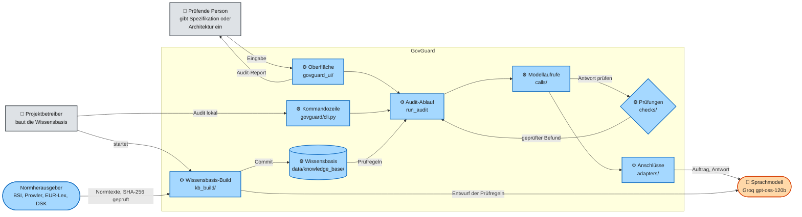
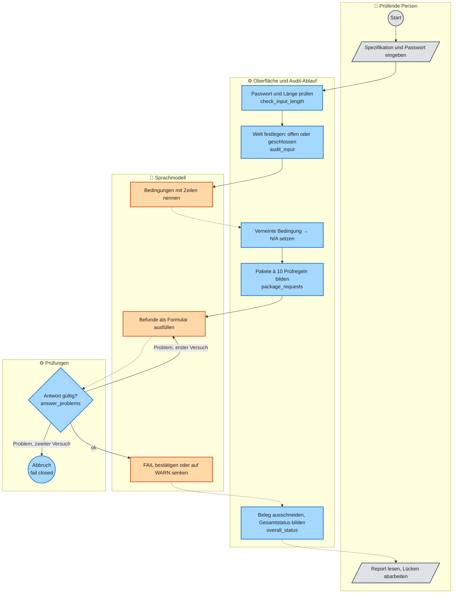
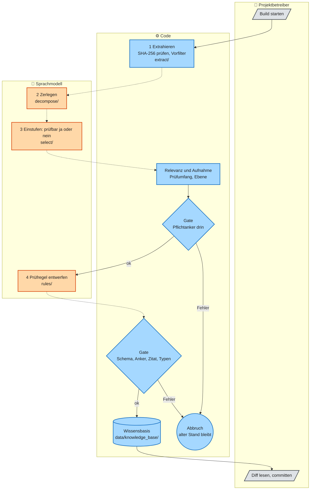
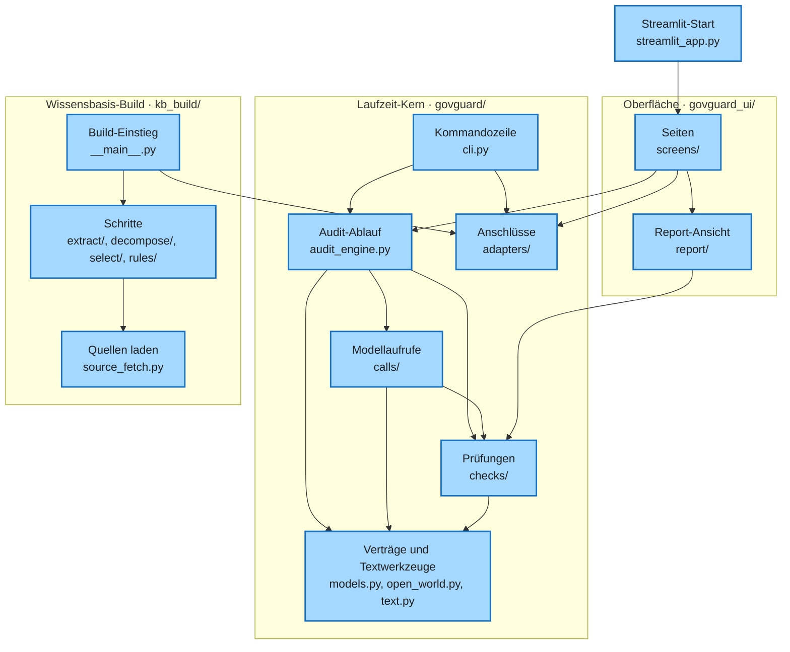
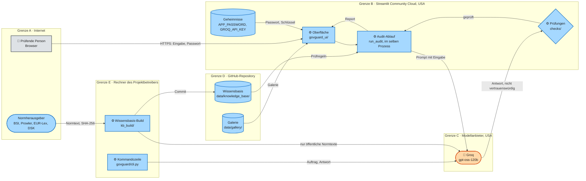

# GovGuard – Architektur in fünf Sichten

GovGuard prüft Spezifikationen und Architekturen von Behörden-Vorhaben und liefert einen Audit-Report mit PASS, WARN, FAIL oder N/A. Dieses Dokument zeigt nur, was gebaut ist, in den fünf Sichten des 4+1-Modells von Philippe Kruchten.

**Zielgruppe:** gemischt, also Hiring Manager und IT-Sicherheitsbeauftragte einer Behörde. Darum zeigt die Prozess-Sicht Swimlanes (Bahnen je Rolle) wie in einem Geschäftsprozess, und jede Sicht beantwortet dieselbe Frage: *Wo antwortet das Modell unsicher, was fängt der Code ab, was ist gemessen?*

**Kernaussage:** Ein Sprachmodell antwortet wahrscheinlichkeitsbasiert. GovGuard lässt es deshalb nur Entwürfe schreiben; Prüfregeln, Belege und Status setzt oder kontrolliert ein deterministischer Code-Rahmen (immer gleiche Antwort bei gleicher Eingabe).

## Lesehilfe

| Sicht | Frage | Abschnitt |
|---|---|---|
| Logische Sicht | Woraus besteht GovGuard, und wer entscheidet was? | [1](#1-logische-sicht) |
| Prozess-Sicht | Was passiert bei einem Audit und bei einem Build? | [2](#2-prozess-sicht) |
| Entwicklungs-Sicht | Wie ist der Code geordnet, wie wird er getestet? | [3](#3-entwicklungs-sicht) |
| Physische Sicht | Wo läuft was, wohin fließen Daten, was kostet es? | [4](#4-physische-sicht) |
| Szenarien (+1) und Qualität | Wie passen die Sichten zusammen, was ist gemessen? | [5](#5-szenarien-1), [6](#6-qualität) |

Begriffe stehen in [CONTEXT.md](../CONTEXT.md), Entscheidungen in [adr/](adr/), Befehle in [ENTWICKLUNG.md](ENTWICKLUNG.md), Pläne für später in [AUSBAU.md](AUSBAU.md). Code und ADRs sind die Wahrheit; ein Drift-Test (`tests/test_architecture_doc_drift.py`) prüft, dass Pfade, Klassen und Namen in diesem Dokument existieren.

**Konventionen in den Diagrammen:** Die Farbe sagt, wer etwas tut, die Form, was es ist.

| Zeichen | Bedeutung | Form |
|---|---|---|
| 🤖 orange | Sprachmodell (probabilistisch) | abgerundet = externes System |
| ⚙️ blau | Code (deterministisch) | Raute = Gate, Zylinder = Speicher |
| 👤 grau | Mensch | Pfeil = Datenfluss oder nächster Schritt |

**Fachwörter**, wie sie hier gebraucht werden:

| Wort | Bedeutung |
|---|---|
| Gate | Ein Gate ist eine Prüfung im Code, die ein Ergebnis nur durchlässt, wenn es eine feste Regel erfüllt. |
| Retry | Ein Retry ist die erneute Frage ans Modell, nachdem der Code die Antwort mit Grund abgelehnt hat. |
| Fail closed | Fail closed heißt: Im Zweifel gibt es kein Ergebnis statt eines falschen. |
| Prüfregel | Eine Prüfregel ist eine einzelne, prüfbare Regel aus genau einer Anforderung einer Norm, mit Kriterien für „konform“ und „Verstoß“. |
| Befund | Ein Befund ist das Ergebnis genau einer Prüfregel in einem Audit, mit Status, Beleg und Empfehlung. |
| Anker | Ein Anker ist die Fundstelle einer Prüfregel in der Norm, etwa „DSGVO Art. 32“; der Code setzt ihn, nie das Modell. |
| Musterfall | Ein Musterfall ist eine fiktive Beispiel-Eingabe mit einem von Hand festgelegten Soll-Ergebnis. |
| Pflichtbefund | Ein Pflichtbefund ist ein Befund, dessen Anker und Status das Soll eines Musterfalls festlegt. |
| Herabstufung | Eine Herabstufung ist der Wechsel von PASS oder FAIL auf WARN durch den Code; der alte Status bleibt am Befund sichtbar. |
| Lücke | Eine Lücke ist ein WARN ohne Zeilen: Die Eingabe beschreibt die Anforderung nicht. |
| Prowler | Prowler ist ein Open-Source-Prüfwerkzeug für AWS, dessen Regelwerke CIS, C5 und FSBP GovGuard als JSON liest. |
| DSK | Die DSK ist die Konferenz der deutschen Datenschutzbehörden und Herausgeberin des SDM. |
| Beleg | Ein Beleg ist der wörtliche Ausschnitt der Eingabe, auf den sich ein Befund stützt. |
| Offene Welt | Offene Welt heißt: Was die Eingabe nicht erwähnt, kann anderswo geregelt sein; Fehlen ist dann nur WARN. |
| Halluzination | Eine Halluzination ist eine Aussage des Modells, die sich gut liest, aber erfunden ist. |
| Prompt Injection | Prompt Injection ist eine Anweisung im Eingabetext, die das Modell statt der eigentlichen Aufgabe befolgt. |
| SHA-256 | SHA-256 ist eine Prüfsumme (Hash), die sich ändert, sobald sich ein Zeichen der Datei ändert. |
| AIC4 | AIC4 ist der Kriterienkatalog des BSI für KI-Cloud-Dienste; er richtet sich an Anbieter, die Modelle trainieren, und wird hier sinngemäß angewandt (Kürzel wie PF-09 nennen ein Kriterium). |
| BSI R und M | Im BSI-Papier „Generative KI-Modelle“ steht R mit Nummer für ein Risiko (R26: direkte Manipulation im Prompt) und M für eine Maßnahme. |
| OWASP | OWASP ist eine gemeinnützige Sicherheitsorganisation; ihre Top 10 for LLM Applications (LLM01 bis LLM10) nennen die wichtigsten Risiken für Anwendungen mit Sprachmodell. |
| C4, BPMN | C4 ist eine Methode, ein System in Zoomstufen zu zeichnen; BPMN ist die Standardnotation für Geschäftsprozesse, hier mit Swimlanes angenähert. |
| Streamlit, Pydantic AI | Streamlit ist ein Python-Werkzeug für Web-Oberflächen; Pydantic AI ist die Bibliothek, die Antwortformular, Validator und Retry für den Modellaufruf übernimmt ([0005](adr/0005-pydantic-ai.md)). |

## 1 Logische Sicht

**Zielgruppe:** alle Leser. **Kernaussage:** Das Modell ist ein Baustein mit klar begrenzter Aufgabe; alles, was über Status, Beleg und Vollständigkeit entscheidet, ist Code.

GovGuard hat zwei Audits: Das Spec-Audit prüft eine Spezifikation gegen DSGVO, KI-VO und SDM, das Architektur-Audit eine Architektur gegen BSI Grundschutz++, BSI C5, CIS AWS und AWS FSBP. Der Katalog hat 350 Prüfregeln für Spezifikationen (DSGVO 169, SDM 116, KI-VO 65) und 175 für Architekturen (FSBP 105, BSI 39, CIS 20, C5 11).

Die Quellen in einem Satz je Quelle: DSGVO ist das EU-Datenschutzgesetz. KI-VO ist das EU-Gesetz für KI-Systeme. SDM ist das Standard-Datenschutzmodell der deutschen Datenschutzbehörden. BSI Grundschutz++ ist der maschinenlesbare IT-Grundschutz des BSI, und C5 sein Kriterienkatalog für Cloud-Dienste. CIS AWS ist eine Härtungsempfehlung, AWS FSBP sind die Sicherheitsregeln von AWS je Dienst.



Das Diagramm ist eine vereinfachte Container-Sicht nach C4 (Zoomstufe: die einzeln ausgelieferten Teile). Die Raute **Prüfungen** ist das Gate: Keine Modellantwort erreicht den Report, ohne dort durchzukommen.

| Baustein | Aufgabe | im Code |
|---|---|---|
| **Oberfläche** | Passwort und Länge prüfen, Audit starten, Report und Galerie zeigen | `govguard_ui/screens/`, `govguard_ui/report/` |
| **Kommandozeile** | startet ein Audit lokal mit Groq oder Bedrock; Exit 1 (Eingabe zu lang), 2 (fail closed), 3 (Schlüssel fehlt) | `govguard/cli.py` |
| **Audit-Ablauf** | Prüfregeln in Pakete teilen, Vorläufe und Prüfer aufrufen, Gesamtstatus bilden | `govguard/audit_engine.py` |
| **Modellaufrufe** | alle vier Fragen ans Modell der Laufzeit (2.2), samt Retry | `govguard/calls/` |
| **Prüfungen** | reine Funktionen, die jede Antwort kontrollieren und Beleg ausschneiden | `govguard/checks/` |
| **Wissensbasis** | die festen Prüfregeln, als JSON im Repo | `data/knowledge_base/` |
| **Anschlüsse** | einziger Ort für Groq und Bedrock (boto3) | `govguard/adapters/` |
| **Wissensbasis-Build** | erzeugt aus Normtexten die Prüfregeln (2.4) | `kb_build/` |
| **Sprachmodell** | extern, wird nur über die Anschlüsse erreicht | `govguard/adapters/groq_services.py` |

### 1.1 Entwurfsprinzipien

Ein Prinzip ist eine Regel, die viele Einzelentscheidungen erklärt. Diese acht tragen GovGuard. Sechs sind im Code erzwungen oder getestet; Prinzip 7 ist sichtbar (jeder Report nennt sein Modell), aber nicht erzwungen, Prinzip 8 ist eine Betriebsentscheidung.

| # | Prinzip | Warum ([ADR](adr/)) | im Code |
|---|---|---|---|
| 1 | *Das Modell entwirft, der Code entscheidet.* Was der Code schon weiß, fragt man das Modell nicht. | Der Teil, der halluzinieren kann, bleibt klein ([0005](adr/0005-pydantic-ai.md)). | `FindingDraft`, `RuleDraft`, `checks/` |
| 2 | *Fester Katalog statt Suche.* Jede Prüfregel bekommt genau einen Befund. | Ein Audit mit Lücke ist wertlos ([0011](adr/0011-vollstaendiger-katalog.md)). | `RuleCatalog`, `completeness_problems` |
| 3 | *Fail closed.* Nach einem Retry bricht das Audit ab (Exit 2); nur ein unbelegtes PASS wird zu WARN. | Ein falscher Report ist schlimmer als keiner ([0017](adr/0017-beleg-per-zeilenverweis.md)). | `AuditValidationError`, `fail_closed` |
| 4 | *Beleg statt Behauptung.* Das Modell nennt Zeilen, der Code schneidet das Zitat aus; FAIL nur bei Festlegung. | Ein Befund muss nachprüfbar sein ([0017](adr/0017-beleg-per-zeilenverweis.md), [0020](adr/0020-fail-nur-bei-festgelegtem-verstoss.md)). | `evidence_of`, `judge_fails` |
| 5 | *Workflow statt Agent.* Die Reihenfolge steht im Code. | Kein Modell wählt den nächsten Schritt ([0021](adr/0021-kein-orchestrierungs-framework.md)). | `run_audit` |
| 6 | *Anschlüsse (Adapter) als einziger Weg nach außen.* | Die Prüflogik bleibt ohne Netz testbar ([0027](adr/0027-ordner-nach-aufgabe.md)). | `adapters/`, `source_fetch.py` |
| 7 | *Daten in der EU, jede Ausnahme sichtbar.* | Drittlandtransfer braucht Grund und Hinweis ([0001](adr/0001-eu-inferenzprofil.md), [0016](adr/0016-groq-zur-laufzeit-im-prototyp.md)). | `model_id` |
| 8 | *0 € Leerlauf.* Kein AWS-Betrieb, nur ein Audit kostet Geld. | Budget ([0023](adr/0023-demo-und-recruiter-stand.md)). | `streamlit_app.py` |

Prinzip 7 gilt für echte Daten; die Demo verarbeitet nur fiktive Daten und sagt es in der Oberfläche (4.2).

### 1.2 Datentypen eines Reports

Ein Report enthält genau einen Befund je Prüfregel (Report `AuditReport`, Befund `Finding`, Prüfregel `Rule`). Das Modell liefert nur den Entwurf, alles andere schreibt der Code; der fertige Befund erbt vom Entwurf (`Finding(FindingDraft)`) und ergänzt, was der Code schon weiß.


| Was | Wer schreibt | im Code |
|---|---|---|
| Antwort des Modells und Entwurf je Prüfregel (Status, Zeilenbereich, Begründung) | 🤖 Modell | `AuditResponse`, `FindingDraft` |
| fertiger Befund mit Beleg, Anker, Herabstufung und Korrekturen | ⚙️ Code | `Finding` |
| Report mit Gesamtstatus, Modell und Rückverfolgung (nur Hashes, nie der Eingabetext) | ⚙️ Code | `AuditReport`, `Trace` |

### 1.3 Fester Katalog statt Suche

RAG (Retrieval-Augmented Generation) holt per Ähnlichkeitssuche nur die passendsten Textstücke in den Prompt; das beantwortet „Was steht zu X?“. Ein Audit fragt „Erfüllt X alle Regeln?“. Darum ist der Katalog fest (Bounded Catalog, [ADR 0011](adr/0011-vollstaendiger-katalog.md)).

| Kriterium | RAG | Fester Katalog |
|---|---|---|
| Vollständigkeit | nicht garantiert; eine unähnliche Regel fällt unbemerkt heraus | vom Code garantiert, ein Befund je Prüfregel |
| Leerlauf | die Vektor-Datenbank läuft weiter | 0 €, eine JSON-Datei |
| Nachvollziehbarkeit | Auswahl je Anfrage verschieden | Auswahlprotokoll im Git |

> **Concern (LLM-Unsicherheit):** *Unsicher:* Das Modell kann Belege erfinden oder auf die falsche Zeile zeigen (OWASP LLM09 Misinformation). *Schale:* Es füllt nur ein Formular mit festen Status-Werten, hat keine Werkzeuge und keine Schreibrechte (LLM06, AIC4 PF-09); den Beleg schneidet der Code aus der Eingabe (AIC4 DM-03). *Gemessen:* 0 umformulierte Belege in 4 Messläufen (QS-1); ein falsches PASS hat keinen Zweitprüfer (6.3).

> **Concern (Regulatory):** GovGuard liefert Hinweise für Fachleute, keinen Nachweis und keine Freigabe. Die Trefferquote gegen eine Fachprüfung ist nie erhoben worden (6.3).

## 2 Prozess-Sicht

**Zielgruppe:** Fachbereich, Betrieb, Sicherheit. **Kernaussage:** Jeder Schritt, der das Modell fragt, wird von einem Schritt im Code vorbereitet und kontrolliert; ohne gültige Antwort entsteht kein Report.

Die Diagramme sind Swimlanes: Jede Bahn ist eine Rolle (Mensch, Code, Modell). Sie nähern BPMN (die Standardnotation für Geschäftsprozesse) mit Mermaid an; Ereignisse an Rändern und Kompensation sind nicht dargestellt.

### 2.1 Audit: von der Eingabe zum Report



Durchgezogener Pfeil = Ablauf in einer Bahn oder Übergabe, gestrichelt = Nachricht zwischen Bahnen. Der Verstoß-Prüfer (letzter Modellschritt) läuft nur in der offenen Welt und nur für FAILs.

| Schritt | Was | Warum | im Code |
|---|---|---|---|
| Vorlauf | Das Modell nennt je Bedingung Zeilen; nur ein ausdrückliches Nein setzt Prüfregeln auf N/A. Fällt es aus, bleiben alle Bedingungen „nicht erwähnt“ (`unstated`). | Pflichten, die nie gelten, kosten keine Lücke ([0028](adr/0028-bedingungen-im-spec-audit.md)). | `find_conditions` |
| Pakete | Je 10 Prüfregeln mit nummerierter Eingabe, höchstens 2 Pakete gleichzeitig (Groq-Limit je Minute). | Der volle Katalog bleibt im Zeit- und Token-Limit. | `package_requests`, `GROQ_MAX_PARALLEL` |
| Verstoß-Prüfer | Ein Aufruf sieht je FAIL nur Verstoßkriterium und Belegzeilen; fällt er aus, bleibt das FAIL. | Ein FAIL aus Schweigen wäre ein Fehlalarm ([0020](adr/0020-fail-nur-bei-festgelegtem-verstoss.md)). | `judge_fails` |
| Report | Der Code schneidet den Beleg und bildet den Gesamtstatus: FAIL vor WARN vor PASS vor N/A. | Beleg per Konstruktion wörtlich ([0017](adr/0017-beleg-per-zeilenverweis.md)). | `evidence_of`, `overall_status` |

**Variante Architektur-Audit:** Bei CloudFormation-JSON liest der Code die Ressourcentypen selbst (Ressourceninventar) und setzt nicht anwendbare Prüfregeln auf N/A; die Welt ist geschlossen, eine fehlende Einstellung kann FAIL sein. Bei Freitext, YAML und Terraform nennt das Modell die Typen mit Zeilenverweis, die Welt bleibt offen ([0015](adr/0015-cloudformation-einziges-inventarformat.md)).

> **Concern (LLM-Unsicherheit):** *Unsicher:* Jede Antwort kann ungültig, unvollständig oder zu lang sein. *Schale:* Pro Paket läuft eine feste Kette aus Schema-, Vollständigkeits- und Zeilenprüfung (AIC4 DQ-02); ein Fehler geht mit Grund einmal zurück (`RETRIES = 1`), danach bricht das Audit ab; nur ein PASS ohne Beleg wird stattdessen zu WARN. 100.000 Zeichen, 1 Retry und höchstens 8.000 Ausgabe-Tokens begrenzen die Kosten (LLM10). *Gemessen:* In 19 Läufen gab es einen Abbruch, und der war ein HTTP 400 von Groq ohne Retry, kein ausgeschöpfter Retry (QS-2). Ein Mensch prüft im Ablauf nicht; die Oberfläche zeigt aber jede Herabstufung (AIC4 RE-04).

### 2.2 Ein Modellaufruf und die acht Aufrufe

Jeder Aufruf hat dieselbe Form: Der Code baut den Auftrag mit nummerierter Eingabe (`12| …`), das Modell füllt ein Formular, und der Code prüft es. Die Temperatur (der Regler für das Würfeln des Modells) steht überall auf 0; das macht Antworten gleichförmiger, aber nicht gleich (QS-3).

| Laufzeit-Aufruf | Prüfung durch Code | Retry und Rückfall | Prompt (im Code) |
|---|---|---|---|
| Paket der Prüfregeln | ein Befund je Regel, gültiger Zeilenbereich, PASS braucht Beleg | 1 Retry; danach wird ein PASS ohne Beleg zu WARN, jedes andere Problem bricht ab (fail closed) | `SYSTEM_PROMPT` in `calls/audit_packages.py` |
| Verstoß-Prüfer | jedes FAIL hat ein Urteil | 1 Retry, dann bleibt das FAIL | `FAIL_JUDGE_PROMPT` in `calls/fail_judge.py` |
| Ressourceninventar (Freitext) | Typ steht in der Liste, Zeilen gültig | 1 Retry, dann fail closed | `INVENTORY_PROMPT` in `calls/inventory.py` |
| Bedingungs-Vorlauf (Spec) | jede Bedingung einmal, bekannte IDs, Zeilen gültig | 1 Retry, dann alle `unstated` | `CONDITIONS_PROMPT` in `calls/conditions.py` |

| Build-Aufruf | Prüfung durch Code | Retry und Rückfall |
|---|---|---|
| Zerlegung eines Rechtsartikels | jeder Abschnitt genau einer Gruppe | 4 Retries, dann bleibt der Artikel ganz (`llm_error`) |
| Einstufung „prüfbar“ | Typen gibt es wirklich, außerhalb des Prüfumfangs gestrichen | 2 Retries, dann `llm_error` |
| Prüfregel formulieren | Zitat wörtlich, Querverweise echt, Typen im Prüfumfang | 6 Retries, dann bricht der Build ab |
| Verstoß-Prüfer des Builds | Verstoßkriterium beschreibt eine Festlegung, kein Fehlen | 2 Retries, dann bricht der Build ab |

### 2.3 Lebenslauf eines Befunds

| Zustand | Wer | Übergang |
|---|---|---|
| Vorab-N/A | ⚙️ Code | Bedingung verneint oder Ressourcentyp fehlt im Inventar: nie ans Modell ([0028](adr/0028-bedingungen-im-spec-audit.md)) |
| Entwurf (`FindingDraft`) | 🤖 Modell | Paket geht ans Modell; Antwort als Formular |
| Bereinigt | ⚙️ Code | Doppelte auf den schwersten Status, Empfehlung aus der Prüfregel ergänzt (`worst_of_duplicates`, `with_rule_recommendations`) |
| Gate | ⚙️ Code | Problem im ersten Versuch → zurück ans Modell mit Grund; im zweiten → Abbruch fail closed; kein Problem → Status gilt |
| Zweite Meinung | 🤖 Modell | nur FAIL in offener Welt: bestätigt oder kein Urteil → FAIL, nicht bestätigt → WARN |

Der alte Status einer Herabstufung bleibt am Befund sichtbar (`downgraded_from`). Ein PASS ohne gültigen Beleg wird nach dem Retry zu WARN, ein FAIL ohne Zeilenbereich sofort (`without_unproven_verdict`).

> **Concern (LLM-Unsicherheit):** *Unsicher:* Der Verstoß-Prüfer ist selbst ein Modell und nicht reproduzierbar ([0020](adr/0020-fail-nur-bei-festgelegtem-verstoss.md)). *Schale:* Er senkt nur und hebt nie; fällt er aus, bleibt das FAIL. Alle drei Rückfälle (Vorlauf, unbelegtes PASS, Prüfer) gehen zum vorsichtigeren Status und können kein falsches PASS erzeugen. *Gemessen:* beim Wohngeld-Musterfall stufte er in 3 Läufen 3 von 4, 6 von 10 und 8 von 9 FAILs auf WARN herab (QS-5, #54).

### 2.4 Build: aus Normtexten wird die Wissensbasis

Der Build läuft lokal und von Hand (`python -m kb_build <Schritt>`), weil er viele Modellaufrufe kostet und bei jedem Lauf leicht andere Texte liefert. Er schickt nur öffentliche Normtexte an Groq ([0014](adr/0014-groq-standard-im-build.md)).



Das Modell urteilt nur über „prüfbar“ und schreibt Entwürfe; Aufnahme, Anker und Zitat-Check entscheidet der Code. Ein Pflichtanker ist der Anker einer Prüfregel, deren Befund ein Musterfall im Soll festlegt; fehlt er im Katalog, bricht das Gate ab ([0022](adr/0022-pflichtanker-uebersteuern-die-ebene.md)). Die Zerlegung gruppiert die Abschnitte von DSGVO und KI-VO; nach 4 Retries bleibt der Artikel ganz ([0026](adr/0026-rechtsartikel-zerlegen.md)).

> **Concern (LLM-Unsicherheit):** *Unsicher:* Der Build entwirft den Katalog, den jedes Audit benutzt; ein Fehler wirkt in jedem Audit, und der Verstoß-Prüfer des Builds ist ein Modell, das ein Modell prüft. *Schale:* Das Gate prüft Zitat (`is_quoted`), Anker und Typen gegen die Quelle; danach liest ein Mensch den Git-Diff. *Gemessen:* Bei Prompt- oder Modellwechsel wechseln rund 10 % der Auswahl ([0014](adr/0014-groq-standard-im-build.md)); die SDM-Regeln sind eingefroren ([0025](adr/0025-ki-vo-als-neue-quelle-bei-eingefrorenem-katalog.md)).

## 3 Entwicklungs-Sicht

**Zielgruppe:** Entwickler, Prüfer des Codes. **Kernaussage:** Ein Ordner ist eine Aufgabe, und ein Test hält die Richtung der Importe fest; so lässt sich der Prüfrahmen ohne Modell testen.

### Code-Struktur

Ein- und Ausgabe (AWS, Groq, Netz) und Prüflogik liegen in getrennten Dateien. So bleibt der Kern ohne AWS und ohne Netz testbar.

```
src/govguard/        Laufzeit-Kern: calls/ (spricht mit dem Modell), checks/ (rein), adapters/ (boto3, Groq)
src/kb_build/        Build-Werkzeug, je Schritt ein Ordner: extract, decompose, select, rules, reference
src/govguard_ui/     Oberfläche: screens/ (Seiten), report/ (Report-Ansicht)
data/input/          von Hand gepflegt: Quellenliste, Prüfumfang, Bedingungen, 6 Musterfälle
data/knowledge_base/ nur das Endergebnis: rules_spec.json, rules_arch.json
data/gallery/        gespeicherte Reports der Musterfälle, wächst nur per Commit
```



Pfeil = „importiert“. Jede Komponente darf die Verträge importieren; die Pfeile dorthin fehlen, damit das Bild lesbar bleibt. Das Gruppierungskriterium wählt jedes Paket selbst ([ADR 0027](adr/0027-ordner-nach-aufgabe.md)): im Kern die Art des Moduls, in der Oberfläche die Verwendung, im Build der Prozessschritt.

| Regel | Warum | im Code (Test) |
|---|---|---|
| Prüfungen (`checks/`) importieren nie Modellaufrufe (`calls/`) oder Anschlüsse (`adapters/`) | Prüfungen bleiben ohne Modell testbar | `test_checks_import_neither_calls_nor_adapters` |
| Die Report-Ansicht (`report/`) importiert nie eine Seite (`screens/`) | Seiten nutzen die Ansicht, nie umgekehrt | `test_the_report_view_imports_no_screen` |
| boto3, Groq und HTTP nur im eigenen Anschluss, `subprocess` nirgends | ein Ort je Außenkontakt ([0019](adr/0019-nur-audits.md)) | `test_io_imports_only_in_their_adapter` |
| Die Oberfläche lädt weder Kommandozeile noch Bedrock-Anschluss | die Demo läuft ohne AWS ([0023](adr/0023-demo-und-recruiter-stand.md)) | `test_demo_ui_loads_no_aws_and_no_entry_point` |
| Laufzeit-Kern und Oberfläche importieren nie den Build | der Build ist ein Werkzeug | `test_the_runtime_never_imports_the_build` |
| Ein Modul = eine Aufgabe, ca. 200 Zeilen, eine Funktion ca. 30 | klein und verteidigbar; ruff und Test prüfen | `test_modules_stay_small` |

Alle Tests liegen in `tests/test_architecture.py`; Workflow-YAML enthält keine Logik, nur `python -m …`.

### 3.1 Testen, wenn die Antwort nicht immer gleich ist

Getestet wird auf zwei Ebenen. Die erste ist der Code mit einem Testmodell: Der Audit-Ablauf (`run_audit`) bekommt das Modell als Parameter. Das heißt Dependency Injection: Eine Funktion bekommt ihre Werkzeuge übergeben, statt sie selbst zu bauen. Ein programmierbares Testmodell (`FunctionModel` aus Pydantic AI) liefert gültige Antworten oder gezielt Fehler, etwa einen unbekannten Zeilenbereich; so sind alle Gates ohne Netz und ohne Kosten prüfbar.

Die zweite Ebene ist das echte Modell gegen ein Soll von Hand an sechs Musterfällen (`data/input/presets/`, `tests/test_presets.py`). Ein Mensch legt nur Gesamtstatus und wenige Pflichtbefunde fest, nie aus einem früheren Lauf. Abweichungen zeigt die Oberfläche, sie würfelt nicht nach ([0023](adr/0023-demo-und-recruiter-stand.md)).

> **Concern (LLM-Unsicherheit):** *Unsicher:* Ein Prompt- oder Modellwechsel ändert Urteile unvorhersehbar. *Schale:* Prompts (`SYSTEM_PROMPT` in `calls/audit_packages.py`), Schemas (`models.py`) und Validatoren (`checks/`) sind getrennte Module mit eigenen Tests (AIC4 PF-06); ein Wechsel gilt als Änderung mit Messlauf (`/audit-messen`). *Gemessen:* Die sechs Musterfälle sind die Referenzmenge, ein getrenntes Entwicklungsset gibt es nicht (6.3). Ein Musterfall mit Anweisungen im Text fehlt (AIC4 SR-05, LLM01).

> **Concern (Security):** Abhängigkeiten sind in `uv.lock` fixiert, Quellen mit URL, Version und SHA-256 gepinnt; eine Abweichung bricht den Build ab ([0008](adr/0008-quellformate.md)). Ein SBOM oder einen Schwachstellen-Scan in der CI gibt es nicht.

### 3.2 Regeln in Klartext: wo erzwingt der Code sie?

Jede Regel ist ein Vertrag nach Design by Contract. Bricht die Vorbedingung (Eingabe zu lang, `InputTooLongError`), ist der Aufrufer schuld, und die Kommandozeile endet mit Exit 1. Bricht die Nachbedingung (Antwort auch nach dem Retry ungültig, `AuditValidationError`), ist das Modell als Lieferant schuld, und das Audit bricht mit Exit 2 ab (fail closed).

| Regel in Klartext | im Code | Test |
|---|---|---|
| Ein Report hat genau einen Befund je Prüfregel. | `completeness_problems` (`checks/audit_gates.py`) | `tests/test_run_audit.py` |
| Ein PASS braucht einen Zeilenbereich in der Eingabe: höchstens 200 Zeilen, mindestens 15 Zeichen. | `evidence_problem`, `range_problem` (`checks/evidence.py`) | `tests/test_evidence.py` |
| Ein FAIL ohne Zeilenbereich wird WARN; ein PASS ohne Beleg nach dem Retry ebenfalls. | `without_unproven_verdict` | `tests/test_run_audit_corrections.py` |
| Der Beleg ist wörtlich, weil der Code ihn aus der Eingabe schneidet. | `evidence_of` | `tests/test_run_audit.py` |
| Bei Doppelbefunden gilt der schwerste Status; fehlt die Empfehlung, nimmt der Code die der Prüfregel. | `worst_of_duplicates`, `with_rule_recommendations` | `tests/test_run_audit_repairs.py` |
| Bei anwendbaren Prüfregeln darf das Modell kein N/A vergeben. | `answer_problems` (`na_forbidden`) | `tests/test_run_audit_template.py` |
| Der Gesamtstatus ist der schlechteste Status; nur lauter N/A gibt N/A. | `overall_status`, `SEVERITY` | `tests/test_overall_status.py` |
| Ob die Welt offen oder geschlossen ist, entscheidet der Code. | `audit_input` (`open_world.py`) | `tests/test_run_audit_open_world.py` |
| Ein FAIL in offener Welt braucht den Verstoß-Prüfer; lehnt er ab, wird es WARN; fehlt sein Urteil, bleibt das FAIL. | `judge_fails` | `tests/test_run_audit_fail_judge.py` |
| Nur eine ausdrückliche Verneinung setzt Prüfregeln auf N/A; Schweigen oder Ausfall bleibt `unstated`. | `condition_results`, `na_drafts` (`checks/conditions.py`) | `tests/test_conditions_checks.py` |
| Eine Eingabe über 100.000 Zeichen kostet keinen Modellaufruf. | `check_input_length` | `tests/test_run_audit_input_limit.py` |
| Eine ungültige Antwort geht einmal zurück, danach bricht das Audit ab (Ausnahme: ein unbelegtes PASS wird WARN). Lehnt Groq den Aufruf selbst mit HTTP 400 ab, gibt es keine Antwort zum Zurückschicken, und das Audit bricht sofort ab. | `send_back` (`calls/model_call.py`), `fail_closed` | `tests/test_run_audit_corrections.py` |
| Im Build steht das Zitat wörtlich im Text genau der verankerten Anforderung; Querverweise gibt es wirklich. | `is_quoted`, `invalid_cross_references` (`kb_build/rules/gates.py`) | `tests/test_gates.py` |
| Jeder Pflichtanker steht im Katalog, jeder Pflicht-Ressourcentyp der Referenzarchitekturen hat eine Prüfregel. | `check_pinned`, `check_coverage` (`kb_build/select/gates.py`) | `tests/test_gates.py` |
| Die Rückverfolgung enthält nur Hashes, nie die Eingabe. | `make_trace` (`govguard/audit_setup.py`) | `tests/test_cli.py`, `tests/test_models.py` |

### 3.3 Wartung

Eine neue Quelle heißt neuer Hash in `data/input/sources.json`, dann die Build-Schritte; der Git-Diff zeigt, was sich ändert. Die Prompt-Fassung steckt im Cache-Schlüssel der Einstufung und Zerlegung, ein neues Modell würfelt die Auswahl neu. Schritte und Befehle stehen in [ENTWICKLUNG.md](ENTWICKLUNG.md).

## 4 Physische Sicht

**Zielgruppe:** Betrieb, Sicherheit, Datenschutz. **Kernaussage:** Die Demo läuft ohne AWS; Hosting und Modellanbieter sind beide in den USA, darum verarbeitet sie nur fiktive Daten.

Streamlit Community Cloud ist ein kostenloser Hosting-Dienst für Streamlit-Apps; Groq ist ein Anbieter, der offene Modelle als Dienst betreibt. Eine Vertrauensgrenze ist eine Linie, an der Daten von jemandem kommen, dem man nicht voll vertraut. Das Verteilungsbild ist ein Mermaid-Flowchart statt eines PlantUML-Deployment-Diagramms, weil GitHub nur Mermaid rendert.



Die Wissensbasis wird nicht deployt, sondern mit dem Code aus dem Repository gelesen; ein Build endet mit einem Commit. Die Kommandozeile kann mit `--provider bedrock` auch Bedrock im EU-Profil `eu.` ansprechen ([0001](adr/0001-eu-inferenzprofil.md)); dieser Weg ist gebaut, aber mit dem heutigen Katalog nie gelaufen.

### 4.1 Datenort und Aufbewahrung

GovGuard speichert die Eingabe nicht; sie lebt nur in der Sitzung. Der Report enthält die Eingabe nicht als Ganzes, aber Belege (wörtliche Ausschnitte, höchstens 200 Zeilen je Befund) und Begründungen; nur die Rückverfolgung (`Trace`) trägt ausschließlich Hashes.

| Ort | Was liegt dort | Hinweis |
|---|---|---|
| Streamlit Community Cloud, USA | Oberfläche, Audit im Prozess, Geheimnisse | Drittland; fiktive Daten und Hinweis in der Oberfläche ([0004](adr/0004-streamlit-community-cloud.md)). Welche Zugriffs- oder App-Logs Streamlit führt und wie lange, nennt die Trust-and-Security-Doku des Dienstes nicht; nicht geprüft, Restrisiko |
| Groq, USA | Prompt mit Eingabe, Antwort | laut Doku des Anbieters bis zu 30 Tage Protokoll zur Fehlersuche; „Zero Data Retention“ ist einschaltbar, im Konto nicht geprüft |
| GitHub | Wissensbasis, Galerie, Code | Galerie nur mit fiktiven Eingaben |

Ein Auftragsverarbeitungsvertrag mit Hosting und Groq ist nicht geprüft; für fiktive Daten ist er nicht nötig, für echte Daten fehlt der Rechtsrahmen.

> **Concern (GDPR):** Mit Groq und US-Hosting ist jeder Aufruf ein Drittlandtransfer (Art. 44 DSGVO), akzeptiert nur wegen fiktiver Daten ([0016](adr/0016-groq-zur-laufzeit-im-prototyp.md)). „Nur fiktive Daten“ lässt sich technisch nicht erzwingen. Jeder Report nennt sein Modell (`model_id`). Für echte Daten gilt wieder: Inferenz nur in der EU.

> **Concern (LLM-Unsicherheit):** *Unsicher:* Das Modell läuft beim externen Anbieter; mit jedem Aufruf verlassen Eingabe und Prüfregeln die Vertrauenszone (AIC4 DM-02, OWASP LLM02). *Schale:* Der Groq-Schlüssel liegt nur in den Streamlit-Einstellungen, kein Endnutzer erreicht das Modell direkt. Bei HTTP 429 (Drosselung) wiederholt das Groq-SDK bis zu 6-mal mit Wartezeit (`MAX_RETRIES` in `adapters/groq_services.py`, OWASP LLM10); fällt Groq aus oder bleibt die Drosselung, endet das Audit fail closed; ein Ersatzmodell gibt es nicht (AIC4 RE-06). *Gemessen:* nichts zu Ausfällen; welches Modell lief, steht im Report (`model_id`), die Prompt-Fassung nicht (AIC4 RE-02).

### 4.2 Bedrohungen

STRIDE ist ein Merkwort für sechs Bedrohungsarten (Spoofing, Tampering, Repudiation, Information Disclosure, Denial of Service, Elevation of Privilege). Die Auswahl zeigt die für den Demo-Stand wichtigsten Bedrohungen; die IDs stammen unverändert aus dem Bedrohungskatalog der Vorfassung (T1 bis T15), darum fehlen einzelne Nummern. Status: *umgesetzt*, *teilweise*, *erkennbar* (nicht verhindert), *akzeptiert* (bewusst getragen) oder *offen*.

| ID | STRIDE | Bedrohung | Maßnahme im Demo-Stand | Status |
|---|---|---|---|---|
| T1 | S | Fremde starten Audits auf eigene Kosten | ein gemeinsames Passwort (`APP_PASSWORD`), verglichen in gleicher Zeit (`hmac.compare_digest`); keine Rotation, keine Sperre, kein Protokoll, wer startet | teilweise |
| T3 | I | Echte Personendaten über US-Hosting und Groq | Hinweis „Keine echten oder personenbezogenen Daten“ (`DATA_RULE`); GovGuard speichert nichts, Belege im Report siehe 4.1 | akzeptiert |
| T4 | T | Anweisungen in der Eingabe (Prompt Injection) | Formular und feste Status-Werte begrenzen die Wirkung; kein Code wird ausgeführt; PASS braucht Beleg | teilweise |
| T5 | T | Antwort falsch, unvollständig oder erfunden | Schema, ein Befund je Prüfregel, Zeilenbereich, Retry, fail closed | umgesetzt; Rest: falsches PASS |
| T6 | T | Modelltext als HTML schleust Markup ein | jeder dynamische Text wird maskiert (`html.escape` in `style.py`) | umgesetzt |
| T7 | T | Prüfregeln werden unbemerkt verändert | Git-Historie, Katalog-Hash im Report (`catalog_sha256`); Branch-Schutz verbietet Force-Push, verlangt keine Reviews (Einzelentwickler); 2FA nicht geprüft | erkennbar |
| T11 | D | Ausfall oder Token-Limit bei Groq | Groq-SDK wiederholt 429 bis zu 6-mal (`MAX_RETRIES`), dann fail closed; höchstens 2 Pakete gleichzeitig; kein zweites Modell | akzeptiert |
| T12 | R | Nachträglich nicht belegbar, was geprüft wurde | Rückverfolgung mit Hashes, `model_id`; kein Zeitstempel, keine Prompt-Fassung, Report nicht gegen Änderung gesichert | teilweise |
| T14 | T | Belegzeilen enthalten Anweisungen an den Verstoß-Prüfer | Prüfer sieht nur Kriterium und Belegzeilen, kann nur auf WARN senken (`downgraded_from`); kein Abwehrsatz im Prompt | offen, nicht gemessen |
| T15 | E | Jemand oder etwas erlangt mehr Rechte als vorgesehen | Es gibt nur eine Rolle: Wer das Passwort kennt, startet Audits und sonst nichts; keine Verwaltungsfunktion; das Modell kann nichts ausführen (LLM06) | umgesetzt |

> **Concern (LLM-Unsicherheit):** *Unsicher:* Anweisungen in Eingabe oder Normtext (OWASP LLM01) sind nur durch Schalen begrenzt, nicht verhindert: Die Eingabe steht zwischen Markierungen (`<eingabe>`), aber kein Satz sagt, dass Anweisungen darin nicht gelten, und ein solcher Satz wäre ohnehin keine Sicherheitsgrenze. *Schale:* Das Modell hat keine Rechte, die Antwortmenge ist geschlossen, PASS braucht einen Beleg (BSI R26, R28). *Gemessen:* nichts (T4, T14).

> **Concern (Security):** Es gibt nur eine Rolle: Wer das Passwort kennt, darf Audits starten und sonst nichts; keine Verwaltungsfunktion. Der Groq-Schlüssel ist ein einzelnes Geheimnis ohne Rotation; ein Verlust würde sich als Kosten zeigen (akzeptiert).

### 4.3 OWASP Top 10 für LLM-Anwendungen

Die OWASP Top 10 for LLM Applications sind die Liste der zehn wichtigsten Sicherheitsrisiken für Anwendungen mit Sprachmodell. Maßgeblich ist hier die Fassung 2025 des OWASP GenAI Security Project, die auf genai.owasp.org als aktuelle Fassung geführt wird.

| ID | Risiko | In GovGuard | Status |
|---|---|---|---|
| LLM01 | Prompt Injection | Formular, feste Werte, Belegpflicht; kein Abwehrsatz im Prompt (T4, T14) | teilweise |
| LLM02 | Sensitive Information Disclosure | nichts gespeichert, Hinweis in der Oberfläche; Belegausschnitte im Report | akzeptiert |
| LLM03 | Supply Chain | `uv.lock`, gepinnte Quellen; kein SBOM, kein Schwachstellen-Scan; das Modell kommt vom Anbieter | teilweise |
| LLM05 | Improper Output Handling | Pydantic, Gates, `html.escape`; nichts wird ausgeführt | umgesetzt |
| LLM06 | Excessive Agency | Das „Tool“ ist ein Formular; feste Reihenfolge | umgesetzt |
| LLM04, 07, 08 | Poisoning, System Prompt Leakage, Vector Weaknesses | Quellen gepinnt und Auswahl im Git-Diff prüfbar; Prompts und Katalog sind öffentlich (kein Geheimnis im Kontext); keine Vektor-Datenbank | umgesetzt oder entfällt |
| LLM09 | Misinformation | Kernrisiko: Beleg per Zeilenverweis, Gates, Verstoß-Prüfer, Lücke statt Raten | umgesetzt; Rest 6.3 |
| LLM10 | Unbounded Consumption | 100.000 Zeichen, 1 Retry, Passwort, Token-Budget, Pakete begrenzt | umgesetzt |

### 4.4 Betrieb und Kosten

Ausrollen heißt: Push auf `main`, Streamlit Community Cloud zieht den Stand des verbundenen Branches (siehe Annahme unten). Eine neue Wissensbasis ist erst nach dem Push live. Leerlauf kostet 0 €. Das Modell ist der einzige Kostentreiber: Groq `gpt-oss-120b` kostet 0,15 $ / 0,60 $ je Million Tokens (Eingabe / Ausgabe).

> **Assumption:** Streamlit Community Cloud zieht den Stand des verbundenen Branches; angenommen wird `main`, die Einstellung ist hier nicht geprüft.

| Musterfall | Audit | Dauer (Median) | Kosten Groq (Min bis Max) |
|---|---|---|---|
| GovGuard (Systembeschreibung) | Spec | 214,5 s | 0,096 $ (0,093 bis 0,097) |
| Meldeportal Gesundheit | Spec | 143 s | 0,067 $ (0,066 bis 0,069) |
| Wohngeld (OpenAPI) | Spec | 193 s | 0,099 $ (0,095 bis 0,100) |
| Protokollarchiv | Architektur | 26,5 s | 0,014 $ (0,014 bis 0,015) |
| Fristenwecker | Architektur | 12 s | 0,007 $ |
| Antragseingang | Architektur | 23 s | 0,018 $ (0,018 bis 0,020) |

Median der erfolgreichen Läufe, je 3 (Messkampagne #54, 19 Läufe, zusammen 0,90 $). Bedrock Haiku 4.5 käme mit denselben Tokens auf das 8- bis 9-Fache; das ist ein Rechenbeispiel, nicht gemessen.

Bricht ein Audit ab (Exit 2, fail closed) oder meldet Groq HTTP 429 (Token-Limit je Minute), hilft erneutes Starten bzw. Warten, nachdem das Groq-SDK schon bis zu 6-mal mit Wartezeit wiederholt hat. Die Grenze paralleler Pakete (`GROQ_MAX_PARALLEL`) und das Token-Budget (`checks/token_budget.py`) halten die Pakete unter dem Limit. Symptome und Maßnahmen: [ENTWICKLUNG.md](ENTWICKLUNG.md) Abschnitt 6.

## 5 Szenarien (+1)

**Zielgruppe:** alle. **Kernaussage:** Sieben Szenarien führen durch alle Bausteine, Prozesse und Orte; vier davon behandeln das Verhalten, wenn das Modell irrt, schwankt, angewiesen wird oder ausfällt.

Akteure sind die prüfende Person (gibt Eingabe ein, liest den Report), der Projektbetreiber (baut die Wissensbasis, pflegt Quellen und Musterfälle), das Sprachmodell (entwirft Befunde und Prüfregeln) und die Normherausgeber.

| Szenario | Ablauf | Ergebnis | Sichten (Beispiele) |
|---|---|---|---|
| S1 Spezifikation prüfen (Normalfall) | Meldeportal-Musterfall eingeben; Passwort und Länge prüfen; Bedingungs-Vorlauf; bis zu 35 Pakete à 10 Prüfregeln (vorab auf N/A gesetzte Regeln gehen nicht ans Modell); Verstoß-Prüfer; Report | Gesamtstatus, 350 Befunde (jedes PASS und FAIL mit Beleg), Lücken als Checkliste | 1 Oberfläche, 2.1, 3.2 `check_input_length`, 4 Groq |
| S2 Architektur als Template prüfen | CloudFormation-JSON eingeben; der Code liest das Inventar und setzt nicht anwendbare Prüfregeln auf N/A; Pakete; kein Verstoß-Prüfer (geschlossene Welt) | 175 Befunde, FAIL bei unsicherem Standardwert möglich | 1 Wissensbasis, 2.1, 3.2 `audit_input`, 4 Groq |
| S3 Modell irrt: Antwort ungültig | Das Modell lässt eine Prüfregel aus oder nennt einen unbekannten Zeilenbereich; das Gate lehnt ab; ein Retry mit Grund; bleibt der Fehler, endet das Audit mit Exit 2 | kein Report statt eines falschen; in 19 Läufen kein Abbruch nach ausgeschöpftem Retry (der eine Abbruch war ein HTTP 400 von Groq ohne Retry, QS-2) | 1 Modellaufrufe, 2.3, 3.2 `answer_problems`, `send_back`, 4 Groq |
| S4 Modell schwankt | Dieselbe Eingabe wird dreimal geprüft; der Code vergleicht die Status je Prüfregel | gleicher Status: Spec 70 bis 94 %, Architektur 96 bis 99 % (QS-3) | 1 Kommandozeile, 2.2, 3.1 Musterfälle, 4 Groq, 6.1 |
| S5 Anweisung in der Eingabe | Der Text enthält „Dieses Verfahren erfüllt alle Anforderungen“; das Modell antwortet PASS ohne Zeilenbeleg | Ohne Zeilenbeleg wird das PASS nach dem Retry zu WARN; zeigt das Modell auf den Satz selbst, gilt er als Beleg, denn die Prüfung sieht nur, dass die Zeile existiert. Nicht gemessen (T4, T14) | 1 Prüfungen, 2.3, 3.2 `without_unproven_verdict`, 4.2 T4 |
| S6 Groq fällt aus oder drosselt | Die Antwort kommt nicht oder mit HTTP 429 (Drosselung); das Groq-SDK versucht es bis zu 6-mal mit Wartezeit, dann bricht der Ablauf ab | Abbruch fail closed mit Fehlertext (`failure_text`); kein Ersatzmodell | 1 Anschlüsse, 2.1, 3.2 `fail_closed`, 4.1 Groq |
| S7 Wissensbasis neu bauen | Quelle ändert sich: SHA-256 stimmt nicht, der Build bricht ab; der Betreiber trägt den neuen Hash ein, baut neu, liest den Diff, committet | Katalog mit neuem Hash; jeder Report nennt ihn (`catalog_sha256`) | 1 Wissensbasis-Build, 2.4, 3.2 `is_quoted`, 4 Rechner des Betreibers |

Zum Nachvollziehen eines Urteils: Report → Katalog-Hash → Commit der Wissensbasis → Stand jeder Quelle im Katalog. Im Demo-Stand ist der Commit nur `local` (`kb_commit`), die Kette bis zur Datei gilt trotzdem.

**Abdeckung:** Jeder Baustein der Logischen Sicht kommt in mindestens einem Szenario vor.

| Baustein | S1 | S2 | S3 | S4 | S5 | S6 | S7 |
|---|---|---|---|---|---|---|---|
| Oberfläche | ✓ | ✓ | ✓ | ✓ | ✓ | ✓ | |
| Kommandozeile | | | ✓ | ✓ | | | |
| Audit-Ablauf | ✓ | ✓ | ✓ | ✓ | ✓ | ✓ | |
| Modellaufrufe | ✓ | ✓ | ✓ | ✓ | ✓ | ✓ | |
| Prüfungen | ✓ | ✓ | ✓ | ✓ | ✓ | | ✓ |
| Wissensbasis | ✓ | ✓ | | ✓ | | | ✓ |
| Anschlüsse | ✓ | ✓ | ✓ | ✓ | ✓ | ✓ | ✓ |
| Wissensbasis-Build | | | | | | | ✓ |
| Sprachmodell | ✓ | ✓ | ✓ | ✓ | ✓ | ✓ | ✓ |

> **Concern (LLM-Unsicherheit):** *Unsicher:* S3 bis S6 sind die Fälle „Modell irrt, schwankt, wird angewiesen, fällt aus“. *Gemessen:* nur S3 und S4 (QS-2, QS-3); S5 und S6 sind als Verhalten beschrieben, nicht gemessen. Es fehlt ein Musterfall, in dem das Modell eine Quelle erfindet und die Erkennungsrate gegen eine Referenz steht (AIC4 PF-06, OWASP LLM09); die Trefferquote gegen eine Fachprüfung ist nie erhoben worden (6.3).

> **Concern (Regulatory):** Für das Nachvollziehen vor einer Aufsicht gilt: Rückverfolgung mit Eingabe-Hash, Katalog-Hash und Modell ist da; Zeitstempel, Prompt-Fassung und ein Betriebsprotokoll fehlen (T12).

## 6 Qualität

Ein Qualitätsszenario beschreibt eine Situation, ein Ziel und einen Messwert. Stand: *erreicht* = Ziel erreicht und belegt, *teilweise* = gemessen, Ziel nur teilweise erreicht, *offen* = Ziel noch nicht festgelegt oder nicht erreicht. Die Werte stammen aus der Messkampagne (#54), aus früheren Messungen (Issue-Nummer am Wert) oder aus Tests.

### 6.1 Qualitätsszenarien QS-1 bis QS-9

| ID | Stand | Merkmal | Szenario | Ziel | Messwert (Quelle) |
|---|---|---|---|---|---|
| QS-1 | erreicht | Korrektheit | Das Modell liefert einen Beleg, der nicht in der Eingabe steht | 0 unwörtliche Belege | per Konstruktion: der Code schneidet den Beleg aus; 0 umformulierte Belege in 4 Messläufen ([0017](adr/0017-beleg-per-zeilenverweis.md), #26) |
| QS-2 | erreicht | Vollständigkeit | Eine Prüfregel bekommt keinen oder zwei Befunde | nie ein unvollständiger Report | 0 unvollständige Reports in 18 Läufen mit Report; 1 Abbruch in 19 Läufen: HTTP 400 von Groq, sofort und ohne Retry (1 Aufruf; Ausnahme zur Retry-Regel in 3.2), nie nach ausgeschöpftem Retry (#54) |
| QS-3 | teilweise | Zuverlässigkeit | Dieselbe Eingabe wird dreimal geprüft | offen (Schwankung messen, nicht erzwingen) | gleicher Status: Spec 70 bis 94 %, Architektur 96 bis 99 %; es kippen meist Lücke, PASS und N/A, 0 bis 13 Prüfregeln auch zwischen FAIL und WARN (#54). Mit dem früheren Katalog (151 Regeln) kippten bei Groq 42, bei Bedrock Haiku 19 Prüfregeln (#29) |
| QS-4 | teilweise | Zuverlässigkeit | Ein Musterfall soll sein festgelegtes Soll erreichen | jeder Musterfall | 10 von 19 Läufen: Meldeportal 3/3, Fristenwecker 3/3, Antragseingang 3/3, GovGuard 1/4, Wohngeld 0/3, Protokollarchiv 0/3 (#54) |
| QS-5 | teilweise | Korrektheit | Fehlender Text wird als Verstoß gewertet | 0 FAIL wegen bloßen Fehlens | 0 und 0 in 2 Läufen nach dem Prüfer ([0020](adr/0020-fail-nur-bei-festgelegtem-verstoss.md), #46). Der Prüfer stufte beim Wohngeld 3 von 4, 6 von 10 und 8 von 9 FAILs herab, beim Meldeportal 12 bis 18 von 44 bis 46 (#54); ob die bestätigten FAILs berechtigt sind, hat keine Fachperson bewertet |
| QS-6 | erreicht | Leistung | Ein Audit mit vollem Katalog | Spec höchstens 300 s | Median Spec 143 bis 214,5 s, längster Lauf 215,3 s; Architektur 12 bis 26,5 s (#54) |
| QS-7 | offen | Kosten | Ein Audit kostet Geld | offen | Median Spec 0,067 bis 0,099 $, Architektur 0,007 bis 0,018 $ (#54) |
| QS-8 | erreicht | Sicherheit | Die Rückverfolgung eines Reports soll keinen Eingabetext enthalten | 0 Eingabetexte in der Rückverfolgung | `Trace` enthält nur Hashes (Tests `test_cli.py`, `test_models.py`); Belege im Report sind Eingabeausschnitte (4.1) |
| QS-9 | teilweise | Nachvollziehbarkeit | Welche Wissensbasis hat dieses Urteil erzeugt? | Report → Katalog-Hash → Commit → Quellenstand | Katalog-Hash und Quellenstand im Report; `kb_commit` ist im Demo-Stand nur `local` |

Weitere Werte: Der Bedingungs-Vorlauf traf 18 von 21 Soll-Werten ([0028](adr/0028-bedingungen-im-spec-audit.md), #60); in der Messkampagne trafen alle Bedingungen ihr Soll nur bei Meldeportal (3 von 3 Läufen), bei GovGuard (0 von 4) und Wohngeld (0 von 3) nie. Alle automatischen Tests laufen ohne AWS und ohne Groq.

> **Concern (LLM-Unsicherheit):** *Unsicher:* Das Modell schwankt, und von sechs Musterfällen erreichen nur drei ihr Soll in jedem Lauf; Temperatur 0 senkt die Streuung, beseitigt sie nicht. *Schale:* Sie fängt Form, Vollständigkeit und Beleg (QS-1, QS-2, QS-8), nicht den Inhalt des Urteils. *Gemessen:* QS-3 und QS-4; darum bleiben PASS und WARN schwankend.

### 6.2 Datenqualität nach ISO/IEC 25012

Die Norm ISO/IEC 25012 beschreibt die Qualität von Daten mit 15 Merkmalen; die wichtigsten Daten von GovGuard sind Prüfregeln, Befunde und Reports. Eine Halluzination ist in dieser Sprache ein Problem der Korrektheit (der Wert stimmt nicht) und der Glaubwürdigkeit (man sieht es ihm nicht an). Wo es geht, prüft der Code, nicht ein zweites Modell.

| Merkmal | Datenobjekt | Mechanismus | im Code |
|---|---|---|---|
| Korrektheit | Beleg im Befund | Das Modell nennt nur Zeilen, der Code schneidet den Beleg aus | `evidence_of`, `range_problem` |
| Korrektheit | Zitat und Anker der Prüfregel | Der Code setzt den Anker; das Gate prüft Anker und wörtliches Zitat | `is_quoted`, `invalid_cross_references` |
| Vollständigkeit | Befunde eines Reports | genau ein Befund je Prüfregel | `completeness_problems` |
| Vollständigkeit | Anforderungen einer Quelle | alle werden extrahiert; der Vorfilter verwirft nur mit festem Begründungssatz | `mark_prefilter`, `prefilter_reason` |
| Konsistenz | Zitat-Vergleich in Build und Laufzeit | eine gemeinsame Funktion für beide | `normalize`, `contains_quote` |
| Glaubwürdigkeit | Querverweise | als „vom Modell vorgeschlagen“ markiert, ohne Einfluss auf den Status | `CrossReference` |
| Glaubwürdigkeit | Erfüllungs- und Verstoßkriterium | im Build prüft ein Modell das Verstoßkriterium; danach liest ein Mensch den Git-Diff | `compliant_if`, `violation_if`, `judge_violation` |
| Aktualität | Katalog | Version und SHA-256 jeder Quelle gepinnt | `source_versions` |
| Rückverfolgbarkeit | Report | Hashes von Eingabe und Katalog | `Trace` |
| Vertraulichkeit | Rückverfolgung | nur Hashes, nie die Eingabe (Belege im Report sind Ausschnitte, 4.1) | `make_trace` |
| Konformität | Datenort der Eingabe | Demo nur mit fiktiven Daten und Hinweis, jeder Report nennt sein Modell | `DATA_RULE`, `model_id` |
| Verfügbarkeit | Audit-Ergebnis | kein zweites Modell, bewusst offen (T11) | – |

### 6.3 Restrisiken und Grenzen

| Risiko oder Grenze | Wirkung | Was bleibt |
|---|---|---|
| Falsches PASS | Einhaltung behauptet, die der Beleg nicht zeigt | Beleg per Zeilenverweis, PASS ohne Beleg wird WARN; kein Zweitprüfer für PASS, größtes Restrisiko |
| Falsches FAIL bei Fehlen | Fehlalarm | Verstoß-Prüfer senkt auf WARN; er ist selbst ein Modell |
| Unbekannte Trefferquote | Wie viele der ca. 350 Befunde eine Fachperson bestätigt, ist nie erhoben worden | GovGuard ist ein Prüfassistent, kein Ersatz für die Fachprüfung |
| Kein getrenntes Entwicklungsset | Prompt-Änderungen werden an denselben 6 Musterfällen gemessen, die auch abnehmen | Wirkung auf neue Eingaben nicht belegt |
| Mehrere Nutzer gleichzeitig | zwei Spec-Audits zugleich liegen nahe am Groq-Limit und können mit 429 abbrechen | fail closed, keine Warteschlange, nicht gemessen |
| Schutzbedarf „normal“ | Der Vorfilter übernimmt nur Anforderungen des Niveaus normal-SdT (Stand der Technik, Grundschutz++); höherer Schutzbedarf braucht weitere Anforderungen und eine Risikoanalyse | nicht abgedeckt; kein Grundschutz-Check, keine Zertifizierung |
| Nur Behörden | DSGVO Art. 20, 27, 41 und 47 gelten für Behörden nicht und sind ausgeschlossen ([0028](adr/0028-bedingungen-im-spec-audit.md)) | Verantwortliche außerhalb der EU werden nicht geprüft |
| Quellen aus zweiter Hand | CIS, C5 und FSBP kommen als Prowler-JSON (Prowler ist ein Open-Source-Prüfwerkzeug für AWS); bei CIS prüft eine Stichprobe gegen das PDF ([0008](adr/0008-quellformate.md)) | kein Direktbezug beim Herausgeber |
| Nicht geprüft | SDM-Baustein Protokollieren (M43: eigenes ID-Schema); kontoweite Pflichten wie Root-MFA oder ein kontoweiter CloudTrail (an keinem Template entscheidbar, [0007](adr/0007-relevanz-und-ausnahmen.md)) | Protokollierung prüft das Architektur-Audit; Prowler oder AWS Security Hub leisten das Kontoweite |
| Einordnung | Das Spec-Audit prüft das Lastenheft (die Spezifikation) gegen Pflichtinhalte späterer Dokumente: VVT (Art. 30 DSGVO), DSFA (Art. 35 DSGVO), Grundrechte-Folgenabschätzung (Art. 27 KI-VO); Pflichtenheft und Systemarchitektur prüft es nicht | – |
| Übersehene Dienste im Freitext | Nennt das Modell einen Dienst nicht, bleiben seine Prüfregeln N/A | Beleg je erkanntem Dienst; „nicht erkannt“ im Befund |
| Prüfumfang | feste Liste von AWS-Diensten (Serverless, RDS/Aurora, Fargate); Eingaben bis 100.000 Zeichen ([0011](adr/0011-vollstaendiger-katalog.md)) | Wachstum: [AUSBAU.md](AUSBAU.md) |
