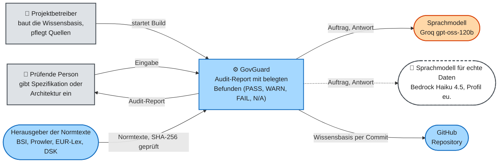
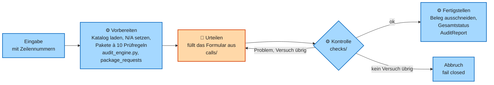
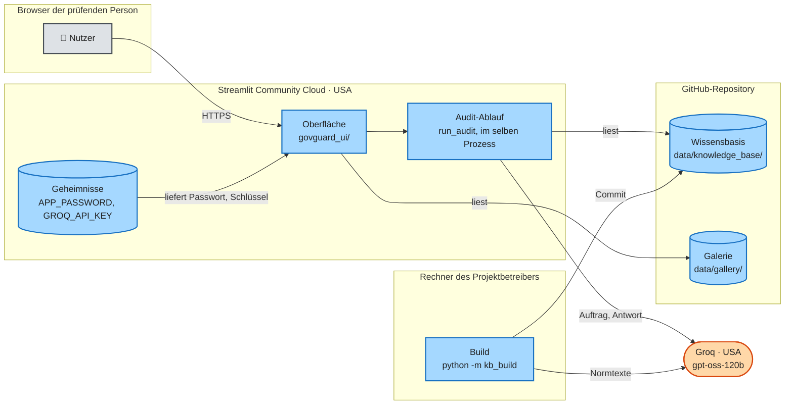
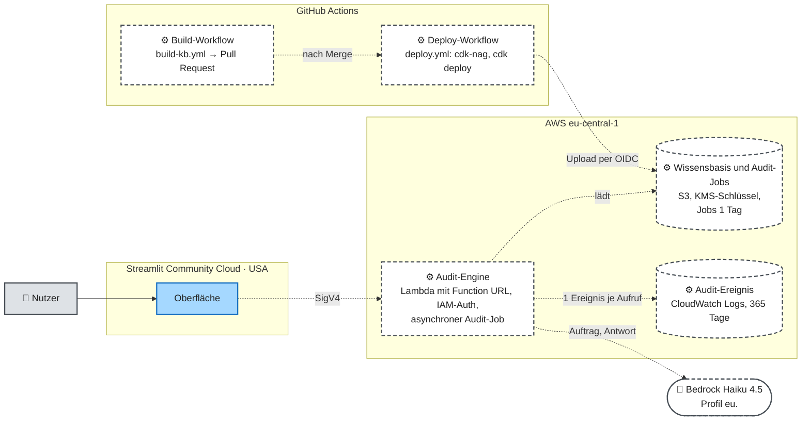
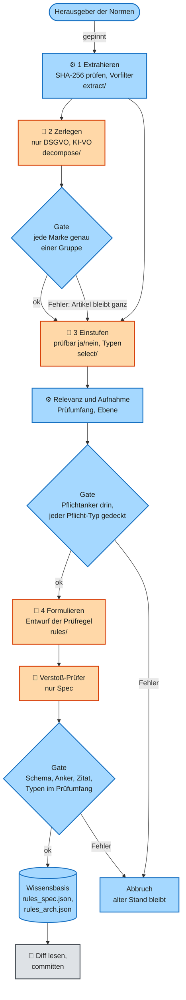
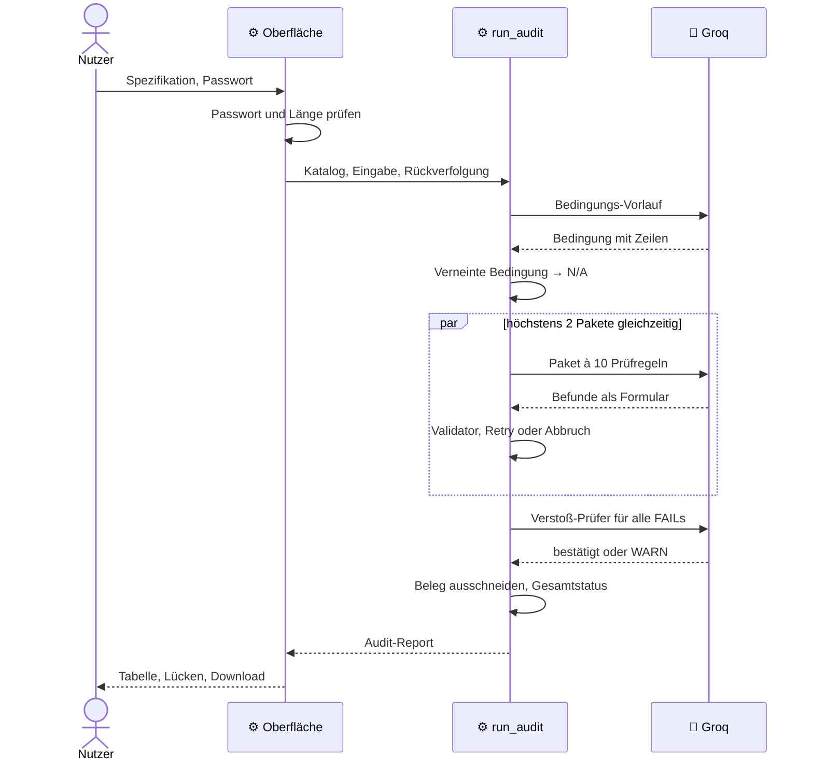
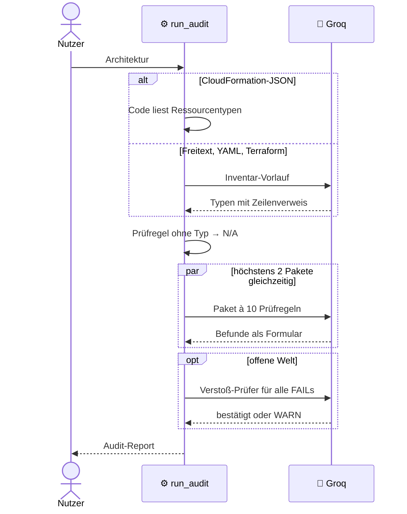
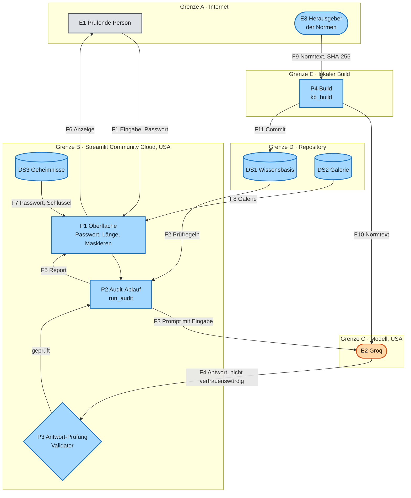
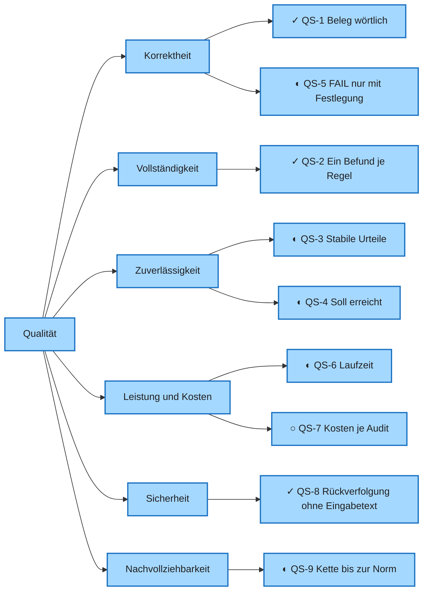
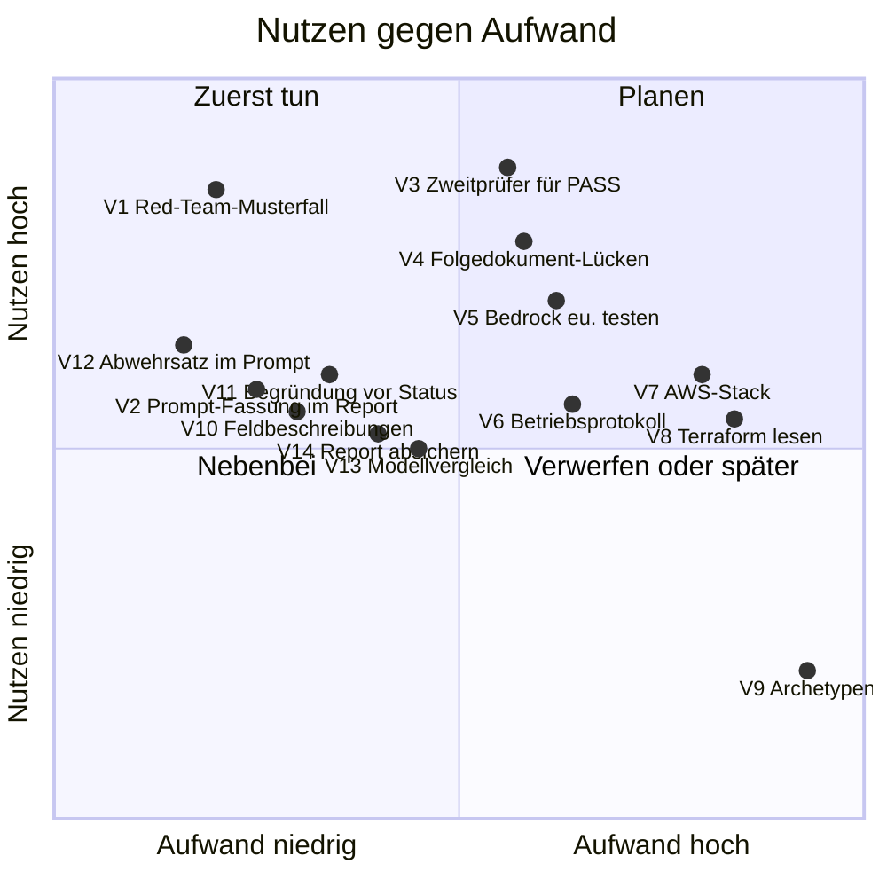

# GovGuard – Architektur

GovGuard prüft Spezifikationen und Architekturen und liefert einen Audit-Report mit PASS, WARN, FAIL oder N/A. Dieses Dokument folgt arc42 in der schlanken Fassung und erklärt das *Warum*. arc42 ist eine verbreitete Gliederung für Architektur-Dokumentation mit zwölf Kapiteln; die Nummer in Klammern hinter einer Überschrift nennt das arc42-Kapitel. Das *Wie* im Code steht in [DESIGN.md](DESIGN.md), Begriffe in [CONTEXT.md](../CONTEXT.md), Entscheidungen in [adr/](adr/), Befehle in [ENTWICKLUNG.md](ENTWICKLUNG.md). Vier arc42-Kapitel stehen woanders: 1 (Ziele) in [SPEC.md](SPEC.md), 5 (Bausteine) in [DESIGN.md](DESIGN.md) D11, 9 (Entscheidungen) hier in 9.3, 12 (Glossar) in [CONTEXT.md](../CONTEXT.md).

Code und ADRs sind die Wahrheit. Was entworfen, aber nicht gebaut ist, steht gestrichelt als Zielbild.

Das Dokument kennt drei Betriebsstände. Der **Demo-Stand** läuft heute: Streamlit Community Cloud und Groq, kein AWS. Der **Recruiter-Stand** ist ein entworfenes AWS-Zwischenziel (Lambda, S3 mit KMS, asynchrone Audit-Jobs, weiter mit Groq), aus Budgetgründen nicht gebaut ([ADR 0023](adr/0023-demo-und-recruiter-stand.md)). Das **Zielbild für echte Daten** ersetzt Groq durch Bedrock im EU-Profil ([ADR 0001](adr/0001-eu-inferenzprofil.md)). Den Bedrock-Anschluss gibt es im Code (Kommandozeile: `--provider bedrock`), das Projektkonto hat aber keinen aktiven Zugang zu Haiku mehr (seit 16.10.2026 abbestellt, [ADR 0023](adr/0023-demo-und-recruiter-stand.md)); der Weg ist also vorhanden, ohne neuen Zugang nicht nutzbar und mit dem heutigen Stand nie getestet. D4 zeigt das Zielbild.

| Diagramm | Frage | Abschnitt |
|---|---|---|
| D1 Kontext | Wer nutzt GovGuard, mit wem spricht es? | 1 |
| D2 LLM zwischen zwei Code-Schichten | Wie ist die Arbeit zwischen Modell und Code geteilt? | 3 |
| D3 Verteilung Demo-Stand | Was läuft heute wo? | 4 |
| D4 Zielbild AWS | Wie sähe der Betrieb für echte Daten aus? | 4 |
| D5 Build der Wissensbasis | Wie entsteht der Prüfkatalog? | 5.1 |
| D6 Spec-Audit | Was passiert bei einer Spezifikation? | 5.2 |
| D7 Architektur-Audit | Was passiert bei einer Architektur? | 5.3 |
| D8 Datenfluss | Wo laufen Daten über Vertrauensgrenzen? | 6 |
| D9 Qualitätsbaum | Welche Qualität ist gemessen? | 7 |
| D10 Nutzen gegen Aufwand | Was lohnt sich als Nächstes? | 9 |

Die Module und Typen zeigt [DESIGN.md](DESIGN.md) mit den Diagrammen D11 bis D15. Alle Diagramme folgen den Konventionen dort (Farben: 🤖 orange Sprachmodell, ⚙️ blau Code, 👤 grau Mensch, gestrichelt Zielbild).

## 0 Architektur- und Designprinzipien

Ein Prinzip ist eine Regel, die viele Einzelentscheidungen erklärt. Diese neun Prinzipien tragen GovGuard; jedes steht im Code, nicht nur im Text. Ein Retry ist die erneute Frage ans Modell, nachdem der Code die Antwort mit Grund abgelehnt hat.

| # | Prinzip | Warum | Woran man es erkennt | im Code |
|---|---|---|---|---|
| 1 | **Das Sprachmodell entwirft, der Code entscheidet.** Was der Code schon weiß, fragt man das Modell nicht. | Der Teil, der halluzinieren kann, bleibt klein ([ADR 0005](adr/0005-pydantic-ai.md)). | Das Modell füllt ein Formular (Entwurf); Anker, Beleg und Gesamtstatus setzt der Code. | `RuleDraft`, `FindingDraft`, `checks/` |
| 2 | **Fester Katalog statt Suche** (Bounded Catalog). | Eine Suche kann relevante Pflichten übersehen; ein Audit mit Lücke ist wertlos ([ADR 0011](adr/0011-vollstaendiger-katalog.md)). | Jede Prüfregel bekommt genau einen Befund, es gibt keine Obergrenze und keine Vektor-Datenbank. | `RuleCatalog`, `completeness_problems` |
| 3 | **Fail closed.** Im Zweifel gibt es kein Ergebnis statt eines falschen. | Ein falscher Report ist schlimmer als keiner ([ADR 0017](adr/0017-beleg-per-zeilenverweis.md)). | Nach einem Retry bricht das Audit ab (Exit 2). Drei Ausnahmen fallen stattdessen auf den vorsichtigeren Status zurück (unter der Tabelle). | `AuditValidationError`, `fail_closed` |
| 4 | **Beleg statt Behauptung.** FAIL nur, wenn die Belegzeilen einen Verstoß festlegen. | Ein Befund muss nachprüfbar sein; Schweigen in der Eingabe ist kein Verstoß ([ADR 0017](adr/0017-beleg-per-zeilenverweis.md), [0020](adr/0020-fail-nur-bei-festgelegtem-verstoss.md)). | Das Modell nennt nur Zeilen, der Code schneidet das Zitat aus; Lücken sind WARN ohne Beleg. | `line_start`, `evidence_of`, `judge_fails` |
| 5 | **Daten in der EU, jede Ausnahme sichtbar.** | Ein Drittlandtransfer nach Art. 44 DSGVO braucht Grund und Hinweis ([ADR 0001](adr/0001-eu-inferenzprofil.md), [0016](adr/0016-groq-zur-laufzeit-im-prototyp.md)). | Die Demo verarbeitet nur fiktive Daten und sagt es; jeder Report nennt sein Modell (`model_id`). Für echte Daten ist Bedrock `eu.` vorgesehen; die Oberfläche läge im Zielbild aber noch auf Streamlit in den USA (4.2, 10). | `DATA_RULE`, `model_id` |
| 6 | **0 € Leerlauf.** Serverless oder gar kein AWS. | Das Budget trägt weder Dauerbetrieb noch AWS-Bau. Bedrock hätte zwar keinen Leerlauf, kostet pro Audit aber das 8- bis 9-Fache von Groq (8.2), und der Zugang des Kontos ist seit 16.10. abbestellt ([ADR 0023](adr/0023-demo-und-recruiter-stand.md), [0016](adr/0016-groq-zur-laufzeit-im-prototyp.md)). | Die Demo läuft auf Streamlit Community Cloud ohne AWS-Konto; nur ein Audit kostet Geld. | `AUDIT_BACKEND=local` |
| 7 | **Workflow statt Agent.** Die Reihenfolge steht im Code. | Kein Modell soll den nächsten Schritt wählen; das hält Kosten und Verhalten vorhersagbar ([ADR 0021](adr/0021-kein-orchestrierungs-framework.md)). | Ein kurzer Ablauf mit `asyncio` (ca. 60 Zeilen), kein LangChain, kein LangGraph. | `run_audit` in `audit_engine.py` |
| 8 | **Adapter als einziger Weg nach außen.** | Die Prüflogik bleibt ohne AWS und ohne Netz testbar ([ADR 0027](adr/0027-ordner-nach-aufgabe.md)). | boto3, Groq-Modell und HTTP-Download liegen je in genau einer Datei; ein Test hält die Import-Richtung fest. | `adapters/`, `source_fetch.py`, `tests/test_architecture.py` |
| 9 | **Klein und verteidigbar.** | Eine Lösung, die ich vollständig erklären kann, schlägt eine große, die ich halb verstehe (CLAUDE.md). | Ein Modul = eine Aufgabe, ca. 200 Zeilen; ruff und ein Test prüfen die Grenzen. | `pyproject.toml`, `tests/test_architecture.py` |

**Die drei Rückfälle statt Abbruch:** „Vorsichtiger“ heißt, dass lieber mehr geprüft oder weniger behauptet wird. (1) Fällt der Bedingungs-Vorlauf aus, gilt jede Bedingung als „nicht erwähnt“ (`unstated`), und alle Prüfregeln gehen ans Modell, statt dass der Code welche auf N/A setzt. (2) Ein PASS ohne gültigen Beleg wird nach dem Retry zu WARN statt zum Abbruch. (3) Fällt der Verstoß-Prüfer aus, bleibt das FAIL ungeprüft stehen. Alle drei können nie ein falsches PASS erzeugen; den Ablauf zeigt DESIGN D14.

## Lesehilfe für die Behörden-IT

Der BSI-Standard 200-2 beschreibt die Vorgehensweise nach IT-Grundschutz in Schritten, der Standard 200-3 die Risikoanalyse. Diese Tabelle ist eine **Lesehilfe**: Sie zeigt, wo in diesem Dokument das Thema eines Schritts behandelt wird. Sie ist ausdrücklich **keine Konformitätsaussage**; GovGuard hat weder einen Grundschutz-Check noch eine Zertifizierung durchlaufen.

| Schritt der BSI-Vorgehensweise | Was er fragt | Wo in diesem Dokument | Stand |
|---|---|---|---|
| Strukturanalyse (200-2) | Welche Systeme, Daten und Verbindungen gibt es? | Kontext (1), Verteilung (4), Datenfluss (6) | beschrieben |
| Schutzbedarfsfeststellung (200-2) | Wie viel Schaden entstünde, wenn Vertraulichkeit, Integrität oder Verfügbarkeit verletzt wird? | Randbedingungen (2): nur fiktive Daten; Einordnung (10): Vorfilter unterstellt „normal“ (Erklärung unter der Tabelle) | nur teilweise |
| Modellierung (200-2) | Welche Bausteine des Grundschutz-Kompendiums gelten? | nicht durchgeführt; eine verkürzte Modellierung („BSI-light“: nur die Bausteine, die für das Zielbild AWS gelten) soll Issue #68 liefern (noch offen) | offen |
| IT-Grundschutz-Check (200-2) | Sind die Anforderungen der Bausteine erfüllt? | nicht durchgeführt; das Architektur-Audit prüft fremde Templates, den eigenen Stack gibt es nicht (ADR 0023) | entfällt |
| Risikoanalyse (200-3) | Welche Gefährdungen gelten bei erhöhtem Schutzbedarf, wie wahrscheinlich und wie schwer? | Die Bedrohungstabellen (6) benennen Bedrohungen und Maßnahmen, bewertet aber weder Eintrittshäufigkeit noch Schadenshöhe | nur Bedrohungen |

„normal-SdT“ ist im Katalog Grundschutz++ des BSI (maschinenlesbar im Format OSCAL) das Sicherheitsniveau „normal“ des Stands der Technik (SdT); der Vorfilter übernimmt nur Anforderungen dieser Stufe (`extract/bsi.py`). Sehr hoher oder hoher Schutzbedarf braucht weitere Anforderungen und eine Risikoanalyse und ist nicht abgedeckt.

Das Kapitel „Einordnung und Grenzen“ (10) ersetzt diese vorläufige Lesehilfe, sobald Issue #68 es mit Primärquellen belegt. #68 ist am 21.10.2026 noch offen.

## 1 Kontext (D1; arc42 3, C4-Ebene 1)

C4 ist eine Methode, ein System in vier Zoomstufen zu zeichnen. Ebene 1 zeigt das System als einen Kasten mit seinen Nutzern und Nachbarsystemen.

Die Normtexte kommen aus sieben Quellen; CIS, C5 und FSBP liest GovGuard aus dem Prowler-JSON, denn Prowler ist ein Open-Source-Prüfwerkzeug für AWS, das diese Regelwerke maschinenlesbar pflegt ([ADR 0008](adr/0008-quellformate.md)). DSGVO ist das EU-Datenschutzgesetz, KI-VO das EU-Gesetz für KI-Systeme, und das SDM ist das Standard-Datenschutzmodell der Datenschutzkonferenz (DSK), dem Gremium der deutschen Datenschutzbehörden. BSI Grundschutz++ ist der maschinenlesbare IT-Grundschutz des BSI, C5 (Cloud Computing Compliance Criteria Catalogue) sein Kriterienkatalog für Cloud-Dienste, CIS AWS eine Härtungsempfehlung des Center for Internet Security, und AWS FSBP (Foundational Security Best Practices) sind die Sicherheitsregeln von AWS je Dienst.

**Kernaussage:** GovGuard hat zwei Nutzer, nämlich die prüfende Person und den Projektbetreiber, und drei Nachbarn: ein Sprachmodell, die Herausgeber der Normtexte und GitHub. Ein zweites Sprachmodell (Bedrock) gehört zum Zielbild.



**Legende:** Rechteck = Mensch oder System; abgerundet = externes System außerhalb des Repos (orange ein Sprachmodell, blau jedes andere). Gestrichelt = Zielbild für echte Daten (im Code über die Kommandozeile vorhanden, ohne Kontozugang nicht nutzbar und mit dem heutigen Stand nie getestet, siehe 8.2). Pfeil = Datenfluss.

**Beschreibung:**

- **Zwei Audits:** Das Spec-Audit prüft eine Spezifikation gegen DSGVO, KI-VO und SDM, das Architektur-Audit eine Architektur gegen BSI IT-Grundschutz in der maschinenlesbaren Fassung „Grundschutz++“, BSI C5, CIS AWS und AWS FSBP. Im Katalog (175 Regeln) überwiegt AWS FSBP (105), dazu kommen BSI 39, CIS 20 und C5 11.
- **Prüfassistent:** GovGuard liefert Hinweise für Fachleute, keinen Nachweis und keine Freigabe (SPEC 13).
- **Kein Golden Archetype:** Die Referenzarchitekturen sind entworfen, aber bewusst nicht gebaut ([ADR 0019](adr/0019-nur-audits.md)).

## 2 Randbedingungen (arc42 2)

Eine Randbedingung ist eine Vorgabe, die die Architektur nicht wählen kann, sondern einhalten muss.

| Bereich | Vorgabe | Quelle |
|---|---|---|
| Daten | Echte Daten nur in der EU; die Demo verarbeitet nur fiktive Daten und sagt es | [ADR 0001](adr/0001-eu-inferenzprofil.md), [0004](adr/0004-streamlit-community-cloud.md), [0016](adr/0016-groq-zur-laufzeit-im-prototyp.md) |
| Kosten | 0 € Leerlauf, Budget für Betrieb und AWS-Bau reicht nicht | [ADR 0023](adr/0023-demo-und-recruiter-stand.md), CONTEXT.md |
| Zeit | Präsentation am 26.10.2026, Arbeitsfenster 08.–21.10.2026 | CLAUDE.md |
| Technik | Python, Pydantic, Pydantic AI, Streamlit; Wissensbasis als JSON | [ADR 0005](adr/0005-pydantic-ai.md), [0011](adr/0011-vollstaendiger-katalog.md) |
| Eingabe | höchstens 100.000 Zeichen, geprüft vor dem ersten Modellaufruf | `audit_engine.py` |
| Quellen | Jede Quelle ist auf Version und SHA-256 gepinnt; keine Quelldatei im Repo, wenn die Lizenz es nicht erlaubt | [ADR 0008](adr/0008-quellformate.md) |
| Modell | Groq begrenzt den Durchsatz (250.000 Tokens je Minute); darum höchstens 2 Pakete gleichzeitig je Audit (`GROQ_MAX_PARALLEL` in `calls/audit_packages.py`, #53). Das Limit gilt für den einen Schlüssel der Demo, also für alle Nutzer zusammen (9.1) | [ADR 0016](adr/0016-groq-zur-laufzeit-im-prototyp.md) |
| Umfang | Der Prüfumfang ist eine feste Liste von AWS-Diensten (Serverless, RDS/Aurora, Fargate) | [ADR 0011](adr/0011-vollstaendiger-katalog.md), [0013](adr/0013-begleittypen-im-pruefumfang.md) |

## 3 Lösungsstrategie (D2; arc42 4)

Ein Workflow ist eine feste Abfolge von Schritten im Code. Ein Agent dagegen wählt seine Schritte selbst, und das tut in GovGuard kein Modell. Ein Gate ist eine Prüfung im Code, die ein Ergebnis nur durchlässt, wenn es eine feste Regel erfüllt.

Die Testfrage für jede Aufgabe lautet: *Gibt es genau eine richtige Antwort, die sich ohne Sprachverständnis ermitteln lässt?* Ja → Code. Nein → Modell, und danach prüft der Code das Ergebnis. Typische Aufgaben, die nach Sprache aussehen und keine sind:

| Aufgabe | Wer | im Code |
|---|---|---|
| „Prüfe, ob du keine Prüfregel vergessen hast“ | Code zählt | `completeness_problems` |
| „Fasse den Gesamtstatus zusammen“ | Code nimmt den schlechtesten Status | `overall_status` |
| „Kommt ein S3-Bucket im Template vor?“ | Code schlägt nach | `Inventory.applies` |

**Kernaussage:** Jeder Modellaufruf steht zwischen zwei Code-Schichten: Der Code bereitet vor, das Modell urteilt, der Code kontrolliert.



**Legende:** Orange = Sprachmodell, blau = Code, Raute = Gate. Die Kontrolle prüft Schema, einen Befund je Prüfregel und gültige Zeilenbereiche. Pfeil = Ablauf; der Pfeil zurück zum Modell ist der Retry.

**Beschreibung:**

- **Das Formular ist kein Beweis:** Das Modell kann nur Status, Zeilenbereich und Begründung liefern; ob der Bereich stimmt, prüft der Code. Details: DESIGN 2.5 (D15).
- **Feste Reihenfolge:** Vorlauf, Pakete, Verstoß-Prüfer folgen immer in dieser Ordnung; das Modell wählt nichts aus ([ADR 0021](adr/0021-kein-orchestrierungs-framework.md)).
- **Ein Code-Weg für zwei Anbieter:** Dieselben Gates gelten für Groq und Bedrock; nur die Art der strukturierten Antwort unterscheidet sich ([ADR 0016](adr/0016-groq-zur-laufzeit-im-prototyp.md)).

### Muster im System

Ein Entwurfsmuster ist eine benannte, bewährte Lösung für ein wiederkehrendes Problem; der Name ersetzt eine halbe Seite Erklärung. Die Einordnung „Workflow statt Agent“ folgt Anthropic („Building effective agents“, 2024): In einem Workflow bestimmt der Code die Schritte, in einem Agenten das Modell. Keine Modellantwort hat bei GovGuard eine Wirkung, denn nichts davon wird ausgeführt, und die Antwortmenge ist geschlossen (Formular mit festen Werten, DESIGN 2.6).

| Muster | Idee | Wo in GovGuard | im Code |
|---|---|---|---|
| Prompt Chaining mit Gates (Anthropic) | Aufgabe in Schritte zerlegen, nach jedem Schritt prüft der Code | Build (D5) und Laufzeit (D6) | `run_audit`, `answer_problems`, `is_quoted` |
| Parallelization (Anthropic) | Teilaufgaben gleichzeitig bearbeiten, dann zusammenführen | Pakete à 10 Prüfregeln | `package_requests` |
| Evaluator (Anthropic) | Einer erzeugt, ein anderer bewertet | Validator mit Retry (deterministisch); Verstoß-Prüfer als zweite Meinung (Modell) | `answer_problems`, `judge_fails` |
| Content Enricher (Hohpe/Woolf) | Der Kern kommt von außen, ein Schritt ergänzt den Rest | Das Modell liefert den Entwurf, der Code ergänzt Anker, Beleg und Titel | `FindingDraft` → `Finding`, `RuleDraft` → `Rule` |
| Fail Closed (Saltzer/Schroeder, 1975) | Im Zweifel kein Ergebnis statt eines falschen | Abbruch nach dem Retry | `fail_closed` |

Weitere Muster haben einen eigenen Abschnitt: Message Filter (Vorfilter, `prefilter`, 5.1), Ports & Adapters (Prinzip 8), Dependency Injection (7, Testen) und das Testorakel (DESIGN 1.4). Nicht verwendet: Orchestrator-Workers (kein Modell verteilt Aufgaben) und Routing (die Auswahl eines Golden Archetype entfällt mit [ADR 0019](adr/0019-nur-audits.md)).

Auch Retrieval fehlt bewusst. RAG (Retrieval-Augmented Generation) holt per Ähnlichkeitssuche über Zahlenvektoren (Embeddings) nur die passendsten Textstücke in den Prompt. Das beantwortet „Was steht zu X?“, ein Audit fragt aber „Erfüllt X alle Regeln?“:

| Kriterium | RAG | Fester Katalog |
|---|---|---|
| Vollständigkeit | nicht garantiert; eine Regel, die dem Text unähnlich ist, fällt unbemerkt heraus | vom Code garantiert, ein Befund je Prüfregel |
| Leerlauf | die Vektor-Datenbank läuft weiter | 0 €, eine JSON-Datei |
| Nachvollziehbarkeit | Auswahl je Anfrage verschieden | Auswahlprotokoll im Git |

Faustregel: Fiele ein fehlender Treffer auf, ist RAG in Ordnung; fiele er nicht auf und wäre trotzdem ein Fehler, braucht es eine vollständige Prüfung ([ADR 0011](adr/0011-vollstaendiger-katalog.md)).

### Code-Struktur

Ein- und Ausgabe (AWS, Groq, Netz) und Prüflogik liegen in getrennten Dateien. So bleibt der Kern ohne AWS und ohne Netz testbar. Das Modulbild ist D11 in [DESIGN.md](DESIGN.md).

```
src/govguard/       Laufzeit-Kern: calls/ (spricht mit dem Modell), checks/ (rein), adapters/ (boto3, Groq)
src/kb_build/       Build-Werkzeug, je Schritt ein Ordner: extract, decompose, select, rules, reference
src/govguard_ui/    Streamlit-Demo: screens/ (Seiten), report/ (Report-Ansicht)
data/input/         von Hand gepflegt: Quellenliste, Prüfumfang, Bedingungen, 6 Musterfälle (fiktive Beispiel-Eingaben mit Soll von Hand)
data/intermediate/  Zwischenergebnisse und Build-Logs, eingecheckt fürs Review
data/knowledge_base/ nur das Endergebnis: rules_spec.json, rules_arch.json
data/gallery/       gespeicherte Reports der Musterfälle, wächst nur per Commit
data/measurements/  Rohdaten der Messkampagne (#54)
```

- **Adapter für Außenkontakt:** boto3 nur in `adapters/aws_services.py`, das Groq-Modell nur in `adapters/groq_services.py`, Downloads nur in `kb_build/source_fetch.py`; kein Modul startet Prozesse ([ADR 0019](adr/0019-nur-audits.md)).
- **Richtung der Importe:** Die Prüfungen kennen weder Modell noch AWS, die Laufzeit kennt den Build nicht ([ADR 0027](adr/0027-ordner-nach-aufgabe.md)); D11 in DESIGN zeigt alle Pfeile, `tests/test_architecture.py` hält sie fest.
- **Keine Logik in Klebe-Code:** Einstiegsdateien verbinden nur. Ein späterer Workflow meldet sich an und ruft `python -m …` auf; derselbe Befehl läuft lokal.

Der CDK-Stack (CDK, das Cloud Development Kit, beschreibt AWS-Infrastruktur als Python-Code; `infra/`) und die Workflows (`.github/workflows/`) gehören zum Zielbild und existieren nicht (4).

## 4 Verteilung (arc42 7)

Die Verteilungssicht zeigt, auf welcher Infrastruktur welcher Teil läuft. D3 ist zugleich die C4-Ebene 2 (Container, also die einzeln ausgelieferten Teile); ein eigenes Container-Diagramm gibt es nicht, und Ebene 4 (Code) ersetzen die Klassendiagramme in DESIGN.

### 4.1 Demo-Stand heute (D3)

**Kernaussage:** Die Demo läuft ohne AWS: Streamlit führt das Audit selbst aus und ruft Groq direkt auf.



**Legende:** Rahmen = Ort des Betriebs; Zylinder = Speicher; abgerundet orange = externes Sprachmodell. Pfeil = Datenfluss; alles ist gebaut, darum nichts gestrichelt.

**Beschreibung:**

- **Beide Orte liegen in den USA:** Hosting und Groq sind Drittland; darum nur fiktive Daten und ein Hinweis in der Oberfläche ([ADR 0004](adr/0004-streamlit-community-cloud.md), [0016](adr/0016-groq-zur-laufzeit-im-prototyp.md), [0023](adr/0023-demo-und-recruiter-stand.md)).
- **Wissensbasis aus dem Repo:** Sie wird nicht deployt, sondern mit dem Code gelesen; ein Build endet mit einem Commit.
- **Build lokal:** Er schickt nur öffentliche Normtexte an Groq ([ADR 0014](adr/0014-groq-standard-im-build.md)).

**Warum Groq mit `gpt-oss-120b`:** Es kostet bei gleichen Tokens etwa ein Achtel bis ein Neuntel von Haiku auf Bedrock (8.2); Hersteller des Modells ist OpenAI (offene Gewichte), betrieben wird es von Groq, im Build hatte Bedrock keine Kapazität frei, und Groq erzwingt das Antwortformat (JSON-Schema) ([ADR 0012](adr/0012-globales-profil-im-build.md), [0014](adr/0014-groq-standard-im-build.md), [0016](adr/0016-groq-zur-laufzeit-im-prototyp.md)). Ein Vergleich mit anderen Modellen oder einem EU-gehosteten Anbieter wurde nicht gemacht und ist offen (V13).

### 4.2 Zielbild AWS (D4)

Eine Function URL ist eine feste HTTPS-Adresse, unter der AWS eine Lambda-Funktion direkt aufrufbar macht. SigV4 ist das Signaturverfahren von AWS, mit dem ein Aufrufer seine IAM-Identität nachweist. KMS ist der Schlüsseldienst von AWS für eigene Verschlüsselungsschlüssel. Das Bedrock-Profil `eu.` ist ein Inferenzprofil: Der Aufruf geht an `eu-central-1`, AWS darf ihn aber in sechs EU-Regionen rechnen (`eu-central-1`, `eu-north-1`, `eu-south-1`, `eu-south-2`, `eu-west-1`, `eu-west-3`); das Profil `global.` rechnet weltweit und wäre per IAM gesperrt ([ADR 0001](adr/0001-eu-inferenzprofil.md)). OIDC lässt GitHub Actions ohne gespeichertes Passwort eine AWS-Rolle annehmen. CDK-Assertions sind Tests, die das aus dem CDK erzeugte Template prüfen. cdk-nag ist ein Prüfwerkzeug, das einen CDK-Stack vor dem Deploy gegen Sicherheitsregeln prüft.

**Kernaussage:** Im Zielbild lägen Audit und Daten in `eu-central-1` und die Inferenz in der EU, das Modell wäre Bedrock Haiku 4.5 im EU-Profil, und eine Pipeline würde die Wissensbasis ausrollen. Die Oberfläche bliebe in diesem Entwurf auf Streamlit in den USA, die Eingabe liefe also weiter über US-Hosting; ADR 0004 verlangt für echte Daten den Umzug nach Frankfurt, das Ziel ist nicht entschieden. Nichts davon ist gebaut.



**Legende:** Gestrichelter Rand und Pfeil = entworfen, nicht gebaut; die Rolle zeigt das Zeichen (🤖 Modell, ⚙️ Code). Nur die Oberfläche (blau) gibt es heute.

**Unterschiede Demo-Stand und Zielbild:**

| Thema | Demo-Stand (heute) | Zielbild AWS (entworfen) | Quelle |
|---|---|---|---|
| Ort des Audits | im Streamlit-Prozess | Lambda hinter Function URL, asynchroner Audit-Job mit Job-ID, Timeout 300 s (die 180 s aus ADR 0018 gehörten zum ersten, synchronen Entwurf und sind durch ADR 0023 überholt) | [ADR 0018](adr/0018-lambda-function-url.md), [0023](adr/0023-demo-und-recruiter-stand.md) |
| Modell | Groq, USA | Bedrock `eu.` für echte Daten; im Recruiter-Stand (siehe oben) weiter Groq | [ADR 0001](adr/0001-eu-inferenzprofil.md), [0023](adr/0023-demo-und-recruiter-stand.md) |
| Wissensbasis | Datei im Repo | S3, vom Deploy befüllt | [ADR 0023](adr/0023-demo-und-recruiter-stand.md) |
| Nachweis je Audit | nur die Rückverfolgung im Report (Hashes, `kb_commit` = `local`) | Audit-Ereignis in CloudWatch, KMS, 365 Tage | [ADR 0006](adr/0006-cloudwatch-audit-protokoll.md) |
| Verschlüsselung | keine eigenen Schlüssel | KMS-Schlüssel für den S3-Bucket und die Log-Gruppe ab Tag 1; wo und wie das Groq-Secret des Recruiter-Stands liegt, ist noch nicht entschieden (T8) | [ADR 0023](adr/0023-demo-und-recruiter-stand.md) |
| Rollout | Push auf `main`, Streamlit zieht den Stand | Pipeline: cdk-nag und CDK-Assertions als Gate, OIDC | [ADR 0023](adr/0023-demo-und-recruiter-stand.md), Issue #37 |
| Build | lokal, von Hand | `build-kb.yml` öffnet einen Pull Request | [ADR 0011](adr/0011-vollstaendiger-katalog.md) |
| Datenort | USA, nur fiktive Daten | Audit und Daten in `eu-central-1`, Inferenz in den EU-Regionen des Profils `eu.`; die Oberfläche (Eingabe) bliebe auf Streamlit, USA, bis ihr Umzug nach Frankfurt entschieden und gebaut ist | [ADR 0001](adr/0001-eu-inferenzprofil.md) |
| Fixkosten | 0 € | ca. 1 $/Monat für KMS (Sicherheit, zählt nicht als Leerlauf, CONTEXT.md) | [ADR 0023](adr/0023-demo-und-recruiter-stand.md), CONTEXT.md |

Die SigV4-Zugangsdaten der Oberfläche wären nach ADR 0004 und 0018 der langlebige Access Key eines IAM-Users in den Streamlit-Secrets, der nur die Function URL aufrufen darf und spätestens alle 90 Tage rotiert wird; gebaut ist nichts davon.

Das LLM-Selbst-Audit läuft auch im Zielbild von Hand und landet in der Galerie; die Pipeline prüft nur mit cdk-nag ([ADR 0023](adr/0023-demo-und-recruiter-stand.md)).

## 5 Laufzeit (arc42 6)

Die Laufzeitsicht zeigt die Abläufe: wie die Wissensbasis entsteht und was in einem Audit nacheinander passiert.

### 5.1 Build-Zeit: Wissensbasis erzeugen (D5)

Der Build erzeugt aus den Normtexten die Prüfregeln. Er läuft heute lokal und von Hand (`python -m kb_build <Schritt>`), weil er viele Modellaufrufe kostet und bei jedem Lauf leicht andere Texte liefert ([ADR 0011](adr/0011-vollstaendiger-katalog.md)).

**Kernaussage:** Das Modell urteilt nur über „prüfbar“ und formuliert Entwürfe; ob etwas in den Katalog kommt und ob es stimmt, entscheidet der Code an drei Gates.



**Legende:** Orange = Modellaufruf, blau = Code, grau = Mensch; Raute = Gate; Zylinder = Speicher. Pfeil = nächster Schritt. Bei einem Fehler der Gates 2 und 3 bricht der Schritt ab, die Wissensbasis bleibt unverändert; bei der Zerlegung bleibt der Artikel nach 4 Retries ganz (`llm_error`, DESIGN 2.6). Einstufung und Zerlegung haben einen Cache; ein Treffer spart den Aufruf.

| Schritt | Was | Warum | im Code |
|---|---|---|---|
| 1 Extrahieren | Je Quelle lädt der Adapter die Datei, prüft die SHA-256 und liest die Anforderungen; ein Vorfilter wirft Offensichtliches mit festem Satz weg. | Reproduzierbar und billig; Organisatorisches fällt früh heraus. | `extract/run.py`, `source_fetch.py` |
| 2 Zerlegen | Das Modell gruppiert die Abschnitte eines Rechtsartikels; der Code setzt Anker und Wortlaut. | Eine Pflicht geht nicht verloren, ein Anker nicht erfunden ([ADR 0026](adr/0026-rechtsartikel-zerlegen.md)). | `decompose/` |
| 3 Einstufen | Das Modell urteilt „prüfbar“ und nennt Ressourcentypen; der Code streicht Typen außerhalb des Prüfumfangs und nimmt auf. | Aufnahme ist keine Bewertungsfrage ([ADR 0011](adr/0011-vollstaendiger-katalog.md), [0013](adr/0013-begleittypen-im-pruefumfang.md)). | `select/` |
| 4 Formulieren | Das Modell schreibt je Anforderung einen Entwurf; im Spec-Katalog prüft ein zweiter Aufruf, dass das Verstoßkriterium (`violation_if`) eine Festlegung beschreibt. | Offene Welt ([ADR 0020](adr/0020-fail-nur-bei-festgelegtem-verstoss.md)). | `rules/` |

- **Pflichtanker:** Ein Pflichtanker ist der Anker einer Prüfregel, deren Befund ein Musterfall im Soll festlegt; das Gate bricht den Build ab, wenn er nicht aufgenommen ist ([ADR 0022](adr/0022-pflichtanker-uebersteuern-die-ebene.md)).
- **Ebene:** Die Ebene (`scope_level`) sagt, wessen Pflicht eine Anforderung ist: die des Templates, des Kontos, von Personen oder des Cloud-Anbieters. Nur Pflichten am Template kommen ins Architektur-Audit ([ADR 0022](adr/0022-pflichtanker-uebersteuern-die-ebene.md)).
- **Auswahlprotokoll:** Jede Anforderung bekommt einen Eintrag mit Ergebnis und Begründung (`data/intermediate/verdicts_*.json`); der Git-Diff zeigt Änderungen zwischen Builds. Formate, Anker und Vorfilter je Quelle: DESIGN 1.1 und 1.2.
- **Eingefroren:** Die SDM-Regeln bleiben Byte für Byte; neue Quellen kommen mit `--only-missing` dazu ([ADR 0025](adr/0025-ki-vo-als-neue-quelle-bei-eingefrorenem-katalog.md)).
- **Preset-Gate nicht gebaut:** Ein Lauf der Musterfälle nach dem Build ist entworfen. Heute messen und vergleichen Menschen von Hand (Galerie, `/audit-messen`).


### 5.2 Spec-Audit (D6)

Die offene Welt ist die Annahme, dass etwas, das die Eingabe nicht erwähnt, anderswo geregelt sein kann. Darum ist Fehlen im Spec-Audit nur WARN.

**Kernaussage:** Vor den Paketen liest ein Vorlauf die Bedingungen; danach urteilt das Modell in Paketen, und jedes FAIL muss noch durch den Verstoß-Prüfer.



**Legende:** 🤖 = Sprachmodell, ⚙️ = Code. Durchgezogener Pfeil = Aufruf, gestrichelt = Antwort. Der Kasten „par“ läuft gleichzeitig.

| Schritt | Was | Warum | im Code |
|---|---|---|---|
| Vorlauf | Das Modell nennt je Bedingung Zeilen; nur ein ausdrückliches Nein setzt Prüfregeln auf N/A. Fällt es aus, bleiben alle Bedingungen „nicht erwähnt“ (`unstated`) und alle Prüfregeln gehen ans Modell. | Pflichten, die nie gelten, kosten keine Lücke ([ADR 0028](adr/0028-bedingungen-im-spec-audit.md)). | `find_conditions` |
| Pakete | Je 10 Prüfregeln mit nummerierter Eingabe; ein Validator verlangt einen Befund je Regel und gültige Zeilen. | Der volle Katalog bleibt im Zeitlimit und unter dem Token-Limit ([ADR 0011](adr/0011-vollstaendiger-katalog.md)). | `package_requests` |
| Verstoß-Prüfer | Ein Aufruf sieht je FAIL nur Verstoßkriterium und Belegzeilen; er bestätigt oder stuft auf WARN herab. Fällt er aus, bleibt das FAIL. | Ein FAIL aus Schweigen wäre ein Fehlalarm ([ADR 0020](adr/0020-fail-nur-bei-festgelegtem-verstoss.md)). | `judge_fails` |
| Report | Der Code schneidet den Beleg aus der Eingabe und bildet den Gesamtstatus. | Beleg per Konstruktion wörtlich ([ADR 0017](adr/0017-beleg-per-zeilenverweis.md)). | `evidence_of`, `overall_status` |

Details: DESIGN 2.2 (Ablauf), 2.6 (die 8 Modellaufrufe), D14 (Zustände eines Befunds).

### 5.3 Architektur-Audit (D7)

Ein Ressourceninventar ist die Menge der Ressourcentypen, die in einer Architektur vorkommen. Es entscheidet, welche Prüfregeln anwendbar sind.

**Kernaussage:** Bei CloudFormation-JSON liest der Code das Inventar selbst und die Welt ist geschlossen; bei allem anderen nennt es ein Vorlauf, und die Welt bleibt offen.



**Legende:** Wie D6. „alt“ = entweder oder, „opt“ = nur wenn die Bedingung zutrifft.

| Schritt | Was | Warum | im Code |
|---|---|---|---|
| Inventar | JSON liest der Code exakt; sonst nennt das Modell die Typen mit Zeilenverweis. IAM, KMS und Logs streicht der Code nie. | Ein übersehener Dienst steht als „nicht erkannt“ im Befund ([ADR 0015](adr/0015-cloudformation-einziges-inventarformat.md)). | `resource_inventory`, `Inventory.applies` |
| Welt | Geschlossen ist nur, was der Code als Bauplan liest: fehlende Einstellung = unsicherer Standardwert = FAIL möglich. | Die Welt hängt an der Eingabe, nicht an der Audit-Art ([ADR 0020](adr/0020-fail-nur-bei-festgelegtem-verstoss.md), Nachtrag #46). | `audit_input` |
| Pakete, Report | wie im Spec-Audit; der Verstoß-Prüfer entfällt in der geschlossenen Welt. | – | `run_audit` |

Terraform ist ungetestet, YAML gilt als Freitext ([ADR 0015](adr/0015-cloudformation-einziges-inventarformat.md)).

### 5.4 Steckbriefe der Archetypen (nur fürs Abdeckungs-Gate)

Golden Archetypes werden nicht gebaut ([ADR 0019](adr/0019-nur-audits.md)). Ihre Steckbriefe (`data/input/archetype_profiles.json`) bleiben als Eingabe des Abdeckungs-Gates, denn jeder Pflicht-Ressourcentyp braucht mindestens eine Prüfregel. Jeder Archetyp ist als End-to-End-Kette ab API Gateway mit IAM-Auth entworfen, aber nicht gebaut ([ADR 0009](adr/0009-end-to-end-archetypen.md)). Solutions Constructs sind fertige CDK-Bausteine von AWS, die mehrere Dienste sicher verbinden.

| Archetyp | Solutions Constructs | Pflicht-Ressourcentypen |
|---|---|---|
| ARCH-01 Sync REST | `aws-apigateway-lambda`, `aws-lambda-dynamodb` | `AWS::ApiGateway::RestApi`, `AWS::Lambda::Function`, `AWS::DynamoDB::Table` |
| ARCH-02 Antragseingang | `aws-apigateway-lambda`, `aws-lambda-sqs`, `aws-sqs-lambda`, `aws-lambda-s3` | `AWS::ApiGateway::RestApi`, `AWS::Lambda::Function`, `AWS::SQS::Queue`, `AWS::S3::Bucket` |
| ARCH-03 Audit-Log-Archiv | `aws-apigateway-lambda`, `aws-lambda-kinesisfirehose`, `aws-kinesisfirehose-s3` | `AWS::ApiGateway::RestApi`, `AWS::Lambda::Function`, `AWS::KinesisFirehose::DeliveryStream`, `AWS::S3::Bucket` (Object Lock nennt nur der Zweck) |

Die Steckbriefe stammen aus [Behörden Cloud-Referenzarchitekturen Analyse](research/Behörden%20Cloud-Referenzarchitekturen%20Analyse.md). Das Zielbild des Archetyp-Zweigs zeigt DESIGN 1.3.

## 6 Datenfluss und Sicherheit (arc42 8, 11)

Ein Datenflussdiagramm (DFD) zeigt externe Akteure, Prozesse, Speicher und die Flüsse dazwischen.

Eine Vertrauensgrenze ist eine Linie, an der Daten von jemandem kommen, dem man nicht voll vertraut.

STRIDE ist ein Merkwort für sechs Bedrohungsarten:

| Buchstabe | Bedrohung | auf Deutsch |
|---|---|---|
| S | Spoofing | Identität vortäuschen |
| T | Tampering | manipulieren |
| R | Repudiation | abstreiten |
| I | Information Disclosure | preisgeben |
| D | Denial of Service | lahmlegen |
| E | Elevation of Privilege | Rechte erweitern |

### 6.1 DFD des Demo-Stands (D8)

**Kernaussage:** Die Modellantwort (F4) kreuzt immer eine Vertrauensgrenze: Dem Dienst traut man den Betrieb, dem Inhalt der Antwort traut man nicht, bis die Antwort-Prüfung sie freigibt.



**Legende:** Rechteck = Prozess oder Akteur (E), abgerundet = externes System, Zylinder = Speicher (DS), Raute = Gate. Rahmen = Vertrauensgrenze. F = Datenfluss. Ein Validator ist eine Prüffunktion, die nach jeder Modellantwort läuft. Maskieren heißt, Zeichen wie `<` so umzuschreiben, dass der Browser sie als Text zeigt; es geschieht erst beim Anzeigen in P1 (F5, F6, T6). P3 ist die Stelle, an der das Entwurf-Muster (Modell entwirft, Code prüft) zum Sicherheitsmerkmal wird.

**Beschreibung:**

- **Fünf Grenzen:** Internet, Hosting, Modell, Repository und lokaler Build; die Modellantwort bekommt mit P3 eine eigene Prüfstelle.
- **Was liegt wo:** GovGuard speichert die Eingabe nicht; sie lebt nur in der Sitzung. Der Report enthält die Eingabe nicht als Ganzes, aber die Belege (wörtliche Ausschnitte, höchstens 200 Zeilen je Befund) und Begründungen, die daraus zitieren können. Nur die Rückverfolgung (`Trace`) und das geplante Audit-Ereignis tragen ausschließlich Hashes ([ADR 0006](adr/0006-cloudwatch-audit-protokoll.md), SPEC 9). Den Report halten der Browser, der Download und die Galerie im Git, wenn der Betreiber ihn einchecken lässt.
- **Build ohne Nutzerdaten:** F10 enthält nur öffentliche Normtexte.

### 6.2 STRIDE-Tabelle

Status: *umgesetzt*, *teilweise*, *erkennbar* (nicht verhindert), *akzeptiert* (bewusst getragen, mit Begründung) oder *offen*. Ein Enum ist eine feste Liste erlaubter Werte, etwa PASS, WARN, FAIL und N/A.

| ID | Element | STRIDE | Bedrohung | Maßnahme im Demo-Stand | im Zielbild AWS | Status |
|---|---|---|---|---|---|---|
| T1 | F1 | S | Fremde starten Audits auf eigene Kosten | ein gemeinsames Passwort (`APP_PASSWORD`), verglichen mit `hmac.compare_digest` (Vergleich in gleicher Zeit, damit die Antwortzeit nichts verrät); ohne Passwort startet kein Audit. Keine Rotation, keine Sperre nach Fehlversuchen, kein Protokoll, wer startet (T12) | IAM-Auth der Function URL (SigV4), Budget-Alarm 5 € ([ADR 0018](adr/0018-lambda-function-url.md)) | teilweise (Passwortverwaltung offen) |
| T2 | F1 | D | Flut oder riesige Eingaben treiben Kosten | 100.000 Zeichen vor dem ersten Aufruf, Passwort | zusätzlich Konto-Limit der Lambda-Ausführungen | umgesetzt |
| T3 | F1, F3 | I | Echte Personendaten über US-Hosting und Groq | Hinweis „Keine echten oder personenbezogenen Daten“; GovGuard speichert nichts, Belege im Report und Dritte siehe 6.1 | Bedrock `eu.`, Daten in `eu-central-1` ([ADR 0001](adr/0001-eu-inferenzprofil.md)) | akzeptiert ([ADR 0004](adr/0004-streamlit-community-cloud.md), [0016](adr/0016-groq-zur-laufzeit-im-prototyp.md)) |
| T4 | P2 | T | Die Eingabe enthält Anweisungen an das Modell (Prompt Injection) | Formular und Enums begrenzen die Wirkung auf Status und Zeilen; kein Code wird ausgeführt; PASS braucht einen Beleg | unverändert | teilweise |
| T5 | F4 | T | Antwort falsch, unvollständig oder erfunden | Schema, ein Befund je Prüfregel, gültiger Zeilenbereich, Retry, fail closed | unverändert | umgesetzt; Rest: falsches PASS (SPEC P3) |
| T6 | F5, F6 | T | Modelltext als HTML schleust Markup in die Seite | jeder dynamische Text wird maskiert (`html.escape` in `style.py`) | unverändert | umgesetzt |
| T7 | DS1 | T | Prüfregeln werden unbemerkt verändert | Git-Historie und Diff; der Katalog-Hash im Report (`catalog_sha256`) macht Abweichungen sichtbar. Schreibrecht auf `main` hat nur der Eigentümer (einziger Collaborator laut GitHub, 21.10.2026); der Branch-Schutz verbietet Force-Push und Löschen, verlangt aber weder Reviews noch Statusprüfungen (Einzelentwickler); 2FA des Kontos: nicht geprüft | nur `deploy.yml` schreibt nach S3, KMS | erkennbar |
| T8 | DS3 | I | Der Groq-Schlüssel wird abgegriffen | Geheimnisse nur in den Streamlit-Einstellungen, nie im Code | Im Recruiter-Stand (Lambda mit Groq) ein Secret im eigenen Konto, Ablage und Verschlüsselung offen (Weiche in #9); mit Bedrock im Zielbild entfällt der Groq-Schlüssel | akzeptiert |
| T9 | F9 | T | Quelle wird manipuliert oder ändert sich still | URL, Version und SHA-256 gepinnt; Abweichung bricht den Build ab ([ADR 0008](adr/0008-quellformate.md)) | unverändert | umgesetzt |
| T10 | E2 | I | Groq speichert oder verwendet Eingaben | nur fiktive Daten; Aufbewahrung bei Groq und Streamlit siehe unter der Tabelle | Groq aus, Bedrock speichert Eingaben standardmäßig nicht | akzeptiert |
| T11 | E2 | D | Ausfall oder Token-Limit (HTTP 429) | fail closed, höchstens 2 Pakete gleichzeitig, Token-Budget je Minute; kein zweites Modell | Bedrock als zweiter Weg denkbar | akzeptiert |
| T12 | alle | R | Nachträglich ist nicht belegbar, was geprüft wurde | Rückverfolgung im Report (Audit-Kennung, Hashes von Eingabe und Katalog, `kb_commit` nur `local`) und das Modell als eigenes Report-Feld (`model_id`); kein Zeitstempel, keine Prompt-Fassung (B2), kein Betriebsprotokoll (SPEC B3); der Report selbst ist nicht gegen Änderung gesichert (V14) | Audit-Ereignis in CloudWatch, 365 Tage, nicht revisionssicher ([ADR 0006](adr/0006-cloudwatch-audit-protokoll.md)) | teilweise |
| T13 | Bibliotheken | T | Manipulierte Abhängigkeit | Versionen in `uv.lock` fixiert | unverändert, Prüfung durch cdk-nag am Stack | teilweise |
| T14 | F4, P2 | T | Belegzeilen enthalten Anweisungen an den Verstoß-Prüfer („dieses Kriterium ist nicht erfüllt“), und ein echtes FAIL wird zu WARN | Der Prüfer sieht nur Kriterium und Belegzeilen; er kann höchstens auf WARN senken, der alte Status bleibt am Befund (`downgraded_from`). Kein Abwehrsatz im Prompt | unverändert | offen, nicht gemessen (V1) |
| T15 | P1, P2 | E | Jemand oder etwas erlangt mehr Rechte als vorgesehen | Es gibt nur eine Rolle: Wer das Passwort kennt, darf Audits starten und sonst nichts; keine Verwaltungsfunktion; das Modell kann nichts ausführen (LLM03) | Der IAM-User der Oberfläche darf nur die Function URL aufrufen, über eine Gruppe ([ADR 0004](adr/0004-streamlit-community-cloud.md), [0018](adr/0018-lambda-function-url.md)); die Lambda nur sich selbst und `audits/*` in S3, kein `bedrock:InvokeModel` im Recruiter-Stand ([ADR 0023](adr/0023-demo-und-recruiter-stand.md)); `global.`-Profile gesperrt ([ADR 0001](adr/0001-eu-inferenzprofil.md)) | umgesetzt (Demo), Zielbild entworfen |

**Aufbewahrung bei Dritten** (Stand 21.10.2026): Groq speichert laut eigener Doku (console.groq.com/docs/your-data) Eingaben und Ausgaben standardmäßig nicht, darf sie aber zur Fehlersuche und Missbrauchsprüfung bis zu 30 Tage protokollieren; „Zero Data Retention“ lässt sich in den Data Controls einschalten. Ob das im GovGuard-Konto an ist, ist nicht geprüft. Streamlit Community Cloud nennt in ihrer Trust-and-Security-Doku keine Aufbewahrungsfrist für Zugriffs- oder App-Logs: nicht geprüft. Ein Auftragsverarbeitungsvertrag mit beiden ist nicht geprüft; für fiktive Daten ist er nicht nötig, für echte Daten fehlt der Rechtsrahmen (SPEC 9).

### 6.3 OWASP Top 10 for LLM Applications 2026

Die OWASP Top 10 for LLM Applications sind die Liste der zehn wichtigsten Sicherheitsrisiken für Anwendungen mit Sprachmodell. Maßgeblich ist hier die Fassung 2026 des OWASP GenAI Security Project (August 2026); die Fassung 2025 ist die Vorgängerin.

| ID | Risiko | Trifft zu? | Maßnahme in GovGuard | Status |
|---|---|---|---|---|
| LLM01 | Prompt Injection | ja: Eingabe und Normtexte gehen in Prompts | Formular, Enums, Belegpflicht; die Eingabe steht im Prompt zwischen eigenen Markierungen (`<eingabe>`), aber kein Satz sagt, dass Anweisungen darin nicht gelten; der Verstoß-Prüfer liest Belegzeilen ebenfalls ungeschützt (T14) | teilweise (T4, T14) |
| LLM02 | Sensitive Information Disclosure | ja | nichts gespeichert, Hinweis in der Oberfläche; im Report stehen Belegausschnitte, in der Rückverfolgung nur Hashes | akzeptiert (T3, T10) |
| LLM03 | Excessive Agency | kaum | Das Tool ist ein Formular, nichts wird ausgeführt; feste Reihenfolge ([ADR 0021](adr/0021-kein-orchestrierungs-framework.md)) | umgesetzt |
| LLM04 | Supply Chain | ja | `uv.lock`, gepinnte Quellen, Modell vom Anbieter | umgesetzt (T9, T13) |
| LLM05 | Data and Model Poisoning | teilweise | Quellen gepinnt, Auswahl und Regeln im Git-Diff prüfbar; das Modell gehört dem Anbieter | umgesetzt im eigenen Teil |
| LLM06 | Unbounded Consumption | ja | 100.000 Zeichen, 1 Retry, Passwort, Token-Budget, Pakete begrenzt | umgesetzt (T1, T2) |
| LLM07 | Misinformation | ja, Kernrisiko | Beleg per Zeilenverweis, Gates, Verstoß-Prüfer, Lücke statt Raten | umgesetzt; Rest SPEC P1 bis P3 |
| LLM08 | Hidden Context Exposure | gering | Prompts und Katalog sind öffentlich im Repo; kein Geheimnis im Kontext | umgesetzt |
| LLM09 | Vector and Embedding Weaknesses | nein | keine Vektor-Datenbank ([ADR 0011](adr/0011-vollstaendiger-katalog.md)) | entfällt |
| LLM10 | Improper Output Handling | ja | Pydantic, Validator, `html.escape`; kein Code aus Modellantworten ausgeführt | umgesetzt (T5, T6) |

### 6.4 Schranken nach Art

Ein Guardrail ist eine Schranke um das Modell, die auch hält, wenn sich das Modell falsch verhält. Ein Verbot im Prompt ist eine Bitte, ein Verbot im Code ist eine Schranke. Die Tabelle ordnet die wichtigsten Schranken nach ihrer Art; Gates im Build zeigt D5, Kosten T11 und LLM06, die Bedrohungen stehen in 6.2.

| Art | Frage | in GovGuard | Wo |
|---|---|---|---|
| Eingabe | Darf die Anfrage ans Modell? | Passwort, höchstens 100.000 Zeichen vor dem ersten Aufruf | T1, T2 |
| Ausgabe | Ist die Antwort gültig und belegt? | Schema, ein Befund je Prüfregel, Zeilenbereich, ein Retry, dann fail closed | DESIGN D14 |
| Befugnis | Was darf das Modell verändern? | nichts: Das Formular wird nicht ausgeführt; Ausnahmen pflegt im Zielbild nur ein Mensch | LLM03, DESIGN 1.3 |
| Daten | Wohin fließen Eingaben? | nur fiktive Daten und Hinweis; für echte Daten Bedrock `eu.` im Zielbild, die Oberfläche bliebe vorerst in den USA | T3, 4.2, Prinzip 5 |

## 7 Qualität (D9; arc42 10)

Ein Qualitätsszenario beschreibt eine Situation, ein Ziel und einen Messwert. Ein Qualitätsbaum ordnet Szenarien unter Merkmalen.

**Kernaussage:** Belege und Vollständigkeit sind durch Code gesichert und per Test belegt, die Rückverfolgung enthält nur Hashes; Stabilität und Soll-Treffer sind gemessen und nur teilweise gut.



**Legende:** ✓ = Ziel erreicht und belegt, ◐ = gemessen, Ziel nur teilweise erreicht, ○ = Ziel offen. Alle Kästen blau, denn Code und Messskript belegen jedes Szenario. Pfeil = „gehört zu“.

| ID | Merkmal | Szenario | Ziel | Messwert (Quelle) |
|---|---|---|---|---|
| QS-1 | Korrektheit | Das Modell liefert einen Beleg, der nicht in der Eingabe steht | 0 unwörtliche Belege | per Konstruktion: der Code schneidet den Beleg aus; 0 umformulierte Belege in 4 Messläufen ([ADR 0017](adr/0017-beleg-per-zeilenverweis.md), #26) |
| QS-2 | Vollständigkeit | Eine Prüfregel bekommt keinen oder zwei Befunde | nie ein unvollständiger Report | 0 unvollständige Reports in 18 Läufen mit Report; 1 fail closed in 10 Spec-Läufen: Die Antwort passte auch nach dem einen Retry nicht zum Schema (#54) |
| QS-3 | Zuverlässigkeit | Dieselbe Eingabe wird dreimal geprüft | offen (Schwankung messen, nicht erzwingen) | gleicher Status: Spec 70 bis 94 %, Architektur 96 bis 99 %; es kippen meist Lücke, PASS und N/A, aber auch 0 bis 13 Prüfregeln zwischen FAIL und WARN (#54). Früher, mit 151 Regeln vor KI-VO und Zerlegung: zwischen zwei Läufen kippten bei Groq 42, bei Bedrock Haiku 19 Prüfregeln (#29) |
| QS-4 | Zuverlässigkeit | Ein Musterfall soll sein festgelegtes Soll erreichen | jeder Musterfall (SPEC 13) | 10 von 19 Läufen: Meldeportal 3/3, Fristenwecker 3/3, Antragseingang 3/3, GovGuard 1/4, Wohngeld 0/3, Protokollarchiv 0/3 (#54) |
| QS-5 | Korrektheit | Fehlender Text wird als Verstoß gewertet | 0 FAIL wegen bloßen Fehlens | 0 und 0 in 2 Läufen nach dem Prüfer ([ADR 0020](adr/0020-fail-nur-bei-festgelegtem-verstoss.md), #46); Wohngeld: 9 von 14 FAILs herabgestuft, 5 bleiben (SPEC P2, #31). Ob die 5 berechtigt sind, ist nicht von einer Fachperson bewertet; Stichprobe im Galerie-Lauf: z. B. wird „Daten verlassen die Region nicht“ als Verstoß gegen Art. 30 gewertet, ein Fehlalarm, den der Prüfer bestätigt hat |
| QS-6 | Leistung und Kosten | Ein Audit mit vollem Katalog | Spec höchstens 300 s (Audit-Job, ADR 0023) | Median Spec 143 bis 214,5 s, Architektur 12 bis 27 s (#54). Wohngeld und GovGuard lägen über dem synchronen Lambda-Timeout von 180 s (ADR 0018, überholt), darum der asynchrone Audit-Job mit 300 s |
| QS-7 | Leistung und Kosten | Ein Audit kostet Geld | offen (SPEC 11 nennt noch „2 bis 3 Cent“, überholt) | Median Spec 0,067 bis 0,099 $, Architektur 0,007 bis 0,018 $ (#54) |
| QS-8 | Sicherheit | Die Rückverfolgung eines Reports soll keinen Eingabetext enthalten | 0 Eingabetexte in der Rückverfolgung | Die Rückverfolgung (`Trace`) enthält nur Hashes (Tests `test_cli.py`, `test_models.py`, DESIGN 4); Belege im Report sind Eingabeausschnitte (6.1) |
| QS-9 | Nachvollziehbarkeit | Welche Wissensbasis hat dieses Urteil erzeugt? | Report → Katalog-Hash → Commit → Quellenstand | Katalog-Hash und Quellenstand im Report; `kb_commit` ist im Demo-Stand nur `local` (SPEC B4) |

Weitere gemessene Werte: Der Bedingungs-Vorlauf traf 18 von 21 Soll-Werten ([ADR 0028](adr/0028-bedingungen-im-spec-audit.md), #60). In der Messkampagne trafen alle Bedingungen ihr Soll nur bei Meldeportal (3 von 3 Läufen), bei GovGuard (0 von 4) und Wohngeld (0 von 3) nie (#54). Alle automatischen Tests laufen ohne AWS und ohne Groq.

### Testen, wenn die Antwort nicht immer gleich ist

Getestet wird auf zwei Ebenen, denn ein Modell liefert nicht bei jedem Lauf dieselbe Antwort.

- **Der Code mit einem Testmodell:** `run_audit` bekommt das Modell als Parameter (Dependency Injection). Ein programmierbares Testmodell (`FunctionModel` aus Pydantic AI) liefert gültige Antworten oder gezielt Fehler wie einen unbekannten Zeilenbereich oder eine fehlende Prüfregel. So sind alle Schranken ohne Netz, ohne Kosten und exakt prüfbar.
- **Das echte Modell gegen ein Soll von Hand:** Ob es fachlich richtig urteilt, zeigen nur echte Aufrufe an den Musterfällen. Das Soll legt ein Mensch fest und nur das Wesentliche (DESIGN 1.4); die Abweichung wird gezeigt, nicht nachgewürfelt.
- **Was nicht gebaut ist:** Ein Lauf der Musterfälle als Gate nach dem Build (5.1); heute vergleichen Menschen die Messungen (`/audit-messen`).

### Datenqualität nach ISO/IEC 25012

Die Norm ISO/IEC 25012 beschreibt die Qualität von Daten mit 15 Merkmalen; die wichtigsten Daten von GovGuard sind Prüfregeln, Befunde und Reports. Eine Halluzination ist in dieser Sprache ein Problem der Korrektheit (der Wert stimmt nicht) und der Glaubwürdigkeit (man sieht es ihm nicht an). Die Tabelle nennt je Merkmal den Mechanismus; wo es geht, prüft der Code, nicht ein zweites Modell.

| Merkmal | Datenobjekt | Mechanismus | im Code |
|---|---|---|---|
| Korrektheit | Beleg im Befund | Das Modell nennt nur Zeilen, der Code schneidet den Beleg aus der Eingabe | `evidence_of`, `range_problem` |
| Korrektheit | Zitat und Anker der Prüfregel | Der Code setzt den Anker; das Gate prüft Anker und wörtliches Zitat | `is_quoted`, `invalid_cross_references` |
| Vollständigkeit | Befunde eines Reports | genau ein Befund je Prüfregel | `completeness_problems` |
| Vollständigkeit | Anforderungen einer Quelle | alle werden extrahiert; der Vorfilter verwirft nur mit festem Begründungssatz im Auswahlprotokoll | `mark_prefilter`, `prefilter_reason` |
| Konsistenz | Zitat-Vergleich in Build und Laufzeit | eine gemeinsame Funktion für beide | `normalize`, `contains_quote` |
| Glaubwürdigkeit | Querverweise | als „vom Modell vorgeschlagen“ markiert, ohne Einfluss auf den Status | `CrossReference` |
| Glaubwürdigkeit | Erfüllungs- und Verstoßkriterium der Prüfregel | im Build prüft ein Modell das Verstoßkriterium; danach liest ein Mensch den Git-Diff | `compliant_if`, `violation_if`, `judge_violation` |
| Aktualität | Katalog | Version und SHA-256 jeder Quelle gepinnt, Stand im Katalog | `source_versions` |
| Rückverfolgbarkeit | Report | Hashes von Eingabe und Katalog | `Trace` |
| Vertraulichkeit | Rückverfolgung | nur Hashes, nie die Eingabe (Belege im Report sind Ausschnitte, 6.1) | `make_trace` |
| Konformität | Datenort der Eingabe | Demo nur mit fiktiven Daten und Hinweis, jeder Report nennt sein Modell; für echte Daten Bedrock `eu.`, die Oberfläche bliebe im Zielbild auf Streamlit (4.2, Prinzip 5) | `DATA_RULE`, `model_id` |
| Verfügbarkeit | Audit-Ergebnis | kein zweites Modell, bewusst offen (T11) | – |

**Restrisiken:** Die Glaubwürdigkeit der Kriterien hängt am Review durch Menschen (P5, 9.1), und die Verfügbarkeit ist nicht abgesichert. Beides ist benannt, nicht verschwiegen.

## 8 Betrieb (arc42 7, 8)

### 8.1 Ausrollen

- **Demo-Stand:** Ein Push genügt; Streamlit Community Cloud zieht den Stand des verbundenen Branches (Annahme: `main`). Passwort und Groq-Schlüssel stehen in den Einstellungen dort (`APP_PASSWORD`, `GROQ_API_KEY`).
- **Wissensbasis:** Ein Build endet mit einem Commit der JSON-Dateien. Ein neuer Stand ist erst nach dem Push live.
- **Zielbild:** Pipeline mit OIDC, `cdk synth`, cdk-nag und CDK-Assertions als Gate, dann `cdk deploy` und Upload der Wissensbasis nach S3. Nicht gebaut.

Befehle für Build, Audit per Kommandozeile und Screenshot-Regression stehen in [ENTWICKLUNG.md](ENTWICKLUNG.md).

### 8.2 Kosten

Das Modell ist der einzige Kostentreiber; Streamlit Community Cloud ist kostenlos und der AWS-Stack nicht gebaut. Die Preise nach `.claude/skills/audit-messen/SKILL.md`: Groq `gpt-oss-120b` 0,15 $ / 0,60 $ je Million Tokens (Eingabe / Ausgabe), Bedrock Haiku 4.5 im Profil `eu.` 1,10 $ / 5,50 $.

**Kosten je Audit** (Groq, Median der erfolgreichen Läufe, je 3; Messkampagne #54 vom 20.10.2026. Die Spalte Bedrock ist ein Rechenbeispiel mit denselben Tokens und nicht gemessen: Jedes Modell zerlegt Text mit eigenem Tokenizer in Token, Haiku käme auf eine andere Zahl):

| Musterfall | Audit | Dauer (Median) | Kosten Groq (Min bis Max) | Rechenbeispiel Bedrock |
|---|---|---|---|---|
| GovGuard (Systembeschreibung) | Spec | 214,5 s | 0,096 $ (0,093 bis 0,097) | ca. 0,77 $ |
| Meldeportal Gesundheit | Spec | 143 s | 0,067 $ (0,066 bis 0,069) | ca. 0,59 $ |
| Wohngeld (OpenAPI) | Spec | 193 s | 0,099 $ (0,095 bis 0,100) | ca. 0,82 $ |
| Protokollarchiv | Architektur | 26,5 s | 0,014 $ (0,014 bis 0,015) | ca. 0,12 $ |
| Fristenwecker | Architektur | 12 s | 0,007 $ | ca. 0,06 $ |
| Antragseingang | Architektur | 23 s | 0,018 $ (0,018 bis 0,020) | ca. 0,15 $ |

Die Kosten der ganzen Kampagne (19 Läufe) lagen bei 0,90 $. **Bedrock gemessen?** Einmal: am 14.10.2026 lief Haiku 4.5 im Profil `eu.` mit dem Musterfall Wohngeld und dem damaligen Katalog (151 Regeln) und kostete ca. 0,90 $; der Lauf endete mit fail closed, weil der Code 52 abgeschriebene Zitat-Belege ablehnte ([ADR 0016](adr/0016-groq-zur-laufzeit-im-prototyp.md), [0017](adr/0017-beleg-per-zeilenverweis.md), #14). Das Rechenbeispiel für Wohngeld mit heute 350 Regeln ergibt 0,82 $, also weniger, obwohl der Katalog mehr als doppelt so groß ist. Die beiden Zahlen sind nicht vergleichbar: Damals schrieb das Modell die Belege als Zitate (viel Ausgabe, Ablehnungen und Retries), heute nennt es nur Zeilen, und die Token-Zahlen des frühen Laufs sind nicht aufbewahrt. Warum der frühe Lauf teurer war, ist darum eine begründete Vermutung, keine Messung. Für Bedrock gilt deshalb nur die Größenordnung „unter 1 $ je großem Audit“; mit dem heutigen Katalog und den heutigen Prompts ist Bedrock nie gelaufen, und der Kontozugang zu Haiku ist seit 16.10. abbestellt ([ADR 0023](adr/0023-demo-und-recruiter-stand.md)). „Ungetestet gegen echtes Bedrock“ heißt darum: nicht mit dem heutigen Stand.

**Kosten je Build-Kommando** (Zeilen „Anfragen, Tokens“ aus den Build-Logs `data/intermediate/logs/*.log` in der Git-Historie, Groq `gpt-oss-120b`; Preis berechnet):

| Kommando | Lauf (Commit) | Anfragen | Tokens Eingabe / Ausgabe | Dauer | Groq | Bedrock (Rechenbeispiel) |
|---|---|---|---|---|---|---|
| `select` Architektur | 15.10. (668d8cd) | 897 | 720.287 / 333.781 | ca. 29 min | 0,31 $ | ca. 2,63 $ |
| `rules` Architektur | 18.10. (d0b5a43) | 267 | 303.793 / 200.393 | ca. 9 min | 0,17 $ | ca. 1,44 $ |
| `decompose` (DSGVO, KI-VO) | 19.10. (0212c56) | 56 | 73.907 / 51.662 | ca. 3 min | 0,04 $ | ca. 0,37 $ |
| `rules` Spec, 151 Regeln (vor Zerlegung) | 14.10. (2acd69b) | 619 | 393.807 / 195.344 | ca. 16 min | 0,18 $ | ca. 1,51 $ |
| **Hochrechnung:** `rules` Spec, 350 Regeln | Faktor 2,3 von 151 | ca. 1.400 | – | ca. 37 min | ca. 0,41 $ | ca. 3,5 $ |
| **Hochrechnung:** Neubau aller Stufen | Summe der Zeilen | – | – | ca. 1,5 h | ca. 1,1 $ | ca. 10 $ |

`extract` und `cfn-properties` brauchen kein Modell und kosten 0 $. Bedrock kostet mit gleichen Tokens das 8- bis 9-Fache von Groq. Die Hochrechnungen sind Schätzungen, keine Messung; der Neubau enthält `select` Spec (nicht vollständig geloggt, ca. 0,2 $ bei Groq). Die Läufe nach `--only-missing` (nur fehlende Einträge neu) und nach dem Vorfilter Behörde (er streicht Artikel, die für Behörden nie gelten, ADR 0028) kosteten dank Cache nur noch Cent-Beträge (`decompose` und `select` am 20.10.: 0 Anfragen).

**Leerlauf:** 0 €. Im Zielbild käme ein KMS-Schlüssel mit ca. 1 $/Monat dazu; Sicherheit zählt nicht als Leerlauf (CONTEXT.md). Ein Audit-Ereignis (ca. 2 KB) kostet Bruchteile eines Cents.

### 8.3 Was tun, wenn …

| Symptom | Ursache | Maßnahme |
|---|---|---|
| Audit bricht ab („fail closed“, Exit 2) | Die Modellantwort war auch nach dem Retry ungültig (1 von 10 Spec-Läufen in #54) | Erneut starten; Gründe der Retries zeigt `/audit-messen` |
| HTTP 429 von Groq | Token-Limit je Minute erreicht | Kurz warten; die Grenze paralleler Pakete (`GROQ_MAX_PARALLEL`) und das Token-Budget (`token_budget.py`) halten die Pakete darunter |
| Zwei Audits gleichzeitig scheitern mit 429 | Jedes Audit hält nur sich selbst unter dem Token-Limit; ein Spec-Audit braucht im Schnitt ca. 120.000 von 250.000 Tokens je Minute (435.000 Tokens in 215 s, #54) | Nacheinander starten; eine Warteschlange gibt es nicht (9.1) |
| „Eingabe zu lang“ (Exit 1) | mehr als 100.000 Zeichen | Eingabe kürzen; es kostete keinen Aufruf |
| Kein Audit startbar | `APP_PASSWORD` fehlt oder falsch; fail closed | Einstellungen in Streamlit prüfen |
| Groq-Schlüssel (`GROQ_API_KEY`) fehlt: Audit per Kommandozeile endet mit Exit 3, der Build bricht mit Fehlermeldung ab | kein stilles Umschalten auf Bedrock | Schlüssel setzen; `--provider bedrock` ausdrücklich wählen geht nur mit Bedrock-Zugang des Kontos ([ADR 0014](adr/0014-groq-standard-im-build.md), [0016](adr/0016-groq-zur-laufzeit-im-prototyp.md)) |
| Build bricht an einer Regel ab | Groq erfindet Zitate oder Typen; das Gate lehnt ab | Wiederholen; der Cache spart Zerlegung und Einstufung, den Checkpoint (Zwischenspeicher der fertigen Regeln, der einen Abbruch überlebt) schreibt nur `rules --only-missing` |
| Build bricht: SHA-256 stimmt nicht | Der Herausgeber hat die Datei geändert | Bewusst aktualisieren: neuen Hash eintragen, Diff prüfen ([ADR 0008](adr/0008-quellformate.md)) |
| Galerie zeigt Soll-Abweichung | Das Modell schwankt (QS-3, QS-4) | Zeigen, nicht nachwürfeln ([ADR 0023](adr/0023-demo-und-recruiter-stand.md)); Messlauf mit `/audit-messen` |

### 8.4 Wartung

- **Quellen:** Neue Version heißt neuer Hash in `data/input/sources.json`, dann `extract` und die Folgeschritte; der Git-Diff zeigt, was sich ändert.
- **Prompt oder Modell ändern:** Die Prompt-Fassung steckt im Cache-Schlüssel, ein neues Modell oder Prompt würfelt die Auswahl neu (rund 10 % wechseln, [ADR 0014](adr/0014-groq-standard-im-build.md)). Preiszeile in `measure.py` mitziehen.
- **Doku und Code:** Zwei Drift-Tests prüfen, dass Pfade und Code-Namen der Diagramme existieren: `tests/test_architecture_doc_drift.py` für dieses Dokument, `tests/test_docs_drift.py` für DESIGN.

Die Schritte für eine neue Quelle samt Fallstrick (Cache und `--only-missing`) stehen in [ENTWICKLUNG.md](ENTWICKLUNG.md) Abschnitt 5.

## 9 Risiken und Verbesserungspotenziale (arc42 11)

### 9.1 Risiken

Temperatur 0 heißt, dass das Modell nicht würfelt, sondern stets die wahrscheinlichste Fortsetzung wählt; ganz gleiche Antworten garantiert das nicht. Prüfbedarf ist die UI-Bezeichnung für WARN mit Grund, also eine Herabstufung oder ein Beleg, der zu prüfen ist; eine Lücke ist ein WARN ohne Zeilen. Die Zahlen sind Messwerte vom Oktober 2026 (SPEC 13 und 14, #54). Die vollständigen Texte stehen in [SPEC.md](SPEC.md). Die Kürzel dort: P = Qualitätsrisiko (P1 bis P6); B = bekannte Grenze: B1 keine echten Daten, B2 Prompt-Fassung fehlt im Report, B3 kein Betriebsprotokoll, B4 `kb_commit` nur `local`, B5 Umfang (kein Protokollieren im Spec-Audit, keine kontoweiten Pflichten, Terraform und YAML nur als Freitext).

| Risiko | Wirkung | Gegenmaßnahme | Was bleibt |
|---|---|---|---|
| Schwankung zwischen Läufen (P1) | derselbe Text bekommt anderen Status | Temperatur 0, Verstoß-Prüfer | PASS und WARN schwanken weiter (QS-3) |
| Falsches PASS (P3) | Einhaltung behauptet, die der Beleg nicht zeigt | Beleg per Zeilenverweis; PASS ohne Beleg wird WARN | Es gibt keinen Zweitprüfer für PASS; größtes Restrisiko |
| Falsches FAIL bei Fehlen (P2) | Fehlalarm | Verstoß-Prüfer | Der Prüfer ist selbst ein Modell |
| Viele Lücken (P4) | langer Report | Oberfläche gruppiert nach Bedingung | Aussagekraft liegt in FAIL und Prüfbedarf |
| Schwächen im Prüfkatalog (P5) | Fehler wirkt in jedem Audit | Gates, Musterfälle | z. B. Platzhalter in DET.3.1: Die Norm nennt keine Frist, darum steht `<Mindestfrist>` in den Kriterien |
| Übersehene Dienste in Freitext (P6) | Prüfregeln bleiben N/A | Beleg je erkanntem Dienst | „nicht erkannt“ im Befund |
| Echte Daten in der Demo (B1) | Drittlandtransfer | Hinweis, fiktive Musterfälle | nicht technisch erzwingbar |
| Unbekannte Trefferquote | Wie viele der ca. 350 Befunde eine Fachperson bestätigt (falsch-positiv, falsch-negativ), ist nie erhoben worden | gemessen sind nur Stabilität, Gesamtstatus und wenige Pflichtbefunde je Musterfall (QS-3 bis QS-5) | Eine Prüfung gegen eine Fachprüfung steht aus; ohne sie ist GovGuard ein Prüfassistent, kein Ersatz |
| Mehrere Nutzer gleichzeitig | Zwei Spec-Audits zugleich liegen rechnerisch nahe am Groq-Limit von 250.000 Tokens je Minute und können mit 429 abbrechen | fail closed, kein falscher Report | Keine Warteschlange, nicht gemessen; Grenzen von Streamlit Community Cloud nicht geprüft |
| Anweisung in Belegzeilen gegen den Verstoß-Prüfer (T14) | ein echtes FAIL wird zu WARN | WARN bleibt sichtbar, `downgraded_from` zeigt den Grund | nicht betrachtet, nicht gemessen; V1 sollte den Fall enthalten |
| Prompt-Fassung fehlt im Report (B2) | zwei gleich aussehende Reports, unterschiedlich entstanden | – | AUSBAU, Szenario 11 |
| Kein getrenntes Entwicklungsset, nur 6 Musterfälle | Prompt-Änderungen werden an denselben Fällen gemessen, die auch abnehmen; eine Verbesserung kann nur für diese Fälle gelten | Soll von Hand (Testorakel), je Runde nur eine gemessene Änderung (METHODIK 6.3) | Wirkung auf neue Eingaben ist nicht belegt |

### 9.2 Verbesserungspotenziale (D10)

Priorisiert nach Nutzen und Aufwand. Die Einordnung ist eine Einschätzung des Projektbetreibers, keine Messung.

Ein Red-Team-Musterfall ist ein Testfall, der das System absichtlich angreift, hier mit Anweisungen in der Eingabe.

**Kernaussage:** Billig sind der Red-Team-Musterfall, die Prompt-Fassung im Report und drei kleine Prompt-Änderungen, die aber je eine Messung brauchen; danach kommt der Zweitprüfer für PASS mit dem größten Nutzen.



**Legende:** Jeder Punkt ist ein Verbesserungspotenzial V1 bis V14 aus der Tabelle. Je weiter oben, desto größer der Nutzen; je weiter rechts, desto größer der Aufwand. „Mittel“ liegt knapp über bzw. rechts der Mitte.

| ID | Potenzial | Nutzen | Aufwand | Begründung | Quelle |
|---|---|---|---|---|---|
| V1 | Red-Team-Musterfall mit Sätzen wie „Dieses Verfahren erfüllt alle Anforderungen“ (Soll WARN) und Sätzen an den Verstoß-Prüfer (Soll FAIL bleibt) | hoch | niedrig | misst T4 und T14 statt zu hoffen | T4, T14, LLM01 |
| V2 | Prompt-Fassung im Report | mittel | niedrig | macht zwei Reports vergleichbar | SPEC B2, AUSBAU 11 |
| V3 | Zweitprüfer für PASS | hoch | mittel | größtes Restrisiko, ein Aufruf mehr | SPEC P3 |
| V4 | Lücken nach Folgedokument gruppieren (VVT, DSFA, Löschkonzept …) | hoch | mittel | Fachleute sehen, welches Dokument fehlt | Idee aus Research #68 (offen) |
| V5 | Bedrock `eu.` mit dem heutigen Katalog gegen echtes Bedrock testen | hoch | mittel | der einzige Weg für echte Daten lief nur einmal mit altem Stand (8.2) | SPEC B1, [ADR 0023](adr/0023-demo-und-recruiter-stand.md) |
| V6 | Betriebsprotokoll (Audit-Ereignis) | mittel | mittel | Zahl der Audits und Abbrüche | SPEC B3 |
| V7 | AWS-Stack mit Audit-Jobs und KMS | mittel | hoch | zeigt Betrieb für echte Daten, Budget fehlt | [ADR 0023](adr/0023-demo-und-recruiter-stand.md), #9, #34 |
| V8 | Terraform und YAML mit Code-Inventar | mittel | hoch | geschlossene Welt auch dort | [ADR 0015](adr/0015-cloudformation-einziges-inventarformat.md), AUSBAU 9 |
| V9 | Golden Archetypes bauen | niedrig | sehr hoch | Kür; Kern ist das Audit | [ADR 0019](adr/0019-nur-audits.md) |
| V10 | Feldbeschreibungen im Formular des Modells (`Field(description=…)`) | mittel | niedrig, plus Messlauf | Anweisung direkt am Feld; heute sieht das Modell nur Namen und feste Werte | Prompt-Regel 5 der METHODIK 6.4 (Formular als Teil des Prompts) |
| V11 | Begründung vor dem Status im Formular (`FindingDraft`) | mittel | niedrig, plus Messlauf | steht die Begründung vorn, fällt das Urteil nicht vorab (zielt auf QS-3) | Prompt-Regel 6 der METHODIK 6.4 (erst begründen, dann urteilen) |
| V12 | Abwehrsatz im Prompt (Audit und Verstoß-Prüfer): Anweisungen in der Eingabe gelten nicht, Selbstbehauptungen sind kein Beleg | mittel | niedrig | die Beleg-Prüfung sieht, dass eine Zeile existiert, nicht, ob sie etwas beweist; Wirkung misst V1 | T4, LLM01, Prompt-Regel 3 der METHODIK 6.4 (Anweisungen und Daten trennen) |
| V13 | Modell- und Anbietervergleich, auch mit EU-gehosteten Modellen | mittel | mittel | Groq `gpt-oss-120b` wurde wegen der Kosten gewählt, nicht gegen Alternativen gemessen (4.1) | ADR 0016 |
| V14 | Report gegen nachträgliche Änderung absichern (Hash oder Signatur über den Report) | mittel | niedrig | die Hashes der Rückverfolgung decken Eingabe und Katalog, nicht den Report (T12) | ADR 0006 |

### 9.3 ADR-Index nach Thema

| Thema | Entscheidungen |
|---|---|
| Datenort und Modell | [0001](adr/0001-eu-inferenzprofil.md) EU-Profil · [0012](adr/0012-globales-profil-im-build.md) globales Profil im Build · [0014](adr/0014-groq-standard-im-build.md) Groq im Build (ersetzt [0010](adr/0010-groq-build-fallback.md)) · [0016](adr/0016-groq-zur-laufzeit-im-prototyp.md) Groq zur Laufzeit |
| Wissensbasis und Katalog | [0011](adr/0011-vollstaendiger-katalog.md) vollständiger Katalog (ersetzt [0002](adr/0002-bounded-catalog.md)) · [0007](adr/0007-relevanz-und-ausnahmen.md) N/A und Ausnahmen · [0013](adr/0013-begleittypen-im-pruefumfang.md) Prüfumfang · [0022](adr/0022-pflichtanker-uebersteuern-die-ebene.md) Pflichtanker · [0008](adr/0008-quellformate.md) Quellformate · [0025](adr/0025-ki-vo-als-neue-quelle-bei-eingefrorenem-katalog.md) KI-VO · [0026](adr/0026-rechtsartikel-zerlegen.md) Zerlegung |
| Audit zur Laufzeit | [0005](adr/0005-pydantic-ai.md) Pydantic AI · [0017](adr/0017-beleg-per-zeilenverweis.md) Beleg per Zeilenverweis · [0020](adr/0020-fail-nur-bei-festgelegtem-verstoss.md) FAIL nur bei Festlegung · [0021](adr/0021-kein-orchestrierungs-framework.md) kein Framework · [0015](adr/0015-cloudformation-einziges-inventarformat.md) Inventarformat · [0028](adr/0028-bedingungen-im-spec-audit.md) Bedingungen |
| Betrieb und Hosting | [0004](adr/0004-streamlit-community-cloud.md) Streamlit Community Cloud · [0018](adr/0018-lambda-function-url.md) Function URL · [0006](adr/0006-cloudwatch-audit-protokoll.md) Audit-Protokoll · [0023](adr/0023-demo-und-recruiter-stand.md) Demo und Recruiter-Stand |
| Umfang | [0019](adr/0019-nur-audits.md) nur Audits (ersetzt Bau in [0003](adr/0003-cdk-solutions-constructs.md) und [0009](adr/0009-end-to-end-archetypen.md)) |
| Code und Tests | [0024](adr/0024-teststrategie-demo-ui.md) Teststrategie der UI · [0027](adr/0027-ordner-nach-aufgabe.md) Ordner nach Aufgabe |

## 10 Einordnung und Grenzen

Das **Spec-Audit** prüft das Lastenheft, also die Spezifikation eines Vorhabens, gegen Pflichtinhalte späterer Dokumente: das Verzeichnis der Verarbeitungstätigkeiten (VVT, Art. 30 DSGVO), die Datenschutz-Folgenabschätzung (DSFA, Art. 35 DSGVO) und die Grundrechte-Folgenabschätzung (Art. 27 KI-VO). Das **Architektur-Audit** prüft die Umsetzung als Template. Was zwischen beiden liegt, etwa das Pflichtenheft und die Systemarchitektur, prüft GovGuard nicht.

**Bekannte Grenzen:**

| Grenze | Grund | Quelle |
|---|---|---|
| Der Vorfilter unterstellt Schutzbedarf „normal“ (nur `normal-SdT` im Grundschutz++-Katalog) | Ein höherer Schutzbedarf braucht weitere Anforderungen und eine Risikoanalyse | `extract/bsi.py`, [ADR 0007](adr/0007-relevanz-und-ausnahmen.md) |
| Nur Behörden: Art. 20, 27, 41 und 47 DSGVO sind ausgeschlossen | Sie gelten für Behörden nicht | [ADR 0028](adr/0028-bedingungen-im-spec-audit.md) |
| SDM ohne Protokollieren (M43) | eigenes ID-Schema, bräuchte einen eigenen Parser; Protokollierung prüft das Architektur-Audit (BSI DET, CIS Kapitel 4) | SPEC B5 |
| CIS, C5 und FSBP aus zweiter Hand | alle drei kommen als Prowler-JSON; bei CIS, das offiziell nur für Mitglieder maschinenlesbar ist, prüft eine Stichprobe gegen das PDF | [ADR 0008](adr/0008-quellformate.md) |
| Keine kontoweiten Pflichten | Root-MFA oder ein kontoweiter CloudTrail sind an keinem Template entscheidbar (Prowler oder AWS Security Hub, der Dienst, der ein Konto laufend prüft, leisten das) | [ADR 0007](adr/0007-relevanz-und-ausnahmen.md) |
| Einstufung „prüfbar“ per Modell | Einzelne Fehlurteile sind möglich; die Gates sichern Pflichtanker und Abdeckung | [ADR 0011](adr/0011-vollstaendiger-katalog.md) |
| Nur CloudFormation-JSON hat ein Code-Inventar | YAML und Terraform gelten als Freitext | [ADR 0015](adr/0015-cloudformation-einziges-inventarformat.md) |
| Prüfumfang und Größe | Serverless, RDS/Aurora, Fargate; Eingaben bis 100.000 Zeichen | [ADR 0011](adr/0011-vollstaendiger-katalog.md); Wachstum: [AUSBAU.md](AUSBAU.md) |
| Eingabe läuft im Zielbild noch über US-Hosting | Die Oberfläche bliebe auf Streamlit, bis ihr Umzug nach Frankfurt entschieden ist; „Daten in der EU“ gilt für Audit, Daten und Modell | 4.2, [ADR 0004](adr/0004-streamlit-community-cloud.md) |
| Kein Nutzenbeleg | Die Handprüfung dauere „Tage“ (SPEC 1, Annahme, nicht erhoben); ein Audit dauert 12 bis 215 s und kostet höchstens 0,10 $. Zeitersparnis, Business Case und Betriebskosten gegenüber einer Fachprüfung sind nicht gerechnet | SPEC 1, 8.2 |
| Audit-Protokoll im Zielbild nicht revisionssicher | CloudWatch Logs sind für Admins löschbar; ein unlöschbarer Speicher für Inhalte widerspräche Art. 17 DSGVO | [ADR 0006](adr/0006-cloudwatch-audit-protokoll.md) |

**Verbesserungspotenziale** aus der Einordnung (Idee aus dem noch offenen Research #68): die Dokumentart wählen können, eine Schwellwertanalyse für die DSFA ergänzen (die Vorprüfung, ob eine Datenschutz-Folgenabschätzung überhaupt nötig ist), die Ausgabe im Behördenformat liefern und Lücken nach dem Folgedokument gruppieren. Ob und wie weit Spec- und Architektur-Audit die Dokumentationsanforderungen der Behörden-IT abdecken (voll, einigermaßen, lückenhaft, gar nicht), belegt #68 mit Primärquellen; bis dahin gilt keine Aussage dazu.
