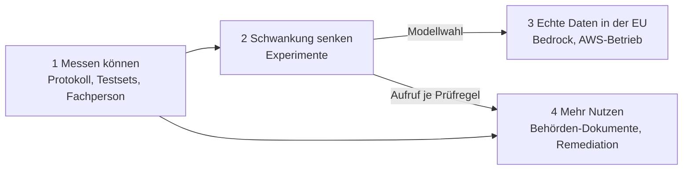
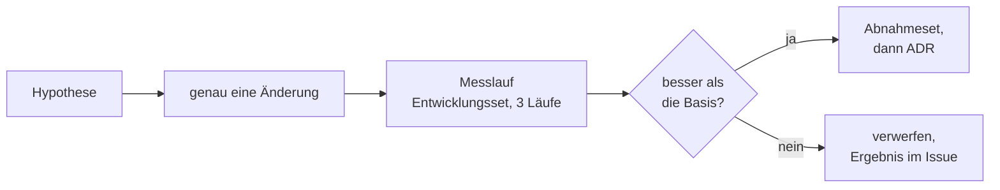
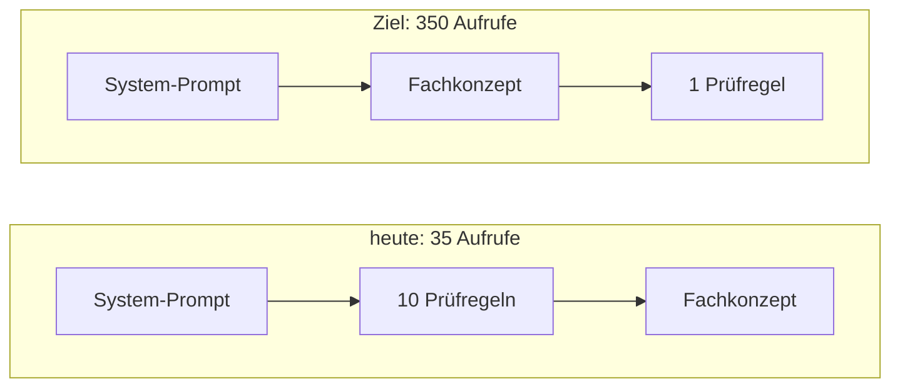
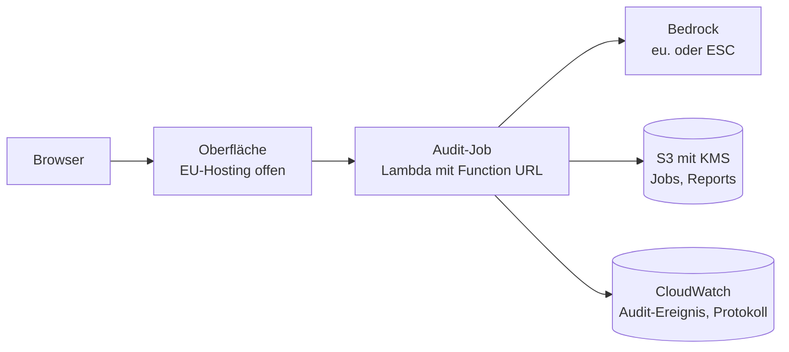
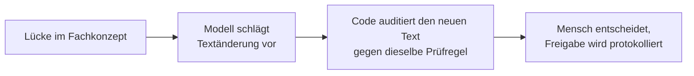

# GovGuard – Ausbau-Ideen vom 22.10.2026 (veraltet)

> **Veraltet seit 25.10.2026 und keine Quelle für Planung.** Die Roadmap steht allein in den Backup-Folien „Produktstrategie“ bis „Einbindung in Behördenwerkzeuge“ der [Abschlusspräsentation](https://claude.ai/artifact/9afnq6xg11xyqzPzGcjT7w), Kern ist „Roadmap: GovGuard im Behördenablauf“. Diese Datei bleibt nur, weil README, ARCHITECTURE und ADRs auf sie verweisen.

Stand 22.10.2026. Der Prototyp prüft Fachkonzepte gegen 350 Prüfregeln aus DSGVO, SDM und KI-VO, als Demo auf Streamlit Community Cloud mit Groq. Wie GovGuard heute arbeitet, steht in [FUNKTIONSWEISE](FUNKTIONSWEISE.md).
Das Architektur-Audit ist gebaut, aber eingefroren: Für Cloud als Code gibt es viele Prüfwerkzeuge, für Fachkonzepte keins ([Markt und Forschung](research/Markt%20und%20Forschung%20–%20Audits%20und%20Remediation.md), #69).

Drei Prinzipien gelten in jeder Phase:

- Jede Prüfregel bekommt einen Befund; keine Regel fällt durch eine Suche weg (ADR 0011).
- Jeder Beleg ist ein wörtliches Zitat, das der Code aus der Eingabe schneidet (ADR 0017).
- Das Modell urteilt nur; Vorbereitung und Endkontrolle macht der Code.

## Überblick

Vier Phasen, in dieser Reihenfolge: erst messen können, dann die Schwankung senken, dann echte Daten in die EU bringen. Mehr Nutzen baut auf den ersten beiden auf.
Jede Änderung am Urteil läuft durch dieselbe Messschleife. Eine Messschleife heißt: eine Änderung, ein Messlauf, dann übernehmen oder verwerfen.

Der Ausblick der Abschlusspräsentation verteilt sich so:

| Punkt im Ausblick | Phase |
|---|---|
| Trefferquote richtig messen | 1 |
| Stärkeres Modell | 2 |
| Echte Daten in der EU | 3 |
| Befunde den Behörden-Dokumenten zuordnen, Remediation-Editor | 4 |

## Phase 1: Messen können

Heute ist gemessen, ob ein Befund stabil ist, nicht, ob er stimmt. Die Trefferquote ist der Anteil der Befunde, die eine Fachperson bestätigt.
Ohne sie und ohne Protokoll der Modellaufrufe lässt sich kein Experiment aus Phase 2 bewerten.

| Baustein | Was | Warum | bisher |
|---|---|---|---|
| Protokoll der Modellaufrufe | Je Audit eine JSON-Datei neben dem Report: jeder Prompt, jede Antwort, Retries mit Grund, Tokens, Dauer. Pydantic AI liefert die Nachrichten schon heute (`capture_run_messages`). | Ein Kippen zwischen zwei Läufen lässt sich nur am Wortlaut der Antworten erklären. | Szen. 11 |
| Prompt-Prüfsumme | Prüfsumme über alle Prompts und Antwortformulare im Report (`Trace.prompt_sha256`), dazu den Versionsstand (`KB_COMMIT`) setzen. | Zwei Reports sind nur vergleichbar bei gleichem Modell, Katalog und Prompt. | Szen. 11 |
| Getrennte Testsets | Ein Entwicklungsset zum Verbessern und ein Abnahmeset, das nie zum Verbessern dient. Heute dienen dieselben 6 Musterfälle beidem. | Sonst passt sich der Prompt an die Prüffälle an. | Szen. 18 |
| Fachperson | Bewertet eine Stichprobe der Befunde und legt das Soll fest; daraus falsch-positive und falsch-negative Raten. | Erst dann ist GovGuard mehr als ein Prüfassistent. | Szen. 18 |
| Preset-Gate | Ein Lauf der Musterfälle vergleicht Gesamtstatus und Pflichtbefunde automatisch mit dem Soll; heute vergleicht ein Mensch. | Jede Änderung in Phase 2 braucht diesen Vergleich. | Szen. 18 |

**Weiche Datenresidenz:** Das Protokoll enthält das Fachkonzept. Als lokale Datei ist es nur für erfundene Daten zulässig; mit echten Daten gehört es in die EU (Phase 3, CloudWatch). Pydantic Logfire, das Beobachtungswerkzeug von Pydantic AI mit EU-Region, ist eine Option, kein Plan.

## Phase 2: Schwankung senken

Heute behalten über drei Läufe 70 bis 94 % der Prüfregeln ihren Status (QS-3, #54). Jede Maßnahme ist ein Experiment nach der Messschleife.
Entschieden wird erst nach dem Messlauf, mit ADR. Messgrößen: gleicher Status über 3 Läufe, Trefferquote, Kosten und Dauer je Audit.

| Experiment | Hypothese | Beleg heute | Preis |
|---|---|---|---|
| Eine Prüfregel je Aufruf statt 10 | Nachbarregeln im Paket ziehen das Urteil mit. | Allein lagen Regeln stabil auf WARN, im Paket einmal 6 FAILs, einmal keins (ADR 0020, #31). | mehr Tokens; bei Groq bindet das Token-Limit je Minute die Dauer |
| Prompt Caching | Senkt die Kosten der Einzelregel. | Prompt Caching heißt: Der Anbieter rechnet einen gleichen Anfang der Anfrage billiger ab. Groq gibt 50 % auf solche Tokens. | Reihenfolge im Prompt ändern, siehe unten |
| Stärkeres Modell | Weniger Kippen zwischen Läufen. | Alter Katalog (151 Regeln): Bei Groq kippten 42 Regeln, bei Claude Haiku 19 (#29). | etwa 8- bis 9-fache Kosten; die Wahl entscheidet den EU-Weg (Phase 3) |
| Zweitprüfer für Einhaltung | Weniger falsche Einhaltung, das größte Restrisiko. | Der Verstoß-Prüfer senkt nur FAIL; eine Einhaltung prüft niemand zweimal. | ein Aufruf mehr je Audit |
| Härtere Prompts | Begründung vor dem Status, Feldbeschreibungen im Formular, Abwehrsatz gegen Anweisungen in der Eingabe. | Prinzipien 3, 5 und 6 der [METHODIK](research/METHODIK.md#64-neun-prinzipien); dazu ein Red-Team-Musterfall. | je Änderung ein Messlauf |
| Retry bei HTTP 400 | Ein beschädigter Tool-Aufruf von Groq bricht heute ohne Retry ab. | einziger Abbruch der Messkampagne (#54) | billig, braucht einen Messlauf |

Prompt Caching trifft nur einen gleichen Anfang. Heute stehen die Regeln vor dem Fachkonzept, also wiederholt sich nur der kurze System-Prompt. Für den Cache muss das Fachkonzept nach vorn.

Rechenbeispiel aus den Tokens der Messkampagne (#54) und Listenpreisen, **nicht gemessen**. Annahmen: je Einzelregel 500 Ausgabe-Tokens bei Groq (das Modell denkt vor der Antwort), 200 bei Haiku; Haiku über Bedrock in der EU ca. 1,10 $ / 5,50 $ je Million Tokens, gecachte Eingabe 0,11 $.

| Variante | Meldeportal (kurz) | Selbstaudit (lang) | Hinweis |
|---|---|---|---|
| Groq, Pakete (heute) | 0,07 $ (gemessen) | 0,09 $ (gemessen) | 2,5 bis 3,5 min |
| Groq, Einzelregel | ≈ 0,19 $ | ≈ 0,65 $ | lang: ≈ 18 min wegen Token-Limit |
| Groq, Einzelregel mit Cache | ≈ 0,15 $ | ≈ 0,40 $ | zählen gecachte Tokens zum Limit? prüfen |
| Haiku, Pakete | ≈ 0,60 $ | ≈ 0,80 $ | 0,90 $ gemessen mit altem Katalog (#14) |
| Haiku, Einzelregel mit Cache | ≈ 1,00 $ | ≈ 0,90 $ | Haiku cacht erst ab 4.096 Tokens; ein kurzes Fachkonzept profitiert nicht |

Bei Groq kostet heute die Ausgabe mehr als die Eingabe (Meldeportal: 82.000 Ausgabe- zu 112.000 Eingabe-Tokens, Ausgabe viermal so teuer). Caching lohnt also vor allem bei langen Fachkonzepten.

## Phase 3: Echte Daten in der EU

Die Demo läuft in den USA (Streamlit, Groq), darum nur mit erfundenen Daten. Für echte Daten müssen Oberfläche, Audit, Modell und Protokoll in der EU laufen.
Welches Modell es wird, entscheidet Phase 2; davon hängt ab, welcher EU-Weg in Frage kommt.

| EU-Weg | Modelle | Stand |
|---|---|---|
| Bedrock in Frankfurt, Profil `eu.` | Claude Haiku und Sonnet | im Code gebaut (ADR 0001), nur über die Kommandozeile; Zugang abbestellt |
| AWS European Sovereign Cloud (ESC) | Gemma 4 verfügbar; gpt-oss und Nova angekündigt; kein Claude | Region Brandenburg seit 15.01.2026; Modell erst messen |

Die ESC ist eine eigene Partition, getrennt vom globalen AWS. Läuft gpt-oss dort, bliebe das heutige Modell erhalten. Region und Partition gehören dann in die Konfiguration statt fest `eu-central-1` (ARNs über `Aws.PARTITION`). _(Modellliste vor dem Bau gegen die AWS-Doku prüfen.)_

| Baustein | Anpassung | bisher |
|---|---|---|
| Audit-Job | Lambda mit Function URL (IAM-Auth), asynchron mit Job-ID, Timeout 300 s; Katalog in S3. Die Antwort ist HTTP 202 mit Job-ID, der Report kommt per `GET`. | Szen. 12 |
| Verschlüsselung und Aufbewahrung | S3 und Log-Gruppe mit KMS ab Tag 1; Jobs 1 Tag, Audit-Ereignis 365 Tage, ohne Eingabetext (Art. 5 Abs. 1 lit. c DSGVO). | Szen. 12 |
| Oberfläche | Streamlit braucht eine dauerhafte WebSocket-Verbindung, Lambda hält sie nicht. In Frage kommen ein Container (Fargate) oder EC2, beide mit Leerlaufkosten: Ausnahme von der FinOps-Leitplanke, neuer ADR (ADR 0004 offen). | Szen. 12 |
| Pipeline | GitHub Actions mit OIDC: `cdk synth`, cdk-nag und Assertions als Gate, dann Deploy und Upload des Katalogs. | Szen. 12 |
| Zugang und Repo | Echte Anmeldung statt gemeinsamem Passwort, Protokoll der Starts; Branch-Schutz, SBOM und Schwachstellen-Scan. | Szen. 17 |
| Datenschutz-Nachweise | Auftragsverarbeitung mit jedem Anbieter, keine Speicherung beim Modellanbieter. | Szen. 17 |
| Mehrere Nutzer | Warteschlange vor dem Audit statt Abbruch bei Drosselung (HTTP 429); erst messen. | Szen. 15 |

## Phase 4: Mehr Nutzen

Erst wenn die Trefferquote bekannt ist (Phase 1), lohnt mehr Funktion. Der Remediation-Editor nutzt den Aufruf je Prüfregel aus Phase 2.

| Baustein | Was | bisher |
|---|---|---|
| Befunde den Behörden-Dokumenten zuordnen | Jeder Befund nennt das Dokument, in dem die Lücke zu schließen ist: Fachkonzept, Verzeichnis der Verarbeitungstätigkeiten, Datenschutz-Folgenabschätzung, Löschkonzept. Dazu eine Vorprüfung, ob eine Folgenabschätzung nötig ist. | Szen. 16 |
| Remediation-Editor | Zu jeder Lücke ein Textvorschlag, gezeigt erst, wenn der Code ihn gegen dieselbe Prüfregel auditiert hat. | Präsentation, Backup „Remediation“ |
| KI-VO voll | Weitere Artikel über die Liste des Vorfilters; Hinweis „KI-System erkannt, Einstufung fehlt“; besondere Kategorien (Art. 9 DSGVO) als Bedingung. _(Rechtsstand vorher prüfen.)_ | Szen. 10 |
| Lange Fachkonzepte | Über 100.000 Zeichen: Das Modell zieht je Kapitel Fakten mit Zitat, der Code baut ein Faktenblatt, das Audit läuft darauf; die Oberfläche zeigt das Faktenblatt. JSON vor dem Nummerieren formatieren. | Szen. 2 |

Die Forschung warnt vor Vorschlägen, die nur den Befund verschwinden lassen, und vor Prüfern, die der Maschine zu sehr vertrauen. Darum bleibt die Freigabe bewusst kein bloßer Klick.

## Nicht mehr im Ausbau

Alles zum Architektur-Audit und zu Referenzarchitekturen ist gestrichen: Golden Archetypes und ihre Generierung, Mehrfach-Architekturen, Portal-Archetyp, Aurora- und Container-Archetyp, Leerlaufkosten fremder Architekturen, Terraform mit Code-Inventar, weitere Typen im Prüfumfang.
Die Entwürfe standen bis 22.10.2026 hier als Szenarien 1 bis 18; sie liegen im Git-Verlauf.

> „Wir skalieren durch Aufteilen, nicht durch Weglassen. Vollständigkeit und Zitatpflicht gelten in jeder Phase.“
