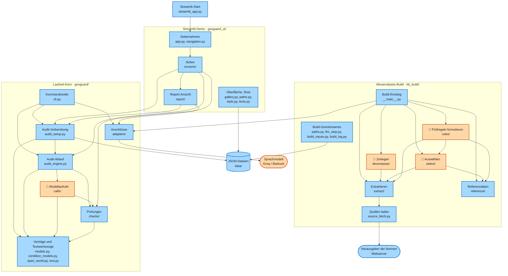
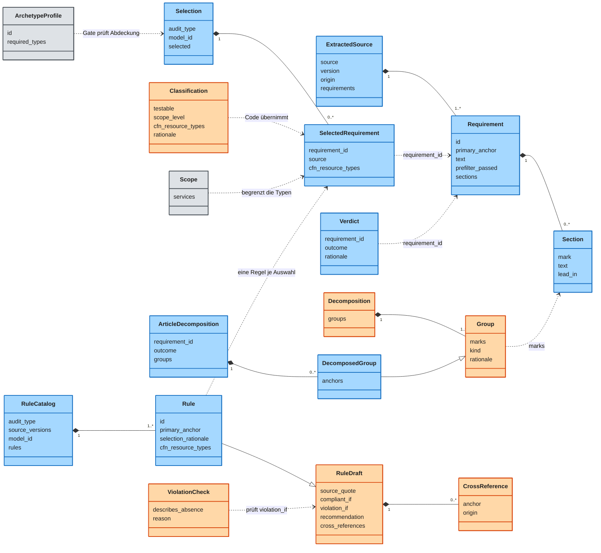
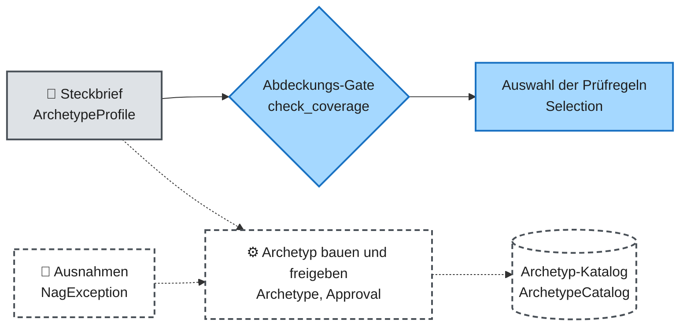
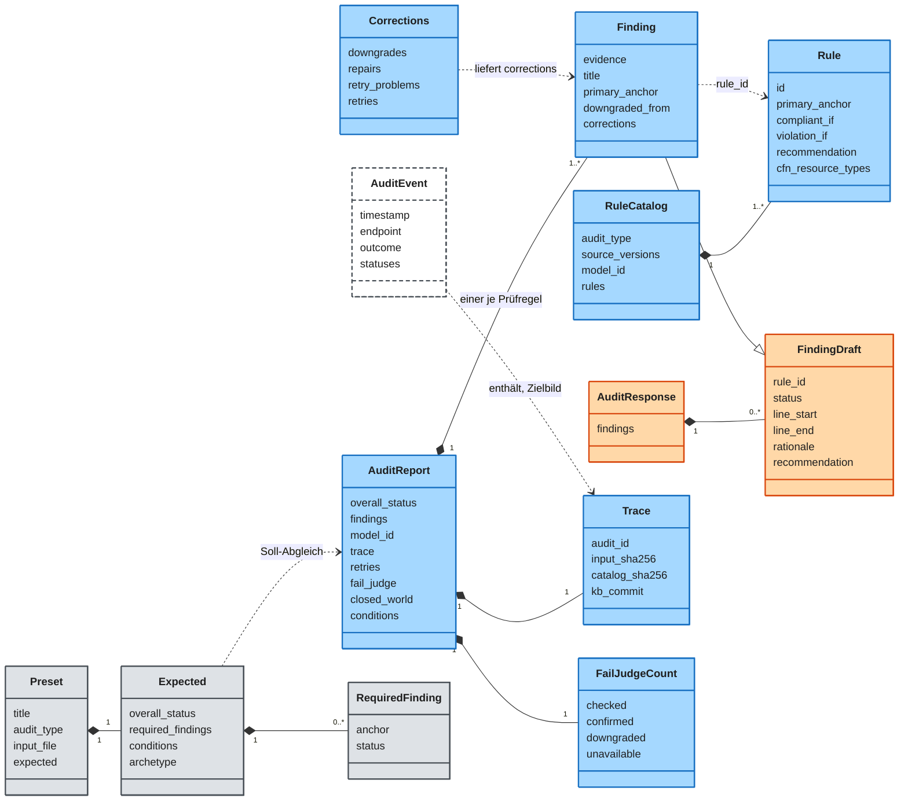
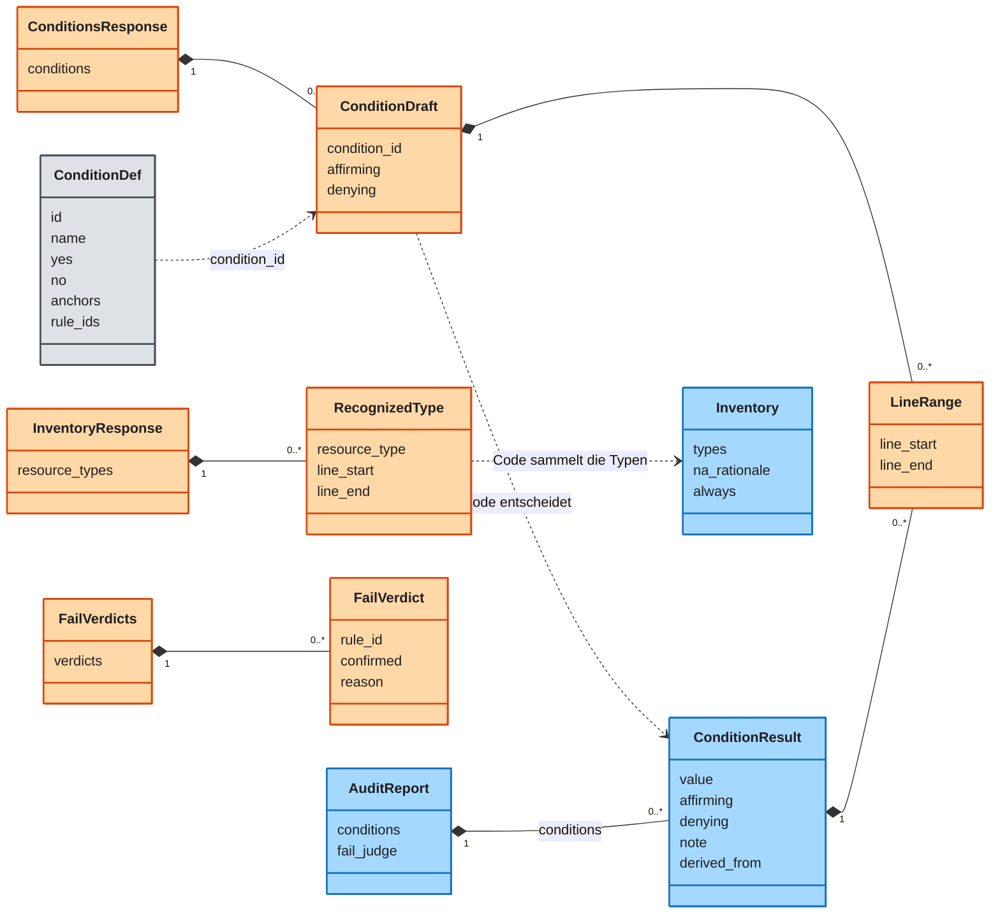
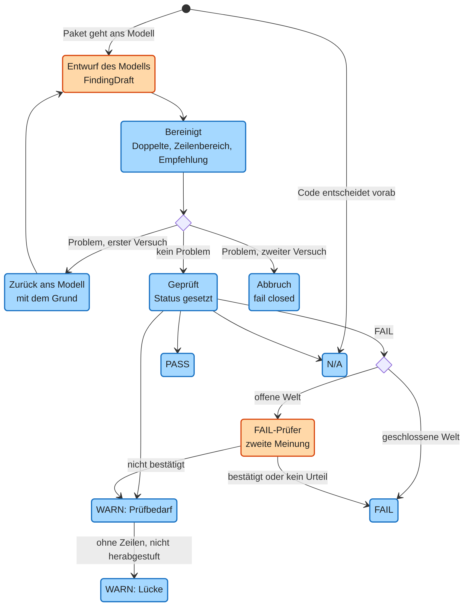
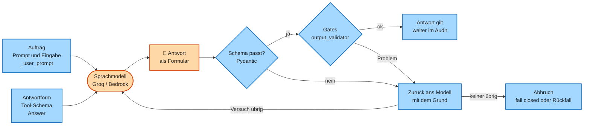

# GovGuard – Design (Module, Typen, Abläufe)

Dieses Dokument zeigt, wie GovGuard im Code aufgebaut ist: die Module, die Datentypen, den Lebenslauf eines Befunds und die Modellaufrufe. Code und ADRs sind die Wahrheit; was nicht gebaut ist, steht gestrichelt als Zielbild. Das Warum steht in [ARCHITECTURE.md](ARCHITECTURE.md), Begriffe in [CONTEXT.md](../CONTEXT.md), die Regeln für Diagramme am Ende ([Konventionen](#konventionen)).

| Diagramm | Frage | Abschnitt |
|---|---|---|
| D11 Module | Wer darf wen importieren? | D11 |
| D12 Typen des Builds | Welche Datentypen hat der Build? | D12, Details in 1 |
| D13 Typen der Laufzeit | Was enthält ein Audit-Report? | 2.1 |
| D13b Typen der Vorläufe | Wie kommen Bedingungen und Inventar hinein? | D13b |
| D14 Zustände eines Befunds | Wie wird aus der Antwort des Modells ein Status? | D14 |
| Archetyp-Zweig | Was ist vom Golden Archetype gebaut? | 1.3 |
| D15 Anatomie eines Modellaufrufs | Wie läuft ein Aufruf? | 2.5 |
| Tabelle der 8 Modellaufrufe | Welche Aufrufe gibt es, und was prüft der Code? | 2.6 |

## D11 Module (C4-Ebene 3)

C4 ist eine Methode, ein System in vier Zoomstufen zu zeichnen, vom Umfeld bis zum Code. Ebene 3 zeigt die Komponenten eines Programms. Eine Komponente ist ein Baustein mit einer klaren Aufgabe, hier ein Ordner oder eine Datei unter `src/`. Ein Retry ist die Wiederholung einer Frage ans Modell, nachdem der Code die Antwort verworfen hat. Die offene Welt ist die Annahme, dass etwas, das die Eingabe nicht erwähnt, anderswo geregelt sein kann.

**Kernaussage:** Die Prüfungen kennen weder das Modell noch AWS, die Oberfläche kennt kein AWS, und die Laufzeit kennt den Build nicht.



**Legende:** Pfeil zwischen Komponenten = „importiert“, Pfeil zu Zylinder oder abgerundetem Kasten = „liest“ bzw. „ruft auf“. 🤖 orange = Komponente, die selbst mit dem Modell spricht. ⚙️ blau = reiner Code. Zylinder = Speicher, abgerundet = externes System. Drei Gruppen von Pfeilen fehlen, damit das Bild lesbar bleibt: Jede Komponente darf die Verträge importieren, jeder Build-Schritt das Build-Gemeinsame und die Report-Ansicht und die Seiten den Oberflächen-Rest.

**Beschreibung:**

- **Eine Richtung:** Oben stehen die drei Einstiege (Kommandozeile, Streamlit-Start, Build-Einstieg), unten die Verträge. Die Pfeile laufen von oben nach unten; nur die Gemeinsamen importieren zwei Typen zurück: die Farben der Oberfläche (`style.py`) die Kategorien der Report-Ansicht, die geteilten Build-Eingaben (`build_inputs.py`) Quelle und Prüfumfang.
- **Zwei Wege zum Modell:** Die Laufzeit spricht über die Modellaufrufe (`calls/`) mit dem Modell und bricht bei einer ungültigen Antwort fail closed ab. Fail closed heißt: Im Zweifel gibt es kein Ergebnis statt eines falschen. Der Build fragt das Modell direkt über Pydantic AI; Einstufung und Zerlegung haben einen Cache (`llm_step.py`) und vermerken eine ungültige Antwort als Modellfehler (`llm_error`), statt abzubrechen (2.6).
- **Die Demo bleibt ohne AWS:** Die Seiten laden nur den Groq-Anschluss (`groq_services.py`). Den Bedrock-Anschluss (`aws_services.py`) nutzen nur Kommandozeile und Build (ADR 0023).

| Komponente | Aufgabe | im Code |
|---|---|---|
| Kommandozeile | startet ein Audit lokal mit Groq oder Bedrock | `govguard/cli.py` |
| Audit-Vorbereitung | lädt Kataloge und Bedingungen, baut die Rückverfolgung, formuliert Fehlertexte | `govguard/audit_setup.py` |
| Audit-Ablauf | teilt die Prüfregeln in Pakete, sammelt die Befunde, bildet den Gesamtstatus | `govguard/audit_engine.py` |
| Modellaufrufe | alle LLM-Aufrufe der Laufzeit, zählt die Wiederholungen (Retries) | `govguard/calls/` |
| Prüfungen | reine Funktionen, die jede Modellantwort kontrollieren und reparieren | `govguard/checks/` |
| Verträge und Textwerkzeuge | Datentypen (Pydantic), Zitat-Vergleich, Regel für nicht erwähnte Einstellungen (offene Welt) | `govguard/models.py`, `condition_models.py`, `open_world.py`, `text.py` |
| Anschlüsse | einziger Ort für die Bibliotheken von Bedrock (boto3) und Groq | `govguard/adapters/` |
| Seitenrahmen | Rahmen und Navigation der Oberfläche | `govguard_ui/app.py`, `navigation.py` |
| Seiten | Start, Audit erstellen, Galerie; startet das Audit selbst | `govguard_ui/screens/` |
| Report-Ansicht | zeigt einen Audit-Report: Tabelle, Detail, Lücken, Bedingungen | `govguard_ui/report/` |
| Oberfläche, Rest | Galerie lesen, Pfade, Farben und Texte | `govguard_ui/gallery.py`, `paths.py`, `style.py`, `texts.py` |
| Build-Einstieg | verteilt die Build-Kommandos auf die Schritte | `kb_build/__main__.py` |
| Extrahieren | liest je Quelle die Anforderungen aus (ohne LLM) | `kb_build/extract/` |
| Zerlegen | gruppiert die Abschnitte eines Rechtsartikels (ADR 0026) | `kb_build/decompose/` |
| Auswählen | Modell urteilt „prüfbar“, Code wählt die feste Menge der Prüfregeln (Bounded Catalog, 1.2) | `kb_build/select/` |
| Prüfregeln formulieren | Modell schreibt je Anforderung eine Prüfregel, Gates prüfen sie | `kb_build/rules/` |
| Referenzdaten | Prüfumfang, Archetyp-Steckbriefe, CloudFormation-Typen und -Eigenschaften | `kb_build/reference/` |
| Build-Gemeinsames | Datenpfade, Cache-Weg zum Modell, geteilte Eingaben, Build-Log | `kb_build/paths.py`, `llm_step.py`, `build_inputs.py`, `build_log.py` |
| Quellen laden | einziger Ort für HTTP-Downloads mit SHA-256 | `kb_build/source_fetch.py` |

Diese Import-Regeln hält je ein Architektur-Test fest (`tests/test_architecture.py`). Dass die Diagramme zum Code passen, prüft der Drift-Test (`tests/test_docs_drift.py`):

| Regel | Warum | im Code (Test) |
|---|---|---|
| Prüfungen importieren nie Modellaufrufe oder Anschlüsse, auch nicht über Umwege | Prüfungen bleiben ohne Modell testbar (ADR 0027) | `test_checks_import_neither_calls_nor_adapters` |
| die Report-Ansicht importiert nie eine Seite | die Seiten nutzen die Ansicht, nie umgekehrt (ADR 0027) | `test_the_report_view_imports_no_screen` |
| die Oberfläche lädt weder die Kommandozeile noch den Bedrock-Anschluss | die Demo läuft ohne AWS (ADR 0023) | `test_demo_ui_loads_no_aws_and_no_entry_point` |
| Bibliotheken für Bedrock (boto3), Groq und HTTP nur in ihrem Anschluss, Prozessstart (`subprocess`) nirgends | ein Ort je Außenkontakt, keine gebauten Archetypen (ADR 0019) | `test_io_imports_only_in_their_adapter` |
| kein Build-Schritt importiert den Ablauf (`run.py`) eines anderen | geteilte Eingaben liegen im Build-Gemeinsamen (ADR 0027) | `test_no_build_step_imports_the_run_of_another` |
| Laufzeit-Kern und Oberfläche importieren nie den Build | der Build ist ein Werkzeug, das die Laufzeit nur benutzt, nie umgekehrt | `test_the_runtime_never_imports_the_build` |

## D12 Typen des Builds

Ein Klassendiagramm (`classDiagram`) zeigt Datentypen mit ihren Feldern und wie sie zusammenhängen. Es stammt aus UML, der Standard-Bildsprache für Software-Entwürfe. Der Prüfumfang ist die Liste der AWS-Dienste und Ressourcentypen, die GovGuard prüft. Ein Archetyp-Steckbrief nennt die Ressourcentypen, die eine Referenzarchitektur mindestens braucht. Ein Tool-Schema ist das Formular, das das Modell bei einem Aufruf ausfüllen muss. Der Code lehnt jede Antwort ab, die nicht hineinpasst.

**Kernaussage:** Das Modell schreibt nur kleine Entwürfe (orange), der Code ergänzt Anker, Herkunft und Gruppen (blau), und Prüfumfang und Archetyp-Steckbriefe kommen vom Menschen (grau).



**Legende:** 🤖 orange = Tool-Schema, das das Modell ausfüllt. ⚙️ blau = Vertrag, den der Code schreibt und prüft. 👤 grau = von Hand gepflegte Eingabe unter `data/input/`. Pfeile: `*--` = enthält, `--|>` = erweitert, `..>` = verweist per Kennung oder Marke. Gezeigt sind nur die wichtigsten Felder.

| Was | Wer schreibt | im Code |
|---|---|---|
| Quelle mit Anforderungen und Abschnitten | ⚙️ Code | `ExtractedSource`, `Requirement`, `Section` |
| Prüfumfang und Archetyp-Steckbrief | 👤 Mensch | `Scope`, `ArchetypeProfile` |
| Einstufung „prüfbar“ | 🤖 Modell | `Classification` |
| Auswahl und ihr Protokoll | ⚙️ Code | `Selection`, `SelectedRequirement`, `Verdict` |
| Gruppen eines Rechtsartikels und ihr Protokoll | 🤖 Modell, ⚙️ Code ergänzt | `Decomposition`, `Group`, `DecomposedGroup`, `ArticleDecomposition` |
| Entwurf einer Prüfregel, Querverweis, Urteil zum Verstoßkriterium | 🤖 Modell | `RuleDraft`, `CrossReference`, `ViolationCheck` |
| Prüfregel und Katalog | ⚙️ Code | `Rule`, `RuleCatalog` |

**Beschreibung:**

- **Der Weg einer Quelle:** Aus der Quelle werden die Anforderungen (`ExtractedSource`), daraus die Auswahl (`Selection`) und der Katalog der Prüfregeln (`RuleCatalog`). Rechtsartikel zerlegt der Build vorher in Gruppen (`ArticleDecomposition`). Ein Gate prüft, dass jeder Pflicht-Typ eines Archetyp-Steckbriefs (`ArchetypeProfile`) in der Auswahl vorkommt.
- **Entwurf und Vertrag:** Aus dem Entwurf (`RuleDraft`) entsteht das Tool-Schema; die fertige Prüfregel (`Rule`) ergänzt Kennung, Primäranker und Herkunft. Ebenso ergänzt die zerlegte Gruppe (`DecomposedGroup`) die Gruppe des Modells um die Anker. So kann das Modell keinen Anker erfinden.
- **Zwei Protokolle:** Das Urteil je Anforderung (`Verdict`) hält fest, warum sie aufgenommen oder verworfen wurde. Das Zerlegungsprotokoll (`ArticleDecomposition`) tut dasselbe je Artikel und vermerkt einen Modellfehler (`llm_error`), wenn der Artikel ganz bleibt.

## 1. Build-Verträge

Dieser Teil vertieft D12: Wie sieht eine Quelle aus, wie kommt eine Anforderung in den Katalog, und was steht in einer Prüfregel? Die Reihenfolge des Builds zeigt [ARCHITECTURE.md](ARCHITECTURE.md) 5.1 (D5).

### 1.1 Quelle und Anforderung (`ExtractedSource`, `Requirement`)

Eine Quelle ist ein Regelwerk wie CIS AWS, eine Anforderung eine einzelne zitierfähige Vorgabe darin. Ein Adapter je Quelle (`kb_build/extract/<quelle>.py`) schreibt die extrahierte Quelle als Datei (`data/intermediate/extracted/<quelle>.json`). Die Datei enthält alle Anforderungen der Quelle, nicht nur die gefilterten, denn das Gate prüft auch Querverweise auf Anforderungen außerhalb der Auswahl.

Der Primäranker ist die eine Anforderung, aus der eine Prüfregel stammt. Den Anker setzt der Code, nie das Modell. Das Gate prüft, dass er in der Quelle wirklich existiert. OSCAL (BSI) und Formex (EU-Amtsblatt) sind die maschinenlesbaren Formate der Herausgeber; CELLAR ist das Archiv des Amts für Veröffentlichungen der EU, aus dem die Formex-Dateien kommen. Das Prowler-JSON stammt aus dem Open-Source-Prüfwerkzeug Prowler und führt die Kennungen von C5, CIS und FSBP (ADR 0008).

| Quelle | Format des Primärankers | Existenz-Check |
|---|---|---|
| BSI Grundschutz++ | `BSI GS++ DET.3.1` | Kennung steht im OSCAL-Katalog |
| BSI C5 | `BSI C5 CRY-03.01B` | Kennung steht im Prowler-JSON (fester Stand) |
| CIS AWS | `CIS AWS v7.0.0 3.1.4` | Kennung steht im Prowler-JSON |
| AWS FSBP | `AWS FSBP SNS.1` | Kennung steht im Prowler-JSON |
| DSGVO | `DSGVO Art. 32`, bei Zerlegung `DSGVO Art. 32 Abs. 1 lit. b` | Artikel steht im Formex-XML (CELLAR) |
| KI-VO | `KI-VO Art. 50 Abs. 2` | Artikel steht im Formex-XML |
| SDM | `SDM Löschen M60.D01` | Maßnahme steht im Text des Bausteins |

Was ein Adapter liefert und was er verwirft, steht je Quelle in dieser Tabelle. Die Fakten (`attributes`) sind reine Tatsachen der Quelle. Sie stehen als Wörterbuch (`dict`) statt als eigene Felder, weil jede Quelle andere Metadaten hat; der Preis ist weniger Typsicherheit, darum nennt die Tabelle die erlaubten Schlüssel. Der Vorfilter (`prefilter`) ist eine feste Code-Regel, die danach offensichtlich unpassende Anforderungen ohne Modell verwirft. Sein Urteil steht in der Datei (`prefilter_passed`, `prefilter_reason`), damit der Git-Diff zeigt, welche Anforderungen nach einer Regeländerung neu dazukommen oder herausfallen.

| Quelle | Einheit | Fakten (`attributes`) | Vorfilter (Code) |
|---|---|---|---|
| BSI Grundschutz++ | Control, z. B. `DET.3.1` (Praktiken: DLS Dienstleistersteuerung, BER Berechtigung, DET Detektion, KONF Konfiguration, BES Beschaffung, ARCH Architektur) | `practice`, `modal_verb`, `sec_level`, `cia_sum` | MUSS oder SOLLTE, Niveau normal-SdT (Sicherheitsniveau „normal“ des Stands der Technik im BSI-Katalog), Praktik DLS, BER, DET, KONF, BES oder ARCH |
| BSI C5 | Kriterium, z. B. `CRY-03.01B` | `area` | Bereiche OPS Betrieb, IAM Identitäts- und Berechtigungsmanagement, CRY Kryptografie, COS Kommunikationssicherheit, PSS Produktsicherheit |
| CIS AWS | Empfehlung, z. B. `3.1.4` | `chapter`, `level`, `automated` | Kapitel 2 IAM, 3 Storage, 4 Logging, 6 Networking |
| AWS FSBP | Control, z. B. `SNS.1` | `service`, `severity` | Dienst gehört zum Prüfumfang (dazu EC2 wegen der VPC-Controls) |
| DSGVO | Artikel, danach zerlegt (ADR 0026) | `chapter`, `fine_tier` | Kapitel II–V (Art. 5–49), ohne Art. 20, 27, 41, 47: gelten nicht für Behörden (ADR 0028) |
| KI-VO | Artikel, danach zerlegt | `chapter` | Art. 4, 5, 6, 13, 14, 26, 27, 50 (ADR 0025) |
| SDM | Maßnahme, z. B. `M60.D01` | `module`, `layer` | keiner: alle Maßnahmen der Bausteine M60, M50, M51 auf allen Ebenen |

Jeder Adapter hat zwei reine Funktionen: Das Extrahieren (`extract(origin, rohdaten, version)`) liefert die Quelle (`ExtractedSource`). Der Vorfilter (`prefilter(requirement)`) liefert `None` (bestanden) oder einen festen Begründungssatz für das Auswahlprotokoll. Datei lesen und den Stand der Quelle (`version`) aus der Quellenliste (`data/input/sources.json`) holen übernimmt der Ablauf des Schritts (`kb_build/extract/run.py`); so bleiben die Adapter ohne Dateizugriff testbar.

### 1.2 Auswahl und Prüfregel (`Selection`, `Verdict`, `Rule`)

Das Modell urteilt nur über „prüfbar“ und nennt die Ebene (`Classification`, `scope_level`): wessen Pflicht die Anforderung ist, die des Templates, des Kontos, von Personen oder des Cloud-Anbieters. Die Aufnahme in den Bounded Catalog entscheidet der Code. Der Bounded Catalog ist die feste Menge aller prüfbaren und relevanten Prüfregeln, die jedes Audit vollständig bewertet (ADR 0011). Zu jeder Anforderung jeder Quelle steht genau ein Eintrag im Auswahlprotokoll (`data/intermediate/verdicts_<arch|spec>.json`):

| Ergebnis | Bedeutung | Entscheidet | im Code (`outcome`) |
|---|---|---|---|
| ausgewählt | prüfbar und relevant, steht im Katalog | Code | `selected` |
| vorgefiltert | vom Vorfilter verworfen, mit festem Satz; bei der Zerlegung auch „keine Pflicht“ (`keine_pflicht`) | Code | `prefiltered` |
| nicht relevant | Architektur: Pflicht liegt nicht am Template, oder kein Ressourcentyp liegt im Prüfumfang (ADR 0013) | Code | `not_relevant` |
| nicht prüfbar | an Spezifikation oder Template nicht entscheidbar | Modell | `not_testable` |
| Modellfehler | Antwort auch nach zwei Retries ungültig; bei einem Pflichtanker (1.4) bricht der Build ab | Code | `llm_error` |

Aus jeder ausgewählten Anforderung schreibt das Modell einen Entwurf (`RuleDraft`), der Code macht daraus die Prüfregel (`Rule`). Feldnamen sind englisch, Inhalte deutsch:

```json
{
  "id": "ARCH-CIS-3.1.4",
  "audit_type": "architecture",
  "source": "CIS",
  "primary_anchor": "CIS AWS v7.0.0 3.1.4",
  "source_quote": "Ensure that S3 is configured with 'Block Public Access' enabled",
  "title": "S3 Block Public Access aktiv",
  "compliant_if": "Jeder S3-Bucket hat alle vier Block-Public-Access-Einstellungen aktiv.",
  "violation_if": "Ein Bucket deaktiviert mindestens eine Einstellung.",
  "recommendation": "Am Bucket BlockPublicAccess.BLOCK_ALL setzen.",
  "cfn_resource_types": ["AWS::S3::Bucket"],
  "selection_rationale": "Direkt an der Bucket-Konfiguration im Template prüfbar.",
  "cross_references": [{ "anchor": "BSI GS++ …", "origin": "ai_suggested" }]
}
```

| Feld | Herkunft | Zweck | im Code |
|---|---|---|---|
| Kennung, Audit-Art, Quelle, Primäranker | Code | Identität und Herkunft; die Kennung ist `<SPEC\|ARCH>-<QUELLE>-<Anforderung ohne Leerzeichen>` und bleibt über Builds stabil | `id`, `audit_type`, `source`, `primary_anchor` |
| Zitat | Modell, vom Code geprüft | wörtlicher Auszug aus der Anforderung | `source_quote` |
| Titel, Kriterium für PASS, Kriterium für FAIL, Empfehlung | Modell | prüfbare Kriterien für PASS und FAIL, dazu die Abhilfe | `title`, `compliant_if`, `violation_if`, `recommendation` |
| Ressourcentypen, Auswahlgrund | Einstufen (Schritt 3 in ARCHITECTURE D5) | für welche Typen die Regel gilt und warum sie prüfbar ist | `cfn_resource_types`, `selection_rationale` |
| Querverweise | Modell, vom Code geprüft | Bezug auf eine andere Quelle; nur „vom Modell vorgeschlagen“ (`ai_suggested`), ohne Einfluss auf den Status. Das Feld hat bewusst nur diesen einen Wert (`Literal`): Scheinpräzision ist ein unbelegter Bezug, der wie ein geprüfter aussieht; das Etikett benennt ihn ehrlich. Eine spätere menschliche Prüfung könnte einen zweiten Wert ergänzen | `cross_references` |

Das Gate prüft jede Prüfregel (`kb_build/rules/gates.py`) in vier Punkten und dazu den ganzen Katalog auf Vollständigkeit (genau eine Prüfregel je ausgewählte Anforderung):

| Prüfung | Frage | Schützt vor | im Code |
|---|---|---|---|
| Schema | Passt das JSON zum Vertrag der Prüfregel? | unvollständigen Regeln | `Rule` |
| Anker | Gibt es Primäranker und Querverweise in den Quellen, Querverweise in einer anderen Quelle? | erfundenen Fundstellen | `invalid_cross_references` |
| Zitat | Steht das Zitat wörtlich im Text genau dieser Anforderung? | erfundenem Normtext; ein Zitat aus Art. 5 belegt keine Regel zu Art. 32 | `is_quoted` |
| Typen | Liegen alle AWS-Ressourcentypen, die Kriterien und Regel nennen, im Prüfumfang? | Kriterien über Dienste, die nichts prüft (#19) | `Scope.outside` |

Zwei Kriterien statt einem: Das Kriterium für PASS (`compliant_if`) und das für FAIL (`violation_if`) lassen eine dritte Zone offen, in der keines eindeutig zutrifft und der Befund WARN lautet. Sie entstehen einmal im Build, damit das Modell die Norm nicht in jedem Audit neu auslegt und ein Mensch den Maßstab im Git-Diff prüfen kann.

Ein falscher Ressourcentyp (`cfn_resource_types`) wäre still gefährlich, denn die Prüfregel würde zur Laufzeit als nicht anwendbar zu N/A. Darum streicht die Einstufung unbekannte Typen (2.6), und die Auswahl steht im Git-Diff.

Der Katalog (`RuleCatalog`) enthält bewusst keinen Zeitstempel, damit ein unveränderter Build keinen Git-Diff erzeugt. Dieselben Prüfungen laufen schon beim Formulieren im Validator des Aufrufs, damit das Modell eine zweite Chance bekommt (D15). Ein Validator ist eine Prüffunktion, die Pydantic AI nach jeder Antwort des Modells aufruft.

### 1.3 Golden Archetype (Zielbild, nicht gebaut)

Ein Golden Archetype ist eine vorab geprüfte Referenzarchitektur. Er ist entworfen, aber bewusst nicht gebaut (ADR 0019). Gebaut ist nur der Steckbrief (`ArchetypeProfile`, `data/input/archetype_profiles.json`): Er nennt die Pflicht-Ressourcentypen, und das Abdeckungs-Gate (`check_coverage` in `kb_build/select/gates.py`) verlangt für jeden mindestens eine Prüfregel.

**Kernaussage:** Vom Archetyp-Zweig läuft heute nur der Steckbrief; alles gestrichelte ist Zielbild.



**Legende:** Durchgezogen = gebaut, gestrichelt = entworfen. Die Namen unter den gestrichelten Kästen gibt es nicht im Code; die Liste der Ausnahmen (`data/nag_allowlist.json`) fehlt ebenfalls.

**Beschreibung:**

- **Gebaut:** Der Steckbrief sorgt dafür, dass der Katalog jeden Pflicht-Ressourcentyp eines Archetyps abdeckt (ADR 0019).
- **Zielbild:** Archetyp bauen, mit Ausnahmen freigeben und in einem Katalog anbieten. Die drei Steckbriefe stehen in [ARCHITECTURE.md](ARCHITECTURE.md) 5.4.
- **Warum nur auswählen:** Zur Laufzeit gäbe es keine Zeit, generierten Infrastruktur-Code zu übersetzen, zu prüfen und zu korrigieren. Darum würde der Archetyp vorab im Build entstehen und zur Laufzeit nur gewählt (ADR 0003).

#### Freigabe-Nachweis (Zielbild)

Funktionstrennung heißt: Wer eine Ausnahme erlaubt, ist nicht der, der den geprüften Code schreibt. Der Nachweis (`Approval`) wäre die Akte, die ein Archetyp mitbringt. Geprüft würde das übersetzte Template (`cdk synth`), nicht der CDK-Code, denn Solutions Constructs verbergen ihre Sicherheitsvorgaben im Code. Nichts davon ist gebaut (ADR 0003, 0007, 0019).

| Teil | Inhalt | Warum |
|---|---|---|
| Struktur-Soll | alle Pflicht-Ressourcentypen (`required_types`) stehen im Template | Sonst lieferte das Modell eine „perfekt sichere“ Architektur ohne Datenbank: keine Ressource, kein Verstoß. |
| Compliance-Soll | das eigene Architektur-Audit ergibt nur PASS oder N/A, N/A setzt der Code | Schon ein WARN verhindert die Freigabe. |
| Zweitprüfung | cdk-nag meldet keinen Fehler; die Fehlerliste muss leer sein, die angewandten Ausnahmen stehen daneben | Sonst prüfte ein Modell das Werk eines Modells. Eine leere Liste sagt „lief und fand nichts“, ein fehlendes Feld ließe das offen. |
| Runden | höchstens 3 Korrekturrunden, danach bricht der Build ab | Eine Schleife ohne Grenze kostet Geld; die Rundenzahl zeigt die Qualität der Arbeit. |
| Bindung | Hash des Regelkatalogs, gegen den freigegeben wurde | Ändert sich der Katalog, ist die Freigabe erkennbar wertlos. |

Das ist die Funktionstrennung: Die Ausnahmen pflegt nur ein Mensch, der Code wendet sie an. Der Code des Modells dürfte keine Ausnahme selbst setzen (`acknowledge(...)` in cdk-nag), sonst schaltete das Modell die Prüfung einfach ab.

### 1.4 Musterfall und Soll (`Preset`, `Expected`)

Ein Musterfall ist eine fiktive Beispiel-Eingabe mit festgelegtem Soll-Ergebnis für Demo und Test. Er liegt als Ordner (`data/input/presets/<id>/`) mit einer Eingabedatei und der Beschreibung des Falls (`preset.json`); das Soll legt ein Mensch fest, nie ein früherer Lauf.

| Feld | Bedeutung | im Code |
|---|---|---|
| Titel, Audit-Art, Eingabedatei | Anzeige in der UI, höchstens 100.000 Zeichen | `Preset.title`, `audit_type`, `input_file` |
| Soll-Gesamtstatus | der erwartete Gesamtstatus | `Expected.overall_status` |
| Pflichtbefunde | Primäranker mit erwartetem Status PASS oder FAIL, nie WARN, sonst flackert der Abgleich. Bezug ist der Anker, nicht die Kennung der Prüfregel: Ein Mensch kennt „DSGVO Art. 9“ aus der Norm, und der Anker bleibt gleich, wie immer der Build die Regel formuliert | `Expected.required_findings` (`RequiredFinding`) |
| Soll der Bedingungen | nur Spec: erwarteter Wert je Bedingung | `Expected.conditions` |
| erwarteter Archetyp | Zielbild: nur Spec ohne FAIL; kein Code wertet ihn aus. `None` heißt „nicht geprüft“, `"NONE"` heißt „Soll: kein Archetyp passt“ | `Expected.archetype` |

Die Anker der Pflichtbefunde heißen Pflichtanker. Beim Build bricht das Gate ab, wenn ein Pflichtanker nicht in den Katalog aufgenommen wird (`check_pinned`, ADR 0022). Zur Laufzeit zeigt die Oberfläche jede Abweichung vom Soll, sie würfelt nicht nach (`expected_checks` in `govguard_ui/report/review.py`, ADR 0023).

Warum das Soll so geschnitten ist:

- **Von Hand, nie aus einem früheren Lauf:** Ein zirkulärer Test ist ein Test, dessen Soll aus dem System selbst stammt; er bleibt grün, auch wenn beide Läufe falsch sind. Erst eine unabhängige Quelle der richtigen Antwort, ein Testorakel, macht den Abgleich aussagekräftig.
- **Nur das Wesentliche:** Festgelegt sind der Gesamtstatus und wenige Pflichtbefunde. Das Modell urteilt in Grenzfällen nicht immer gleich, und ein Test auf jeden Befund wäre brüchig, also schon bei harmlosen Änderungen rot.
- **Aus dem richtigen Grund:** Ein richtiger Gesamtstatus kann zufällig stimmen. Verlangt wird darum genau der Status des Pflichtbefunds, nicht „mindestens so schlecht“; so fällt ein zu WARN abgeschwächtes FAIL auf.

## 2. Laufzeit-Verträge

Dieser Teil zeigt, was bei einem Audit entsteht: die Typen (D13), der Lebenslauf eines Befunds (D14), der Ablauf von `run_audit()`, die Anatomie eines Modellaufrufs (D15) und die 8 Aufrufe (2.6).

### 2.1 Befund und Report (D13)

Das Entwurf-Muster gilt auch zur Laufzeit: Das Modell füllt nur einen Entwurf (`*Draft`), der Code ergänzt, was er schon weiß. Die offene Welt entscheidet, was ein Fehlen bedeutet: Was die Eingabe nicht erwähnt, kann anderswo geregelt sein. Deshalb ist Fehlen nur WARN und FAIL nur bei einer Festlegung (ADR 0020). Geschlossen ist allein ein CloudFormation-JSON, das der Code selbst lesen kann.

Der fertige Befund erbt vom Entwurf (`Finding(FindingDraft)`, ebenso `Rule(RuleDraft)`). Was der Code schon weiß, erzeugt das Modell nicht, denn ein Feld, das es nicht ausfüllen muss, kann es auch nicht falsch ausfüllen. Der Entwurf ist ein reiner Datenträger (DTO, Data Transfer Object); der Code reichert ihn an, in der Mustersprache ein Content Enricher (ARCHITECTURE 3).

#### D13 Typen der Laufzeit

**Kernaussage:** Ein Report enthält genau einen Befund je Prüfregel; das Modell liefert nur Entwürfe (orange), alles andere schreibt der Code.



**Legende:** 🤖 orange = Tool-Schema, das das Modell ausfüllt. ⚙️ blau = Typ, den der Code schreibt. 👤 grau = von Hand gepflegt. Weiß gestrichelt = ⚙️ nicht in Betrieb: Das Audit-Ereignis (`AuditEvent`) gibt es als Klasse, aber kein Code schreibt es (Abschnitt 2.4). Pfeile wie in D12; gezeigt sind nur die wichtigsten Felder.

| Was | Wer schreibt | im Code |
|---|---|---|
| Katalog der Prüfregeln, Prüfregel | ⚙️ Code (Build) | `RuleCatalog`, `Rule` |
| Antwort des Modells und sein Entwurf je Prüfregel | 🤖 Modell | `AuditResponse`, `FindingDraft` |
| fertiger Befund mit Beleg, Titel, Anker | ⚙️ Code | `Finding` |
| Sammler aller Korrekturen eines Audits | ⚙️ Code | `Corrections` |
| Audit-Report samt Rückverfolgung und Zähler des FAIL-Prüfers | ⚙️ Code | `AuditReport`, `Trace`, `FailJudgeCount` |
| Musterfall und Soll | 👤 Mensch | `Preset`, `Expected`, `RequiredFinding` |
| Protokolleintrag je Aufruf (Zielbild) | ⚙️ Code | `AuditEvent` |

**Beschreibung:**

- **Ein Befund je Prüfregel:** Der Report hat genau so viele Befunde wie der Katalog Prüfregeln, sortiert nach dem ersten Ressourcentyp (ADR 0011). Titel, Anker und Querverweise holt der Code aus der Prüfregel. Doppelte Befunde zu einer Prüfregel fasst er zum schwersten zusammen (D14).
- **Der Beleg gehört dem Code:** Das Modell nennt nur den Zeilenbereich (`line_start`, `line_end`), der Beleg (`evidence`) wird aus der Eingabe geschnitten und ist damit wörtlich (ADR 0017). Der Report enthält also Eingabeausschnitte (höchstens 200 Zeilen je Befund), dazu das Modell des Audits (`model_id`); nur die Rückverfolgung ist hashes-only (2.4).

### D13b Typen der Vorläufe und Prüfer

Zwei Aufrufe laufen vor den Paketen (Bedingungen im Spec-Audit, Ressourceninventar im Architektur-Audit), einer danach (FAIL-Prüfer). Eine Bedingung ist eine Tatsache über das Vorhaben, von der Prüfregeln abhängen, etwa „ein KI-System ist im Einsatz“ (ADR 0028).

**Kernaussage:** Das Modell nennt nur Zeilen; ob eine Bedingung `yes`, `no` oder `unstated` ist, entscheidet der Code.



**Legende:** Farben und Pfeile wie in D13. Der Zeilenbereich eines Belegs (`LineRange`) ist orange, weil das Modell ihn nennt; der Code prüft ihn.

| Was | Wer schreibt | im Code |
|---|---|---|
| Bedingung samt Kriterium für „ja“ und „nein“ und den betroffenen Prüfregeln | 👤 Mensch (`data/input/conditions.json`) | `ConditionDef` |
| belegende und verneinende Zeilen je Bedingung | 🤖 Modell | `ConditionsResponse`, `ConditionDraft`, `LineRange` |
| Wert der Bedingung `yes`, `no` oder `unstated` im Report | ⚙️ Code | `ConditionResult` |
| erkannte Ressourcentypen mit Zeilen (nur Freitext-Architektur) | 🤖 Modell | `InventoryResponse`, `RecognizedType` |
| Ressourceninventar mit Begründung für N/A | ⚙️ Code | `Inventory` (Datenklasse) |
| Urteil je FAIL: bestätigt oder nicht | 🤖 Modell | `FailVerdicts`, `FailVerdict` |

**Beschreibung:**

- **Nur ein ausdrückliches „no“ macht N/A:** Verneinen die Zeilen die Bedingung für das ganze Vorhaben, setzt der Code die Prüfregeln dieser Bedingung auf N/A, mit der Verneinungszeile als Beleg. Schweigen bleibt `unstated`, die Regeln gehen ans Modell.
- **Fällt der Vorlauf aus, ist nichts verneint:** Alle Bedingungen sind dann `unstated`. Der Vorlauf kann nur Regeln wegnehmen, nie ein FAIL erzeugen, darum gibt es hier kein fail closed.

### D14 Zustände eines Befunds

Ein Zustandsdiagramm (`stateDiagram`) zeigt, in welchen Zuständen etwas sein kann und was es von einem in den nächsten bringt. Hier ist es ein einzelner Befund, von der Antwort des Modells bis zum Status im Report.

**Kernaussage:** Kein Status kommt ungeprüft in den Report: Was nicht belegt ist, wird WARN, was das Modell nicht schafft, wird nach einem Retry zum Abbruch.



**Legende:** Kasten = Zustand, Raute = Gate (Prüfung durch Code). 🤖 orange = Das Modell schreibt, ⚙️ blau = der Code entscheidet. Pfeil = Übergang, beschriftet mit der Bedingung. Eine Herabstufung ist der Wechsel von FAIL oder PASS auf WARN durch den Code; der alte Status bleibt am Befund sichtbar (`downgraded_from`). „Prüfbedarf“ ist die Bezeichnung der Oberfläche für WARN mit Grund (Herabstufung oder zu prüfender Beleg), eine „Lücke“ ein WARN ohne Zeilen. Der Gesamtstatus ist der schlechteste Status: FAIL vor WARN vor PASS vor N/A, nur lauter N/A ergibt N/A (`overall_status`).

| Schritt | Was | Warum | im Code |
|---|---|---|---|
| Vorab-N/A | Der Code setzt N/A, bevor das Modell fragt: Bedingung verneint (Spec) oder Ressourcentyp nicht im Inventar (Architektur). | Das spart Aufrufe und verhindert ein erfundenes Urteil. | `na_drafts`, `Inventory.applies` |
| Bereinigen | Der Code behält bei Doppelten den schwersten Status, ergänzt eine fehlende Empfehlung aus der Prüfregel und streicht einen unbrauchbaren Zeilenbereich. Ein FAIL ohne Zeilenbereich wird WARN. | Was der Code selbst reparieren kann, braucht keinen Retry. Was nicht belegt ist, gilt nicht als FAIL. | `worst_of_duplicates`, `with_rule_recommendations`, `without_unproven_verdict` |
| Gates | Der Code prüft: ein Befund je Prüfregel, keine fremden Kennungen, PASS hat einen gültigen Zeilenbereich, kein N/A bei anwendbaren Regeln. | Ein Fehler geht mit seinem Grund einmal ans Modell zurück; derselbe Text steht später im Befund. | `answer_problems` |
| Retry oder Abbruch | Beim ersten Versuch fragt der Code das Modell neu. Beim zweiten wird ein PASS ohne Beleg zu WARN, jedes andere Problem bricht das Audit ab. | Im Zweifel gibt es kein Ergebnis statt eines falschen (fail closed). | `send_back`, `fail_closed` |
| FAIL-Prüfer | In der offenen Welt prüft ein zweiter Aufruf jedes FAIL nur anhand von Verstoßkriterium und Belegzeilen. Bestätigt er nicht, wird es WARN. Fehlt das Urteil, bleibt das FAIL ungeprüft stehen. | Ein FAIL aus bloßem Schweigen wäre ein Fehlalarm; im Zweifel gilt der strengere Status. | `judge_fails` |
| Lücke | Ein WARN ohne Zeilenbereich und ohne Herabstufung ist eine Lücke: Die Eingabe beschreibt die Anforderung nicht. | Die Oberfläche zeigt Lücken als Checkliste, getrennt vom Prüfbedarf. | `is_gap` in `govguard_ui/report/review.py` |

### 2.2 Ablauf von `run_audit()`

Die Prüflogik kennt Bedrock nicht. Dependency Injection heißt: Eine Funktion bekommt ihre Werkzeuge übergeben, statt sie selbst zu bauen. So bekommt das Audit ein Pydantic-AI-Modell (ADR 0005): Die Anschlüsse (`govguard/adapters/`) bauen es, Tests übergeben ein programmierbares Testmodell (`FunctionModel` aus Pydantic AI), das gültige oder gezielt fehlerhafte Antworten gibt. Der Aufruf lautet `run_audit(catalog, input_text, model, trace, on_progress=None, conditions=None)`.

| Schritt | Was | Warum | im Code |
|---|---|---|---|
| 1 Länge | Eingabe über 100.000 Zeichen wird abgelehnt. | Ein zu langer Text kostet so keinen Modellaufruf. | `check_input_length` |
| 2 Welt | Der Code entscheidet offen oder geschlossen. | Das Modell darf die Regeln für FAIL nicht selbst festlegen. | `audit_input` |
| 3 Vorlauf | Spec: Bedingungen feststellen. Architektur: Ressourceninventar bestimmen. Betroffene Prüfregeln werden N/A. | Was der Code weiß, geht nicht ans Modell (D13b). | `find_conditions`, `resource_inventory` |
| 4 Pakete | Je 10 Prüfregeln gehen mit der nummerierten Eingabe gleichzeitig ans Modell, bei Groq höchstens 2 Pakete zugleich. | Der volle Katalog bleibt unter dem Zeitlimit und unter dem Token-Limit je Minute. | `package_requests`, `PACKAGE_SIZE`, `GROQ_MAX_PARALLEL` |
| 5 FAIL-Prüfer | In der offenen Welt gehen alle FAILs gebündelt an den Prüfer. | siehe D14 | `judge_fails` |
| 6 Vollständigkeit | Der Code prüft die zusammengeführten Pakete: ein Befund je Prüfregel. | Ein Paket darf keine Regel verlieren. | `completeness_problems` |
| 7 Befunde fertigstellen | Beleg ausschneiden, Titel und Anker ergänzen, nach erstem Ressourcentyp sortieren. | Der Beleg ist wörtlich, Duplikate stehen nebeneinander (ADR 0011). | `_complete_findings` |
| 8 Report | Gesamtstatus, Rückverfolgung und Zähler eintragen. | Der Report ist allein aus Eingabe und Katalog nachvollziehbar. | `overall_status`, `AuditReport` |

Der Validator eines Pakets (`@agent.output_validator`, Prüfungen in `govguard/checks/audit_gates.py`) prüft die Antwort in dieser Reihenfolge:

1. Das Schema stimmt (`AuditResponse`), geprüft von Pydantic AI.
2. Jede gesendete Kennung einer Prüfregel (`rule_id`) kommt genau einmal vor, keine unbekannte; in der Architektur ist N/A verboten, wenn die Prüfregel anwendbar ist.
3. PASS hat einen Zeilenbereich in der Eingabe (höchstens 200 Zeilen, Ausschnitt mindestens 15 Zeichen, `MAX_SPAN`), und WARN und FAIL haben eine Empfehlung.

Fehler aus Schritt 2 und 3 schickt das Modul einmal ans Modell zurück (`RETRIES = 1`). Ein Schema-Fehler aus Schritt 1 geht ebenfalls zurück (Pydantic AI), verbraucht aber denselben einen Versuch; der Validator sieht ihn nicht, und im Report steht kein Grund je Prüfregel. Scheitert der zweite Versuch oder fällt die Modell-API aus (Drosselung, `ModelAPIError`), bricht der Audit-Ablauf mit einem Fehler ab (`AuditValidationError`); Kommandozeile und Oberfläche zeigen daraus den Fehlertext (`failure_text()`).

### 2.3 API-JSON (Zielbild, nicht gebaut)

Es gibt keine HTTP-Schnittstelle: Der Demo-Stand führt das Audit in Streamlit selbst aus (ADR 0023). Lambda mit Function URL oder API Gateway ist Ausbau. Die frühere Tabelle der Endpunkte und Statuscodes (400, 403, 422, 429, 502, 504) ist entfallen.

### 2.4 Rückverfolgung und Audit-Ereignis (`Trace`, `AuditEvent`)

Die Rückverfolgung (`Trace`) verbindet einen Report mit Eingabe, Wissensbasis und Deploy. Kommandozeile und Oberfläche bauen sie vor dem Audit (`make_trace` in `govguard/audit_setup.py`), `run_audit()` legt sie unverändert in den Report. Nur Hashes, nie die Eingabe selbst (ADR 0006). Das Modell des Audits steht daneben als eigenes Feld des Reports (`AuditReport.model_id`), nicht in der Rückverfolgung. Es fehlen bewusst oder noch: ein Zeitstempel, die Fassung der Prompts (SPEC B2) und im Demo-Stand ein echter `kb_commit`.

| Feld | Bedeutung | im Code |
|---|---|---|
| Audit-Kennung | eine UUID je Audit | `Trace.audit_id` |
| Hash der Eingabe | SHA-256 der Eingabe, nie der Text | `Trace.input_sha256` |
| Hash des Katalogs | SHA-256 der geladenen Katalogdatei | `Trace.catalog_sha256` |
| Commit der Wissensbasis | Umgebungsvariable `KB_COMMIT`, lokal `local` | `Trace.kb_commit` |

Das Audit-Ereignis (`AuditEvent`) wäre eine JSON-Zeile je Aufruf in CloudWatch Logs, mit Status je Prüfregel, aber ohne Eingabetext und ohne Belege (Datenminimierung, Art. 5 Abs. 1 lit. c DSGVO). Es ist Zielbild: Die Klasse existiert, aber ohne Lambda schreibt sie niemand. Die Kette zum Regelwerk gilt schon heute: Hash des Katalogs, Katalogdatei im Commit der Wissensbasis, Stand jeder Quelle im Katalog (`source_versions`, z. B. CIS v7.0.0).

### 2.5 D15 Anatomie eines LLM-Aufrufs

Pydantic AI ist die Bibliothek, die Tool-Schema, Validator und Retry übernimmt (ADR 0005). Temperatur ist der Regler, der bestimmt, wie stark ein Modell würfelt; bei 0 wählt es stets die wahrscheinlichste Fortsetzung, und dieselbe Eingabe liefert meist, aber nicht garantiert dieselbe Antwort.

**Kernaussage:** Jeder Modellaufruf hat dieselbe Form: Der Code fragt, das Modell füllt ein Formular, und zwei Prüfungen im Code entscheiden, ob die Antwort zählt.



**Legende:** Raute = Gate, abgerundet = externes System, Pfeil = Datenfluss. Der Rückweg „Zurück ans Modell“ ist der Retry; der Grund ist derselbe Text, den später der Befund in seinen Korrekturen (`corrections`) zeigt. Bei Einstufung und Zerlegung im Build fragt vor dem Modell ein Cache (`llm_step.py`), ein Treffer spart den Aufruf.

| Schritt | Was | Warum | im Code |
|---|---|---|---|
| Auftrag bauen | Der Code schreibt den Prompt und hängt die Eingabe mit Zeilennummern (`12\| …`) an. | Das Modell kann auf Zeilen zeigen, statt Text abzuschreiben (ADR 0017). Im Audit-Paket sieht es je Prüfregel nur Kennung, Titel und beide Kriterien; Zitat, Anker, Querverweise, Auswahlgrund, Empfehlung und Ressourcentypen bleiben draußen, das spart Tokens und Ablenkung. | `_user_prompt`, `numbered` |
| Antwortform festlegen | Ein Tool-Schema legt fest, was das Modell zurückgeben darf. | Es kann nur strukturiertes JSON liefern, keinen Freitext. | `Answer`, `agents_for` in `calls/model_call.py` |
| Modell fragen | Temperatur 0; Paket, FAIL-Prüfer und Bedingungen höchstens 8.000 Ausgabe-Tokens. | Gleiche Eingabe soll möglichst gleiche Antwort geben; Stabilität misst man, man erzwingt sie nicht. | `ask` |
| Gates | Der Validator prüft den Inhalt und repariert, was er selbst reparieren kann. | Ein Formular beweist nichts: Auch eine gültige Antwort kann falsch sein. | `@agent.output_validator`, `count_retry`, `send_back` |
| Retry oder Abbruch | Ein Problem geht mit Grund ans Modell zurück; sind die Versuche aufgebraucht, greift die Rückfall-Regel des Aufrufs (2.6). | Die Laufzeit hat ein Zeitlimit, der Build hat mehr Geduld. | `RETRIES`, `fail_closed` |

Den Aufbau zur Laufzeit übernimmt eine gemeinsame Funktion (`agents_for` in `govguard/calls/model_call.py`). Dieselben Gates gelten für beide Anbieter; nur die Art der Antwort ist verschieden:

```python
outputs = {"bedrock": ToolOutput(answer.schema, **spec),
           "groq": NativeOutput(answer.schema, **{**spec, "strict": True})}  # ADR 0017
```

- **Das Tool ist ein Formular:** Bedrock bekommt ein Tool mit erzwungener Wahl (`toolChoice: any`); wir führen nichts aus, die Argumente sind das Ergebnis. Groq bekommt zur Laufzeit ein JSON-Schema mit festem Aufbau (`NativeOutput`); die Build-Aufrufe nutzen bei beiden Anbietern das Tool. Wichtig: Unterstützt ein Modell die erzwungene Wahl nicht, fällt Pydantic AI in der installierten Fassung still auf `auto` zurück, und das Modell dürfte frei antworten. Eine stille Degradierung ist gefährlicher als ein lauter Fehler; darum ist das Modell fest gewählt, und die Gates prüfen trotzdem.
- **Enums schließen die Antwortmenge:** Das Modell kann keinen Status „OK“ erfinden. Ein gutes Formular lässt ihm einen ehrlichen Ausweg: Ohne WARN müsste es bei fehlender Information zwischen PASS und FAIL raten.
- **Ein Formular ist kein Beweis:** Darum folgen die Gates. Was der Code schon weiß (Anker, Querverweise, Gesamtstatus), fragt man das Modell nicht.

### 2.6 Die 8 Modellaufrufe

Jeder Aufruf hat die Form aus D15; die Tabellen zeigen, was sich je Aufruf unterscheidet. Es gibt **8 Modellaufrufe**, 4 zur Laufzeit und 4 im Build. Alle laufen mit Temperatur 0. Die Prompts stehen als Konstanten im Code, meist im Modul des Aufrufs, bei Einstufung und Formulieren in einer eigenen Prompt-Datei (`prompts.py`).

| Laufzeit-Aufruf | Eingabe | Tool-Schema | Prüfung durch Code | Retry und Rückfall | Prompt (im Code) |
|---|---|---|---|---|---|
| Paket der Prüfregeln | 10 Prüfregeln, nummerierte Eingabe | `submit_audit` (`AuditResponse`) | Validator aus 2.2, dazu Reparaturen und Herabstufungen | 1 Retry, dann fail closed | `SYSTEM_PROMPT` in `calls/audit_packages.py` |
| FAIL-Prüfer | je FAIL Kriterium und Belegzeilen | `submit_fail_verdicts` (`FailVerdicts`) | jedes FAIL hat ein Urteil | 1 Retry, dann bleibt das FAIL ungeprüft | `FAIL_JUDGE_PROMPT` in `calls/fail_judge.py` |
| Ressourceninventar | Typenliste, nummerierte Eingabe (nur Freitext) | `submit_inventory` (`InventoryResponse`) | Typ steht in der Liste, Zeilenbereich gültig (`range_problem`) | 1 Retry, dann fail closed | `INVENTORY_PROMPT` in `calls/inventory.py` |
| Bedingungs-Vorlauf | Kriterien der Bedingungen, nummerierte Eingabe (nur Spec) | `submit_conditions` (`ConditionsResponse`) | jede Bedingung genau einmal, bekannte IDs, gültige Zeilen | 1 Retry, dann alle `unstated` | `CONDITIONS_PROMPT` in `calls/conditions.py` |

| Build-Aufruf | Eingabe | Tool-Schema | Prüfung durch Code | Retry und Rückfall | Prompt (im Code) |
|---|---|---|---|---|---|
| Zerlegung | Abschnitte eines Rechtsartikels | `decompose_article` (`Decomposition`) | jede Marke genau einer Gruppe (`decomposition_problems`) | 4 Retries, dann bleibt der Artikel ganz (`llm_error`) | `INSTRUCTIONS` in `decompose/split.py` |
| Einstufung | eine Anforderung, Prüfumfang | `classify_requirement` (`Classification`) | Typen gibt es wirklich, außerhalb des Prüfumfangs gestrichen | 2 Retries, dann `llm_error` | `select/prompts.py` |
| Prüfregel formulieren | Anforderung, Auswahlgrund | `formulate_rule` (`RuleDraft`) | Zitat wörtlich, Querverweise echt, genannte Typen im Prüfumfang | 6 Retries, dann bricht der Build ab | `rules/prompts.py` |
| Verstoß-Prüfer des Builds | `violation_if` einer Spec-Regel | `judge_violation` (`ViolationCheck`) | beschreibt das Kriterium eine Festlegung, kein Fehlen? | 2 Retries für Schema-Fehler, dann bricht der Build ab | `JUDGE_PROMPT` in `rules/violation_judge.py` |

**Wie der Audit-Prompt entstand.** Je Stufe gab es ein gemessenes Fehlerbild (Zahlen unten) und genau eine Änderung; die Methode steht in [METHODIK 6](METHODIK.md#6-prompt-engineering-als-designdisziplin). Die Prompts der übrigen Aufrufe sind nicht in Stufen dokumentiert; ihre Gründe stehen in den ADRs 0020 (Prüfer), 0026 (Zerlegung) und 0028 (Bedingungen) und in der Git-Historie. So beginnt der Prompt für ein Paket (`SYSTEM_PROMPT`, gekürzt):

```text
Du bist ein Compliance-Prüfer für Behörden-IT. Bewerte die Eingabe gegen jede Prüfregel.
- PASS: Einhaltung ist in der Eingabe belegt.
- FAIL: Ein Verstoß ist in der Eingabe belegt.
- WARN: Aus der Eingabe nicht entscheidbar.
- N/A: Die Prüfregel ist auf die Eingabe nicht anwendbar.
```

- **v0 → v1:** Das Modell schrieb Belege als Zitat ab, und der Code lehnte beim größten Musterfall 52 von 151 ab (Abbruch); seitdem nennt es nur Zeilen ([ADR 0017](adr/0017-beleg-per-zeilenverweis.md)).
- **v1 → v2:** 130 von 151 Verstoßkriterien beschrieben ein Fehlen, und Groq vergab auch mit Prompt-Regel noch 50 FAILs; seitdem gilt die offene Welt mit FAIL-Prüfer ([ADR 0020](adr/0020-fail-nur-bei-festgelegtem-verstoss.md)).
- **v2 → v3:** Pflichten, die nie gelten, kosteten 24 Lücken je Audit; der Vorlauf senkte die Lücken um 15 bis 31 % (METHODIK 6.5); seitdem gibt es den Bedingungs-Vorlauf ([ADR 0028](adr/0028-bedingungen-im-spec-audit.md)). Die Schwankung von v3 wird gemessen (ARCHITECTURE §7, QS-3), an den 6 Musterfällen ohne getrenntes Entwicklungsset (ARCHITECTURE §9.1).

## 3. Gemeinsame Funktionen

Build (Zitat-Check) und Mindestlänge eines Zeilenbelegs (Audit und Freitext-Vorlauf) messen mit **derselben** Funktion `too_short_to_prove()`. Sonst würde ein Text als Zitat im Build scheitern und als Zeilenbeleg zur Laufzeit bestehen oder umgekehrt.

```python
# src/govguard/text.py – rein
MIN_QUOTE_LENGTH = 15  # shorter quotes such as "S3" prove nothing

def normalize(text: str) -> str
def too_short_to_prove(text: str) -> bool  # shorter than MIN_QUOTE_LENGTH, emphasis not counted
def contains_quote(text: str, quote: str) -> bool  # long enough, compared without spaces and emphasis
def template_resource_types(text: str) -> set[str] | None  # types under "Resources" of a CloudFormation JSON, else None
```

Das Normalisieren (`normalize()`) führt fünf Schritte aus, in dieser Reihenfolge:
1. Unicode-Normalform NFKC herstellen.
2. EUR-Lex-Marker wie „►C2“ und „◄“ entfernen.
3. Weiche Trennstriche entfernen.
4. Typografische Anführungszeichen und Gedankenstriche durch ASCII-Zeichen ersetzen, damit „…“ und "…" gleich sind.
5. Alle Leerzeichen und Zeilenumbrüche zu einem Leerzeichen zusammenfassen.

Der Zitat-Vergleich (`contains_quote()`) vergleicht danach ohne Leerzeichen, denn pypdf zerteilt Wörter im SDM-PDF (`M60.S06`: „Protokollie rung“). Markdown-Hervorhebung (`*`, `_`, Backticks) wird auf beiden Seiten ignoriert, denn Modelle zitieren `**Name:** Text` ohne Sterne (#39). Die Mindestlänge zählt mit Leerzeichen, aber ohne Hervorhebung, auch beim Zeilenbeleg.

Groß- und Kleinschreibung bleibt erhalten, denn „wörtlich“ heißt wörtlich. Eine bekannte Grenze: Silbentrennung am Zeilenende („Verarbei- tung“) wird nicht repariert, weil sich echte Bindestriche („Cloud-Dienst“) nicht sicher davon unterscheiden lassen.

Das Lesen der Ressourcentypen (`template_resource_types()`) erkennt nur JSON. YAML mit Kurzformen wie `!Ref` und Terraform gelten als Freitext; dort nennt der LLM-Vorlauf die Typen mit Beleg (2.2).

## 4. Regeln in Klartext: wo erzwingt der Code sie?

Statt einer formalen Sprache (OCL) steht hier jede Regel als Satz, mit der Stelle im Code und dem Test, der sie festhält. Jede Regel ist ein Vertrag nach Design by Contract: Eine Vorbedingung muss der Aufrufer erfüllen, eine Nachbedingung der Lieferant. Bricht die Vorbedingung (Eingabe zu lang, `InputTooLongError`), ist der Aufrufer schuld und die Kommandozeile endet mit Exit 1. Bricht die Nachbedingung (Modellantwort auch nach dem Retry ungültig, `AuditValidationError`), ist das Modell als Lieferant schuld, und das Audit bricht mit Exit 2 ab (fail closed). Ein Test in einer eigenen Datei heißt „Test“; Gates des Builds prüft `tests/test_gates.py`.

| Regel in Klartext | wo im Code erzwungen | Test |
|---|---|---|
| Ein Report hat genau einen Befund je Prüfregel. | `completeness_problems` (`checks/audit_gates.py`), `_complete_findings` | `test_run_audit.py` |
| Ein PASS braucht einen Zeilenbereich in der Eingabe, höchstens 200 Zeilen, mindestens 15 Zeichen. | `evidence_problem`, `range_problem` (`checks/evidence.py`) | `test_evidence.py`, `test_run_audit.py` |
| Ein FAIL ohne Zeilenbereich wird WARN; ein PASS ohne Beleg nach dem Retry ebenfalls. | `without_unproven_verdict` | `test_run_audit_corrections.py` |
| Der Beleg ist wörtlich, weil der Code ihn aus der Eingabe schneidet. | `evidence_of` | `test_run_audit.py` |
| WARN und FAIL haben eine Empfehlung, sonst nimmt der Code die der Prüfregel. | `field_problem`, `with_rule_recommendations` | `test_run_audit_repairs.py` |
| Bei Doppelbefunden zu einer Prüfregel gilt der schwerste Status. | `worst_of_duplicates` | `test_run_audit_repairs.py` |
| Bei anwendbaren Prüfregeln darf das Modell kein N/A vergeben. | `answer_problems` (`na_forbidden`) | `test_run_audit_template.py` |
| Der Gesamtstatus ist der schlechteste Status; nur lauter N/A gibt N/A. | `overall_status`, `SEVERITY` | `test_overall_status.py` |
| Ob die Welt offen oder geschlossen ist, entscheidet der Code. | `audit_input` (`open_world.py`) | `test_run_audit_open_world.py` |
| Ein FAIL in offener Welt braucht den Prüfer; lehnt er ab, wird es WARN; fehlt sein Urteil, bleibt das FAIL. | `judge_fails` | `test_run_audit_fail_judge.py` |
| Nur eine ausdrückliche Verneinung setzt Prüfregeln auf N/A; Schweigen oder Ausfall des Vorlaufs bleibt `unstated`. | `condition_results`, `na_drafts` (`checks/conditions.py`) | `test_conditions_checks.py` |
| Belegen und verneinen Zeilen dieselbe Bedingung, gilt „ja“ mit Hinweis auf den Widerspruch; ohne KI-System gibt es kein Hochrisiko-System, also kein KI-System mit hohem Risiko nach KI-VO (ADR 0028). | `CONTRADICTION`, `derived_from` (`checks/conditions.py`) | `test_conditions_checks.py` |
| Eine Eingabe über 100.000 Zeichen kostet keinen Modellaufruf. | `check_input_length` | `test_run_audit_input_limit.py` |
| Eine ungültige Antwort geht einmal zurück, danach bricht das Audit ab. | `send_back` (`calls/model_call.py`), `fail_closed` | `test_run_audit_corrections.py` |
| Im Build steht das Zitat wörtlich im Text genau der verankerten Anforderung. | `is_quoted` (`kb_build/rules/gates.py`) | `test_gates.py` |
| Querverweise gibt es wirklich und gehören zu einer anderen Quelle. | `invalid_cross_references` | `test_gates.py` |
| Jeder Pflichtanker steht im Katalog, jeder Pflicht-Ressourcentyp eines Steckbriefs hat eine Prüfregel. | `check_pinned`, `check_coverage` (`kb_build/select/gates.py`) | `test_gates.py` |
| Eine Quelle hat jede Kennung nur einmal, ein Katalog mindestens eine Prüfregel. | Validator von `ExtractedSource`, `RuleCatalog.rules` (`min_length=1`) | `test_extracted_models.py`, `test_models.py` |
| Ein Verstoßkriterium einer Spec-Regel beschreibt eine Festlegung, kein Fehlen. | `judge_violation` (`kb_build/rules/violation_judge.py`) | `test_formulate.py` |
| Die Rückverfolgung enthält nur Hashes, nie die Eingabe. | `make_trace` (`govguard/audit_setup.py`) | `test_cli.py`, `test_models.py` |

## Konventionen

Dieser Abschnitt ist für Autoren, nicht für Leser. Die Regeln gelten für alle Diagramme der Doku-Tickets #63 bis #67. Die Diagramme sind Mermaid-Text, den GitHub als Bild zeigt. Die `classDef`-Zeilen zum Kopieren stehen am Ende jedes Diagramms hier (z. B. D11).

- **Aufbau:** Kernaussage (ein Satz) → Diagramm → Legende (Farbe, Form, Pfeil) → Beschreibung (bei einem Ablauf die Tabelle `Schritt | Was | Warum | im Code`, sonst höchstens 3 Stichpunkte). Neue Fachwörter erklärt ein ganzer Satz direkt unter der Überschrift; jeder Abschnitt ist in 2 Minuten gelesen.
- **Code-Namen:** nie allein im Satz, erst das Alltagswort, dann der Code-Name in Klammern („der Beleg per Zeilenverweis (`evidence`)“). Im Kasten steht das Alltagswort oben, der Code-Name darunter; Klassendiagramme zeigen Klassennamen, die Alltagswörter stehen in einer Tabelle darunter. Tabellen bekommen eine Spalte „im Code“.
- **Schrift und Pfeile:** Jede Klasse setzt Füllung und Schriftfarbe `#1f1f1f`, damit der Text in hellem und dunklem Theme lesbar bleibt. Die Legende sagt, was ein Pfeil bedeutet (z. B. „importiert“). Entworfenes (`planned`) hat weiße Füllung, gestrichelten Rand und gestrichelte Pfeile (`-.->`); das Zeichen im Text zeigt die Rolle.

Die Farbe sagt, wer etwas tut, die Form, was es ist:

| Zeichen | Bedeutung | `classDef` | Füllung | Rand |
|---|---|---|---|---|
| 🤖 orange | Sprachmodell | `llm` | `#ffd8a8` | `#d9480f` |
| ⚙️ blau | Code (deterministisch) | `code` | `#a5d8ff` | `#1971c2` |
| 👤 grau | Mensch | `human` | `#dee2e6` | `#495057` |
| weiß, gestrichelt | entworfen, nicht gebaut (Zielbild) | `planned` | `#ffffff` | `#495057` |

Formen: Raute `{ }` = Gate (eine Prüfung im Code, die ein Ergebnis nur bei erfüllter Regel durchlässt), Zylinder `[( )]` = Speicher, abgerundet `([ ])` = externes System (orange ein Sprachmodell, blau jedes andere).
