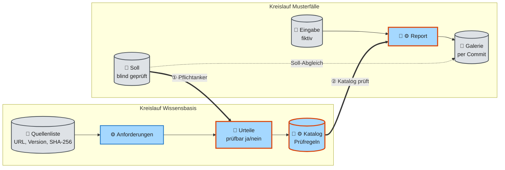

# GovGuard – Entwicklung

Dieses Dokument erklärt, wie man GovGuard sicher verändert: die Wissensbasis erweitern, verbessern oder neu aufsetzen und die Musterfälle mit ihrem Soll pflegen. Es ist für jemanden geschrieben, der das mit einem Agenten wie Claude Code tut und dessen Vorschläge beurteilen muss. Die Befehle stehen im [Anhang](#anhang-befehle).

Was die Begriffe bedeuten (Prüfregel, Soll, Galerie, Pflichtanker, eingefrorener Katalog), erklärt [FUNKTIONSWEISE](FUNKTIONSWEISE.md); wie der Code gebaut ist, zeigt [ARCHITECTURE](ARCHITECTURE.md). Dieses Dokument wiederholt beides nicht, sondern zeigt, was bei einer Änderung kippt und wer was entscheidet.

| Abschnitt | Frage |
|---|---|
| [1 Zwei Kreisläufe](#1-zwei-kreisläufe) | Welche Teile hängen voneinander ab? |
| [2 Wer legt was fest](#2-wer-legt-was-fest) | Was darf ein Agent ändern, was nur ich? |
| [3 Was ein roter Test bedeutet](#3-was-ein-roter-test-bedeutet) | Daten korrigieren oder Test nachziehen? |
| [4 Pflegefälle](#4-pflegefälle) | Was kippt beim Erweitern, Verbessern, Neuaufsetzen? |
| [5 Schwankung und Messen](#5-schwankung-und-messen) | Woran erkenne ich, dass eine Änderung besser ist? |
| [6 Mit einem Agenten arbeiten](#6-mit-einem-agenten-arbeiten) | Woran erkenne ich einen schlechten Vorschlag im Diff? |
| [7 Bekannte Grenzen](#7-bekannte-grenzen) | Was im Betrieb nicht (voll) funktioniert |
| [Anhang: Befehle](#anhang-befehle) | Einrichten, Build, Kommandozeile, Screenshots |

## 1 Zwei Kreisläufe

GovGuard hat zwei Kreisläufe mit Daten von Hand und vom Modell: die Wissensbasis (Quelle → Prüfregel) und die Musterfälle (Eingabe → Soll → Report). Sie berühren sich an zwei Stellen: Das Soll zwingt Prüfregeln in den Katalog, und der Katalog erzeugt die Reports. Wer eine Seite ändert, ändert fast immer die andere mit.

*Berührung ① Pflichtanker.* Jeder Pflichtbefund im Soll eines Musterfalls nennt einen Anker. Dieser Anker muss beim Auswählen als prüfbar durchgehen, sonst bricht der Build ab ([FUNKTIONSWEISE 2](FUNKTIONSWEISE.md#2-wie-der-katalog-entsteht), Schritt 3). Ein neuer Pflichtbefund ist darum immer auch eine Änderung an der Wissensbasis.

*Berührung ② Katalog prüft.* Ein Report ist das Ergebnis aus Eingabe, Katalog, Modell und Prompts. Ändert sich einer der vier, ist der gespeicherte Report in der Galerie nicht mehr der Report, den GovGuard heute erzeugen würde. Der Report nennt drei davon selbst: den Hash der Eingabe (`input_sha256`), den Hash des Katalogs (`catalog_sha256`) und das Modell (`model_id`). Für die Prompts gibt es noch keine Prüfsumme ([AUSBAU](AUSBAU.md#phase-1-messen-können), Phase 1).

*Der eingefrorene Katalog trennt die Kreisläufe.* Weil das Modell dieselbe Anforderung bei jedem Build anders formuliert, würde jeder Neubau alle Reports entwerten. Deshalb bleiben die bestehenden Prüfregeln des Spec-Katalogs Byte für Byte stehen, und eine neue Quelle darf nur Prüfregeln hinzufügen ([SPEC](SPEC.md) G13, ADR [0025](adr/0025-ki-vo-als-neue-quelle-bei-eingefrorenem-katalog.md)). Das Architektur-Audit hat diesen Schutz nicht (Abschnitt 4).

## 2 Wer legt was fest

Jede Datei hat einen Urheber: ein Mensch, das Modell oder der Code. Ein Agent darf ändern, was der Code oder ein Befehl erzeugt, aber nie ersetzen, was ein Mensch festgelegt hat. Die wichtigste Regel: Ein Soll wird nie an einen Lauf angepasst.

| Was | legt fest | ändert sich durch | darf ein Agent es ändern? | im Code |
|---|---|---|---|---|
| Quellenliste | 👤 Mensch | neue Quelle oder Version, neuer Hash bewusst eingetragen | nur auf Auftrag | `data/input/sources.json` |
| Prüfumfang, Bedingungen | 👤 Mensch | Entscheidung, oft mit ADR | nur auf Auftrag | `scope.json`, `conditions.json` |
| Vorfilter | 👤 Mensch, als Code | Code-Änderung mit Test | ja, im Ticket | `prefilter()` je Adapter |
| Urteile „prüfbar ja/nein“ | 🤖 Modell, ⚙️ Code entscheidet | Build-Schritt `select` | nur per Befehl, nie von Hand | `verdicts_*.json`, `selection_*.json` |
| Prüfregeln | 🤖 Modell formuliert, ⚙️ Gates prüfen | Build-Schritt `rules` | nur per Befehl, nie von Hand | `rules_*.json` |
| Eingabe eines Musterfalls | 👤 Mensch (mit Agent) | gewollte Mängel einbauen | ja, wenn das Soll dazu feststeht | `data/input/presets/<id>/` |
| **Soll eines Musterfalls** | 👤 **Mensch**, blind geprüft | nur deine Entscheidung | **nein** | `expected` in `preset.json` |
| Galerie-Report | 🤖 Modell, ⚙️ Code | ein Lauf der Kommandozeile | nur auf Auftrag (kostet) | `data/gallery/<id>.json` |
| Fingerabdrücke in Tests | ⚙️ abgeschrieben vom Ist | Abschnitt 3 | ja, mit Begründung im Commit | z. B. `test_review.py` |

*Ausnahme Datenzusatz.* Ein Galerie-Report darf ohne neuen Modelllauf per Skript ergänzt werden, wenn der Diff nur Zeilen hinzufügt und keinen Status, Text oder Beleg ändert; so kam in #83 das Feld `by_code` in die sechs Reports. Das Skript gehört nicht ins Repository.

*Warum keine Prüfregel von Hand?* Eine Prüfregel von Hand zu ändern, geht technisch. Aber der nächste Build überschreibt sie, und das Build-Log erklärt sie nicht mehr. Wer eine Prüfregel verbessern will, ändert den Grund, aus dem sie so geworden ist: den Vorfilter, ein Gate oder einen Prompt (Abschnitt 4.3).

*Warum kein Soll aus einem Lauf?* Das Soll ist der Maßstab, an dem GovGuard gemessen wird. Schreibt man es vom Report ab, misst GovGuard sich an sich selbst, und jede Abweichung verschwindet. Darum legt ein Mensch das Soll fest, und ein zweites Modell prüft es blind, also ohne das Soll zu kennen (Abschnitt 4.1).

*Weichen.* Eine Weiche ist eine Entscheidung, an der der Agent anhält und fragt ([CLAUDE.md](../CLAUDE.md)). Bei der Pflege sind es drei: Kosten (jeder Modelllauf: Build, Galerie-Report, Messung), Prompt-Design und jede Änderung am Soll.

## 3 Was ein roter Test bedeutet

Rund 15 Testdateien lesen echte Daten aus `data/` oder `docs/`. Sie zerfallen in zwei Arten: Wächter prüfen eine Regel, Fingerabdrücke halten einen Ist-Stand fest. Ein roter Wächter heißt „Daten falsch“, ein roter Fingerabdruck heißt „neuen Wert bewusst eintragen“.

*Wächter.* Ein Wächter-Test prüft eine Regel, die immer gelten muss, zum Beispiel „jeder Pflichtanker steht im Katalog“ oder „der Galerie-Report gehört zum Hash seiner Eingabe“. Wird er rot, sind die Daten falsch. Man korrigiert die Daten, nie den Test.

*Fingerabdruck.* Ein Fingerabdruck-Test (Snapshot-Test) hält einen Ist-Stand fest: eine Anzahl, einen Hash, eine Zeilennummer oder eine bekannte Abweichung. Er schützt davor, dass sich etwas unbemerkt ändert. Wird er rot, prüft man, ob die Änderung gewollt war, und trägt dann den neuen Wert ein, mit Grund im Commit.

*Das Soll ist keins von beiden.* Ein Beispiel zeigt den Unterschied: `test_review.py` hält fest, dass der Galerie-Report des Meldeportals beim Anker M60.P01 WARN statt des Solls FAIL zeigt. Entsteht der Report neu und trifft das Soll, wird dieser Fingerabdruck rot. Nachgezogen wird dann der Test, der das Ist beschreibt, nie das Soll in `preset.json`.

*Doppelte Buchführung.* Einige Teile des Solls stehen ein zweites Mal als feste Liste in Tests: die Menge der Pflichtanker (`test_pinned_anchors.py`) und das Soll der Bedingungen (`SOLL` in `test_presets.py`). So fällt eine versehentliche Soll-Änderung auf; eine gewollte muss an beiden Stellen stehen.

| Pflegefall | Fingerabdrücke, die rot werden | Wächter, die schützen | im Code |
|---|---|---|---|
| Galerie-Report neu erzeugen | Soll-Abweichungen und Zählungen je Musterfall; Kacheln im Report-Kopf; Zeilen der Befundtabelle; markierte Zeilennummern; Referenzbilder der Galerie | Report passt zum Hash der Eingabe | `test_review.py`, `test_ui_report_header.py`, `test_ui_gallery_arch.py`, `test_ui_conditions.py`, `test_findings_view.py`, `tests/visual/gallery-*.png`; Wächter `test_gallery.py` |
| Eingabe eines Musterfalls ändern | wie oben, denn der Report muss neu entstehen | Hash der Eingabe; Eingabe unter 100.000 Zeichen; Selbstaudit gleich der Spezifikation | `test_gallery.py`, `test_presets.py` |
| Soll ändern, Pflichtbefund ergänzen | Menge der Pflichtanker; Soll der Bedingungen; Soll-Abweichungen | Anker steht in der Quelle und im Katalog | `test_pinned_anchors.py`, `test_presets.py`, `test_review.py` |
| Musterfall hinzufügen | alles darüber, dazu „genau 6 Musterfälle“ und die Vorauswahl der Oberfläche | wie oben | `test_presets.py`, `test_ui_create_input.py` |
| Quelle neu ziehen oder Version wechseln | Anzahl Anforderungen und Kandidaten je Quelle; Prüfsteine der Zerlegung | Pflichtanker gibt es in der Quelle noch | `test_extracted_golden.py`, `test_decomposition_touchstones.py`, `test_pinned_anchors.py` |
| Eingefrorene Spec-Regeln anfassen | Zahl (116) und Hash der SDM-Regeln | – | `test_frozen_rules.py` |
| Prompt der Einstufung oder Zerlegung ändern | Prompt-Version im eingecheckten Cache | – | `test_cache_keys_frozen.py` |

*Was kein Test prüft.* Kein Test prüft, ob ein Galerie-Report zum heutigen Katalog passt. Nach einem Neubau des Katalogs zeigt die Galerie also still alte Reports. Prüfen lässt es sich von Hand: `catalog_sha256` im Report gegen den Hash von `rules_<art>.json`.

## 4 Pflegefälle

Die Pflegefälle unterscheiden sich darin, wie viel vom eingefrorenen Stand sie aufgeben. Einen Musterfall anlegen oder eine Spec-Quelle ergänzen lässt das Bestehende stehen. Eine Prüfregel verbessern, das Modell wechseln oder neu aufsetzen entwertet Galerie und Soll-Prüfung der betroffenen Audit-Art.

| Pflegefall | lässt Bestehendes stehen? | Folge für Galerie und Soll | Kosten (Groq) |
|---|---|---|---|
| 4.1 Musterfall anlegen oder ändern | ja | ein Report neu, Soll neu blind prüfen | Cent-Betrag je Report |
| 4.2 Quelle ergänzen, Spec | ja, nur neue Prüfregeln | alle Spec-Reports neu, Soll bleibt | Cent-Beträge |
| 4.2 Quelle ergänzen, Architektur | nein, alle Prüfregeln neu formuliert | alle Architektur-Reports neu, Soll erneut prüfen | ca. 0,2 $ plus Reports |
| 4.3 Prüfregel verbessern | nein, für die Audit-Art | alle Reports der Audit-Art neu, Soll erneut prüfen | bis ca. 0,5 $ je Audit-Art |
| 4.4 Quelle aktualisieren | teilweise | je nach Änderung der Anker | Cent-Beträge |
| 4.5 Neu aufsetzen oder Modell wechseln | nein | alles neu, ADR nötig | ca. 1,1 $ plus Messkampagne |

### 4.1 Musterfall anlegen oder ändern

Ein Musterfall prüft GovGuard nur, wenn sein Soll unabhängig vom Modell entstanden ist. Darum kommt das Soll zuerst, die Eingabe danach, und ein zweites Modell prüft beides blind. Erst dann läuft GovGuard und liefert den Report für die Galerie.

1. **Soll entwerfen.** Du legst fest, was der Fall zeigen soll: den Gesamtstatus, wenige Pflichtbefunde als Anker mit PASS oder FAIL und im Spec-Audit den Wert jeder Bedingung. Ein Pflichtbefund ist nie WARN, weil ein Urteil zwischen PASS und WARN schwankt ([FUNKTIONSWEISE 5](FUNKTIONSWEISE.md#5-report-soll-und-galerie)).
2. **Eingabe schreiben.** Der Agent darf die fiktive Eingabe schreiben, mit den gewollten Mängeln als sichtbare Zeilen. Für jeden Pflichtbefund steht im Bauplan, welche Zeile ihn belegt. Der Bauplan (`BAUPLAN.local.md`) ist nicht eingecheckt, weil er das Soll enthält.
3. **Blind prüfen.** Ein zweites Modell (bisher Gemini im normalen Chat) bekommt Eingabe und Normtexte, aber nicht das Soll. Ein Anker bleibt nur Pflichtbefund, wenn das Modell dieselbe Norm mit demselben Status nennt; sonst wird er gestrichen, nie hinzugefügt. Nennt es ein ungeplantes FAIL in einem WARN-Fall, wird die Eingabe korrigiert, nicht das Soll.
4. **Katalog prüfen.** Steht ein neuer Pflichtanker noch nicht im eingecheckten Katalog, wird sofort ein Wächter rot (`test_pinned_anchors.py`), und der nächste Build bricht ab. Das ist eine Weiche: einen anderen Anker wählen oder den Katalog wachsen lassen (4.2, 4.3).
5. **Report erzeugen und committen.** Ein Lauf der Kommandozeile schreibt den Report in die Galerie ([A.4](#a4-audit-per-kommandozeile)). Weicht er vom Soll ab, bleibt er so, wie er ist (Abschnitt 5). Danach werden die Fingerabdrücke nachgezogen (Abschnitt 3).

*Sonderfall Selbstaudit.* Der Musterfall „GovGuard prüft sich selbst“ ist eine Kopie von [SPEC.md](SPEC.md) und muss Byte für Byte gleich sein. Jede Änderung an der Spezifikation, auch ein Tippfehler, braucht darum eine neue Kopie und einen neuen Galerie-Report. Wer nur einen Link in der Spezifikation reparieren will, löst diese Kette ebenfalls aus.

*Ein Testset für zwei Zwecke.* Die sechs Musterfälle dienen heute zugleich zum Verbessern und zur Abnahme. Wer einen Prompt so lange anpasst, bis die Musterfälle passen, passt GovGuard an diese sechs Fälle an, nicht an die Wirklichkeit ([AUSBAU](AUSBAU.md#phase-1-messen-können), Phase 1).

### 4.2 Wissensbasis erweitern: neue Quelle

Eine neue Quelle darf im Spec-Audit nur Prüfregeln hinzufügen. Der Modus „nur fehlende“ behält die eingecheckten Urteile und Prüfregeln und fragt das Modell nur nach dem Neuen. Im Architektur-Audit gibt es diesen Modus nicht, dort formuliert der Build alle Prüfregeln neu.

*Spec-Audit.* Der Modus „nur fehlende“ (`--only-missing`) ist genau für diesen Fall gebaut; so kam die KI-VO dazu (ADR [0025](adr/0025-ki-vo-als-neue-quelle-bei-eingefrorenem-katalog.md)). Bestehende Prüfregeln bleiben Byte für Byte, nur bei zerlegten Rechtsakten setzt der Code das Zitat neu (ADR [0026](adr/0026-rechtsartikel-zerlegen.md)). Das Soll bleibt gültig. Die Galerie-Reports veralten trotzdem, weil sich der Hash des Katalogs ändert und die neuen Prüfregeln im Report fehlen.

*Architektur-Audit.* Der Cache hält die alten Urteile fest, solange der Prompt gleich bleibt. Ein normales `rules` formuliert aber alle Prüfregeln neu, mit anderem Wortlaut. Damit gilt hier dasselbe wie beim Verbessern (4.3): alle Architektur-Reports neu, Soll erneut prüfen.

*Vorfilter vor Modell.* Der billigste und nachvollziehbarste Hebel ist der Vorfilter der neuen Quelle. Er verwirft mit festem Satz, was nie in Frage kommt, bevor das Modell bezahlt wird. Die Schritte im Code stehen in [A.3](#a3-neue-quelle-hinzufügen).

### 4.3 Wissensbasis verbessern

Eine falsche Prüfregel verbessert man an ihrem Grund: Vorfilter, Gate oder Prompt. Jeder dieser Hebel trifft die ganze Audit-Art, nicht nur die eine Regel. Im Spec-Audit bricht das den eingefrorenen Katalog und braucht deshalb eine bewusste Entscheidung.

| Hebel | wann | Wirkung | Folge |
|---|---|---|---|
| Vorfilter | eine Anforderung kommt nie in Frage | fester Satz, kein Modell | Auswahl ändert sich nur bei dieser Quelle |
| Gate | ein Fehler lässt sich im Code erkennen (erfundene Eigenschaft, fehlendes Zitat) | Modell bekommt einen Retry mit Grund | nur betroffene Regeln ändern sich; andere bleiben, wenn der Cache greift |
| Prompt | ein Fehler, den nur das Modell vermeiden kann | ändert jede Antwort der Audit-Art | Cache der Audit-Art verloren, rund 10 % der Auswahl wechseln |

*Der Prompt gilt je Audit-Art.* Die Prompts der Einstufung gelten je Audit-Art, nicht je Quelle. Ihre Version steckt im Schlüssel des Caches (`prompt_version`). Ändert sich der Prompt, verliert die ganze Audit-Art den Cache, und ein normales `select` würfelt die alte Auswahl neu. Deshalb verlässt sich „nur fehlende“ auf die eingecheckte Auswahl, nicht auf den Cache: Der Spec-Katalog stammt von einer älteren Prompt-Version als der Code.

*Im Spec-Audit ist Verbessern ein Bruch.* Eine bestehende Spec-Regel zu ändern verletzt G13: Alle Spec-Reports müssen neu entstehen und jedes Soll muss erneut geprüft werden. Das ist kein Verbot, aber eine Entscheidung mit ADR. Die Zerlegung von DSGVO und KI-VO war so eine bewusste Ausnahme (#53).

### 4.4 Quelle aktualisieren

Eine neue Fassung einer Quelle fällt an ihrer Prüfsumme auf, aber erst, wenn der lokale Cache leer ist. Der neue Hash wird bewusst eingetragen und der Diff der extrahierten Anforderungen gelesen. Entscheidend ist, ob Anker verschwinden, die ein Musterfall als Pflichtbefund nennt.

Was sich ändert, zeigen drei Stellen: die Anzahlen im Fingerabdruck der Extraktion, der Git-Diff der extrahierten Datei und der Wächter der Pflichtanker. Hat sich nur der Wortlaut geändert, behält eine Anforderung ihren Anker; ihr Urteil im Cache gilt dann nicht mehr, weil der Schlüssel des Caches den Text enthält. Verschwindet ein Pflichtanker oder wandert er, ist das eine Soll-Frage und damit deine.

### 4.5 Neu aufsetzen oder Modell wechseln

Neu aufsetzen heißt, den eingefrorenen Stand aufzugeben: alle Urteile und Prüfregeln neu, alle Galerie-Reports neu, jedes Soll erneut blind prüfen. Ein Modellwechsel hat dieselben Folgen, auch wenn nur die Laufzeit wechselt. Beides ist eine Entscheidung mit ADR, kein Wartungsschritt.

*Wann es sich lohnt.* Lohnend ist ein Neuaufbau, wenn der alte Stand nicht mehr zu verteidigen ist: ein deutlich besseres Modell, ein grundlegend neuer Prompt oder ein Gate, das viele bestehende Regeln verwerfen würde. Ein einzelner Fehler rechtfertigt ihn selten; dafür ist ein Eintrag in den bekannten Grenzen ehrlicher.

*Reihenfolge.* Zuerst den Stand vor dem Neuaufbau messen (Abschnitt 5), dann neu bauen, die Gates und den Qualitätsbericht lesen, die Musterfälle neu laufen lassen und vergleichen. Das Soll wird nur dort angepasst, wo die blinde Prüfung es verlangt, nie dort, wo der neue Report abweicht.

*Was alles mitwandert.* Kostenangaben und Stabilitätszahlen in diesem Dokument und in ARCHITECTURE gelten für ein bestimmtes Modell (`openai/gpt-oss-120b`). Nach einem Wechsel stimmen sie nicht mehr. Auch der Cache gilt nicht mehr, denn sein Schlüssel enthält neben Text und Prompt-Version das Modell (`cache_key`). Der Fingerabdruck der eingefrorenen SDM-Regeln (116 Regeln, Hash) bekommt einen neuen Wert.

## 5 Schwankung und Messen

Das Modell gibt bei gleicher Eingabe nicht immer dieselbe Antwort; ein einzelner Lauf beweist darum nichts. Ob eine Änderung besser ist, zeigt erst eine Messkampagne mit mehreren Läufen je Musterfall. Gemessen wird heute, wie stabil ein Befund ist, nicht, ob er stimmt.

*Zeigen, nicht nachwürfeln.* Weicht ein Report vom Soll ab, zeigt GovGuard die Abweichung (ADR [0023](adr/0023-demo-und-recruiter-stand.md)). Einen Lauf so lange zu wiederholen, bis er das Soll trifft, wäre dasselbe wie das Soll an den Lauf anzupassen: Die Galerie würde eine Treffsicherheit zeigen, die es nicht gibt.

*Stabil heißt nicht richtig.* Die Stabilität ist der Anteil der Prüfregeln, die über alle Läufe denselben Status behalten; heute 70 bis 99 % je Musterfall (#54). Die Trefferquote ist der Anteil der Befunde, die eine Fachperson bestätigt; sie ist nicht gemessen. Ein Modell kann stabil falsch liegen.

*Wann eine Änderung besser ist.* Eine Änderung ist besser, wenn über mehrere Läufe das Soll mindestens so oft erfüllt ist wie vorher und die Stabilität nicht sinkt. Vergleichbar sind zwei Messungen nur bei gleicher Eingabe, gleichem Katalog, gleichem Modell und gleichen Prompts. Das Werkzeug dafür ist der Skill `/audit-messen`: drei Läufe je Musterfall, ausgewertet als „Soll erfüllt in x von n“, Anteil stabiler Prüfregeln und Art der Wechsel.

## 6 Mit einem Agenten arbeiten

Ein Agent kennt die Regeln aus [CLAUDE.md](../CLAUDE.md), [CONTEXT.md](../CONTEXT.md), den ADRs und diesem Dokument. Er neigt aber dazu, einen roten Test auf dem kürzesten Weg grün zu machen. Dein Werkzeug dagegen ist der Git-Diff, bevor du committest.

*Den Auftrag klar stellen.* Nenne den Pflegefall aus Abschnitt 4 beim Namen und gib das Soll selbst vor. „Lege einen Musterfall an, Soll FAIL, Pflichtbefund DSGVO Art. 32 FAIL“ lässt dem Agenten keine Entscheidung, die deine ist. „Lege einen Musterfall an“ lässt ihn das Soll erfinden.

| Im Diff des Agenten | heißt meist | tun |
|---|---|---|
| `expected` in einer `preset.json` geändert, ohne dass du es verlangt hast | Soll an einen Lauf angepasst | zurücknehmen |
| eine Prüfung in einem Wächter-Test gelockert, übersprungen oder gelöscht | ein Datenfehler wird versteckt | zurücknehmen, Daten korrigieren |
| SDM-Regeln in `rules_spec.json` geändert oder neuer Hash in `test_frozen_rules.py` | eingefrorener Katalog gebrochen (G13) | nur mit ADR, neuer Galerie und erneuter Soll-Prüfung |
| `rules_*.json` geändert, aber kein Build-Log in `data/intermediate/logs/` | Prüfregel von Hand bearbeitet | zurücknehmen, über Vorfilter, Gate oder Prompt lösen |
| neuer Galerie-Report ohne Auftrag | Modell ist gelaufen (Kosten), vielleicht mehrmals | nach dem Grund fragen; nachgewürfelte Reports verwerfen |
| neue Zahl in einem Fingerabdruck-Test | gewollt oder Nebenwirkung? | Grund im Commit verlangen |

*Hilfen im Repo.* Der Skill `/audit-messen` misst Kosten, Dauer und Stabilität, der Skill `/design-screenshots` erzeugt die Soll-Bilder der Oberfläche, `/verstehen` schreibt die Lernkarte zu einem Ticket. Der Qualitätsbericht des Builds zählt je Quelle vage Wörter, kontoweite Pflichten und unbekannte Eigenschaften in den Prüfregeln (`quality_report`).

## 7 Bekannte Grenzen

Die Grenzen des Betriebs stehen hier, die Risiken des Entwurfs in [ARCHITECTURE](ARCHITECTURE.md#74-wo-die-schale-endet) 7.4.

| Grenze | Was es heißt | Maßnahme |
|---|---|---|
| Groq schwankt | Je Musterfall behalten 70 bis 99 % der Prüfregeln in allen Läufen ihren Status (#54); früher wechselten im Spec-Audit 42 von 151 Prüfregeln, bei Bedrock 19 (#29). Der FAIL-Prüfer fängt FAILs ohne festgelegten Verstoß ab (#31), PASS und WARN schwanken weiter. Jeder Report nennt sein Modell (`model_id`). | Zeigen, nicht nachwürfeln ([ADR 0023](adr/0023-demo-und-recruiter-stand.md)); Bedrock ist für die Demo nicht verfügbar. |
| fail closed | Von 10 Spec-Läufen brach einer ab (#54). | Erneut starten. |
| YAML | CloudFormation-YAML gilt als Freitext und damit als offene Welt; ein fehlender Baustein wird dort nur WARN, kein FAIL (#48). | Template als JSON einreichen ([ADR 0015](adr/0015-cloudformation-einziges-inventarformat.md)). |
| Build mit Groq | Der Build (`kb_build`) bricht oft an einer einzelnen Regel ab (#49). | Wiederholen; der Cache spart `decompose` und `select`, ein normales `rules` beginnt von vorn ([A.2](#a2-wissensbasis-bauen)). |
| Prüfregeln | S3.5, DLS.2.2, IAM-09.01AC und BER.5.9 werten Deny bei `false` als Verstoß; 12 Regeln enthalten Platzhalter, nur `<Mindestfrist>` in DET.3.1 verfälscht das Ergebnis (WARN statt PASS, #50). | Offen, im Review beobachten; Weg zur Lösung in 4.3. |
| Galerie und Katalog | Kein Test prüft, ob ein Galerie-Report zum heutigen Katalog passt (Abschnitt 3). | Nach jedem Neubau `catalog_sha256` vergleichen. |
| Bildvergleich | Die Referenzbilder stammen von macOS ([A.5](#a5-screenshot-regression)). | Auf anderem System mit `--update-snapshots` neu anlegen und ansehen. |

Weitere Symptome: Bei HTTP 429 (Groq-Limit von 250.000 Tokens je Minute) hilft Warten und nacheinander starten: Ein Spec-Audit braucht ca. 120.000 Tokens je Minute, `GROQ_MAX_PARALLEL` und `checks/token_budget.py` halten nur ein einzelnes Audit unter dem Limit, eine Warteschlange gibt es nicht. Ein fehlendes oder falsches `APP_PASSWORD` verhindert den Start (fail closed). Stimmt die SHA-256 einer Quelle nicht, bricht der Build ab: den neuen Hash bewusst eintragen und den Diff prüfen (4.4).

## Anhang: Befehle

Der Anhang ist die Referenz für die Befehle; das *Warum* steht in den Abschnitten oben. Alle Befehle laufen im Repo-Root.

### A.1 Einrichten

[uv](https://docs.astral.sh/uv/) ist der Paketmanager des Projekts; er holt Python 3.13 und alle Pakete aus `uv.lock`.

| Aufgabe (Befehl) | Was passiert |
|---|---|
| Installieren (`uv sync`) | Installiert die Pakete (Gruppen `build`, `dev`, `ui` sind Standard, `pyproject.toml`). |
| Testen (`uv run pytest -q`) | Alle Tests ohne Browser; die Browser-Tests (Marker `visual`) bleiben aus. Sie brauchen weder AWS noch Groq. |
| Code prüfen (`uv run ruff check .`) | Der Linter ruff liest den Code, ohne ihn auszuführen, und meldet Regelverstöße. Er prüft auch die Grenzen für kleine Einheiten (Komplexität, Argumente, Anweisungen je Funktion). |
| Oberfläche starten (`uv run streamlit run streamlit_app.py`) | Startet die Demo-Oberfläche; die Galerie läuft ohne Schlüssel (auch `./start_streamlit.sh`). |

**Audit erstellen in der lokalen Oberfläche:** Die Seite verlangt ein Passwort und, für das Modell, den Groq-Schlüssel. Beides kommt aus Umgebungsvariablen oder aus `.streamlit/secrets.toml`: `APP_PASSWORD=… GROQ_API_KEY=… uv run streamlit run streamlit_app.py`. Fehlt das Passwort (`APP_PASSWORD`), startet kein Audit (fail closed). Auf Streamlit Community Cloud stehen beide Werte in den Secrets der App ([ARCHITECTURE](ARCHITECTURE.md#53-ausrollen-betrieb-und-kosten) 5.3).

### A.2 Wissensbasis bauen

Der Build ist ein Werkzeug, das lokal läuft: `uv run python -m kb_build <befehl>`. Die Befehle laufen in dieser Reihenfolge; jeder liest das Ergebnis des vorigen. Ein Gate ist eine Prüfung im Code, die eine Prüfregel nur durchlässt, wenn sie eine feste Regel erfüllt. Ein Retry ist die erneute Frage ans Modell, nachdem der Code die Antwort mit Grund abgelehnt hat. Hintergrund und Gates: [FUNKTIONSWEISE 2](FUNKTIONSWEISE.md#2-wie-der-katalog-entsteht).

| Schritt (Befehl) | Was passiert | Ergebnis |
|---|---|---|
| Zerlegen (`extract`, Standard) | Lädt die Quellen, prüft die SHA-256 und zerlegt sie in Anforderungen. Kein Modell, braucht Netz. | `data/intermediate/extracted/*.json` |
| Gruppieren (`decompose`) | Das Modell gruppiert die Abschnitte von DSGVO und KI-VO; der Code setzt Anker und Wortlaut ([ADR 0026](adr/0026-rechtsartikel-zerlegen.md)). | `data/intermediate/decomposed/*.json`, `decompositions_spec.json` |
| Auswählen (`select`) | Das Modell urteilt „prüfbar ja/nein“, der Code wählt aus (Relevanz, Pflichtanker). | `selection_<arch\|spec>.json`, `verdicts_*.json` (Urteil je Anforderung, [ADR 0011](adr/0011-vollstaendiger-katalog.md)) |
| Formulieren (`rules`) | Das Modell formuliert je ausgewählter Anforderung eine Prüfregel; ein Gate prüft Schema, Anker, Zitat und Eigenschaften. | `data/knowledge_base/rules_<arch\|spec>.json` |
| Eigenschaften lesen (`cfn-properties`) | Liest Schemas aus einem Ordner und schreibt die echten Eigenschaften je Ressourcentyp. Kein Modell. | `data/input/cfn_properties.json` |

**Optionen:**

- **Modell (`--provider`):** Standard ist Groq ([ADR 0014](adr/0014-groq-standard-im-build.md)): `export GROQ_API_KEY=…`, das Modell wechselt `GROQ_MODEL`. Fehlt der Schlüssel, bricht der Lauf ab, ohne auf Bedrock auszuweichen. Bedrock gibt es nur ausdrücklich: `--provider bedrock` (`eu-central-1`, Profil `eu.`, gültiger Login über `AWS_PROFILE=…`) oder `--provider bedrock-global` ([ADR 0012](adr/0012-globales-profil-im-build.md)). Der Build schickt nur öffentliche Normtexte hinaus.
- **Eine Audit-Art (`--audit-type spec|architecture`):** `select` und `rules` rechnen nur diese Liste neu. Nach dem Vorfilter stuft `select` rund 470 Spec- bzw. 880 Architektur-Anforderungen ein (`verdicts_*.json`).
- **Nur Fehlendes (`--only-missing`):** Die eingefrorenen Regeln bleiben, das Modell bewertet nur neue Anforderungen. Gebaut nur für das Spec-Audit, also immer mit `--audit-type spec` (4.2, [ADR 0025](adr/0025-ki-vo-als-neue-quelle-bei-eingefrorenem-katalog.md)).

**Protokoll und Abbruch:**

- **Protokoll:** Jeder Lauf schreibt eine Zeile je Anforderung mit Uhrzeit auf das Terminal und in `data/intermediate/logs/<befehl>.log` (Retries, Tokens, Verstoß-Prüfer). Die Logs werden mit dem Ergebnis eingecheckt.
- **Abbruch:** Fehlt ein Pflichtanker (`pinned`), bricht der Lauf in den ersten Sekunden ab. Scheitert eine Regel an einem Gate, bricht der Lauf ab und der alte Stand bleibt.
- **Wiederholen:** Ein Cache ist ein Zwischenspeicher für schon bezahlte Urteile; er gilt für `decompose` (`decomposition_cache.json`) und `select` (`judgement_cache.json`). Ein Checkpoint ist eine Zwischendatei mit den fertigen Regeln; ihn schreibt nur `rules --only-missing` (`rules_<art>.checkpoint.json`). Ein normales `rules` formuliert nach einem Abbruch alles neu.

**Kosten je Befehl** (Groq `gpt-oss-120b`, aus den Build-Logs in `data/intermediate/logs/`): `select` Architektur ca. 0,31 $ (897 Anfragen, ca. 29 min), `rules` Architektur ca. 0,17 $ (267 Anfragen, ca. 9 min), `rules` Spec mit 151 Regeln ca. 0,18 $ (619 Anfragen, ca. 16 min), `decompose` ca. 0,04 $ (56 Anfragen, ca. 3 min); `extract` und `cfn-properties` kosten 0 $. Ein Neubau aller Stufen kostet hochgerechnet ca. 1,1 $ und dauert ca. 1,5 h; mit `--only-missing` und Cache sinken die Kosten auf Cent-Beträge. Bedrock käme mit gleichen Tokens auf das 8- bis 9-Fache (Rechenbeispiel).

**Echte Ressourcentypen und Eigenschaften:** Das Modell darf nur Typen und Eigenschaften nennen, die es wirklich gibt; sonst gibt es einen Retry. Der Qualitätsbericht zählt unbekannte Eigenschaften (`unknown_properties`). Beide Dateien zieht man neu aus AWS (Login nötig):

- **Typen:** `data/input/cfn_resource_types.json` (1926 Typen) kommt aus `aws cloudformation list-types --visibility PUBLIC --type RESOURCE --filters Category=AWS_TYPES --query 'TypeSummaries[].TypeName'`.
- **Eigenschaften:** `data/input/cfn_properties.json` hält je Typ des Prüfumfangs alle Eigenschaftspfade (z. B. `RedirectConfig.Protocol`). Neu ziehen: `mkdir schemas`, dann `for t in $(jq -r '.[][]' data/input/scope.json); do aws cloudformation describe-type --type RESOURCE --type-name $t --query Schema --output text > schemas/${t//::/-}.json; done`, danach `uv run python -m kb_build cfn-properties` (anderer Ordner per `--schema-dir`). Nennt eine Prüfregel einen Typ außerhalb von `scope.json`, gibt es ebenfalls einen Retry.

### A.3 Neue Quelle hinzufügen

Eine Quelle ist ein Regelwerk wie BSI oder CIS, aus dem Prüfregeln entstehen ([CONTEXT.md](../CONTEXT.md)). Was dabei am Bestehenden kippt, steht in 4.2. Der Ablauf im Code hat sechs Schritte:

1. `data/input/sources.json`: URL, Version (Commit oder Tag), SHA-256, Lizenz ([ADR 0008](adr/0008-quellformate.md)).
2. Ein Adapter ist ein Modul, das genau ein Quellformat liest. Er liegt in `src/kb_build/extract/<quelle>.py` und hat eine Lesefunktion (`extract()`) und einen Vorfilter (`prefilter()`). Der Vorfilter gibt `None` zurück oder für jede verworfene Anforderung einen festen Begründungssatz (Auswahlprotokoll). Prowler-Quellen (CIS, FSBP, C5) beschreiben nur ihr Format (`ProwlerFormat`: Anker, Titel, Text, Attribute, Vorfilter); gelesen wird im gemeinsamen Parser `prowler.py`.
3. Anmelden: die Liste der Adapter (`ADAPTERS` in `src/kb_build/extract/run.py`) und die Liste der Quellnamen (`SourceName` in `src/govguard/models.py`). In der Zuordnung zur Audit-Art (`SELECTIONS` in `src/kb_build/build_inputs.py`) kommt die Quelle zu Spec oder Architektur.
4. Lizenz: offen → Extrakt einchecken, Vermerk in `NOTICE`; sonst Extrakt in `.gitignore` (CIS, FSBP, C5).
5. Test mit kleinem Fixture: Anzahl, Stichprobe, Vorfilter mit Begründung; dazu die Anzahlen im Fingerabdruck der Extraktion (`test_extracted_golden.py`).
6. Spec-Quelle bei eingefrorenem Katalog: `select --audit-type spec --only-missing` und `rules --audit-type spec --only-missing`. Architektur-Quelle: normales `select` und `rules` mit den Folgen aus 4.2.

### A.4 Audit per Kommandozeile

Das Kommando prüft eine Datei und gibt den Audit-Report als JSON auf stdout aus: `uv run python -m govguard.cli spec <datei>` für eine Spezifikation, `arch <datei>` für ein CloudFormation-Template oder Freitext. Beispiel mit einem Musterfall: `uv run python -m govguard.cli arch data/input/presets/arch-fristenwecker/template.json`.

| Exit-Code | Bedeutung |
|---|---|
| 0 | Report auf stdout |
| 1 | Eingabe über 100.000 Zeichen; abgelehnt vor dem ersten Modellaufruf, es kostet nichts |
| 2 | fail closed: die Modellantwort war auch nach dem Retry ungültig; Grund auf stderr ([ADR 0017](adr/0017-beleg-per-zeilenverweis.md)) |
| 3 | Groq-Schlüssel (`GROQ_API_KEY`) fehlt; `export GROQ_API_KEY=…`, das Kommando liest keine `.env` |

- **Modell (`--provider`):** Standard ist Groq, nur mit fiktiven Daten, denn die Eingabe geht in die USA. Für echte Daten gibt es nur `--provider bedrock` (Profil `eu.`, [ADR 0001](adr/0001-eu-inferenzprofil.md)).
- **Katalog (`--catalog`):** Standard ist `data/knowledge_base/rules_spec.json` bzw. `rules_arch.json`; ein kleinerer Katalog macht Probeläufe billig.
- **Galerie-Report:** Die Ausgabe eines Musterfalls wird zum Galerie-Report, wenn sie unter dem Namen des Musterfalls liegt: `uv run python -m govguard.cli arch data/input/presets/<id>/<eingabe> > data/gallery/<id>.json`. Nur Exit-Code 0 ergibt einen Report; danach die Fingerabdrücke nachziehen (Abschnitt 3).
- **Messen:** Kosten, Dauer und Stabilität misst der Skill `/audit-messen` (`.claude/skills/audit-messen/SKILL.md`); `uv run python .claude/skills/audit-messen/evaluate.py data/measurements` wertet die Läufe in `data/measurements/` aus.

### A.5 Screenshot-Regression

Die Regression fotografiert die Oberfläche in einem echten Browser und vergleicht die Bilder mit Referenzbildern. So fällt auf, wenn eine Änderung das Aussehen verschiebt ([ADR 0024](adr/0024-teststrategie-demo-ui.md)). Ein Marker ist ein Etikett an einem Test, mit dem pytest Tests gezielt ein- oder ausschließt; die Browser-Tests tragen den Marker `visual`.

- **Einmalig:** `uv run playwright install chromium`. Normales `uv run pytest` braucht den Browser nicht und überspringt den Marker `visual`.
- **Prüfen:** `uv run pytest -m visual` startet `streamlit_app.py` lokal (ohne Schlüssel, `AUDIT_BACKEND=local`) und fotografiert 4 Ansichten bei 1440 px (`start`, `gallery-spec`, `gallery-arch`, `create`). Erlaubt sind höchstens 100 geänderte Pixel. In `tests/visual/output/` (nicht eingecheckt) landen das Foto, bei Abweichung `<ansicht>-diff.png` (Änderungen rot) und `<ansicht>-design.png` (links Design aus `tests/visual/design/`, rechts Streamlit).
- **Freigeben:** War die Änderung gewollt, schreibt `uv run pytest -m visual --update-snapshots` die Referenzbilder `tests/visual/<ansicht>.png` neu; danach ansehen und committen. Die Referenzbilder stammen von macOS, auf einem anderen System rendern die Schriften anders. Das Bild `gallery-spec.png` zeigt auch das [README](../README.md); ein neuer Galerie-Report ändert es mit.
