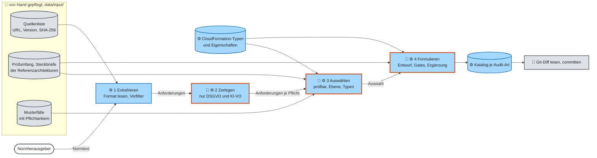
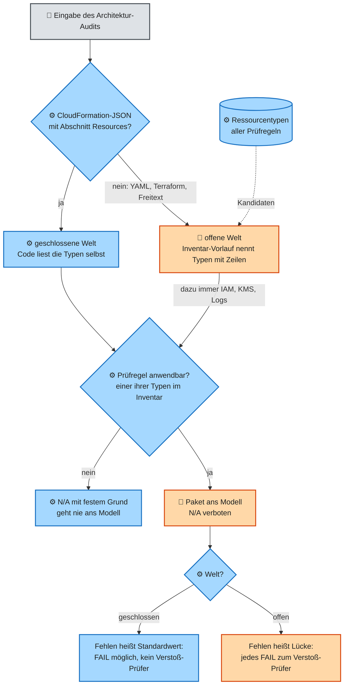

# GovGuard – Funktionsweise

GovGuard prüft eine Spezifikation oder eine Architektur gegen einen festen Katalog von Prüfregeln. Zu jeder Prüfregel fragt es 🤖 ein Sprachmodell, und ⚙️ Code prüft jede Antwort, bevor sie zählt. Dieses Dokument erklärt die fachlichen Konzepte dahinter so genau, dass man GovGuard daraus nachbauen kann.

Drei Dokumente teilen sich die Arbeit. [SPEC.md](SPEC.md) sagt kurz, *was* GovGuard leisten soll; es ist zugleich ein Musterfall und bleibt darum eingefroren. Dieses Dokument erklärt, *wie GovGuard fachlich arbeitet*: welche Begriffe es kennt, nach welchen Regeln es entscheidet und an welchen Beispielen man das sieht. [ARCHITECTURE.md](ARCHITECTURE.md) zeigt nach Kruchten 4+1, *wie es gebaut ist*: Typen, Prozesse, Code und Knoten. Diese Trennung folgt dem Rational Unified Process (RUP), den Kruchten verantwortet hat: Dort beschreiben Anwendungsfälle und ihre fachliche Umsetzung die Funktionen, und das Architekturdokument verweist nur darauf.

## Lesehilfe

Die Kapitel folgen dem Weg der Daten: erst die Grundbegriffe, dann der Build, der den Katalog erzeugt, dann die beiden Audits, die ihn anwenden, dann der Report. Das letzte Kapitel sagt, wo im Code steht, was dieses Dokument nicht abschreibt.

| Kapitel | Frage |
|---|---|
| [1 Prüfregel, Katalog und Befund](#1-prüfregel-katalog-und-befund) | Mit welchen Begriffen arbeitet GovGuard? |
| [2 Wie der Katalog entsteht](#2-wie-der-katalog-entsteht) | Wie wird aus einer Norm eine Prüfregel? |
| [3 Wie ein Spec-Audit urteilt](#3-wie-ein-spec-audit-urteilt) | Wie bewertet GovGuard eine Spezifikation? |
| [4 Wie ein Architektur-Audit urteilt](#4-wie-ein-architektur-audit-urteilt) | Wie bewertet GovGuard eine Architektur? |
| [5 Report, Soll und Galerie](#5-report-soll-und-galerie) | Was sieht die prüfende Person, und woran misst GovGuard sich? |
| [6 Was ein Nachbau braucht](#6-was-ein-nachbau-braucht) | Wo stehen Prompts, Formate und Grenzwerte? |

Die Anwendungsfälle, also wer GovGuard wofür nutzt, stehen in [ARCHITECTURE 1.1](ARCHITECTURE.md#11-was-govguard-leistet). Die Zeichen folgen [ARCHITECTURE 0.3](ARCHITECTURE.md#03-modell-oder-code-die-konvention): 🤖 orange heißt Sprachmodell, probabilistisch; ⚙️ blau heißt Code, deterministisch; 👤 grau heißt Mensch; blau mit orangem Rand heißt, dass ⚙️ Code den Schritt führt und darin 🤖 das Modell fragt. Begriffe stehen in [CONTEXT.md](../CONTEXT.md). Jedes Konzept zeigt ein Musterfall: das „Meldeportal Gesundheit“ für das Spec-Audit, der „Fristenwecker“ für das Architektur-Audit.

## 1 Prüfregel, Katalog und Befund

Eine Prüfregel ist eine prüfbare Pflicht aus genau einer Anforderung einer Norm. Alle Prüfregeln einer Audit-Art bilden den Katalog, und jedes Audit liefert für jede Prüfregel genau einen Befund. Diese drei Begriffe tragen alles Weitere.

*Die Prüfregel.* Eine Prüfregel sagt in zwei Sätzen, woran man Einhaltung und Verstoß erkennt. Der Build hat sie vorher aus der Norm formuliert; zur Laufzeit wird sie nur gelesen. Die Tabelle zeigt ihre Felder an der Prüfregel, die beim Fristenwecker ein FAIL ergibt. Ein Gate ist eine Prüfung im Code, die ein Ergebnis nur durchlässt, wenn eine feste Regel erfüllt ist.

| Feld | Bedeutung | Beispiel | wer schreibt | im Code |
|---|---|---|---|---|
| Kennung | `SPEC` oder `ARCH`, Quelle und Kennung der Anforderung ohne Leerzeichen, durch Bindestriche getrennt; über Builds hinweg stabil, denn der eingefrorene Katalog erkennt Prüfregeln daran | ARCH-FSBP-SNS.1, SPEC-DSGVO-Art.5Abs.1lit.a | ⚙️ | `id` (`rule_id`) |
| Primäranker | Fundstelle in der Norm | AWS FSBP SNS.1 | ⚙️ | `primary_anchor` |
| Zitat | wörtlicher Auszug der Anforderung, der die Kernpflicht trägt | „This control checks whether an SNS topic is encrypted at rest using AWS KMS.“ | 🤖, vom Gate geprüft; bei zerlegten Rechtsakten ⚙️ | `source_quote` |
| Titel | höchstens acht Wörter | Verschlüsselung von SNS-Topics | 🤖 | `title` |
| Kriterium für „konform“ | ein Satz | Das SNS-Topic ist verschlüsselt (AWS::SNS::Topic mit KmsMasterKeyId). | 🤖 | `compliant_if` |
| Kriterium für „Verstoß“ | ein Satz | Ein SNS-Topic ohne KmsMasterKeyId ist nicht verschlüsselt. | 🤖 | `violation_if` |
| Empfehlung | ein Satz zur Abhilfe | KmsMasterKeyId auf einen KMS-Schlüssel setzen | 🤖 | `recommendation` |
| Ressourcentypen | nur Architektur: an welchen CloudFormation-Typen sich die Pflicht zeigt | AWS::SNS::Topic | 🤖 eingestuft, ⚙️ gefiltert | `cfn_resource_types` |
| Auswahlgrund | warum die Anforderung prüfbar ist | „anhand des Parameters KmsMasterKeyId des Typs AWS::SNS::Topic prüfbar“ | 🤖 | `selection_rationale` |
| Querverweise | Bezüge auf andere Quellen, als Vorschlag markiert, ohne Einfluss auf den Status | – | 🤖 vorgeschlagen, ⚙️ geprüft | `cross_references` |

*Der Katalog.* Ein Katalog ist eine JSON-Datei je Audit-Art (`RuleCatalog`): 350 Prüfregeln für das Spec-Audit, 175 für das Architektur-Audit. Er nennt dazu den Stand jeder Quelle (`source_versions`) und das Modell, das ihn formuliert hat. Der Katalog ist fest und vollständig: Ein Audit fragt jede Prüfregel, nicht nur die, die zur Eingabe zu passen scheinen. Eine Ähnlichkeitssuche würde eine unpassend wirkende Prüfregel unbemerkt weglassen. RAG (Retrieval-Augmented Generation) ist so ein Verfahren: Es sucht per Ähnlichkeit die passenden Texte heraus und gibt nur diese dem Modell. Warum GovGuard darum auf RAG verzichtet, zeigt [ARCHITECTURE 7.2](ARCHITECTURE.md#72-die-deterministische-schale) (Muster 3).

*Der Befund.* Ein Befund ist die Antwort auf eine Prüfregel in einem Audit. Er hat einen von vier Status. Die Oberfläche zeigt eine fünfte Kategorie, die Lücke, weil sie eine andere Handlung verlangt als ein WARN mit Beleg.

| Status | Bedeutung | Belegzeilen | Empfehlung | wer setzt ihn |
|---|---|---|---|---|
| PASS | Die Eingabe belegt die Einhaltung. | Pflicht | – | 🤖; ⚙️ prüft den Beleg |
| FAIL | Die Eingabe belegt einen Verstoß. | Pflicht | Pflicht | 🤖; ⚙️ prüft den Beleg, in offener Welt zusätzlich 🤖 der Verstoß-Prüfer |
| WARN | Aus der Eingabe nicht entscheidbar („Prüfbedarf“). | möglich | Pflicht | 🤖, oder ⚙️ durch Herabstufung |
| Lücke | ein WARN ohne Belegzeilen, das der Code weder herabgestuft noch um ungültige Zeilen gekürzt hat: Die Eingabe beschreibt die Anforderung nicht. Beide Eingriffe verlangen einen Blick auf den Befund: Ein herabgestuftes WARN hat einen alten Status, und bei gestrichenen Zeilen hatte das Modell eine Stelle gesehen, nur die Nummern stimmten nicht (Marke `range_dropped`). | keine | Pflicht | 🤖 |
| N/A | Die Prüfregel ist auf die Eingabe nicht anwendbar. | bei einer verneinten Bedingung die verneinende Zeile | – | ⚙️ vorab; 🤖 nur im Spec-Audit |

Der Gesamtstatus eines Reports ist der schlechteste Status aller Befunde in der Reihenfolge FAIL, WARN, PASS, N/A; nur wenn alle Befunde N/A sind, ist er N/A (`overall_status`).

*Beispiel.* Die Spezifikation des Meldeportals schreibt in den Zeilen 46 bis 49, dass die Gesundheitsangaben der Kinder ohne Einwilligung der Eltern ausgewertet werden, gestützt auf berechtigte Interessen. Die Prüfregel zu DSGVO Art. 9 Abs. 2 verlangt eine der dort genannten Ausnahmen. 🤖 Das Modell vergibt FAIL mit den Zeilen 46 bis 49, ⚙️ der Code schneidet diese Zeilen als Beleg aus, und 🤖 der Verstoß-Prüfer bestätigt das FAIL.

## 2 Wie der Katalog entsteht

Der Build macht aus öffentlichen Normtexten in vier Schritten die beiden Kataloge. 🤖 Das Modell zerlegt Rechtsartikel, stuft Anforderungen als prüfbar ein und formuliert Prüfregeln. ⚙️ Code extrahiert, filtert, prüft jeden Entwurf und ergänzt Kennung, Anker und Zitat; 👤 ein Mensch liest am Ende den Git-Diff.

Ein Build ist teuer und würfelt; darum läuft er von Hand, Schritt für Schritt, und jeder Schritt schreibt sein Ergebnis erst, wenn seine Gates bestanden sind. Das Ablaufbild zeigt die vier Schritte von links nach rechts, links die Eingaben, die ein Mensch pflegt. Wie die Schritte im Code und als Sequenz aussehen, zeigen [ARCHITECTURE 4.2](ARCHITECTURE.md#42-paket-kb_build-der-build) und [6.1](ARCHITECTURE.md#61-s1-wissensbasis-bauen).

*Elemente.* Die vier Kästen in der Mitte sind die Schritte des Builds; jeder ist ein Befehl von `python -m kb_build`. Nur das Extrahieren kommt ohne Modell aus. Die anderen drei sind blau mit orangem Rand, weil ⚙️ Code den Schritt führt und 🤖 das Modell darin je Artikel oder Anforderung einmal fragt. Zylinder sind Dateien: grau die von Hand gepflegten Eingaben, blau die vom Code oder per AWS-Befehl erzeugten. Der Kasten rechts ist der einzige menschliche Schritt.

*Verbindungen.* Ein Pfeil zeigt, welche Daten ein Schritt vom vorigen oder aus einer Datei bekommt. Das Extrahieren lädt den Normtext von der Adresse in der Quellenliste und macht daraus Anforderungen. Das Zerlegen gibt die Anforderungen weiter, Rechtsartikel aufgeteilt in einzelne Pflichten. Das Auswählen liest dazu den Prüfumfang, die Steckbriefe der Referenzarchitekturen, die Pflichtanker der Musterfälle und die echten CloudFormation-Typen. Das Formulieren bekommt die Auswahl, liest den Prüfumfang und prüft Typen und Eigenschaften gegen die echten CloudFormation-Typen. Am Ende steht der Katalog, und erst ein Commit macht ihn für die Audits gültig.

*Die echten CloudFormation-Typen.* Der blaue Zylinder „CloudFormation-Typen und Eigenschaften“ steht für zwei Dateien, die von AWS kommen, nicht aus einer Norm. Die Liste aller Typen (`data/input/cfn_resource_types.json`) liefert der AWS-Befehl `aws cloudformation list-types`. Die Eigenschaften je Typ des Prüfumfangs (`data/input/cfn_properties.json`) erzeugt ein fünfter Befehl des Builds (`python -m kb_build cfn-properties`) aus den Schemas, die `aws cloudformation describe-type` je Typ liefert. Beide Befehle mit allen Optionen stehen in [ENTWICKLUNG.md](ENTWICKLUNG.md#a2-wissensbasis-bauen).

*Schritt 1: Extrahieren.* Jede Quelle hat ein eigenes Format, und je Format gibt es einen Leser im Code. Ein Vorfilter mit festem Satz entscheidet ohne Modell, welche Anforderungen überhaupt in Frage kommen (`prefilter_reason`). Vor dem Lesen prüft der Code die Prüfsumme (SHA-256) der Datei gegen den Wert in der Quellenliste. Ein Cache ist ein lokaler Zwischenspeicher für schon geladene Dateien oder schon bezahlte Antworten des Modells. Liegt die Datei schon im lokalen Cache, prüft er die gespeicherte Datei; nur ohne Cache lädt er sie neu vom Herausgeber. Eine geänderte Fassung beim Herausgeber fällt darum erst auf, wenn der Cache leer ist, etwa auf einem neuen Rechner; dann bricht der Build ab ([ARCHITECTURE 6.4](ARCHITECTURE.md#64-fehlerfälle), F1).

| Quelle | Herausgeber und Format | eine Anforderung ist | Vorfilter behält | Prüfregeln |
|---|---|---|---|---|
| DSGVO | EUR-Lex, Formex-XML | ein Artikel, nach dem Zerlegen eine Pflicht | Kapitel II bis V (Art. 5 bis 49) ohne Art. 20, 27, 41 und 47, die für Behörden nicht gelten | 169 |
| KI-VO | EUR-Lex, Formex-XML im ZIP | ein Artikel, nach dem Zerlegen eine Pflicht | Art. 4, 5, 6, 13, 14, 26, 27 und 50 | 65 |
| SDM | Datenschutzkonferenz, ein PDF je Baustein: Löschen (M60), Trennen (M50), Zugriffe regeln (M51) | eine Maßnahme | alle | 116 |
| BSI Grundschutz++ | BSI auf GitHub, OSCAL-JSON | eine Anforderung | Modalverb MUSS oder SOLLTE, Niveau „normal-SdT“, Praktiken DLS, BER, DET, KONF, BES und ARCH | 39 |
| CIS AWS | Prowler-JSON | eine Empfehlung | Kapitel 2 IAM, 3 Storage, 4 Logging, 6 Networking | 20 |
| AWS FSBP | Prowler-JSON | ein Control | eine feste Liste von 19 Prowler-Diensten (`SERVICES` in `kb_build/extract/fsbp.py`), angelehnt an den Prüfumfang; EC2 ist dabei wegen der VPC-Controls, EC2-Instanzen streicht erst das Auswählen | 105 |
| BSI C5 | Prowler-JSON | ein Kriterium | Bereiche OPS, IAM, CRY, COS und PSS | 11 |

OSCAL ist das maschinenlesbare Format des NIST für Sicherheitskataloge, Formex das XML-Format des Amtsblatts der EU. Prowler ist ein Open-Source-Prüfwerkzeug, dessen Regelwerke GovGuard als JSON liest.

*Schritt 2: Zerlegen.* Ein Rechtsartikel enthält oft mehrere Pflichten; DSGVO Art. 5 Abs. 1 etwa nennt sechs Grundsätze. 🤖 Das Modell ordnet jeden Abschnitt des Artikels genau einer Gruppe zu und nennt die Art der Gruppe. ⚙️ Der Code prüft, dass jeder Abschnitt in genau einer Gruppe steht, und bildet daraus Anforderungen mit eigenem Anker und dem wörtlichen Text der Abschnitte; das Modell zitiert nie (ADR [0026](adr/0026-rechtsartikel-zerlegen.md)).

| Art der Gruppe | Bedeutung | wird zu | Beispiel |
|---|---|---|---|
| alle gelten | jeder Abschnitt eine eigene Pflicht | einer Anforderung je Abschnitt | Grundsätze in Art. 5 Abs. 1 lit. a bis f |
| eine genügt | Alternativen, eine reicht | bei mehreren Abschnitten einer Anforderung für den ganzen Absatz, sonst einer für den einen Abschnitt; mit Hinweis im Prompt des Formulierens | Rechtsgrundlagen in Art. 6 Abs. 1 |
| je nach Risiko | Maßnahmen, soweit das Risiko sie erfordert | einer Anforderung je Abschnitt, mit Hinweis im Prompt des Formulierens | Maßnahmen in Art. 32 Abs. 1 |
| keine Pflicht | Befugnisse anderer Stellen, Hinweise, Ausnahmen | einer Anforderung je Abschnitt, die als vorgefiltert gilt, mit dem Grund „Keine Pflicht laut Zerlegung“; sie geht nie ans Modell | Aufgaben der Aufsicht |

Den Hinweis je Art (`KIND_LINES`) hängt der Build an den Auftrag zum Formulieren: Bei „eine genügt“ ist die Pflicht erfüllt, wenn eine Alternative festgelegt ist; bei „je nach Risiko“ auch dann, wenn die Spezifikation begründet, warum das Risiko die Maßnahme nicht erfordert.

Ein Retry ist eine Wiederholung des Modellaufrufs, bei der der Code dem Modell sagt, was an der vorigen Antwort falsch war. Bleibt die Antwort nach vier Retries ungültig, bleibt der Artikel ganz und wird als eine Anforderung weitergegeben (`llm_error` im Zerlegungsprotokoll).

*Schritt 3: Auswählen.* 🤖 Das Modell beantwortet je Anforderung drei Fragen: Ist sie an der Eingabe prüfbar? Wessen Pflicht ist sie? An welchen CloudFormation-Typen zeigt sie sich? Die zweite und dritte Frage gibt es nur im Architektur-Audit. Die Workload ist das, was eine Architektur beschreibt: die Ressourcen der Anwendung selbst, ohne das AWS-Konto, in dem sie laufen. Für die Ebene der Pflicht (`scope_level`) gibt es vier Antworten: die Workload selbst (`template`), das Konto oder die Organisation, Personen und Prozesse oder der Cloud-Anbieter. ⚙️ Der Code entscheidet dann fest:

| Ergebnis | Regel des Codes | Begründung im Protokoll |
|---|---|---|
| vorgefiltert | Der Vorfilter aus Schritt 1 oder das Zerlegen hat die Anforderung verworfen; das Modell wird nicht gefragt. | fester Satz des Codes |
| nicht prüfbar | Das Modell sagt, eine Eingabe kann die Anforderung nicht zeigen. | Satz des Modells |
| nicht relevant | nur Architektur: Die Pflicht liegt nicht bei der Workload, oder nach dem Streichen der Typen außerhalb des Prüfumfangs bleibt keiner übrig. Typen, die es in CloudFormation nicht gibt, streicht der Code ebenfalls. | fester Satz des Codes |
| ausgewählt | alles andere; daraus wird genau eine Prüfregel | Satz des Modells |
| Modellfehler | Die Antwort blieb nach zwei Retries ungültig; die Anforderung fehlt im Katalog. | fester Satz des Codes |

Zwei Gates halten die Auswahl fest. Das erste läuft zuerst, bevor der Build für die übrigen Anforderungen bezahlt: Jeder Anker, den ein Musterfall als Pflichtbefund fordert, muss ausgewählt sein (`check_pinned`). Fordert ein Musterfall einen Befund an der Workload, setzt der Code die Ebene darum auf `template` (ADR [0022](adr/0022-pflichtanker-uebersteuern-die-ebene.md)). Das zweite läuft am Ende: Jeder Ressourcentyp, den eine der drei Referenzarchitekturen mindestens braucht, muss mindestens eine Prüfregel haben (`check_coverage`). Das Ergebnis je Anforderung mit Grund steht im Auswahlprotokoll, damit ein Mensch jede Entscheidung nachlesen kann.

*Schritt 4: Formulieren.* 🤖 Das Modell schreibt je ausgewählte Anforderung einen Entwurf (`RuleDraft`). ⚙️ Der Code prüft ihn, bevor er zählt, und schickt ihn mit dem Grund bis zu sechsmal zurück:

| Gate | gilt für | Was der Code prüft | im Code |
|---|---|---|---|
| Zitat | beide | Das Zitat steht wörtlich im Text genau dieser Anforderung; bei zerlegten Rechtsakten setzt der Code das Zitat selbst. | `is_quoted`, `quoted_by_code` |
| Querverweise | beide | Jeder Querverweis nennt einen Anker, den es in einer anderen Quelle gibt. | `invalid_cross_references` |
| Kriterien am Template entscheidbar | Architektur | Die Kriterien nennen einen Ressourcentyp der Prüfregel wörtlich und nur Eigenschaften, die es an diesem Typ gibt; sie enthalten keine Wörter wie „angemessen“, die Wissen außerhalb des Templates brauchen; jeder genannte Typ liegt im Prüfumfang. | `criteria_problems` |
| Verstoß ist eine Festlegung | Spezifikation | 🤖 Ein zweiter Modellaufruf, der Verstoß-Prüfer des Builds, urteilt, ob das Verstoßkriterium ein bloßes Fehlen beschreibt; dann geht der Entwurf zurück. | `judge_violation` |
| Vollständigkeit | Katalog | genau eine Prüfregel je ausgewählter Anforderung | `check_rules` |

Den fertigen Typ (`Rule`) ergänzt der Code um Kennung, Audit-Art, Quelle, Primäranker, Auswahlgrund und Ressourcentypen; das Modell kann darum keinen Anker erfinden. Scheitert eine Prüfregel, formuliert der Build die übrigen weiter und bricht erst am Ende ab.

*Eingefrorener Katalog.* Ein neuer Build würde dieselbe Anforderung anders formulieren, denn das Modell schwankt. Damit die Musterfälle und ihr Soll vergleichbar bleiben, gibt es für das Auswählen und das Formulieren einen Modus „nur fehlende“ (`--only-missing`). Beim Auswählen behält er die eingecheckten Urteile und stuft nur Anforderungen ohne Urteil ein; beim Formulieren ergänzt er nur neue Prüfregeln und lässt die vorhandenen Byte für Byte stehen (ADR [0025](adr/0025-ki-vo-als-neue-quelle-bei-eingefrorenem-katalog.md)). Diesen Modus gibt es nur für das Spec-Audit, also nur mit `--audit-type spec`, etwa `python -m kb_build rules --audit-type spec --only-missing`; ohne diese Angabe oder für das Architektur-Audit bricht der Befehl mit einem Fehler ab.

## 3 Wie ein Spec-Audit urteilt

Ein Spec-Audit stellt zuerst fest, was die Spezifikation zu sieben Bedingungen sagt, und setzt die Prüfregeln verneinter Bedingungen ohne Modell auf N/A. Alle übrigen Prüfregeln gehen in Paketen ans Modell. Weil eine Spezifikation eine offene Welt ist, gilt ein Verstoß nur, wenn die Spezifikation etwas Widersprechendes festlegt; jedes FAIL prüft ein zweiter Modellaufruf.

Den Ablauf als Aktivitätsdiagramm zeigt [ARCHITECTURE 3.3](ARCHITECTURE.md#33-aktivität-spec-audit), die Sequenz der Aufrufe [6.2](ARCHITECTURE.md#62-s2-spezifikation-prüfen). Hier stehen die Konzepte, die diesen Ablauf bestimmen, in der Reihenfolge, in der sie wirken.

*Nummerierte Eingabe.* Der Code stellt jeder Zeile der Eingabe ihre Nummer voran, etwa „12| “, und schickt die ganze nummerierte Eingabe mit jedem Aufruf; nur der Verstoß-Prüfer bekommt allein die Belegzeilen. 🤖 Das Modell nennt einen Beleg nur als Anfang und Ende eines Zeilenbereichs; ⚙️ der Code schneidet den Text aus. So ist jeder Beleg wörtlich (ADR [0017](adr/0017-beleg-per-zeilenverweis.md)).

*Bedingungen.* Manche Pflichten gelten nur unter einer Bedingung: Die KI-VO gilt nur, wenn ein KI-System eingesetzt wird. Ohne Bedingungen bekäme eine Spezifikation ohne KI-System bis zu 65 Lücken zur KI-VO, die nichts aussagen. Eine Bedingung ist darum eine Tatsache über das Vorhaben, von der eine feste Menge von Prüfregeln abhängt. Die sieben Bedingungen stehen von Hand gepflegt in `data/input/conditions.json` (`ConditionDef`), mit diesen Feldern (ADR [0028](adr/0028-bedingungen-im-spec-audit.md)):

| Feld | Bedeutung | geht an | im Code |
|---|---|---|---|
| Kennung | etwa „consent“ | Modell, Report | `id` |
| Name | etwa „Einwilligung“; steht im Satz „Die Spezifikation verneint: Einwilligung.“ | Report | `name` |
| Erklärung | was die Bedingung bedeutet, mit Fundstelle im Gesetz | Modell, Oberfläche | `meaning` |
| Kriterium „ja“ und „nein“ | woran eine Zeile die Bedingung bejaht oder ausdrücklich verneint | Modell, Oberfläche | `yes`, `no` |
| Bedingungssatz | etwa „eine Verarbeitung auf einer Einwilligung beruht“; die Oberfläche bildet daraus „Nur wenn …“ über den Lücken dieser Bedingung | Oberfläche | `only_if` |
| Betroffene Prüfregeln | Artikelanker oder einzelne Kennungen | Code | `anchors`, `rule_ids` |

| Bedingung | betroffene Prüfregeln |
|---|---|
| KI-System | KI-VO Art. 4, 5, 6 und 50 |
| Hochrisiko-KI | KI-VO Art. 13, 14, 26 und 27 |
| Drittlandübermittlung | DSGVO Art. 44, 45, 46, 48 und 49 |
| Auftragsverarbeiter | DSGVO Art. 28 und 29 |
| Einwilligung | DSGVO Art. 7 und 8 |
| Mandantenfähigkeit | 16 Maßnahmen des SDM-Bausteins Trennen (M50) |
| automatisierte Entscheidung | DSGVO Art. 22 |

Ein Anker trifft den ganzen Artikel, aber nur diesen: „DSGVO Art. 4“ trifft „DSGVO Art. 4 Abs. 2“, nicht „DSGVO Art. 44“ (`affects`).

🤖 Ein Vorlauf vor den Paketen, der Bedingungs-Vorlauf, bekommt Kennung, Name, Erklärung und beide Kriterien jeder Bedingung und nennt je Bedingung zwei Listen von Zeilen: Zeilen, die sie bejahen, und Zeilen, die sie ausdrücklich verneinen. Schließt eine Zeile die Bedingung nur für einen Teil des Vorhabens aus, gehört sie in keine Liste. ⚙️ Den Wert entscheidet der Code nach einer festen Tabelle (`condition_results`):

| bejahende Zeilen | verneinende Zeilen | Wert | Wirkung |
|---|---|---|---|
| ja | nein | ja (`yes`) | Die Prüfregeln gehen ans Modell. |
| nein | ja | nein (`no`) | Die Prüfregeln werden ohne Modell N/A; Beleg ist die erste verneinende Zeile. |
| ja | ja | ja, mit Hinweis „Widerspruch“ | der strengere Wert: Die Prüfregeln gehen ans Modell. |
| nein | nein | nicht genannt (`unstated`) | Die Prüfregeln gehen ans Modell; ihre Lücken stehen im Report gesondert unter „Nur wenn …“. |

Dazu kommt eine Ableitung: Verneint die Spezifikation ein KI-System, ist auch die Hochrisiko-KI verneint, mit derselben Zeile als Beleg. Bejaht die Spezifikation trotzdem eine Hochrisiko-KI, bleibt diese „ja“, mit dem Hinweis „Widerspruch“. Fällt der Vorlauf aus oder bleibt seine Antwort ungültig, sind alle Bedingungen „nicht genannt“, und alle Prüfregeln gehen ans Modell; ein falsches N/A kann so nicht entstehen (Rückfall, [ARCHITECTURE 7.2](ARCHITECTURE.md#72-die-deterministische-schale)).

*Beispiel Meldeportal.* Zeile 47 lautet: „Eine Einwilligung der Eltern wird für diese Auswertung nicht eingeholt“. Der Vorlauf nennt sie als verneinend für die Einwilligung, der Code setzt den Wert auf „nein“ und die Prüfregeln zu DSGVO Art. 7 und 8 auf N/A mit der Begründung „Die Spezifikation verneint: Einwilligung.“ Die Zeilen 53 bis 58 über ein Analysewerkzeug einer US-Firma bejahen die Drittlandübermittlung; deren Prüfregeln gehen ans Modell.

*Pakete.* Die verbleibenden Prüfregeln teilt der Code in Pakete zu je zehn. Jedes Paket ist ein Modellaufruf und enthält von jeder Prüfregel nur Kennung, Titel und die beiden Kriterien, dazu die ganze nummerierte Eingabe zwischen den Markierungen `<eingabe>` und `</eingabe>`. Der Auftrag (`SYSTEM_PROMPT`) definiert die vier Status, verlangt Belegzeilen bei PASS und FAIL und eine Empfehlung bei WARN und FAIL. Die Antwort ist ein Formular mit genau einem Entwurf je Prüfregel (`AuditResponse`).

*Offene Welt.* Eine Spezifikation sagt nicht alles: Was sie nicht erwähnt, kann im Pflichtenheft, im Betriebskonzept oder in einer Dienstanweisung geregelt sein. Das heißt hier offene Welt. Ein FAIL aus bloßem Schweigen wäre darum ein Fehlalarm; Schweigen ergibt eine Lücke. GovGuard setzt das an drei Stellen durch, weil keine allein reicht (ADR [0020](adr/0020-fail-nur-bei-festgelegtem-verstoss.md)):

| Stelle | Mechanismus | wer |
|---|---|---|
| Build | Das Verstoßkriterium jeder Prüfregel beschreibt eine Festlegung, nie ein Fehlen; der Verstoß-Prüfer des Builds schickt ein Fehlen zurück. | 🤖 ⚙️ |
| Paket | Der Auftrag enthält eine Regel für die offene Welt: FAIL nur, wenn die Belegzeilen etwas festlegen, das der Prüfregel widerspricht (`OPEN_WORLD_FAIL_RULE`). | 🤖 |
| nach den Paketen | Der Verstoß-Prüfer prüft jedes FAIL noch einmal. | 🤖 ⚙️ |

*Antwort prüfen.* ⚙️ Der Code prüft jede Antwort, bevor sie zählt: genau ein Befund je Prüfregel, PASS mit gültigem Beleg, Empfehlung bei WARN und FAIL. Was er selbst reparieren kann, repariert er ohne Retry: Bei Doppelbefunden gilt der schwerste Status, eine fehlende Empfehlung kommt aus der Prüfregel, ungültige Zeilen bei WARN, FAIL und N/A streicht er mit einer Korrektur, und ein FAIL ohne Zeilen wird WARN. Ein PASS mit ungültigem Beleg geht einmal mit Grund zurück und wird danach WARN, ohne Abbruch. Alles andere geht einmal mit Grund zurück ans Modell; bleibt es ungültig, endet das Audit ohne Report. Die vollständige Liste der Regeln steht in [ARCHITECTURE 4.6](ARCHITECTURE.md#46-regeln-in-klartext-wo-erzwingt-der-code-sie), die Ausnahmen in [7.2](ARCHITECTURE.md#72-die-deterministische-schale) (Muster 5).

*Verstoß-Prüfer.* Ob Belegzeilen einen Verstoß festlegen oder nur zum Thema schweigen, ist eine Frage der Bedeutung, die kein Code entscheidet. 🤖 Ein zweiter Modellaufruf bekommt darum alle FAILs zusammen, aber je FAIL nur Titel, Verstoßkriterium und die nummerierten Belegzeilen, nicht die Begründung des Pakets (`judge_fails`). Er bestätigt jedes FAIL oder nicht, mit einem Satz Grund. ⚙️ Ein nicht bestätigtes FAIL wird WARN, und der alte Status bleibt am Befund sichtbar. Ohne Urteil bleibt das FAIL. Der Prüfer kann nur senken, nie heben. Im gespeicherten Report des Meldeportals prüfte er 49 FAILs, bestätigte 33 und stufte 16 herab.

*Report bilden.* Zum Schluss prüft der Code, dass alle Pakete zusammen genau einen Befund je Prüfregel ergeben, schneidet die Belege aus, ergänzt Titel, Anker und Korrekturen und bildet den Gesamtstatus. Zum Report gehören außerdem der Wert jeder Bedingung, die Zähler des Verstoß-Prüfers und die Rückverfolgung über Hashes ([ARCHITECTURE 8.4](ARCHITECTURE.md#84-nachvollziehbarkeit)).

## 4 Wie ein Architektur-Audit urteilt

Ein Architektur-Audit entscheidet zuerst am Format, ob die Welt geschlossen oder offen ist. Dann stellt es fest, welche Ressourcentypen die Eingabe enthält, und setzt jede Prüfregel ohne passenden Typ ohne Modell auf N/A. In geschlossener Welt darf ein fehlender Wert ein Verstoß sein, in offener nicht.

Das Entscheidungsbild zeigt den Weg einer Eingabe von oben nach unten: zur Welt, zum Inventar, zur Anwendbarkeit jeder Prüfregel und zur Regel für FAIL. Den Ablauf als Aktivitätsdiagramm zeigt [ARCHITECTURE 3.4](ARCHITECTURE.md#34-aktivität-architektur-audit), die Sequenz [6.3](ARCHITECTURE.md#63-s3-architektur-als-template-prüfen).

*Elemente.* Rauten sind Entscheidungen, die ⚙️ der Code nach fester Regel trifft. Blaue Kästen sind Schritte ohne Modell, orange Kästen Schritte mit 🤖 Modell. Der Zylinder ist die Liste aller Ressourcentypen, die im Katalog vorkommen.

*Verbindungen.* Die erste Raute teilt am Format. Ist die Eingabe ein CloudFormation-JSON mit einem Abschnitt „Resources“, liest der Code die Typen selbst (`template_resource_types`). Sonst nennt der Inventar-Vorlauf die Typen; er darf nur Typen aus der Liste der Prüfregeln nennen, darum der gestrichelte Pfeil. In offener Welt kommen IAM, KMS und Logs immer dazu. Beide Wege enden in derselben Raute: Eine Prüfregel ist anwendbar, wenn einer ihrer Typen im Inventar steht. Nicht anwendbare Prüfregeln werden N/A, anwendbare gehen ins Paket. Die letzte Raute legt fest, was fehlender Text für ein FAIL bedeutet.

*Welt nach Format.* Der Code entscheidet die Welt, nie das Modell (`audit_input`). Geschlossen ist nur eine Eingabe, die der Code vollständig lesen kann; YAML und Terraform liest er nicht und behandelt sie wie Freitext (ADR [0015](adr/0015-cloudformation-einziges-inventarformat.md)).

| Format | Welt | Inventar | eine fehlende Einstellung heißt | Verstoß-Prüfer |
|---|---|---|---|---|
| CloudFormation-JSON | geschlossen | ⚙️ Code liest die Typen | der Standardwert von AWS gilt; ein unsicherer Standardwert ist ein Verstoß | nein |
| CloudFormation-YAML, Terraform, Freitext | offen | 🤖 Inventar-Vorlauf mit Belegzeilen | nicht beschrieben, also Lücke | ja |

Für die geschlossene Welt gibt es keinen eigenen Satz im Auftrag. Sie wirkt über zwei Dinge: Der Satz für die offene Welt (`OPEN_WORLD_FAIL_RULE`) fehlt, und die Kriterien der Architektur-Prüfregeln nennen das Fehlen einer Einstellung selbst als Verstoß, etwa „AWS::SNS::Topic ohne KmsMasterKeyId“. Das hat der Build so erzwungen (Kapitel 2, Schritt 4).

*Der Katalog der Ressourcentypen.* Das Architektur-Audit kennt nur Dienste, für die es Prüfregeln gibt. Drei Listen legen das fest. Der Prüfumfang (`data/input/scope.json`) nennt 23 Dienste von API Gateway bis Application Auto Scaling mit ihren CloudFormation-Typen; er ist von Hand gepflegt. Jede Prüfregel nennt die Typen, an denen sie sich zeigt (`cfn_resource_types`); die Vereinigung dieser Typen ist die Liste, aus der der Inventar-Vorlauf wählen darf. Die Liste aller echten CloudFormation-Typen (`data/input/cfn_resource_types.json`) und ihrer Eigenschaften (`data/input/cfn_properties.json`) braucht nur der Build: Er streicht damit erfundene Typen und Eigenschaften. Ein Dienst außerhalb des Prüfumfangs, etwa EC2-Instanzen, ergibt in keinem Audit einen Befund; die VPC-Typen (`AWS::EC2::VPC` und andere) liegen dagegen im Prüfumfang.

*Inventar und Anwendbarkeit.* Das Ressourceninventar ist die Menge der Typen, die in der Eingabe vorkommen (`Inventory`). Eine Prüfregel ist anwendbar, wenn mindestens einer ihrer Typen darin steht (`Inventory.applies`). In offener Welt gelten Typen von IAM, KMS und CloudWatch Logs immer als vorhanden, weil jede Workload sie braucht, auch wenn der Text sie nicht nennt. Nicht anwendbare Prüfregeln werden ohne Modell N/A, mit dem Grund „Ressourcentyp nicht im Template“ oder „Dienst in der Eingabe nicht erkannt“. Für alle anderen sagt der Auftrag dem Modell, dass N/A verboten ist, und das Gate prüft es.

Der Inventar-Vorlauf prüft jede Antwort in zwei Schritten: Erst muss jeder genannte Typ in der Liste stehen, dann müssen seine Zeilen gültig sein. Er hat keinen Rückfall: Bleibt seine Antwort nach dem Retry ungültig, endet das Audit, denn ein übersehener Dienst würde alle seine Prüfregeln still auf N/A setzen.

*Nur die Workload.* Der Katalog enthält nur Pflichten, die sich an der Workload zeigen. Pflichten des Kontos, etwa Root-MFA, hat schon der Build als „nicht relevant“ aussortiert (Kapitel 2, Schritt 3). Das Architektur-Audit prüft also ein Template, nicht ein AWS-Konto.

*Beispiel Fristenwecker.* Das Template enthält fünf Ressourcen: ein SNS-Topic, eine Subscription, eine Log-Gruppe, eine IAM-Rolle und eine Step-Functions-Zustandsmaschine. Es ist JSON, also ist die Welt geschlossen, und der Code liest die fünf Typen ohne Modell. 144 der 175 Prüfregeln haben keinen dieser Typen und werden N/A mit dem Grund „Ressourcentyp nicht im Template“. 31 gehen in vier Paketen ans Modell. Das SNS-Topic in den Zeilen 5 bis 11 hat keine Einstellung für einen KMS-Schlüssel; in geschlossener Welt gilt der Standardwert „unverschlüsselt“, und die Prüfregel AWS FSBP SNS.1 ergibt FAIL, ohne Verstoß-Prüfer.

## 5 Report, Soll und Galerie

Ein Report zeigt jeden Befund mit Beleg im Dokument und macht jeden Eingriff des Codes sichtbar; nur Reports von vor #74 vermerken gestrichene Zeilen noch nicht (*Galerie*). Musterfälle sind fiktive Eingaben mit einem Soll von Hand; die Galerie zeigt ihre gespeicherten Reports. Weicht ein Report vom Soll ab, zeigt GovGuard das, statt neu zu würfeln.

*Der Report.* Der Report ist ein JSON-Dokument (`AuditReport`); die Oberfläche zeigt ihn neben der geprüften Eingabe und bietet ihn als JSON zum Herunterladen an. Wo welche Teile im Code liegen, zeigt [ARCHITECTURE 4.4](ARCHITECTURE.md#44-paket-govguard_ui-die-oberfläche).

| Teil | Inhalt |
|---|---|
| Kopf | Audit-Art, Modell, Zahl der Retries, Gesamtstatus, Zähler je Kategorie mit Lücken, Zähler des Verstoß-Prüfers (geprüft, bestätigt, herabgestuft, nicht verfügbar) |
| Soll-Abgleich | nur bei Musterfällen: Gesamtstatus und jeder Pflichtbefund gegen das Soll, Abweichungen markiert (`expected_checks`) |
| Bedingungen | nur Spec-Audit: Wert jeder Bedingung mit Kriterium, Belegzeilen und Wirkung |
| Befundtabelle | alle Befunde außer Lücken, filterbar nach Status und Quelle; FAIL zuerst, dann WARN, PASS und N/A, innerhalb eines Status nach der ersten Belegzeile (`visible_findings`). Ein Klick auf einen Spaltenkopf sortiert nach dieser Spalte, ein zweiter kehrt die Richtung um (`sorted_findings`, #80): Status nach Schwere, Zeilen als Zahl, Text mit Zahlen als Zahl (Art. 9 vor Art. 10); gleiche Werte behalten die Grundordnung, Befunde ohne Zeilen stehen beim Sortieren nach Zeilen immer unten. Im JSON-Report stehen die Befunde des Architektur-Audits dagegen nach erstem Ressourcentyp sortiert, damit Doppelungen über Quellen nebeneinander stehen |
| Ansicht nach Fundstelle | Standardansicht (#81); ein Umschalter wechselt zur Befundtabelle („nach Prüfregel“), Filter und gewählter Befund bleiben erhalten. Eine Fundstelle ist eine Stelle im Dokument mit allen Befunden, die auf sie zeigen; die Befunde selbst bleiben unverändert. Das Dokument steht in voller Breite, jede Fundstelle ist ein Balken am Rand, so lang wie ihre Zeilen, in der Farbe ihres schwersten Status und mit der Zahl ihrer Befunde; überlappende Fundstellen stehen in eigenen Spuren. Ein Klick auf Balken oder Zeile öffnet die Befunde unter der Stelle, „vorige“ und „nächste“ gehen nach Zeilen. Vor dem ersten Klick ist die Fundstelle des ersten Befunds der Tabelle offen, also des schwersten. Gruppiert wird so (`group_sites`): Der häufigste Zeilenbereich wird zur Mitte einer Fundstelle und nimmt jeden noch freien Bereich auf, dessen Anfang und Ende um höchstens 2 Zeilen von ihm abweichen. Ein schon vergebener Bereich wird nie selbst zur Mitte, darum verketten sich Fundstellen nicht; zwei Befunde einer Fundstelle können so bis zu 4 Zeilen auseinanderliegen. Fundstellen über mehr als die Hälfte der Zeilen stehen über dem Dokument („Betrifft das ganze Dokument“), Befunde ohne Zeilen darunter |
| Detail eines Befunds | Begründung, Empfehlung, Korrekturen des Codes, Querverweise; der Beleg markiert im Dokument |
| Lücken | als Checkliste nach Quelle; im Spec-Audit getrennt nach Bedingungen, zu denen die Eingabe schweigt, unter „Nur wenn …“ |

*KI-Kennzeichnung.* Begründung und Empfehlung eines Befunds schreibt das Sprachmodell; Status, Fundstellen und Zitate prüft der Code nach. Schreibt der Code einen Text selbst (N/A durch den Code, die Empfehlung eines nicht belegten PASS), steht das im Befund unter `by_code`, und der Text bekommt kein „KI“-Zeichen; die Empfehlung aus der Prüfregel schrieb das Modell des Builds, der Code setzt nur ein „Falls nicht erfüllt:“ davor, sie behält das Zeichen. Das macht GovGuard sichtbar: eine graue Zeile unter dem Report-Kopf („Mit KI erstellt · Modell … · Status, Fundstellen und Zitate hat der Code nachgeprüft“) und ein kleines „KI“ neben den Überschriften *Begründung* und *Empfehlung* in jeder Ansicht. Im JSON-Report steht dasselbe maschinenlesbar im Feld `ai_disclosure` (von KI erstellt, Modell, betroffene Felder außer den Texten in `findings[].by_code`, Verweis auf KI-VO (EU) 2024/1689 Art. 50); der Code berechnet es aus dem Modell, deshalb laden ältere Reports unverändert. Alles kommt aus einem Baustein (`ai_label.py`), und ein Test lässt jede Stelle der Oberfläche mit Modelltext scheitern, die ihn nicht nutzt; eine spätere Maßnahme des Modells (#82) nutzt denselben Baustein.

*Musterfälle und Soll.* Ein Musterfall ist eine fiktive Eingabe mit einem Soll, das ein Mensch festlegt, nie ein früherer Lauf (`Preset`, `Expected`). Das Soll nennt den Gesamtstatus, wenige Pflichtbefunde als Anker mit PASS oder FAIL und beim Spec-Audit den Wert jeder Bedingung. Ein Pflichtbefund ist nie WARN, weil ein Urteil zwischen PASS und WARN schwankt. Der Soll-Abgleich im Report vergleicht nur Gesamtstatus und Pflichtbefunde; das Soll der Bedingungen vergleicht allein das Mess-Skript des Skills `/audit-messen` (`.claude/skills/audit-messen/evaluate.py`). Jeder Anker eines Pflichtbefunds muss im Katalog stehen, sonst bricht der Build ab (Kapitel 2, Schritt 3).

| Musterfall | Audit | Eingabe | Soll | Pflichtbefunde |
|---|---|---|---|---|
| GovGuard prüft sich selbst | Spec | Markdown: [SPEC.md](SPEC.md) | FAIL | DSGVO Art. 46 Abs. 1 FAIL; KI-VO Art. 4 Abs. 1 und Art. 50 Abs. 2 PASS |
| Meldeportal Gesundheit | Spec | Markdown | FAIL | DSGVO Art. 9 Abs. 2 FAIL; SDM Löschen M60.P01 FAIL |
| Wohngeld online | Spec | OpenAPI als YAML | WARN | keine |
| Antragseingang mit Sicherheitsmängeln | Architektur | CloudFormation-JSON | FAIL | CIS 3.1.4 und 4.6, BSI GS++ BER.4.1 FAIL |
| Fristenwecker | Architektur | CloudFormation-JSON | FAIL | AWS FSBP SNS.1 FAIL; StepFunctions.1 PASS |
| Protokollarchiv | Architektur | Freitext in Markdown | WARN | CIS 3.1.4 und BSI GS++ DET.3.1 PASS |

Das Soll eines Musterfalls kann auch eine Referenzarchitektur nennen (`archetype`); das Feld ist ein Rest des nicht gebauten Archetyp-Pfads, und kein Code wertet es aus (ADR [0019](adr/0019-nur-audits.md)). Ein Validator lässt es nur bei einem Spec-Audit ohne Soll-FAIL zu (`archetype_only_for_spec_without_fail`).

*Galerie.* Die Galerie zeigt für jeden Musterfall den gespeicherten Report neben der Eingabe (`GalleryEntry`). Die Reports entstehen mit der Kommandozeile, liegen als JSON in `data/gallery/` und ändern sich nur per Commit; die Galerie ruft kein Modell auf und kostet nichts. Reports von vor #74 kennen die Marke für gestrichene Zeilenbereiche nicht; ein WARN, dessen Zeilen der Code gestrichen hat, erscheint dort noch als Lücke. Das Selbstaudit prüft die eigene Spezifikation; darum muss der Musterfall Byte für Byte gleich `docs/SPEC.md` sein.

## 6 Was ein Nachbau braucht

Wer GovGuard nachbauen will, braucht drei Dinge, die dieses Dokument nicht abschreibt: die Prompts, die Datenformate und die Grenzwerte. Die Tabelle nennt, wo jedes davon festgelegt ist. Die Kataloge selbst sind ein Produkt des Modells; ein Nachbau übernimmt sie oder baut sie neu und muss dann mit anderen Formulierungen rechnen.

| Was | festgelegt in | Hinweis |
|---|---|---|
| Auftrag der Pakete und Regel für die offene Welt | `SYSTEM_PROMPT`, `OPEN_WORLD_FAIL_RULE` in `src/govguard/calls/audit_packages.py` | Schema der Antwort: `AuditResponse` |
| Auftrag des Bedingungs-Vorlaufs | `CONDITIONS_PROMPT` in `src/govguard/calls/conditions.py` | Kriterien aus `data/input/conditions.json` |
| Auftrag des Inventar-Vorlaufs | `INVENTORY_PROMPT` in `src/govguard/calls/inventory.py` | Kandidaten sind die Typen der Prüfregeln |
| Auftrag des Verstoß-Prüfers | `FAIL_JUDGE_PROMPT` in `src/govguard/calls/fail_judge.py` | Beispielpaar je Welt in `src/govguard/open_world.py` |
| Aufträge des Builds | in `src/kb_build/`: `INSTRUCTIONS` in `decompose/split.py`; `PROMPTS` und `SCOPE_PROMPT` (Dienste des Prüfumfangs, nur Architektur) in `select/prompts.py`; `PROMPTS` und `KIND_LINES` (Hinweis je Art der Gruppe) in `rules/prompts.py`; `JUDGE_PROMPT` in `rules/violation_judge.py` | je Audit-Art ein eigener Auftrag |
| Datenformate | `models.py`, `condition_models.py` im Laufzeit-Kern; `models.py` je Build-Schritt | Klassendiagramme in [ARCHITECTURE 2.3 bis 2.5](ARCHITECTURE.md#23-typen-des-builds) |
| Formular für Groq zur Laufzeit | jedes Feld eines Entwurfs ist Pflicht und hat keinen Standardwert; wo ein Wert fehlen darf, ist er `null` | Groq prüft das Schema beim Erzeugen streng (`NativeOutput`) und verwirft sonst die Antwort mit HTTP 400. Der Build nutzt auch bei Groq ein Werkzeug (`ToolOutput`) ohne diese Strenge; dort darf ein Feld einen Standardwert haben, etwa die Querverweise eines Entwurfs |
| Eingaben von Hand | `data/input/sources.json`, `data/input/scope.json`, `data/input/archetype_profiles.json`, `data/input/conditions.json`, `data/input/presets/` | Quellen mit URL, Version und SHA-256 |
| Eingaben von AWS | `data/input/cfn_resource_types.json`, `data/input/cfn_properties.json` | neu zu ziehen mit der AWS-Kommandozeile, siehe Kapitel 2 und [ENTWICKLUNG.md](ENTWICKLUNG.md#a2-wissensbasis-bauen) |
| Grenzwerte | Konstanten wie `PACKAGE_SIZE`, `MAX_SPAN`, `RETRIES`, `GROQ_TOKENS_PER_MINUTE` | vollständig in [ARCHITECTURE 3.6](ARCHITECTURE.md#36-grenzwerte) |
| Modell | `openai/gpt-oss-120b` bei Groq, Temperatur 0; umschaltbar über die Umgebungsvariable `GROQ_MODEL` | ein Modellwechsel ändert Ergebnisse und gilt als Änderung mit Messlauf ([ARCHITECTURE 7.4](ARCHITECTURE.md#74-wo-die-schale-endet)) |
| Regeln, die der Code erzwingt | Gates in `checks/` und `kb_build/rules/gates.py` | Klartext mit Test in [ARCHITECTURE 4.6](ARCHITECTURE.md#46-regeln-in-klartext-wo-erzwingt-der-code-sie) |

Die Reihenfolge für einen Nachbau folgt den Abhängigkeiten: zuerst die Datenformate und die reinen Prüfungen, die ohne Modell testbar sind ([ARCHITECTURE 4.3](ARCHITECTURE.md#43-paket-govguard-der-laufzeit-kern)); dann ein Modellaufruf mit Formular, Validator und einem Retry ([3.7](ARCHITECTURE.md#37-die-acht-modellaufrufe)); dann der Ablauf des Audits ([3.3](ARCHITECTURE.md#33-aktivität-spec-audit), [3.4](ARCHITECTURE.md#34-aktivität-architektur-audit)); zuletzt der Build, falls die Kataloge nicht übernommen werden.
