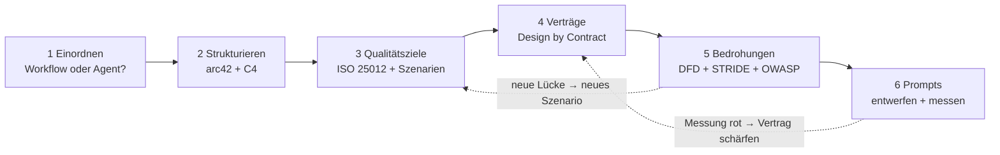
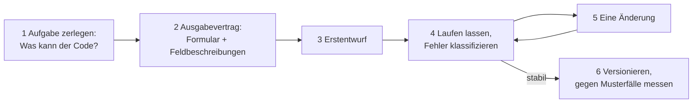

# GovGuard – Methodik: das Rezept

> **Lern-Handbuch.** Dieses Dokument erklärt die Standardmethoden, mit denen GovGuard beschrieben, geprüft und begründet wird: was sie sind, warum sie passen, wie man vorgeht und woran man scheitert. Die **Ergebnisse** stehen nur in [ARCHITECTURE.md](ARCHITECTURE.md) und [DESIGN.md](DESIGN.md); hier steht je Methode ein Link darauf. Verbindlich sind außerdem die [ADRs](adr/) und [CONTEXT.md](../CONTEXT.md).

**Zielgruppe:** IT-Juniors, die die Methoden zum ersten Mal anwenden, und IHK-Prüfer. Jeder Abschnitt ist in 2 Minuten gelesen.

---

## 0. Wie du dieses Dokument liest

### 0.1 Das Problem: Die klassischen Methoden kennen kein LLM

Eine Komponente ist deterministisch, wenn sie bei gleicher Eingabe immer die gleiche Ausgabe liefert. UML und die meisten Qualitätsnormen stammen aus einer Zeit, in der jede Komponente so war. Ein Sprachmodell (LLM) ist probabilistisch: Es kann bei derselben Frage verschiedene Antworten geben, und eine plausible Antwort kann erfunden sein. Eine eigene Standardmethodik für LLM-Systeme hat sich bisher nicht durchgesetzt.

Im Chatfenster bist du selbst die Qualitätskontrolle und merkst, wenn eine Antwort seltsam klingt. In einem Programm liest niemand mit, die Antwort geht direkt in die nächste Funktion. Darum braucht sie ein festes Format, eine Prüfung und im Fehlerfall eine ehrliche Meldung statt eines plausiblen Ergebnisses.

Drei Eigenschaften musst du einrechnen: Das Modell erfindet plausible Fakten (Halluzination), antwortet nicht immer gleich (Nicht-Determinismus) und meldet keine Unsicherheit von selbst (stille Fehler). Bessere Prompts verringern das, beseitigen es aber nie.

GovGuard wendet deshalb bewährte Methoden an und **modelliert das LLM darin als unvertrauenswürdigen externen Akteur**. Ein Webformular kann jeder ausfüllen, auch ein Angreifer, und kein Entwickler schreibt Formulardaten ungeprüft in eine Datenbank. Genau so behandelt GovGuard jede Modellantwort.

Drei Wörter brauchst du vorab. Ein **Gate** ist eine Prüfung im Code, die ein Ergebnis nur durchlässt, wenn es eine feste Regel erfüllt. Ein **Retry** ist die erneute Frage ans Modell, nachdem der Code die Antwort mit Grund abgelehnt hat. **Fail closed** heißt: Im Zweifel gibt es kein Ergebnis statt eines falschen.

### 0.2 Die Methodenlandkarte

Jede Methode beantwortet eine Frage. Du brauchst nicht alle Methoden der Welt, sondern für jede wichtige Frage eine.

| Frage | Methode | Kapitel |
|---|---|---|
| Was für ein System bauen wir? | Workflow-Muster für LLM-Systeme | 1 |
| Wie gliedere ich die Architektur-Doku? | arc42 und C4-Modell | 2 |
| Was heißt „gute Daten“, und wie messe ich das? | ISO/IEC 25010, 25012, Qualitätsszenarien | 3 |
| Welche Regeln gelten immer? | Design by Contract mit UML und OCL | 4 |
| Was kann schiefgehen, wer könnte angreifen? | Datenflussdiagramm, STRIDE, OWASP Top 10 for LLM | 5 |
| Wie sage ich dem LLM, was es tun soll? | Prompt Engineering | 6 |
| Wie nenne ich, was ich gebaut habe? | Entwurfsmuster | 7 |

### 0.3 In welcher Reihenfolge?

Die Reihenfolge ist nicht streng. Die gestrichelten Pfeile zeigen das Wichtigste: Die Methoden speisen sich gegenseitig, denn Architekturarbeit ist ein Kreislauf, kein Wasserfall.

### 0.4 Aufbau jedes Kapitels

Jedes Methodenkapitel hat fünf Teile: **die Methode in Kürze**, **Warum für GovGuard?**, **Vorgehen** (das Rezept, auch für andere Projekte), **Typische Fehler** und den **Fachgespräch-Satz**. Am Ende des Vorgehens steht das **Ergebnis** nur als Link in ARCHITECTURE oder DESIGN.

---

## 1. Einordnung: Workflow oder Agent?

### 1.1 Die Methode in Kürze

Bevor man ein LLM-System modelliert, muss man wissen, wie viel das LLM selbst entscheiden darf. Anthropic unterscheidet dafür in „Building effective agents“ (Dezember 2024) zwei Arten. In einem **Workflow** legt der Code den Ablauf fest, in einem **Agenten** steuert das LLM den Ablauf selbst.

| Stufe | Wer steuert? | Vorhersagbarkeit | Beispiel |
|---|---|---|---|
| 1 Einzelaufruf | Code | hoch | Text zusammenfassen |
| 2 Workflow | Code, mehrere LLM-Schritte | hoch bis mittel | GovGuard |
| 3 Agent | LLM | niedrig | Coding-Assistent, der selbst Dateien ändert |

Jede Stufe nach oben bringt Flexibilität und kostet Vorhersagbarkeit. Die Empfehlung lautet: **Nimm die einfachste Stufe, die das Problem löst.** Für Workflows nennt der Artikel fünf Muster:

| Muster | Idee | Alltagsvergleich |
|---|---|---|
| Prompt Chaining | Aufgabe in Schritte zerlegen, der Code prüft dazwischen (Gates) | Fließband mit Kontrolle nach jeder Station |
| Routing | Eingabe klassifizieren und weiterleiten | Poststelle sortiert Briefe |
| Parallelization | Teilaufgaben gleichzeitig bearbeiten | mehrere Prüfer lesen je ein Kapitel |
| Orchestrator-Workers | ein LLM zerlegt und verteilt die Aufgabe selbst | Projektleiter verteilt Arbeitspakete |
| Evaluator-Optimizer | einer erzeugt, ein anderer bewertet, dann wird nachgebessert | Autor und Lektor |

### 1.2 Warum für GovGuard?

Die erste Frage eines Prüfers zu einem KI-System lautet fast immer: **Was darf die KI selbst entscheiden?** Die Antwort bestimmt die Angriffsfläche, den Testaufwand und welche Risikokataloge überhaupt gelten.

### 1.3 Vorgehen

1. **Alle Modellaufrufe auflisten**, jede Stelle im Code, an der ein Modell gefragt wird.
2. **Je Aufruf vier Leitfragen beantworten** (Tabelle unten).
3. **Jedem Aufruf ein Muster zuordnen** und ein Gesamturteil bilden: Steuert irgendwo das LLM den Ablauf, ist es (teilweise) ein Agent, sonst ein Workflow.
4. **Begründen**, warum die gewählte Stufe reicht und was die höhere kosten würde.

| Leitfrage | Warum sie zählt |
|---|---|
| Wer entscheidet den nächsten Schritt: Code oder LLM? | Ein LLM als Entscheider macht den Ablauf unvorhersehbar. |
| Hat die Antwort eine Wirkung (ausführen, schreiben, löschen)? | Wirkung vergrößert die Angriffsfläche. |
| Ist die Antwortmenge offen (Freitext, Code) oder geschlossen (feste Werte)? | Eine geschlossene Menge lässt sich vollständig prüfen. |
| Wie oft darf das Modell es wiederholen, und wer begrenzt das? | Ohne Grenze entstehen Schleifen und Kosten. |

**Ergebnis:** [ARCHITECTURE §3 „Lösungsstrategie“](ARCHITECTURE.md#3-lösungsstrategie-d2-arc42-4) mit [„Muster im System“](ARCHITECTURE.md#muster-im-system); die acht Aufrufe zeigt [DESIGN 2.6](DESIGN.md#26-die-8-modellaufrufe).

### 1.4 Zehn Fragen vor dem ersten Modellaufruf

Die Liste ist eine Checkliste für jedes neue System mit Sprachmodell; die Antworten für GovGuard stehen in den Kapiteln dieses Dokuments.

1. Welche Teilaufgaben brauchen Sprachverständnis, welche erledigt der Code (Testfrage, 6.3)?
2. Wie sieht das Formular aus, und welche Felder kennt der Code schon?
3. Welche Werte sind erlaubt, und welchen ehrlichen Ausweg gibt es (bei GovGuard WARN)?
4. Wogegen prüft der Code jede Aussage des Modells: Liste, Schema, Eingabe?
5. Was passiert, wenn auch der Retry scheitert, und sieht der Nutzer den Fehler?
6. Muss das Ergebnis vollständig sein? Dann kein Top-K-Retrieval.
7. Was lässt sich vorab erzeugen und prüfen statt zur Laufzeit?
8. Was darf das Modell verändern und was nur ein Mensch?
9. Welche Beispiele mit einem von Menschen gesetzten Soll prüfen das fachliche Verhalten?
10. Welche Daten landen in Logs, und wo läuft die Inferenz?

Filter misst man, man nimmt sie nicht an: Der Vorfilter „nur MUSS“ hätte beim BSI keine technische Anforderung übrig gelassen, denn alle stehen auf SOLLTE ([ADR 0007](adr/0007-relevanz-und-ausnahmen.md)).

### 1.5 Typische Fehler

- **„Agent“ als Schlagwort:** Pydantic AI nennt seine Klasse `Agent`, das macht GovGuard nicht zum Agenten im Sinn der Stufen.
- **Zu hohe Stufe wählen:** Ein Agent, wo ein Workflow reicht, erschwert Tests und Sicherheitsnachweise.
- **Wirkung übersehen:** „Das Modell schreibt nur Code“ klingt harmlos, bis der Code ausgeführt wird.

### 1.6 Fachgespräch-Satz

„GovGuard ist bewusst kein Agent, sondern ein Workflow: Der Code bestimmt jeden Schritt, das Modell füllt nur Formulare aus. Damit bleibt das System vorhersagbar und testbar.“

---

## 2. Doku-Struktur: arc42 und das C4-Modell

### 2.1 Die Methode in Kürze

**arc42** ist eine freie Vorlage von Gernot Starke und Peter Hruschka für Architekturdokumentation mit 12 Kapiteln. Sie ist kein Formular, das vollständig auszufüllen wäre, sondern eine Checkliste gegen vergessene Themen: Ein Kapitel darf kurz sein oder auf ein anderes Dokument verweisen.

| Nr. | Kapitel | Frage |
|---|---|---|
| 1 | Einführung und Ziele | Was soll das System leisten, für wen? |
| 2 | Randbedingungen | Was ist vorgegeben? |
| 3 | Kontextabgrenzung | Was gehört zum System, was ist außen? |
| 4 | Lösungsstrategie | Welche Grundideen tragen die Lösung? |
| 5 | Bausteinsicht | Aus welchen Teilen besteht es? |
| 6 | Laufzeitsicht | Wie arbeiten die Teile zusammen? |
| 7 | Verteilungssicht | Wo läuft was? |
| 8 | Querschnittliche Konzepte | Welche Regeln gelten überall? |
| 9 | Architekturentscheidungen | Was wurde warum entschieden? |
| 10 | Qualitätsanforderungen | Wie gut, messbar? |
| 11 | Risiken und technische Schulden | Was ist bekannt problematisch? |
| 12 | Glossar | Was bedeuten die Begriffe? |

Das **C4-Modell** von Simon Brown ist eine Regel für Diagramme mit vier Zoomstufen wie bei einer Landkarte: **Context** (das System als eine Box mit Nutzern und Nachbarn), **Container** (die lauffähigen Teile), **Component** (die Bausteine eines Containers) und **Code**. „Container“ heißt hier nicht Docker, sondern etwas, das separat läuft oder Daten hält. arc42 sagt, *welche* Kapitel es gibt; C4 sagt, *wie* die Diagramme in den Kapiteln 3, 5 und 7 aussehen.

### 2.2 Warum für GovGuard?

Ein Prüfer, der arc42 kennt, sucht die „Kontextabgrenzung“ unter diesem Namen. Eine feste Gliederung macht die Doku navigierbar und deckt Lücken auf, ohne dass man alles umschreibt.

### 2.3 Vorgehen

1. **Bestand inventarisieren** und jedem Abschnitt ein arc42-Kapitel zuordnen.
2. **Lücken entscheiden:** füllen oder in einem Satz begründen, warum das Kapitel hier unwichtig ist.
3. **Diagramme einer C4-Ebene zuordnen.** Mischt ein Diagramm mehrere Ebenen, teile es auf.
4. **Jedes Diagramm bekommt eine Legende** und genau eine Kernaussage.

**Ergebnis:** [ARCHITECTURE](ARCHITECTURE.md) trägt die arc42-Nummer in jeder Überschrift; die Kapitel, die woanders stehen, nennt der Kopf des Dokuments. Kontext: [ARCHITECTURE §1](ARCHITECTURE.md#1-kontext-d1-arc42-3-c4-ebene-1), Verteilung: [§4](ARCHITECTURE.md#4-verteilung-arc42-7), Komponenten: [DESIGN D11](DESIGN.md#d11-module-c4-ebene-3). Die Diagrammregeln stehen in [DESIGN „Konventionen“](DESIGN.md#konventionen).

### 2.4 Typische Fehler

- **arc42 als Pflichtformular:** 12 Kapitel mit Fülltext sind schlechter als 8 gute und 4 begründet leere.
- **Ebenen mischen:** Nutzer, Funktionen und Klassen in einem Bild liest niemand.
- **Diagramm ohne Legende:** Ohne Legende rät der Leser, was ein Zylinder oder ein gestrichelter Pfeil bedeutet.

### 2.5 Fachgespräch-Satz

„Meine Doku folgt arc42, die Diagramme folgen dem C4-Modell: Kontext für die Systemgrenze, Verteilung für die Betriebsorte, Komponenten für die Trennung von Logik und Anschlüssen.“

---

## 3. Qualität: ISO/IEC 25010, 25012 und Qualitätsszenarien

### 3.1 Die Methode in Kürze

Funktionale Anforderungen sagen, *was* ein System tut; Qualitätsanforderungen sagen, *wie gut*. Für ein Compliance-Werkzeug sind sie der Kern, denn ein Audit mit falschen Belegen ist schlimmer als keines. Die Normreihe **ISO/IEC 25000** liefert die Begriffe. Sie heißt kurz SQuaRE (Software product Quality Requirements and Evaluation).

**ISO/IEC 25010** bewertet die Qualität einer *Software* (z. B. Leistungseffizienz, Zuverlässigkeit, Sicherheit). **ISO/IEC 25012** bewertet die Qualität von *Daten* mit 15 Merkmalen in drei Gruppen: inhärent (Korrektheit, Vollständigkeit, Konsistenz, Glaubwürdigkeit, Aktualität), inhärent und systemabhängig (u. a. Vertraulichkeit, Präzision, Rückverfolgbarkeit, Konformität) und systemabhängig (Verfügbarkeit, Portabilität, Wiederherstellbarkeit). Bei GovGuard sind die wichtigsten Produkte Daten: Prüfregeln, Befunde, Reports.

Normen nennen nur Merkmale. Messbar werden sie durch **Qualitätsszenarien** (Bass, Clements, Kazman; auch arc42 Kapitel 10). Ein Szenario hat sechs Teile:

| Teil | Frage | Beispiel Online-Shop |
|---|---|---|
| Quelle | Wer löst aus? | 1.000 Kunden |
| Stimulus | Was passiert? | rufen gleichzeitig die Startseite auf |
| Artefakt | Welcher Teil ist betroffen? | Webserver |
| Umgebung | Unter welchen Umständen? | Black Friday |
| Reaktion | Was tut das System? | liefert die Seite aus |
| Messgröße | Woran misst man Erfolg? | 95 % unter 1 Sekunde |

„Schnell“ ist keine Anforderung, „95 % unter 1 Sekunde bei 1.000 Nutzern“ ist eine. Viele Szenarien ordnet man im **Qualitätsbaum** (englisch Utility Tree): Wurzel „Qualität“, darunter Merkmale, darunter Szenarien, bewertet nach Nutzen und Schwierigkeit. Er stammt aus ATAM (Architecture Tradeoff Analysis Method), einer Methode, mit der ein Team eine Architektur in Workshops gegen ihre Qualitätsziele bewertet.

### 3.2 Warum für GovGuard?

„Halluzination“ ist ein unscharfes Wort. In der Sprache von ISO 25012 ist sie ein Problem der **Korrektheit** (der Wert stimmt nicht) und der **Glaubwürdigkeit** (man sieht es ihm nicht an). Damit beantwortest du „Wie gehen Sie mit Halluzinationen um?“ systematisch statt mit einer Liste von Einzelmaßnahmen.

### 3.3 Vorgehen

1. **Datenobjekte inventarisieren:** Wer schreibt sie (Code, Mensch, Modell)? Was passiert, wenn sie falsch sind?
2. **Leitfragen stellen** (Tabelle unten) und auswählen, wo ein Modell schreibt oder ein falscher Wert Schaden anrichtet.
3. **Mechanismus zuordnen.** Reihenfolge der Vorliebe: Code, dann Mensch, dann Modell. Ein Modell als einzige Prüfung eines anderen Modells ist ein Risiko.
4. **Szenario mit Messgröße schreiben** und mit einem Nachweis verbinden (Test, Musterfall oder Messung). Ein Szenario ohne Nachweis ist ein Wunsch.
5. **Priorisieren** im Qualitätsbaum.

| Merkmal | Leitfrage |
|---|---|
| Korrektheit | Woher weiß ich, dass der Wert stimmt? |
| Vollständigkeit | Kann etwas fehlen, ohne dass es auffällt? |
| Konsistenz | Können zwei Stellen dasselbe verschieden sagen? |
| Glaubwürdigkeit | Sieht der Leser, wer den Wert erzeugt hat? |
| Aktualität | Kann ein veralteter Wert unbemerkt weiterleben? |
| Präzision | Ist der Wert genau genug, um etwas zu beweisen? |
| Rückverfolgbarkeit | Woher kam der Wert? |
| Vertraulichkeit | Steht etwas darin, das nicht jeder sehen darf? |
| Wiederherstellbarkeit | Was bleibt, wenn ein Schritt scheitert? |

**Ergebnis:** [ARCHITECTURE §7 „Qualität“](ARCHITECTURE.md#7-qualität-d9-arc42-10) mit neun Szenarien und Qualitätsbaum (D9; er zeigt statt Nutzen und Schwierigkeit den erreichten Stand je Szenario) sowie der Zuordnung [„Datenqualität nach ISO/IEC 25012“](ARCHITECTURE.md#datenqualität-nach-isoiec-25012).

### 3.4 Typische Fehler

- **Ziel ohne Messgröße:** „Die Belege sollen korrekt sein“ lässt offen, woran man das Gegenteil merkt.
- **Pflichtübung:** Alle 15 Merkmale für jedes Objekt auszufüllen ist lang und sagt nichts.
- **Modell als Prüfmechanismus:** Wo es eine eindeutige Antwort gibt, prüft der Code.

### 3.5 Fachgespräch-Satz

„Halluzinationen behandle ich als Datenqualitätsproblem nach ISO/IEC 25012: Korrektheit sichere ich, indem der Code den Beleg aus der Eingabe schneidet, Vollständigkeit durch einen Befund je Prüfregel, Rückverfolgbarkeit durch Hashes. Jedes Ziel ist ein Szenario mit Messgröße.“

---

## 4. Verträge: Design by Contract mit UML und OCL

### 4.1 Die Methode in Kürze

**Design by Contract** stammt von Bertrand Meyer (Eiffel). Jede Schnittstelle ist ein Vertrag zwischen einem Aufrufer und einem Lieferanten mit drei Klauseln:

| Klausel | Bedeutung | Verantwortlich | Pizzadienst |
|---|---|---|---|
| Vorbedingung | gilt, *bevor* geliefert wird | Aufrufer | Die Adresse liegt im Liefergebiet. |
| Nachbedingung | gilt, *nachdem* geliefert wurde | Lieferant | Die Pizza kommt heiß. |
| Invariante | gilt *immer* | beide | Der Laden hat eine Lebensmittelerlaubnis. |

**UML** (Unified Modeling Language) ist die Standard-Bildsprache für Software-Entwürfe. Ein **Klassendiagramm** zeigt Datentypen und ihre Beziehungen: Generalisierung („ist ein“, erbt), Komposition („besteht aus“) und Abhängigkeit („benutzt“). Zwei weitere Diagramme ergänzen es: das **Zustandsdiagramm** (Zustände *eines Objekts*) und das **Aktivitätsdiagramm** (Reihenfolge von *Schritten* mit Verzweigungen).

Im Zustandsdiagramm trägt ein Pfeil ein Ereignis und oft eine Wächterbedingung. Eine Wächterbedingung ist eine Bedingung in eckigen Klammern, die erfüllt sein muss, damit der Übergang stattfindet, zum Beispiel `[Versuch übrig]`.

Ein Diagramm kann nicht sagen: „Bei PASS muss ein Beleg da sein.“ Dafür gibt es die **OCL (Object Constraint Language)**, eine Textsprache für Bedingungen, die nie etwas verändert. Für Python-Entwickler ist sie leicht zu lesen:

| OCL | Bedeutung | Python |
|---|---|---|
| `context X inv: …` | gilt für jedes `X`, immer | `@model_validator` |
| `pre: …` / `post: …` | gilt beim Aufruf / danach | Prüfung am Anfang / vor dem `return` |
| `a implies b` | wenn a, dann b | `(not a) or b` |
| `xs->forAll(x \| p(x))` | für alle gilt p | `all(p(x) for x in xs)` |
| `xs->exists(x \| p(x))` | für mindestens eins | `any(p(x) for x in xs)` |
| `xs->size()` | Anzahl | `len(xs)` |

### 4.2 Warum für GovGuard?

Die Pydantic-Modelle und Gates *sind* schon Verträge, aber viele Regeln stehen verteilt im Fließtext („Pflicht bei PASS“, „höchstens 200 Zeilen“). Wer eine Regel eindeutig aufschreiben muss, merkt, wenn sie es nicht ist. Und die Vertragsklauseln erklären, *wer schuld ist*, wenn etwas bricht.

GovGuard schreibt die Regeln als **Klartext-Tabelle** statt in OCL, mit Fundstelle im Code und Test. Das liest jeder Prüfer ohne Zusatzwissen; OCL bleibt hier eine Methode zum Verstehen, kein Werkzeug.

### 4.3 Vorgehen

1. **Klassen finden** und Beziehungen bestimmen (erbt, besteht aus, kennt).
2. **Regeln sammeln:** In Doku und Spec alle Sätze mit „muss“, „immer“, „höchstens“, „genau“, „Pflicht“ heraussuchen.
3. **Jede Regel einordnen:** Vorbedingung, Nachbedingung oder Invariante. Regeln über Dateien oder Hashes lassen sich nicht in OCL fassen und brauchen einen Test.
4. **Durchsetzungsort festlegen:** Typ, Validator, Gate oder Test, dazu der Test, der die Regel hält.
5. **Lebenszyklen zeichnen:** Zustandsdiagramm für Objekte mit Zuständen, Aktivitätsdiagramm für Abläufe.

**Ergebnis:** Klassen: [DESIGN D12](DESIGN.md#d12-typen-des-builds), [D13](DESIGN.md#d13-typen-der-laufzeit), [D13b](DESIGN.md#d13b-typen-der-vorläufe-und-prüfer). Zustände: [D14](DESIGN.md#d14-zustände-eines-befunds). Regeln mit Fundstelle und Test sowie die Zuordnung von Vor- und Nachbedingung zu den Exit-Codes: [DESIGN §4](DESIGN.md#4-regeln-in-klartext-wo-erzwingt-der-code-sie).

### 4.4 Typische Fehler

- **Alles in OCL:** Typen und Pflichtfelder sieht man schon im Diagramm; OCL ist für den Rest.
- **Diagramm und Code laufen auseinander:** Ein ungepflegtes Diagramm lügt nach drei Wochen. Darum prüfen Drift-Tests, dass Klassen und Pfade der Diagramme existieren.
- **Nur die Prosa übersetzen:** Der Wert entsteht beim Formalisieren. Lässt sich eine Regel nicht eindeutig fassen, ist das ein Befund.

### 4.5 Fachgespräch-Satz

„Meine Gates und Validatoren sind die ausführbare Form von Invarianten. Eine verletzte Vorbedingung liegt beim Aufrufer, eine verletzte Nachbedingung beim Modell als Lieferant. Darum endet das eine mit Exit 1, das andere fail closed mit Exit 2.“

---

## 5. Bedrohungen: Datenflussdiagramm, STRIDE und OWASP Top 10 for LLM

### 5.1 Die Methode in Kürze

**Threat Modeling** heißt: Bevor ein Angreifer es tut, fragt man systematisch, was schiefgehen kann. Adam Shostack fasst es in vier Fragen zusammen: Woran arbeiten wir? Was kann schiefgehen? Was tun wir dagegen? Haben wir gute Arbeit geleistet?

Ein **Datenflussdiagramm (DFD)** kennt fünf Elemente: externe Entität (Nutzer, Fremdsystem), Prozess, Datenspeicher, Datenfluss und **Vertrauensgrenze**. Die Vertrauensgrenze ist eine Linie, an der Daten von jemandem kommen, dem man nicht voll vertraut; Bedrohungen entstehen fast immer dort.

**STRIDE** (entwickelt bei Microsoft) ist ein Merkwort für sechs Bedrohungsarten, jede verletzt ein Schutzziel:

| Buchstabe | Bedrohung | verletztes Schutzziel | Beispiel |
|---|---|---|---|
| S | Spoofing | Authentizität | fremder Client ruft die API auf |
| T | Tampering | Integrität | Prüfregeln verändert |
| R | Repudiation | Nichtabstreitbarkeit | Protokoll gelöscht |
| I | Information Disclosure | Vertraulichkeit | Personendaten im Log |
| D | Denial of Service | Verfügbarkeit | Flut riesiger Eingaben |
| E | Elevation of Privilege | Autorisierung | fremder Code läuft mit Build-Rechten |

STRIDE-per-Element spart Arbeit: Nicht jede Bedrohung passt zu jedem Elementtyp (eine externe Entität kann nur S und R betreffen, ein Prozess alle sechs). Für LLM-Systeme reicht STRIDE nicht, denn Prompt Injection (Daten werden zu Anweisungen) und Halluzination (kein Angriff, aber Schaden) fallen durch das Raster. Darum ergänzt man die **OWASP Top 10 for LLM Applications**, die Liste der zehn wichtigsten Risiken solcher Anwendungen (Fassung 2026 des OWASP GenAI Security Project). Für Behörden lohnt der Blick in die BSI-Publikation „Generative KI-Modelle – Chancen und Risiken für Industrie und Behörden“.

### 5.2 Warum für GovGuard?

GovGuard ist selbst ein Sicherheitswerkzeug, und ein Prüfer fragt, ob es seine eigenen Maßstäbe erfüllt. Ein Infrastruktur-Scanner prüft nur die Infrastruktur; ein Threat Model prüft auch das Design, inklusive der Modellanteile.

### 5.3 Vorgehen

1. **DFD zeichnen,** ausgehend vom Container-Diagramm (Kapitel 2): Container werden Prozesse und Speicher, Pfeile werden Datenflüsse.
2. **Vertrauensgrenzen einzeichnen.** Die Ausgabe eines Modells kreuzt immer eine Grenze: Man traut dem Dienst den Betrieb zu, aber nicht dem *Inhalt* der Antwort.
3. **STRIDE je Element an den Grenzen** und die OWASP-Liste Punkt für Punkt durchgehen: Trifft er zu? Wenn nein, warum nicht?
4. **Je Bedrohung einen Status festhalten:** umgesetzt, teilweise, erkennbar, akzeptiert (bewusst getragen, mit Begründung), offen oder entfällt.
5. **Nachweisen:** Für jede Maßnahme ein Test, ein Musterfall oder ein Log. „Akzeptiert“ braucht eine Begründung im ADR.

**Ergebnis:** [ARCHITECTURE §6](ARCHITECTURE.md#6-datenfluss-und-sicherheit-arc42-8-11) mit [DFD (D8)](ARCHITECTURE.md#61-dfd-des-demo-stands-d8), [STRIDE-Tabelle](ARCHITECTURE.md#62-stride-tabelle) und [OWASP-Zuordnung](ARCHITECTURE.md#63-owasp-top-10-for-llm-applications-2026). Die Lesehilfe zum BSI-Vorgehen steht in [ARCHITECTURE „Lesehilfe für die Behörden-IT“](ARCHITECTURE.md#lesehilfe-für-die-behörden-it).

### 5.4 Typische Fehler

- **Dem Dienst vertrauen statt dem Inhalt misstrauen:** „Der Anbieter ist etabliert, also stimmt die Antwort“ verwechselt Betrieb und Datenschutz mit der Richtigkeit des Inhalts.
- **Bedrohungen ohne Status:** Eine Liste von Gefahren ohne Entscheidung ist Angstmacherei, kein Threat Model.
- **Einmal und nie wieder:** Jede neue Funktion bringt neue Datenflüsse und damit neue Grenzen.

### 5.5 Fachgespräch-Satz

„Im Datenflussdiagramm ist die Modellausgabe eine eigene Vertrauensgrenze: Ich vertraue dem Dienst, aber nicht dem Inhalt. Das Threat Model nach STRIDE und OWASP Top 10 for LLM 2026 weist jede Bedrohung mit Status aus, auch die offenen.“

---

## 6. Prompt Engineering als Designdisziplin

### 6.1 Die Methode in Kürze

Ein Prompt ist die **Spezifikation einer probabilistischen Komponente**. Prompt Engineering ist darum kein Herumprobieren mit Formulierungen, sondern dieselbe Ingenieursarbeit wie bei Code: entwerfen, testen, messen, versionieren.

Anfänger denken bei „Prompt“ nur an den Systemprompt. Bei einem Aufruf mit festem Antwortformular besteht er aus sechs Teilen:

| Teil | was er steuert | im Code |
|---|---|---|
| Systemprompt | Rolle, Regeln, Bewertungskriterien | `SYSTEM_PROMPT` in `calls/audit_packages.py` |
| Name und Beschreibung des Werkzeugs | wofür das Formular gedacht ist | `submit_audit` |
| JSON-Schema des Formulars | Format, erlaubte Werte, Feldbeschreibungen | `AuditResponse` |
| Nutzernachricht | die Daten | `_user_prompt` |
| Retry-Meldung | wie das Modell einen Fehler korrigiert | `send_back` |
| Modelleinstellungen | Streuung und Länge | Temperatur 0 und Längengrenze (`_SETTINGS`) |

Ein guter Prompt hat einen erkennbaren Aufbau wie ein gutes Ticket: **Rolle, Aufgabe, Kriterien, Daten (klar abgegrenzt), Ausgabeformat, Umgang mit Unsicherheit, wenige Beispiele.**

### 6.2 Warum für GovGuard?

Drei Qualitätsziele lassen sich nur über Prompts verbessern. Stabile Urteile (Szenario QS-3 in [ARCHITECTURE §7](ARCHITECTURE.md#7-qualität-d9-arc42-10)) kann man nicht programmieren; klare Kriterien im Prompt sind der wichtigste Hebel. Die Abwehr von Prompt Injection (Bedrohung T4 in [ARCHITECTURE §6.2](ARCHITECTURE.md#62-stride-tabelle)) braucht eine Abgrenzung der Daten. Und die Qualität der Prüfkriterien hängt am Prompt, der die Prüfregeln formuliert.

### 6.3 Vorgehen

1. **Aufgabe zerlegen** mit der Testfrage: Gibt es genau eine richtige Antwort, die sich ohne Sprachverständnis ermitteln lässt? Dann macht es der Code; nur der Rest kommt in den Prompt.
2. **Ausgabevertrag zuerst:** Das Formular mit Feldbeschreibungen ist Teil des Prompts und entsteht vor dem Systemprompt.
3. **Erstentwurf bewusst einfach** schreiben und messen.
4. **Fehler klassifizieren,** nicht einzeln reparieren: „Das Modell setzt FAIL, wo Information fehlt“ ist ein Fehlerbild, kein Einzelfall.
5. **Genau eine Änderung je Runde,** dann erneut messen.
6. **Versionieren:** Prompts liegen als Text im Repo und gehen wie Code durch den Pull Request.

Ein **Entwicklungsset** ist eine Sammlung von Testfällen, an denen man den Prompt verbessert, getrennt von den Fällen, die am Ende das Ergebnis abnehmen. Das ist die saubere Lösung, denn wer an den Abnahmefällen optimiert, misst danach nur noch, ob der Prompt diese Fälle kennt. GovGuard hat sechs Musterfälle und kein getrenntes Entwicklungsset; das Risiko steht in [ARCHITECTURE §9.1](ARCHITECTURE.md#91-risiken).

### 6.4 Neun Prinzipien

Jedes Prinzip nennt, ob GovGuard es heute umsetzt.

1. **Was der Code weiß, fragt man das Modell nicht.** Anker, Beleg und Gesamtstatus setzt der Code. *Umgesetzt* (ARCHITECTURE §0, Prinzip 1).
2. **Ein Aufruf, eine Aufgabe.** Das macht Fehler zuordenbar und Prompts kurz. *Umgesetzt:* acht Aufrufe mit je einer Aufgabe.
3. **Anweisungen und Daten trennen.** Die Eingabe steht zwischen Markierungen, und ein Satz sagt, dass Anweisungen darin nicht gelten. *Teilweise:* Die Markierung gibt es, der Satz fehlt (T4).
4. **Kriterien statt Bauchgefühl.** Statusdefinitionen im Prompt und Kriterien je Prüfregel. Die wichtigste Regel: *Schweigen ist keine Verletzung.* *Umgesetzt.*
5. **Das Formular ist Teil des Prompts.** Das Modell sieht das Schema samt Feldbeschreibungen; näher kann eine Anweisung nicht am Feld stehen. *Teilweise:* Feldnamen und feste Werte sieht das Modell, Feldbeschreibungen (`Field(description=…)`) gibt es noch nicht.
6. **Erst begründen, dann urteilen.** Ein Modell schreibt Feld für Feld; steht die Begründung vor dem Status, fällt das Urteil nicht vorab. *Noch nicht umgesetzt:* Im Entwurf steht der Status vor der Begründung.
7. **Beispiele sparsam und vielfältig,** an erfundenen Fällen, sonst kopiert das Modell Inhalte. *Kaum eingesetzt:* Nur der Bedingungs-Vorlauf hat ein Gegenbeispiel.
8. **Fehlermeldungen sind auch Prompts.** Eine gute Meldung nennt die Prüfregel, den Fehler und den Ausweg. *Umgesetzt:* Der Grund des Retries ist derselbe Text, den später der Befund zeigt.
9. **Streuung begrenzen und messen.** Temperatur 0 verringert die Streuung, beseitigt sie nicht. *Umgesetzt;* wie stabil die Urteile sind, zeigt nur die Messung (QS-3).

### 6.5 Weg v0 → v3 bei GovGuard

Das Muster gilt für jedes Projekt: Eine Stufe beginnt mit einem gemessenen Fehlerbild, sucht seine Ursache, ändert genau eine Sache und misst erneut. Bei GovGuard wuchs der Audit-Prompt so, nicht nach Gefühl; jede Stufe hat ein Fehlerbild, eine Änderung und einen Beleg.

| Stufe | Fehlerbild (gemessen) | Änderung für die nächste Stufe | Beleg |
|---|---|---|---|
| v0 | Das Modell schreibt den Beleg als wörtliches Zitat ab: beim größten Musterfall (151 Prüfregeln) lehnte der Code 52 Belege ab, Folge: Abbruch | Das Modell nennt nur Zeilen, der Code schneidet den Beleg aus | [ADR 0017](adr/0017-beleg-per-zeilenverweis.md) |
| v1 | FAIL mit Beleg, der keinen Verstoß zeigt: 130 von 151 Verstoßkriterien beschrieben ein Fehlen, und selbst mit Prompt-Regel vergab Groq noch 50 FAILs | Regel „offene Welt“ im Prompt, Kriterien als Festlegung umformuliert, ein zweiter Aufruf prüft jedes FAIL | [ADR 0020](adr/0020-fail-nur-bei-festgelegtem-verstoss.md) |
| v2 | Pflichten, die für Behörden nie gelten, kosteten 24 Lücken je Audit | Bedingungs-Vorlauf: ein Aufruf mehr, den Rest entscheidet der Code (Lücken sanken um 15 bis 31 %) | [ADR 0028](adr/0028-bedingungen-im-spec-audit.md) |
| v3 (heute) | Schwankung zwischen Läufen | keine Prompt-Änderung: Die Schwankung wird mit 3 Läufen je Musterfall gemessen, nicht erzwungen | [ARCHITECTURE §7](ARCHITECTURE.md#7-qualität-d9-arc42-10) (QS-3) |

Die Lehre: Nicht jedes Fehlerbild ist ein Prompt-Problem. Die Änderungen v0 bis v2 liegen überwiegend im Code und in den Daten, nur ein Teil davon im Prompt-Text. Was nach v3 bleibt, ist Schwankung, und die misst man.

**Ergebnis:** Den Ablauf eines Aufrufs zeigt [DESIGN 2.5 (D15)](DESIGN.md#25-d15-anatomie-eines-llm-aufrufs), die acht Aufrufe mit ihren Prompts [DESIGN 2.6](DESIGN.md#26-die-8-modellaufrufe). Die Prompts selbst stehen im Code.

### 6.6 Typische Fehler

- **Prompt „verschönern“ ohne Messung:** Ein Prompt, der besser klingt, ist nicht automatisch besser.
- **Fünf Änderungen auf einmal:** Danach weiß niemand, was gewirkt hat.
- **Großbuchstaben und Drohungen:** Klare Kriterien wirken zuverlässiger als Lautstärke.

### 6.7 Fachgespräch-Satz

„Ich behandle Prompts wie Code: Sie haben einen Ausgabevertrag, werden Schritt für Schritt an gemessenen Fehlerbildern verbessert und liegen versioniert im Repo. Was der Code entscheiden kann, steht nicht im Prompt.“

---

## 7. Muster-Vokabular für das Fachgespräch

### 7.1 Die Methode in Kürze

Ein Entwurfsmuster ist eine benannte, bewährte Lösung für ein wiederkehrendes Problem. Der Name ist der eigentliche Wert: „Das ist ein Content Enricher“ ersetzt eine halbe Seite Erklärung, wenn das Gegenüber das Muster kennt. Darum gehört zu jedem Muster seine Quelle.

### 7.2 Warum für GovGuard?

Im Fachgespräch wirkt ein Standardbegriff stärker als ein Eigenname. Das Entwurf-Muster (Draft-Pattern: „Modell liefert Entwurf, Code ergänzt und prüft“) ist ein Projektname; die Standardbegriffe dafür sind *Content Enricher* (Hohpe/Woolf) und *Design by Contract* (Meyer). Das selbst zu sagen ist ehrlicher und überzeugender.

### 7.3 Vorgehen

1. **Ein Stück Code oder Design beschreiben,** das du erklären sollst.
2. **Das Muster benennen,** mit Quelle, in einem Satz.
3. **Grenzen nennen:** Wo passt das Muster nicht ganz?

**Ergebnis:** [ARCHITECTURE §3 „Muster im System“](ARCHITECTURE.md#muster-im-system) mit Quelle und Fundstelle im Code.

### 7.4 Projekteigene Namen

Diese Namen stammen aus dem Projekt, nicht aus der Literatur. Sag sie nur zusammen mit dem Standardbegriff.

| Name im Projekt | Bedeutung | Standardbegriff | im Code |
|---|---|---|---|
| Entwurf-Muster (Draft-Pattern) | Das Modell liefert den Entwurf, der Code ergänzt und prüft | Content Enricher | `FindingDraft` → `Finding` |
| Sandwich | Der Code bereitet vor, das Modell urteilt, der Code kontrolliert | Prompt Chaining mit Gates | `run_audit` |
| Tool als Formular | Ein erzwungenes Tool, dessen Argumente das Ergebnis sind; bei Groq ein festes JSON-Schema statt Tool | strukturierte Ausgabe | `ToolOutput`, `NativeOutput` |
| Geschlossene Antwortmenge mit Ausweg | Feste Werte im Formular, darunter ein ehrlicher Ausweg | – | `Status`, WARN |
| Bounded Catalog | Feste, vollständig geprüfte Menge von Prüfregeln | – | `RuleCatalog` |
| Vorab-N/A | Der Code setzt N/A, bevor das Modell fragt | Message Filter | `na_drafts`, `Inventory.applies` |

### 7.5 Anti-Muster bei Systemen mit Sprachmodell

| Anti-Muster | Warum gefährlich | Besser |
|---|---|---|
| Das Modell zählen, sortieren oder rechnen lassen | Fehler sind still und schwer zu finden | Code (Testfrage) |
| Verbote nur im Prompt | Ein Prompt ist eine Bitte | Schranke im Validator oder Gate ([ARCHITECTURE 6.4](ARCHITECTURE.md#64-schranken-nach-art)) |
| Top-K-Retrieval bei Vollständigkeitspflicht | Fehlende Regeln fallen nicht auf | fester Katalog |
| Kein Ausweg im Formular | Das Modell muss raten | WARN anbieten |
| Retries oder Korrekturschleifen ohne Grenze | Zeit, Kosten, keine Konvergenz | feste Obergrenze, dann fail closed |
| Soll aus einem früheren Lauf | zirkulärer Test | Mensch setzt das Soll |
| Stiller Fallback | Das System läuft scheinbar, aber ohne Schutz | Fähigkeiten prüfen, laut scheitern |
| Prompts und Antworten vollständig loggen | Personendaten im Protokoll | Hashes und Status |

### 7.6 Typische Fehler

- **Namen ohne Verständnis:** Wer das Muster nennt, muss es in einem Satz erklären können.
- **Eigennamen als Standard ausgeben:** Ein projektinterner Begriff ist kein Muster aus der Literatur.
- **Muster erzwingen:** Passt eines nicht, sagt man es.

### 7.7 Fachgespräch-Satz

„Das Modell liefert den Kern, der Code reichert ihn an und prüft den Vertrag: Das ist ein Content Enricher mit Design by Contract. Den Namen ‚Entwurf-Muster‘ habe ich im Projekt selbst vergeben.“

---

## 8. Zusammenfassung

### 8.1 Methoden und wo ihr Ergebnis steht

| Methode | Ergebnis | gehört in arc42 |
|---|---|---|
| Workflow-Muster (1) | [ARCHITECTURE §3](ARCHITECTURE.md#3-lösungsstrategie-d2-arc42-4), [Muster im System](ARCHITECTURE.md#muster-im-system) | Kap. 4 |
| arc42 + C4 (2) | [ARCHITECTURE](ARCHITECTURE.md) (Aufbau), [§1 Kontext](ARCHITECTURE.md#1-kontext-d1-arc42-3-c4-ebene-1), [DESIGN D11](DESIGN.md#d11-module-c4-ebene-3) | Kap. 3, 5, 7 |
| ISO 25012 + Szenarien (3) | [ARCHITECTURE §7](ARCHITECTURE.md#7-qualität-d9-arc42-10), [Datenqualität](ARCHITECTURE.md#datenqualität-nach-isoiec-25012) | Kap. 10 |
| Design by Contract (4) | [DESIGN D12 bis D14](DESIGN.md#d12-typen-des-builds), [§4 Regeln in Klartext](DESIGN.md#4-regeln-in-klartext-wo-erzwingt-der-code-sie) | Kap. 5, 6, 8 |
| DFD + STRIDE + OWASP (5) | [ARCHITECTURE §6](ARCHITECTURE.md#6-datenfluss-und-sicherheit-arc42-8-11) | Kap. 8, 11 |
| Prompt Engineering (6) | [DESIGN 2.5 und 2.6](DESIGN.md#25-d15-anatomie-eines-llm-aufrufs), Weg v0 → v3 in 6.5 | Kap. 8 |
| Muster (7) | [ARCHITECTURE §3](ARCHITECTURE.md#muster-im-system) | Kap. 4, 8 |

### 8.2 Bewusst weggelassen

- **ISO/IEC 42001 und NIST AI RMF** richten sich an Organisationen, nicht an ein einzelnes Werkzeug; sie betreffen den künftigen Betreiber.
- **ATAM vollständig und formale Verifikation:** Übernommen ist nur der Qualitätsbaum; OCL dient dem Verstehen, den Nachweis liefern Tests.
- **Rechtliche Einordnung nach der KI-Verordnung (EU AI Act)** ist nicht Gegenstand dieses Dokuments.

### 8.3 Offene Verbesserungen

Was als Nächstes lohnt, steht nach Nutzen und Aufwand in [ARCHITECTURE §9.2 (D10)](ARCHITECTURE.md#92-verbesserungspotenziale-d10), darunter die offenen Prinzipien 3, 5 und 6 aus 6.4 (V10 bis V12). Ob eine Prompt-Änderung wirkt, zeigt eine Messung wie in 6.5.

### 8.4 Fragen für den Prüfer-Lesetest

Ein unbefangener Leser kennt nur [README](../README.md), [ARCHITECTURE](ARCHITECTURE.md) und [DESIGN](DESIGN.md). Er liest einmal als **IHK-Prüfer** und einmal als **IT-Sicherheitsbeauftragter einer Behörde** und beantwortet die Fragen, ohne nachzufragen. Fehlt eine Antwort an der genannten Stelle, ist das eine Lücke in der Doku, nicht beim Leser.

| # | Rolle | Frage | Antwort steht in |
|---|---|---|---|
| 1 | Prüfer | Was entscheidet das Sprachmodell, was der Code, und warum ist GovGuard kein Agent? | [ARCHITECTURE §0](ARCHITECTURE.md#0-architektur--und-designprinzipien) (Prinzip 1 und 7), [§3](ARCHITECTURE.md#3-lösungsstrategie-d2-arc42-4) |
| 2 | Prüfer | Wie gehen Sie mit erfundenen Antworten (Halluzinationen) um? | [ARCHITECTURE §7](ARCHITECTURE.md#7-qualität-d9-arc42-10) (QS-1, Datenqualität), [DESIGN D14](DESIGN.md#d14-zustände-eines-befunds) |
| 3 | Prüfer | Ist das Ergebnis reproduzierbar, und was haben Sie gemessen? | [ARCHITECTURE §7](ARCHITECTURE.md#7-qualität-d9-arc42-10) (QS-3, QS-4) |
| 4 | Prüfer | Was kostet ein Audit, der Leerlauf, der Build? | [ARCHITECTURE §8.2](ARCHITECTURE.md#82-kosten) |
| 5 | Prüfer | Welche Schwächen kennen Sie, und was kommt als Nächstes? | [ARCHITECTURE §9.1](ARCHITECTURE.md#91-risiken), [§9.2](ARCHITECTURE.md#92-verbesserungspotenziale-d10), [§10](ARCHITECTURE.md#10-einordnung-und-grenzen) |
| 6 | Prüfer | Nach welchem Standard ist die Doku gegliedert, und wo finde ich Module und Datentypen? | [ARCHITECTURE (Kopf)](ARCHITECTURE.md#govguard--architektur), [DESIGN D11 bis D13](DESIGN.md#d11-module-c4-ebene-3) |
| 7 | Prüfer | Wie wurden die Prompts entwickelt und getestet? | [DESIGN 2.5 und 2.6](DESIGN.md#26-die-8-modellaufrufe) (Weg des Audit-Prompts), [ARCHITECTURE §9.1](ARCHITECTURE.md#91-risiken) (kein Entwicklungsset) |
| 8 | Sicherheit | Wohin gehen welche Daten, und wer verarbeitet sie? | [ARCHITECTURE §4.1](ARCHITECTURE.md#41-demo-stand-heute-d3), [§6.1](ARCHITECTURE.md#61-dfd-des-demo-stands-d8), [§6.2](ARCHITECTURE.md#62-stride-tabelle) (T3, T10) |
| 9 | Sicherheit | Welche Bedrohungen sind betrachtet, welche bleiben offen? | [ARCHITECTURE §6.2](ARCHITECTURE.md#62-stride-tabelle), [§6.3](ARCHITECTURE.md#63-owasp-top-10-for-llm-applications-2026) |
| 10 | Sicherheit | Was ist nach BSI IT-Grundschutz nachgewiesen, was nicht? | [ARCHITECTURE „Lesehilfe“](ARCHITECTURE.md#lesehilfe-für-die-behörden-it), [§10](ARCHITECTURE.md#10-einordnung-und-grenzen) |
| 11 | Sicherheit | Wer darf Audits starten, wo liegen die Geheimnisse? | [ARCHITECTURE §6.2](ARCHITECTURE.md#62-stride-tabelle) (T1, T8), [§8.1](ARCHITECTURE.md#81-ausrollen) |
| 12 | Sicherheit | Kann man später belegen, was geprüft wurde, und was ändert sich für echte Daten? | [DESIGN 2.4](DESIGN.md#24-rückverfolgung-und-audit-ereignis-trace-auditevent), [ARCHITECTURE §4.2](ARCHITECTURE.md#42-zielbild-aws-d4) |
| 13 | Prüfer | Welche Alternativen haben Sie verworfen (Vektor-Datenbank, Agent-Framework, Bedrock im Demo-Stand), und warum? | [ARCHITECTURE §0](ARCHITECTURE.md#0-architektur--und-designprinzipien) (Prinzip 2, 6, 7), [§9.3](ARCHITECTURE.md#93-adr-index-nach-thema) |
| 14 | Prüfer | Wie testen Sie, ohne das Modell oder AWS aufzurufen? | [ARCHITECTURE §0](ARCHITECTURE.md#0-architektur--und-designprinzipien) (Prinzip 8), [DESIGN 2.2](DESIGN.md#22-ablauf-von-run_audit), [DESIGN §4](DESIGN.md#4-regeln-in-klartext-wo-erzwingt-der-code-sie) |
| 15 | Sicherheit | Was passiert, wenn die Eingabe Anweisungen an das Modell enthält (Prompt Injection)? | [ARCHITECTURE §6.2](ARCHITECTURE.md#62-stride-tabelle) (T4), [§6.3](ARCHITECTURE.md#63-owasp-top-10-for-llm-applications-2026) (LLM01), [§9.2](ARCHITECTURE.md#92-verbesserungspotenziale-d10) (V1, V12) |

### 8.5 Glossar der Methodenbegriffe

| Begriff | Bedeutung |
|---|---|
| **Aktivitätsdiagramm** | UML-Diagramm für Abläufe mit Verzweigungen und Schwimmbahnen. |
| **arc42** | Vorlage für Architekturdokumentation mit 12 Kapiteln. |
| **C4-Modell** | Regel für Architekturdiagramme in vier Zoomstufen: Context, Container, Component, Code. |
| **Design by Contract** | Schnittstellen als Verträge aus Vorbedingung, Nachbedingung und Invariante. |
| **DFD** | Datenflussdiagramm aus Entitäten, Prozessen, Speichern, Flüssen und Vertrauensgrenzen. |
| **Entwicklungsset** | Testfälle, an denen ein Prompt verbessert wird; getrennt von den Abnahmefällen. |
| **Fail closed** | Im Zweifel kein Ergebnis statt eines falschen. |
| **Few-Shot** | Beispiele im Prompt, die das gewünschte Muster zeigen. |
| **Gate** | Prüfung im Code, die ein Ergebnis nur bei erfüllter Regel durchlässt. |
| **Guardrail** | Schranke um das Modell, die auch hält, wenn sich das Modell falsch verhält; ein Verbot im Code, nicht im Prompt. |
| **Halluzination** | Plausibel klingende, aber erfundene Ausgabe eines Modells. |
| **Invariante** | Bedingung, die für ein Objekt immer gilt. |
| **OCL** | Object Constraint Language; Textsprache für Bedingungen in UML-Modellen. |
| **OWASP Top 10 for LLM Applications** | Liste der zehn wichtigsten Sicherheitsrisiken von LLM-Anwendungen. |
| **Qualitätsbaum** | Baum aus Merkmalen und Szenarien, bewertet nach Nutzen und Schwierigkeit. |
| **Qualitätsszenario** | Messbare Anforderung aus Quelle, Stimulus, Artefakt, Umgebung, Reaktion, Messgröße. |
| **RAG** | Retrieval-Augmented Generation: passende Textstücke per Ähnlichkeitssuche in den Prompt holen; bei GovGuard bewusst nicht genutzt. |
| **Retry** | Erneute Frage ans Modell, nachdem der Code die Antwort mit Grund abgelehnt hat. |
| **STRIDE** | Merkwort für sechs Bedrohungsarten: Spoofing, Tampering, Repudiation, Information Disclosure, Denial of Service, Elevation of Privilege. |
| **Testorakel** | Unabhängige Quelle der richtigen Antwort für einen Test, bei GovGuard das von Hand gesetzte Soll. |
| **Tool als Formular** | Ein erzwungenes Tool mit festem Schema, dessen Argumente das Ergebnis sind und das nichts ausführt. |
| **Vertrauensgrenze** | Stelle, an der Daten aus einer weniger vertrauenswürdigen Zone kommen. |
| **Wächterbedingung** | Bedingung an einem Zustandsübergang, z. B. „noch ein Versuch übrig“. |
| **Workflow / Agent** | Workflow: Code steuert den Ablauf. Agent: Das LLM steuert den Ablauf. |
| **Zirkulärer Test** | Test, dessen Soll aus dem System selbst stammt; er bleibt grün, auch wenn alles falsch ist. |
| **Zustandsdiagramm** | UML-Diagramm der Zustände eines Objekts und der Ereignisse, die sie ändern. |

### 8.6 Literatur und Quellen

- arc42 – Vorlage und Dokumentation: <https://arc42.org> und <https://docs.arc42.org>
- Simon Brown: The C4 model for visualising software architecture: <https://c4model.com>
- ISO/IEC 25010:2023 – Product quality model; ISO/IEC 25012:2008 – Data quality model
- Len Bass, Paul Clements, Rick Kazman: *Software Architecture in Practice*, Addison-Wesley (Qualitätsszenarien, Utility Tree)
- Bertrand Meyer: *Object-Oriented Software Construction*, Prentice Hall (Design by Contract)
- OMG: Object Constraint Language (OCL), Version 2.4: <https://www.omg.org/spec/OCL/>
- Adam Shostack: *Threat Modeling: Designing for Security*, Wiley (vier Fragen, STRIDE)
- OWASP GenAI Security Project: OWASP Top 10 for LLM Applications 2026: <https://genai.owasp.org/resource/owasp-genai-llm-top-10-2026/>
- BSI: Generative KI-Modelle – Chancen und Risiken für Industrie und Behörden: <https://www.bsi.bund.de>
- Anthropic: Building effective agents: <https://www.anthropic.com/engineering/building-effective-agents>
- Gregor Hohpe, Bobby Woolf: *Enterprise Integration Patterns*, Addison-Wesley
- Alistair Cockburn: Hexagonal Architecture (Ports and Adapters)
- Jerome Saltzer, Michael Schroeder: The Protection of Information in Computer Systems (1975)

**Fachgespräch-Satz zum Schluss:**
„Für LLM-Systeme gibt es noch keine eigene Standardmethodik. Ich habe deshalb etablierte Methoden – arc42, ISO 25012, Design by Contract, STRIDE – auf eine neue Komponente angewendet und das Modell darin als unvertrauenswürdigen Partner modelliert. Die LLM-spezifischen Risiken habe ich mit der OWASP-Liste 2026 abgedeckt.“
