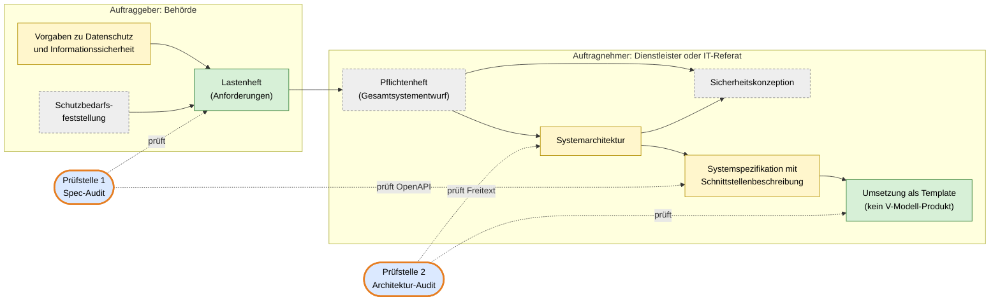
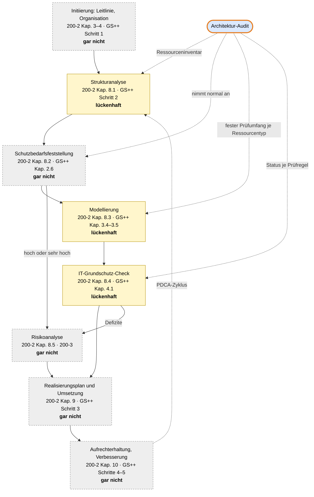
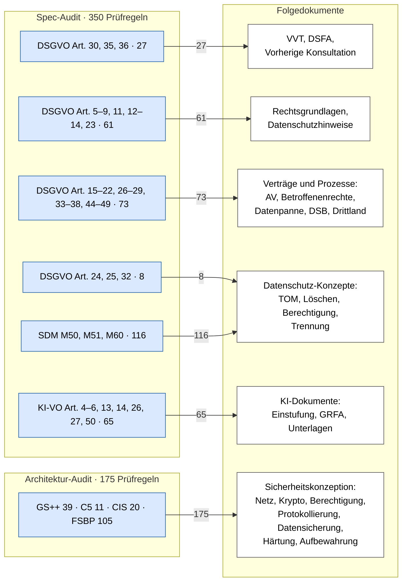

# Einordnung in BSI-Prozess und Behörden-Doku

_Research zu Issue #68, Normen-Teil. Stand und Abruf aller Quellen: 2026-10-22._

Die Werkzeuge der Behörden je Prozessschritt stehen in einer eigenen Datei: [Werkzeuge der Behörden je Prozessschritt](Werkzeuge%20der%20Behörden%20je%20Prozessschritt.md). Das Kapitel in ARCHITECTURE.md, die Seiten „BSI light“ und die Umbenennung der Musterfälle sind nicht Teil dieser Datei.

---

## 0 Ziel, Methode, Quellenregel

**Ziel.** Die Datei belegt, welche Dokumente Behörden für ein IT-Vorhaben schreiben müssen und welche Pflichtinhalte darin stehen. Sie zeigt, wie weit Spec-Audit und Architektur-Audit diese Pflichtinhalte abdecken: voll, einigermaßen, lückenhaft oder gar nicht.

**Methode.**

1. Die Primärquellen wurden gelesen: BSI-Standards 200-1 bis 200-3, der Leitfaden und der Anwenderkatalog Grundschutz++, das V-Modell XT Bund 2.4, DSGVO, KI-VO, SDM und die Listen nach Art. 35 Abs. 4 DSGVO.
2. Die Prüfregeln wurden mit `python3 -I` aus `data/knowledge_base/rules_spec.json` (350) und `rules_arch.json` (175) gelesen und nach Artikel, SDM-Baustein oder Grundschutz-Praktik zusammengefasst. Die Lücken der Galerie stammen aus `data/gallery/*.json`.
3. Jeder Pflichtinhalt bekam eine Abdeckungsstufe nach der Tabelle unten.

**Quellenregel.** Jede Aussage trägt ein Kürzel wie [Q7], das im [Quellenverzeichnis](#9-quellenverzeichnis) mit URL, Fundstelle und Abrufdatum steht. Eine Aussage ohne Primärquelle beginnt mit *Einschätzung:*. Was nicht auffindbar war, steht als „nicht gefunden“ da. Zahlen aus dem Repo tragen den Hinweis „Repo“.

**Die vier Abdeckungsstufen.** Abdeckung heißt hier: Gibt es zu einem Pflichtinhalt eine Prüfregel mit passendem Primäranker? Ein Primäranker ist die eine Fundstelle einer Norm, aus der eine Prüfregel abgeleitet ist.

| Stufe | Bedeutung |
|---|---|
| voll | Jeder Pflichtinhalt hat mindestens eine eigene Prüfregel. |
| einigermaßen | Der Kern ist abgedeckt, einzelne Pflichtinhalte fehlen. |
| lückenhaft | Nur einzelne Pflichtinhalte oder ein kleiner Ausschnitt sind abgedeckt. |
| gar nicht | Es gibt keine Prüfregel. |

Abdeckung ist kein Nachweis. Das Spec-Audit fragt, ob das geprüfte Dokument einen Pflichtinhalt beschreibt; ob das Folgedokument später existiert und stimmt, prüft GovGuard nicht. Fehlt ein Inhalt, ist das in offener Welt eine Lücke (WARN ohne Beleg), kein Verstoß.

---

## 1 Begriffe sauber getrennt

*Lastenheft und Pflichtenheft sind genormt und trennen Auftraggeber von Auftragnehmer. Fachkonzept und DV-Konzept sind Begriffe der Verwaltungspraxis ohne Norm und trennen fachliche von technischer Sicht. Das V-Modell XT Bund verbindet beides in festen Produkten.*

### 1.1 Lastenheft und Pflichtenheft (DIN 69901-5)

DIN 69901-5 ist die deutsche Norm für die Begriffe des Projektmanagements; die aktuelle Ausgabe ist 2009-01 [Q13]. Der Normtext ist kostenpflichtig. Die Definitionen stammen darum aus einer öffentlichen Wiedergabe in einer Vorlesung der LMU München [Q14], gekennzeichnet als Sekundärquelle.

| Begriff | Definition nach DIN 69901-5 (Wiedergabe [Q14]) | Wer schreibt | Frage |
|---|---|---|---|
| Lastenheft | „Vom Auftraggeber festgelegte Gesamtheit der Forderungen an die Lieferungen und Leistungen eines Auftragnehmers innerhalb eines Auftrags.“ | Auftraggeber | Was soll das System leisten? |
| Pflichtenheft | „… vom Auftragnehmer erarbeitete Realisierungsvorgaben aufgrund der Umsetzung des vom Auftraggeber vorgegebenen Lastenhefts“ | Auftragnehmer | Wie wird es umgesetzt? |

Dieselbe Quelle warnt: Juristen meinen mit „Pflichtenheft“ oft das Lastenheft im technischen Sinne [Q14, Folie 134]. Wer die Begriffe nutzt, sollte also sagen, welche Seite das Dokument geschrieben hat.

### 1.2 Fachkonzept und DV- bzw. IT-Konzept (Verwaltungspraxis)

Eine normative Definition von „Fachkonzept“ und „DV-Konzept“ wurde **nicht gefunden**, weder im V-Modell XT Bund (Textsuche: 0 Treffer für „Fachkonzept“ [Q7]) noch im Organisationshandbuch des Bundes [Q10]. Belegt ist nur der Sprachgebrauch in Behördendokumenten:

- Ein Fachkonzept (dort „fachliches Feinkonzept“) beschreibt das künftige System „ausschließlich aus der fachlichen Sicht des Anwenders – unabhängig von den Rahmenbedingungen, unter denen das System realisiert wird“ [Q15, Kap. GENESIS, PDF-S. 353].
- Ein DV-Konzept beschreibt danach die technischen Aspekte wie Systemplattformen, Systemarchitektur und Benutzeroberfläche und muss „vor der Umsetzung des fachlichen Feinkonzepts“ erstellt werden [Q15, ebd.].
- Im Vorgehensmodell des Statistischen Bundesamts schreibt die Fachabteilung als Auftraggeber das Lastenheft, der IT-Bereich als Auftragnehmer IT-Konzept, DV-Konzept und Pflichtenheft [Q16, Kap. 6, Abbildung „Dokumentstruktur des Vorgehensmodells VMAS“, PDF-S. 127].

*Einschätzung:* In der Verwaltungspraxis entspricht das Fachkonzept inhaltlich dem Lastenheft, das DV- oder IT-Konzept dem Pflichtenheft samt Systemarchitektur. Die Begriffe sind nicht trennscharf; LMU-Folien setzen das „fachliche Feinkonzept“ sogar mit dem Pflichtenheft im juristischen Sinn gleich [Q14, Folie 133].

### 1.3 Produkte im V-Modell XT Bund

Das V-Modell XT ist ein Vorgehensmodell: Es legt fest, welche Ergebnisse ein IT-Projekt liefert, wer sie schreibt und wann sie geprüft werden. Ein Ergebnis heißt dort Produkt. Das V-Modell XT Bund ist die Anpassung an die Bundesverwaltung; aktuell ist Version 2.4 vom Juni 2024 [Q8], herausgegeben vom ITZBund im Auftrag des Beauftragten der Bundesregierung für Informationstechnik [Q7, Titelei].

Das Prinzip steht in einem Satz: „Der Auftraggeber legt im Lastenheft (Anforderungen) fest, was das System leisten soll. Im Pflichtenheft (Gesamtsystementwurf) definiert der Auftragnehmer, wie er die Anforderungen umsetzt.“ [Q7, B, Abb. 40, S. 39]

| Produkt (Name im V-Modell XT Bund 2.4) | Seite | Pflichtinhalte (Themen des Produkts) | Fundstelle [Q7] |
|---|---|---|---|
| Lastenheft (Anforderungen) | Auftraggeber | Ausgangssituation und Zielsetzung, funktionale und nicht-funktionale Anforderungen, Skizze von Lebenszyklus und Gesamtsystemarchitektur, Anforderungsverfolgung, Lieferumfang, Abnahmekriterien, Glossar. Es „sollte im Allgemeinen keine technischen Lösungen vorgeben“. | C.1.10.1, S. 105–111 |
| Vorgaben zur Informationssicherheit | Auftraggeber | verbindliche Vorgaben, Ausschlüsse, Empfehlungen; Pflicht für alle Projekte mit Anforderungen an die Informationssicherheit | C.1.10.2, S. 112 |
| Vorgaben zum Datenschutz | Auftraggeber | Vorgehen, Kategorisierung nach Schutzbedarf, verbindliche technische und organisatorische Maßnahmen (TOM), Ausschlüsse, Empfehlungen; Pflicht, sobald personenbezogene Daten verarbeitet werden | C.1.10.3, S. 113–114 |
| Schutzbedarfsfeststellung | Auftraggeber | Schutzbedarfskategorien, Schadensszenarien, Schutzbedarfsmatrix für Daten und Datenflüsse, Gesamtbewertung | C.1.10.5, S. 115–116 |
| Pflichtenheft (Gesamtsystementwurf) | Auftragnehmer | Dekomposition, funktionale und nicht-funktionale Anforderungen, Schnittstellenübersicht, Abnahmekriterien, Anforderungsverfolgung zum Lastenheft | C.1.11.1, S. 132 |
| Systemarchitektur | Auftragnehmer | Architekturprinzipien, Dekomposition, Schnittstellenübersicht, Datenkatalog, informationssicherheits- und datenschutzkritische Systemelemente, Designabsicherung | C.1.11.2, S. 136–139 |
| Sicherheitskonzeption | Auftragnehmer | verwendete Methode, Vorgaben, Annahmen, Systembeschreibung aus Sicht der Informationssicherheit, Schutzbedarf, Bedrohungen, Maßnahmen, Risikoabschätzung, Risikobehandlung und Restrisiken | C.1.11.6, S. 149–152 |
| Erweiterung der Vorgaben zum Datenschutz bzw. zur Informationssicherheit | Auftragnehmer | Änderungen und Ergänzungen der Auftraggeber-Vorgaben mit Begründung | C.1.11.7, C.1.11.8, S. 152–154 |
| Systemspezifikation, Thema Schnittstellenbeschreibung | Auftragnehmer | statisches und dynamisches Verhalten jeder Schnittstelle | C.1.12.1.2, S. 160 |

Zwei Befunde zu den Namen:

- Das Issue nennt „Gesamtsystemspezifikation/Pflichtenheft“. Die Bund-Fassungen 2.3 und 2.4 führen diesen Namen nicht (Textsuche: 0 Treffer); das Produkt heißt „Pflichtenheft (Gesamtsystementwurf)“ [Q7].
- Das Issue nennt „Sicherheitskonzept“. Das Produkt heißt „Sicherheitskonzeption“ [Q7, C.1.11.6]. Das BSI spricht vom „Sicherheitskonzept“ [Q1, Kap. 8].

Das V-Modell XT Bund kennt **kein** Produkt für das Verzeichnis von Verarbeitungstätigkeiten, die Datenschutz-Folgenabschätzung, das Löschkonzept oder das Berechtigungskonzept (Textsuche in 2.4: je 0 Treffer [Q7]). Diese Dokumente kommen aus DSGVO und SDM, nicht aus dem Vorgehensmodell.

### 1.4 Begriffsbrücke

| Verwaltungspraxis | DIN 69901-5 | V-Modell XT Bund 2.4 | GovGuard | im Code |
|---|---|---|---|---|
| Fachkonzept | Lastenheft | Lastenheft (Anforderungen) | Spezifikation, Eingabe des Spec-Audits | `spec` |
| DV- oder IT-Konzept | Pflichtenheft | Pflichtenheft (Gesamtsystementwurf), Systemarchitektur | Architektur (Freitext), Eingabe des Architektur-Audits | `architecture` |
| Schnittstellenbeschreibung | (Teil des Pflichtenhefts) | Systemspezifikation, Thema Schnittstellenbeschreibung | Spezifikation (OpenAPI) | `spec` |
| – | – | kein Produkt; *Einschätzung:* Ergebnis der Realisierung | Template (CloudFormation-JSON) | `architecture`, `closed_world` |

### 1.5 Die sechs Musterfälle eingeordnet

Ein Musterfall ist eine fiktive Beispiel-Eingabe mit festgelegtem Soll-Ergebnis. Das Issue nennt heute „zwei Fachkonzepte, eine Schnittstellenbeschreibung und drei Templates“. Die Prüfung der Dateien (Repo) ergibt ein anderes Bild: **Nur zwei Musterfälle sind Templates; der dritte Architektur-Fall ist eine Architekturbeschreibung in Freitext.**

| Musterfall | Titel heute | Eingabedatei | Dokumentart (Befund) | V-Modell-Produkt | Begründung | im Code |
|---|---|---|---|---|---|---|
| Schuleingangsuntersuchung | Online-Anmeldung zur Schuleingangsuntersuchung … | Markdown | Fachkonzept | Lastenheft | Überschrift „Fachkonzept“; Ziel, Ablauf, Datenkatalog, Rechtsgrundlagen; kaum Technik. | `spec-meldeportal-gesundheit/input.md` |
| GovGuard selbst | GovGuard prüft sich selbst … | Markdown | Fachkonzept mit Lösungsanteilen (Mischform) | Lastenheft mit Teilen von Pflichtenheft und Systemarchitektur | Überschrift „Fachkonzept (Kurzfassung)“, aber mit Plattform, Sprachmodell-Anbieter und Datenflüssen; das Lastenheft soll keine technische Lösung vorgeben [Q7, C.1.10.1]. *Einschätzung:* typisch für Eigenentwicklung, wo Auftraggeber und Auftragnehmer dieselbe Stelle sind. | `spec-govguard/SPEC.md` |
| Wohngeld | Wohngeld online: Antragsschnittstelle … (OpenAPI) | OpenAPI-YAML | Schnittstellenbeschreibung mit eingebettetem Fachkonzept | Systemspezifikation (Schnittstellenbeschreibung); Fachteil wie Lastenheft | Die OpenAPI-Datei trägt im Feld `description` ein „Fachkonzept: Online-Antrag auf Wohngeld“. | `spec-wohngeld-openapi/openapi.yaml` |
| Antragseingang | Antragseingang mit Sicherheitsmängeln (CloudFormation) | CloudFormation-JSON | Template | kein Produkt | Infrastruktur als Datei. | `arch-antragseingang-fehlerhaft/template.json` |
| Fristenwecker | Fristenwecker im Bauamt (CloudFormation) | CloudFormation-JSON | Template | kein Produkt | Infrastruktur als Datei. | `arch-fristenwecker/template.json` |
| Protokollarchiv | Revisionssicheres Protokollarchiv für Fachverfahren | Markdown | Architekturbeschreibung, **kein Template** | Systemarchitektur | Überschrift „Architekturbeschreibung“; Komponenten, Ablauf, Sicherheitsmaßnahmen in Prosa. | `arch-protokollarchiv/input.md` |

Richtig gezählt sind es also ein reines Fachkonzept, ein Fachkonzept in Mischform, eine Schnittstellenbeschreibung, eine Architekturbeschreibung und zwei Templates.

---

## 2 Dokumente und Pflichtinhalte aus Primärquellen

*Das BSI verlangt ein Sicherheitskonzept mit Strukturanalyse, Schutzbedarf, Modellierung, Check und bei Bedarf Risikoanalyse. Die DSGVO verlangt VVT, bei hohem Risiko DSFA und vorherige Konsultation, die KI-VO bei Hochrisiko-KI eine Grundrechte-Folgenabschätzung. Das SDM übersetzt die DSGVO in Maßnahmen-Bausteine.*

### 2.1 BSI-Standard 200-1: Managementsystem

Ein ISMS (Informationssicherheits-Managementsystem) ist die Gesamtheit der Regeln und Abläufe, mit denen eine Behörde ihre Informationssicherheit steuert. BSI-Standard 200-1 markiert jede Aktion, die dokumentiert werden muss, mit „[DOK]“ [Q1, Kap. 4.3, S. 24]. Für das Sicherheitskonzept sind das [Q1, Kap. 8.1, S. 32–36]:

| Pflichtdokument nach 200-1 | Fundstelle [Q1] |
|---|---|
| Leitlinie zur Informationssicherheit mit Sicherheitszielen, Geltungsbereich | Kap. 7.1, S. 28 |
| Methode zur Risikoanalyse, Klassifikation von Risiken, Risikoanalyse, Strategie zur Risikobehandlung | Kap. 8.1, S. 32–34 |
| Auswahl von Sicherheitsmaßnahmen | Kap. 8.1, S. 35 |
| Realisierungsplan mit Prioritäten, Verantwortlichen, Ressourcen und Terminen | Kap. 8.1, S. 36 |
| Kontrolle der Umsetzung, Überprüfung von Wirksamkeit, Managementbewertung | Kap. 8.1–8.3, S. 36–38 |

### 2.2 BSI-Standard 200-2: Standard-Absicherung

Der IT-Grundschutz ist die Methode des BSI, mit Standardanforderungen ein normales Sicherheitsniveau zu erreichen. Die Standard-Absicherung erstellt eine Sicherheitskonzeption in fünf Aktionsfeldern [Q2, Kap. 8, S. 76–78]:

| Schritt | Was entsteht (Pflichtinhalt) | Fundstelle [Q2] |
|---|---|---|
| Strukturanalyse | Erfassung von Geschäftsprozessen, Anwendungen, IT-Systemen, Netzplan, Kommunikationsverbindungen und Räumen des Informationsverbunds. Ein Informationsverbund ist der Geltungsbereich, für den das Konzept gilt. | Kap. 8.1, S. 77–103 |
| Schutzbedarfsfeststellung | Schutzbedarf je Zielobjekt für Vertraulichkeit, Integrität, Verfügbarkeit in den Kategorien „normal“, „hoch“, „sehr hoch“, mit Begründung. Ein Zielobjekt ist ein Bestandteil des Verbunds, etwa eine Anwendung oder ein Raum. | Kap. 8.2, S. 104 ff. |
| Modellierung | Zuordnung der Bausteine bzw. Anforderungen zu den Zielobjekten | Kap. 8.3, S. 132 ff. |
| IT-Grundschutz-Check | Soll-Ist-Vergleich; je Anforderung Status „entbehrlich“, „ja“, „teilweise“ oder „nein“ | Kap. 8, S. 77–78; Kap. 8.4, S. 145 ff. |
| Risikoanalyse | nur bei hohem oder sehr hohem Schutzbedarf, bei nicht modellierbaren Zielobjekten oder ungewöhnlichem Einsatz | Kap. 8.5, S. 152–153 |
| Realisierungsplan | Zielobjekt, Baustein, Anforderung, Maßnahme, Termine, Budget, Verantwortliche | Kap. 9.4, S. 161 |

Die Schritte müssen nicht streng nacheinander laufen [Q2, Kap. 8, S. 78]. Als Dokumente nennt 200-2 unter anderem das „Sicherheitskonzept mit den Berichten zur Risikoanalyse“ und die Leitlinie [Q2, Kap. 5.2.2, S. 55–56].

### 2.3 BSI-Standard 200-3: Risikoanalyse

Eine Risikoanalyse ermittelt Gefährdungen, bewertet ihr Risiko und legt fest, wie damit umgegangen wird. Sie setzt Strukturanalyse, Schutzbedarfsfeststellung, Modellierung und Grundschutz-Check voraus [Q3, Kap. 2, S. 9–10]. Die Pflichtinhalte sind eine Gefährdungsübersicht (Kap. 4), die Risikoeinstufung (Kap. 5), die Risikobehandlung mit den Optionen Vermeiden, Reduzieren, Transferieren oder Akzeptieren unter Beteiligung der Leitung (Kap. 6.1, S. 33) und die Konsolidierung des Sicherheitskonzepts (Kap. 7, S. 39) [Q3].

### 2.4 Grundschutz++

Grundschutz++ ist die Neuentwicklung des IT-Grundschutzes; jede Anforderung ist eine maschinenlesbare Regel [Q5]. Der Anwenderkatalog löst das IT-Grundschutz-Kompendium ab [Q5]. Eine Praktik bündelt Anforderungen nach Tätigkeiten mit einer zuständigen Rolle; jede Anforderung gehört zu genau einer Praktik [Q4, Kap. 7.7, S. 44].

| Prozessschritt (Methodik) | ISMS-Praktik | Pflichtinhalt | Fundstelle [Q4] |
|---|---|---|---|
| 1 Erhebung und Planung | Governance und Compliance (GC) | Kontext, Leitlinie, Geltungsbereich, Informationssicherheitseinstufung (Schutzbedarf je Geschäftsprozess) | Kap. 1.4, S. 8; Kap. 2.6, S. 15 |
| 2 Anforderungsanalyse | Strukturmodellierung (STM) | Informationsverbund, Asset-Modellierung, Zuordnung der Assets zu Zielobjektkategorien, Anforderungspaket, Risikobetrachtung bei Bedarf | Kap. 3.4, S. 21; Kap. 3.8, S. 27 |
| 3 Realisierung | Umsetzung (UMS) | Umsetzungsstatus je Anforderung, nur „ja“ oder „nein“; Planung, Fristen, Ausnahmen | Kap. 4.1, S. 28 |
| 4 Überwachung | Monitoring und Evaluation (PERF) | Leistungsbewertung, Audits, Managementbewertung | Kap. 5 |
| 5 Kontinuierliche Verbesserung | Verbesserung (VRB) | Nicht-Konformitäten, Korrektur, Wirksamkeitsprüfung | Kap. 6 |

Zwei Unterschiede zu 200-2 sind für GovGuard wichtig. Der Schutzbedarf kennt nur „normal“ und „hoch“ [Q4, Kap. 7.9, S. 44]. Für den Umsetzungsstatus nennt die Methodik ausdrücklich auch „automatisierte Konfigurationsprüfungen und technische Scans“ als Methode [Q4, Kap. 4.1, S. 28].

**Umfang.** Der Anwenderkatalog in der Fassung, die GovGuard baut, hat 20 Praktiken mit 1.000 Anforderungen, davon 773 auf Niveau „normal-SdT“ und 227 „erhöht“ (Repo, [Q6]). Die fünf technischen Praktiken, aus denen GovGuard schöpft, haben zusammen 412 Anforderungen, davon 303 „normal-SdT“.

**Status.** Der Leitfaden ist mit März 2026 datiert [Q4, Änderungshistorie]. Laut BSI-Seite wird die Methodik erst am 27.10.2026 veröffentlicht, ab 01.01.2027 ist Grundschutz++ zertifizierbar, und die Zertifizierbarkeit nach altem IT-Grundschutz endet am 30.11.2031 [Q5, Meilensteinplan, Stand Oktober 2026]. Der gelesene Leitfaden ist also eine Vorfassung.

### 2.5 V-Modell XT Bund: Informationssicherheit und Datenschutz im Projekt

Das V-Modell XT Bund verlangt Informationssicherheit und Datenschutz schon im Lastenheft. Die Vorgaben zur Informationssicherheit, zum Datenschutz und zum IT-Betrieb „müssen“ im Thema nicht-funktionale Anforderungen „aufgeführt oder referenziert werden“, ebenso die Schutzbedarfsfeststellung, „die zusammen mit den vorgenannten Vorgaben die Grundlage der zu erstellenden Sicherheitskonzeption“ ist [Q7, C.1.10.1.3, S. 109].

Die Auftraggeber-Seite liefert Vorgaben und Schutzbedarfsfeststellung als Teil der Vergabeunterlagen [Q7, B, S. 50]. Die Auftragnehmer-Seite liefert die Sicherheitskonzeption; sie prüft, ob das Pflichtenheft den Anforderungen aus Lastenheft und Schutzbedarfsfeststellung entspricht [Q7, C.1.11.6, S. 149]. Als Methode nennt das V-Modell beispielhaft BSI-Standard 200-2 [Q7, C.1.11.6.1].

### 2.6 DSGVO Art. 30, 35, 36

| Dokument | Pflichtinhalt | Fundstelle [Q17] |
|---|---|---|
| Verzeichnis von Verarbeitungstätigkeiten (VVT) | Das VVT ist die Liste aller Verarbeitungen personenbezogener Daten einer Stelle. Pflichtangaben: Name und Kontakt des Verantwortlichen und des DSB, Zwecke, Kategorien von Personen und Daten, Empfänger, Drittlandübermittlungen, wenn möglich Löschfristen und eine allgemeine Beschreibung der TOM; schriftlich oder elektronisch; auf Anfrage an die Aufsicht. | Art. 30 Abs. 1, 3, 4 |
| VVT des Auftragsverarbeiters | Name und Kontakt, Kategorien der Verarbeitungen, Drittlandübermittlungen, TOM | Art. 30 Abs. 2 |
| Datenschutz-Folgenabschätzung (DSFA) | Die DSFA ist eine vorab durchgeführte Abschätzung der Folgen einer Verarbeitung mit voraussichtlich hohem Risiko. Mindestinhalt: systematische Beschreibung und Zwecke, Notwendigkeit und Verhältnismäßigkeit, Risikobewertung, Abhilfemaßnahmen. Dazu Rat des DSB, Regelfälle, Standpunkt der Betroffenen „gegebenenfalls“, Überprüfung bei Änderungen. Für Behörden wichtig: Beruht die Verarbeitung auf einer Rechtsvorschrift, deren Erlass schon eine allgemeine Folgenabschätzung enthielt, kann die DSFA entfallen. | Art. 35 Abs. 1–3, 7, 9, 10, 11 |
| Liste nach Art. 35 Abs. 4 | Die Aufsichtsbehörde veröffentlicht eine Liste der Verarbeitungen, für die eine DSFA Pflicht ist. | Art. 35 Abs. 4 |
| Vorherige Konsultation | Die vorherige Konsultation ist die Pflicht, vor der Verarbeitung die Aufsicht zu fragen, wenn die DSFA ein hohes Restrisiko zeigt. Zu liefern: Zuständigkeiten, Zwecke und Mittel, Maßnahmen und Garantien, Kontakt des DSB, die DSFA, weitere angeforderte Informationen. | Art. 36 Abs. 1, 3 lit. a–f |

### 2.7 Standard-Datenschutzmodell (SDM)

Das SDM ist die Methode der Datenschutzkonferenz, die Anforderungen der DSGVO über sieben Gewährleistungsziele in technische und organisatorische Maßnahmen übersetzt [Q19, Einleitung, S. 5]. Die Maßnahmen stehen im Referenzmaßnahmen-Katalog, gegliedert in Bausteine. Ein Baustein bündelt die Maßnahmen zu einem Thema, etwa Löschen. Wer von einer Maßnahme abweicht, muss dokumentieren, ob, inwieweit und warum [Q19, E6, S. 78].

Freigegeben sind neun Bausteine [Q20]: 11 Aufbewahren, 41 Planen und Spezifizieren, 42 Dokumentieren, 43 Protokollieren, 50 Trennen, 51 Zugriffe regeln, 60 Löschen und Vernichten, 61 Berichtigen, 62 Einschränken der Verarbeitung.

Für die Planung verlangt das SDM eine „obligatorische Schwellwert-Analyse“ und daraus gegebenenfalls eine DSFA mit DSFA-Bericht [Q19, D4.4.1, S. 64].

### 2.8 Muss-Liste nach Art. 35 Abs. 4 DSGVO

Die Muss-Liste der DSK hat 17 Einträge, gilt aber nur **für den nicht-öffentlichen Bereich** [Q21, Titel der Liste auf der DSK-Seite; Version 1.1 vom 17.10.2018]. Für Behörden gelten die Listen der jeweiligen Landes- oder Bundesaufsicht. Ein Beispiel ist die Hamburger Liste für den öffentlichen Bereich mit 24 Einträgen, darunter „umfangreiche Verarbeitung von Daten über Kinder“ (Nr. 8) und „Einsatz von künstlicher Intelligenz“ (Nr. 18) [Q22, Version 2.0a, Stand 08.04.2021]. Eine Liste der BfDI für Bundesbehörden wurde **nicht gefunden**.

### 2.9 KI-VO Art. 27: Grundrechte-Folgenabschätzung

Die Grundrechte-Folgenabschätzung (GRFA) ist die Pflicht bestimmter Betreiber, vor dem ersten Einsatz eines Hochrisiko-KI-Systems dessen Folgen für die Grundrechte abzuschätzen. Sie gilt für Einrichtungen des öffentlichen Rechts [Q18, Art. 27 Abs. 1]. Pflichtinhalte: Verfahren, Zeitraum und Häufigkeit, betroffene Personengruppen, Schadensrisiken, menschliche Aufsicht, Maßnahmen bei Eintritt der Risiken (Abs. 1 lit. a–f); Aktualisierung (Abs. 2); Mitteilung an die Marktüberwachungsbehörde (Abs. 3); Verweis auf eine vorhandene DSFA ist erlaubt (Abs. 4) [Q18].

### 2.10 C5

Der C5 (Cloud Computing Compliance Criteria Catalogue) ist der Kriterienkatalog des BSI für Cloud-Dienste. Er „richtet sich in erster Linie an professionelle Cloud-Anbieter, deren Prüfer und Kunden“; die Erfüllung wird durch Wirtschaftsprüfer testiert [Q23]. Ein Testat ist die Bestätigung eines Prüfers. Kunden müssen selbst prüfen, ob für ihren Fall weitere Kriterien nötig sind [Q23].

---

## 3 Abdeckungstabellen

*Das Spec-Audit deckt die Pflichtinhalte von VVT voll und von DSFA, Konsultation und GRFA einigermaßen ab; Schutzbedarf und Informationssicherheit im Lastenheft fehlen fast ganz. Das Architektur-Audit deckt nur den technischen Ausschnitt des Grundschutz-Checks ab, und das lückenhaft.*

Die Zahlen in Klammern sind die Anzahl der Prüfregeln (Repo). Die Spalte „im Code“ nennt das Muster der Kennung (`id`) der Prüfregeln.

### 3.1 Spec-Audit

| Dokument | Pflichtinhalt | GovGuard-Prüfregeln (Anker) | im Code | Abdeckung | Begründung |
|---|---|---|---|---|---|
| VVT | Art. 30 Abs. 1 lit. a–g [Q17] | DSGVO Art. 30 Abs. 1 lit. a–g (7) | `SPEC-DSGVO-Art.30Abs.1lit.*` | voll | Jede Pflichtangabe hat eine eigene Prüfregel. Geprüft wird, ob die Spezifikation die Angabe enthält. |
| VVT (Auftragsverarbeiter, Form) | Art. 30 Abs. 2–4 [Q17] | DSGVO Art. 30 Abs. 2 lit. a–d, Abs. 3, Abs. 4 (6) | `SPEC-DSGVO-Art.30Abs.{2,3,4}*` | voll | Abs. 5 hat eine eigene Prüfregel, die von „Unternehmen“ spricht. *Einschätzung:* Für Behörden ist sie kaum aussagekräftig. |
| DSFA, Mindestinhalt | Art. 35 Abs. 7 lit. a–d [Q17] | DSGVO Art. 35 Abs. 7 lit. a–d (4) | `SPEC-DSGVO-Art.35Abs.7lit.*` | voll | Alle vier Mindestinhalte sind abgedeckt. |
| DSFA, Verfahren | Art. 35 Abs. 1, 2, 3, 8, 9, 10, 11 [Q17] | DSGVO Art. 35 Abs. 1, 2, 3, 8 (4) | `SPEC-DSGVO-Art.35Abs.{1,2,3,8}` | einigermaßen | Standpunkt der Betroffenen (Abs. 9) und Überprüfung bei Änderung (Abs. 11) fehlen. Die Ausnahme für Verarbeitungen auf gesetzlicher Grundlage (Abs. 10), für Behörden oft entscheidend, fehlt ebenfalls. |
| Muss-Liste nach Art. 35 Abs. 4 | 17 Fälle (DSK, nicht-öffentlich) [Q21]; Landeslisten für Behörden, z. B. 24 Fälle [Q22] | kein Anker auf die Listen; indirekt Art. 35 Abs. 1, 3 und die Bedingungen KI-System und automatisierte Entscheidung | `ConditionDef` | lückenhaft | Welche Landesliste gilt, weiß GovGuard nicht; kein Listeneintrag ist eine Prüfregel. |
| Vorherige Konsultation | Art. 36 Abs. 1, Abs. 3 lit. a–f [Q17] | DSGVO Art. 36 Abs. 3 lit. a–e (5) | `SPEC-DSGVO-Art.36Abs.3lit.*` | einigermaßen | Der Auslöser (Abs. 1) und lit. f fehlen. |
| GRFA | KI-VO Art. 27 Abs. 1 lit. a–f, Abs. 2, 3 [Q18] | KI-VO Art. 27 Abs. 1 lit. a–f, Abs. 2, Abs. 5 (8) | `SPEC-KI-VO-Art.27*` | einigermaßen | Mindestinhalt voll; die Mitteilung (Abs. 3) fehlt. Abs. 5 ist eine Pflicht des Büros für KI, die Prüfregel verlangt aber einen Musterfragebogen in der Spezifikation. *Einschätzung:* Das ist ein Fehlanker. |
| SDM, Bausteine 50, 51, 60 | Maßnahmen der Bausteine Trennen, Zugriffe regeln, Löschen [Q20] | SDM Trennen M50 (33), Zugriffe regeln M51 (58), Löschen M60 (25) | `SPEC-SDM-M50.*`, `M51.*`, `M60.*` | einigermaßen | Der Build nimmt nur Maßnahmen auf, die eine Spezifikation beschreiben kann; der Rest ist bewusst verworfen. |
| SDM, übrige Bausteine | 11, 41, 42, 43, 61, 62 [Q20] | keine | – | gar nicht | Protokollieren (43) fehlt bewusst (ARCHITECTURE 0.1). Berichtigen und Einschränken sind nur über DSGVO Art. 16 und 18 berührt. |
| SDM, Methode | Gewährleistungsziele, Schwellwert-Analyse [Q19, D3.2.1, D4.4.1] | keine | – | gar nicht | Kein Anker auf die Methode selbst. |
| Lastenheft (V-Modell) | Themen nach C.1.10.1 [Q7] | alle 350 Prüfregeln, aber nur zu Datenschutz und KI | `rules_spec.json` | lückenhaft | Geprüft wird der rechtliche Inhalt, nicht Gliederung, Abnahmekriterien oder Anforderungsverfolgung. |
| Vorgaben zum Datenschutz (V-Modell) | Vorgehen, Kategorisierung nach Schutzbedarf, verbindliche TOM, Ausschlüsse [Q7, C.1.10.3] | DSGVO Art. 24, 25, 32 (8) und SDM (116) | `SPEC-DSGVO-Art.{24,25,32}*`, `SPEC-SDM-*` | einigermaßen | Die TOM sind breit abgedeckt; die Kategorisierung nach Schutzbedarf und Art. 32 Abs. 1 lit. b fehlen. |
| Vorgaben zur Informationssicherheit (V-Modell) | verbindliche Vorgaben, Ausschlüsse, Empfehlungen [Q7, C.1.10.2] | nur DSGVO Art. 32 (4) | `SPEC-DSGVO-Art.32*` | lückenhaft | BSI-Prüfregeln gibt es nur im Architektur-Audit. |
| Schutzbedarfsfeststellung | Kategorien, Schadensszenarien, Matrix, Gesamtbewertung [Q7, C.1.10.5]; [Q2, Kap. 8.2] | keine | – | gar nicht | Der Vorfilter des Builds nimmt Schutzbedarf „normal“ an (`prefilter_reason`). |

### 3.2 Architektur-Audit

| Dokument | Pflichtinhalt | GovGuard-Prüfregeln (Anker) | im Code | Abdeckung | Begründung |
|---|---|---|---|---|---|
| Grundschutz++, technische Praktiken ARCH, BER, DET, DLS, KONF | 303 Anforderungen „normal-SdT“, 412 insgesamt [Q6] | GS++ ARCH (9), BER (10), DET (2), DLS (1), KONF (17) | `ARCH-BSI-*` | lückenhaft | 39 von 303, also rund 13 %. Aufgenommen ist nur, was an einem Template entscheidbar ist und einen Dienst im Prüfumfang betrifft (`scope_level`). |
| Grundschutz++, übrige Praktiken | ASST, PERS, BES, TEST, GEB, SENS, NOT, REA, DEV: 489 Anforderungen [Q6] | keine | – | gar nicht | Organisation, Personal, Gebäude, Notfall. Datensicherung prüfen nur FSBP- und CIS-Regeln, ohne Anker in der Praktik NOT. |
| Grundschutz++, ISMS-Praktiken | GC, STM, UMS, PERF, VRB, RISK: 99 Anforderungen [Q6]; Prozessschritte 1–5 [Q4] | keine | – | gar nicht | Prozess und Management prüft GovGuard nicht. |
| Strukturanalyse | Prozesse, Anwendungen, Netzplan, IT-Systeme, Räume [Q2, Kap. 8.1] | kein Anker; der Code liest die Ressourcentypen eines Templates | `Inventory`, `template_resource_types()` | lückenhaft | Nur die technischen Bestandteile eines Templates, ohne Geschäftsprozesse und Räume. |
| Schutzbedarfsfeststellung | [Q2, Kap. 8.2]; [Q4, Kap. 2.6] | keine | – | gar nicht | Annahme „normal“. |
| Modellierung | Anforderungen je Zielobjekt [Q2, Kap. 8.3]; Zielobjektkategorien [Q4, Kap. 3.4] | Ressourcentypen je Prüfregel, Anwendbarkeit im Audit | `cfn_resource_types`, `Inventory.applies` | lückenhaft | Die Zuordnung ist zur Bauzeit fest und kennt nur AWS-Ressourcentypen. |
| IT-Grundschutz-Check bzw. Umsetzungsstatus | Status je Anforderung [Q2, Kap. 8.4]; „ja“/„nein“ [Q4, Kap. 4.1] | Befund je Prüfregel mit PASS, WARN, FAIL, N/A | `Status` | lückenhaft | Die Methode passt: automatisierte Konfigurationsprüfung ist nach [Q4] zulässig. Der Umfang ist klein (siehe erste Zeile). |
| Risikoanalyse | [Q3, Kap. 4–7] | keine | – | gar nicht | Keine Gefährdungen, keine Risikobewertung. |
| Realisierungsplan | Zielobjekt, Maßnahme, Termine, Budget, Verantwortliche [Q2, Kap. 9.4]; [Q1, Kap. 8.1] | keine; nur eine Empfehlung je Befund | `recommendation` | gar nicht | Termine, Budget und Verantwortliche fehlen ganz. |
| Systemarchitektur (V-Modell) | Prinzipien, Dekomposition, Schnittstellen, Datenkatalog, kritische Systemelemente [Q7, C.1.11.2] | alle 175 Prüfregeln auf beschriebene Dienste, wenn die Architektur als Freitext kommt | `rules_arch.json` | lückenhaft | Geprüft werden Sicherheitseigenschaften der Dienste, nicht die Pflichtthemen des Produkts. |
| Sicherheitskonzeption (V-Modell) | Methode, Vorgaben, Annahmen, Systembeschreibung, Schutzbedarf, Bedrohungen, Maßnahmen, Risiko [Q7, C.1.11.6] | 175 Prüfregeln zum Thema „Maßnahmen“ auf Template-Ebene | `rules_arch.json` | lückenhaft | Sieben von acht Themen fehlen. |
| C5 | Kriterien für Cloud-Anbieter, Nachweis per Testat [Q23] | BSI C5 OPS, IAM, CRY, COS, PSS (11) | `ARCH-C5-*` | lückenhaft | GovGuard prüft nur die kundenseitige Konfiguration; das Testat des Anbieters prüft es nicht. |

CIS AWS (20) und AWS FSBP (105) sind keine Behörden-Dokumente, sondern technische Härtungsregeln. Sie stärken die technische Prüfung, decken aber keinen der Pflichtinhalte oben zusätzlich ab.

---

## 4 Einordnung im V-Modell: zwei Prüfstellen und was dazwischen bleibt

*Kernaussage: GovGuard prüft am Anfang (Lastenheft) und am Ende (Template). Pflichtenheft und Sicherheitskonzeption dazwischen prüft es nicht, und es verbindet die beiden Prüfungen nicht miteinander.*

Mermaid ist eine Textsprache für Diagramme, die GitHub direkt anzeigt.

**Legende.**

| Form oder Farbe | Bedeutung |
|---|---|
| grün | GovGuard prüft dieses Dokument; dafür ist das Audit gebaut. |
| gelb | GovGuard nimmt es als Eingabe an, prüft aber nur einen Teil seiner Pflichtinhalte. |
| grau gestrichelt | ungeprüft |
| blau mit orangem Rand, abgerundet | Prüfstelle von GovGuard: ein Ablauf, den Code führt und in dem er das Sprachmodell fragt (wie ARCHITECTURE 0.3) |
| durchgezogener Pfeil | „ist Grundlage für“ nach V-Modell XT Bund [Q7] |
| gestrichelter Pfeil | „GovGuard prüft“ |

**Elemente.** Die Kästen links sind die Produkte des Auftraggebers, die Kästen rechts die des Auftragnehmers [Q7, C.1.10, C.1.11, C.1.12]. Das Template ist kein V-Modell-Produkt. *Einschätzung:* Es gehört zur Realisierung auf dem aufsteigenden Ast des V. Die Vorgaben zum Datenschutz sind gelb, weil das Spec-Audit ihre TOM im Lastenheft mitprüft (Abschnitt 3.1).

**Verbindungen.** Lastenheft, Vorgaben und Schutzbedarfsfeststellung gehen an den Auftragnehmer [Q7, B, S. 50]. Pflichtenheft und Systemarchitektur bestimmen, ob und für welche Elemente eine Sicherheitskonzeption entsteht [Q7, C.1.11.2.8, C.1.11.6]. Das Spec-Audit prüft das Lastenheft, nimmt aber auch eine OpenAPI an (Musterfall Wohngeld). Das Architektur-Audit prüft das Template und nimmt auch eine Architekturbeschreibung in Freitext an (Musterfall Protokollarchiv).

**Was dazwischen ungeprüft bleibt.**

| Produkt oder Zusammenhang | Was fehlt | Fundstelle |
|---|---|---|
| Schutzbedarfsfeststellung | Kategorien, Schadensszenarien, Matrix; GovGuard nimmt „normal“ an | [Q7, C.1.10.5]; [Q2, Kap. 8.2] |
| Vorgaben zur Informationssicherheit | verbindliche Vorgaben und Ausschlüsse des Auftraggebers | [Q7, C.1.10.2] |
| Pflichtenheft | Dekomposition, Abnahmekriterien, Anforderungsverfolgung zum Lastenheft | [Q7, C.1.11.1] |
| Sicherheitskonzeption | Annahmen, Bedrohungen, Risikoabschätzung, Restrisiken | [Q7, C.1.11.6] |
| Erweiterung der Vorgaben | begründete Abweichungen des Auftragnehmers | [Q7, C.1.11.7, C.1.11.8] |
| Rückverfolgung Lastenheft → Template | Ob das Template umsetzt, was das Lastenheft fordert. Die beiden Audits haben getrennte Eingaben und keinen Bezug zueinander. | [Q7, C.1.11.1.9] (Pflicht zur Anforderungsverfolgung) |
| Betrieb und Konto | Vorgaben zum IT-Betrieb, kontoweite Einstellungen | [Q7, C.1.15.1]; ARCHITECTURE 0.1 „Nur die Workload“ |

---

## 5 BSI-Ablauf mit Abdeckung je Schritt

*Kernaussage: Im Ablauf nach BSI-Standard 200-2 berührt GovGuard nur drei Schritte, und alle nur lückenhaft. Schutzbedarf, Risikoanalyse und Umsetzung bleiben ganz beim Menschen.*

**Legende.**

| Form oder Farbe | Bedeutung |
|---|---|
| gelb | Abdeckung lückenhaft |
| grau gestrichelt | Abdeckung gar nicht |
| blau mit orangem Rand | Prüfstelle von GovGuard (wie ARCHITECTURE 0.3) |
| durchgezogener Pfeil | Reihenfolge nach 200-2; beschriftet = nur unter dieser Bedingung |
| gestrichelter Pfeil von GovGuard | was GovGuard zu diesem Schritt beiträgt |
| PDCA | Plan-Do-Check-Act, der Kreislauf aus Planen, Umsetzen, Prüfen und Verbessern |

**Elemente.** Die Kästen sind die Schritte der Standard-Absicherung [Q2, Kap. 3–10]. Jeder Kasten nennt das passende Kapitel in Grundschutz++ [Q4]. Die Abdeckung je Schritt stammt aus Abschnitt 3.2.

**Verbindungen.** Die Risikoanalyse ist nur nötig bei hohem oder sehr hohem Schutzbedarf oder bei Zielobjekten, die sich nicht modellieren lassen [Q2, Kap. 8.5, S. 153]; in Grundschutz++ auch für nicht umgesetzte relevante Anforderungen [Q4, Kap. 4.1]. GovGuard liefert zur Strukturanalyse das Ressourceninventar (`Inventory`), zur Modellierung die feste Zuordnung von Prüfregeln zu Ressourcentypen (`cfn_resource_types`) und zum Check einen Status je Prüfregel (`Status`). Zur Schutzbedarfsfeststellung trägt es nichts bei, sondern setzt „normal“ voraus. Das Spec-Audit fehlt im Bild, weil 200-2 den Datenschutz nicht als eigenen Schritt führt; er steht im SDM (Abschnitt 2.7).

---

## 6 Vorschlag: Anker → Folgedokument

*Jede Prüfregel lässt sich über ihren Primäranker einem Folgedokument zuordnen. Ein Folgedokument ist ein Dokument, das nach oder neben dem geprüften Text entsteht, etwa VVT oder Löschkonzept. So kann die UI Lücken als „gehört ins Löschkonzept“ zeigen statt als lange Liste.*

Heute gruppiert die Lückenliste nach Quelle, also „DSGVO“ oder „SDM Löschen“ (`_gap_group` in `govguard_ui/report/gaps_view.py`). Der Vorschlag ersetzt diese Gruppe durch das Folgedokument. Er ändert weder Katalog noch Status.

**Die gesamte Zuordnung ist eine *Einschätzung*.** Die Normen nennen das Dokument nur für Art. 30 (VVT), Art. 35 (DSFA), Art. 36 und KI-VO Art. 27 ausdrücklich [Q17, Q18]; Löschkonzept und Rollen- und Berechtigungskonzept nennen die SDM-Bausteine selbst (Prüfregeln M60.P03 „Löschkonzept vorhanden“, M51.S04 „Rollen- und Berechtigungskonzept“, Repo). Die übrigen Zuordnungen folgen dem Thema des Artikels.

### 6.1 Spec-Audit (350 Prüfregeln)

| Folgedokument | Primäranker | Prüfregeln | Grundlage | im Code (Vorschlag) |
|---|---|---|---|---|
| Verzeichnis von Verarbeitungstätigkeiten | DSGVO Art. 30 | 14 | Norm [Q17] | `vvt` |
| Datenschutz-Folgenabschätzung | DSGVO Art. 35 | 8 | Norm [Q17] | `dsfa` |
| Vorherige Konsultation | DSGVO Art. 36 | 5 | Norm [Q17] | `consultation` |
| Rechtsgrundlagen- und Zweckprüfung | DSGVO Art. 5–9, 11, 23 | 26 | Einschätzung | `legal_basis` |
| Datenschutzhinweise | DSGVO Art. 12–14 | 35 | Einschätzung | `privacy_notice` |
| Prozess für Betroffenenrechte | DSGVO Art. 15–18, 21, 22 | 28 | Einschätzung | `data_subject_rights` |
| Datenschutzkonzept (TOM) | DSGVO Art. 24, 25, 32 | 8 | Einschätzung; [Q7, C.1.10.3] | `tom` |
| AV-Vertrag, Vereinbarung nach Art. 26 | DSGVO Art. 26, 28, 29 | 17 | Einschätzung | `processor_contract` |
| Meldeprozess Datenpanne | DSGVO Art. 33, 34 | 10 | Einschätzung | `breach_process` |
| Benennung des DSB | DSGVO Art. 37, 38 | 6 | Einschätzung | `dpo` |
| Drittlandübermittlung | DSGVO Art. 44–46, 48, 49 | 12 | Einschätzung | `transfer` |
| Löschkonzept | SDM Löschen M60 | 25 | SDM-Baustein [Q20] | `deletion_concept` |
| Rollen- und Berechtigungskonzept | SDM Zugriffe regeln M51 | 58 | SDM-Baustein [Q20] | `access_concept` |
| Trennungskonzept (Mandanten) | SDM Trennen M50 | 33 | Einschätzung | `separation_concept` |
| Grundrechte-Folgenabschätzung | KI-VO Art. 27 | 8 | Norm [Q18] | `frfa` |
| KI-Einstufung | KI-VO Art. 5, 6 | 26 | Einschätzung | `ai_classification` |
| KI-Unterlagen (Schulung, Betriebsanleitung, Betreiberpflichten, Transparenz) | KI-VO Art. 4, 13, 14, 26, 50 | 31 | Einschätzung | `ai_documents` |

Die Codenamen sind Vorschläge; nichts davon existiert im Code.

### 6.2 Architektur-Audit (175 Prüfregeln)

Alle Architektur-Prüfregeln gehören zum Thema „Informationssicherheitsmaßnahmen“ der Sicherheitskonzeption [Q7, C.1.11.6.7]. Für die UI lohnt eine feinere Gruppe nach Teilkonzept. Die Zuordnung lief per Schlüsselwort im Titel mit 23 Korrekturen von Hand (Repo); sie ist eine *Einschätzung*.

| Teilkonzept der Sicherheitskonzeption | GS++ | C5 | CIS | FSBP | Summe | passende GS++-Praktik [Q6] |
|---|---|---|---|---|---|---|
| Netz- und Segmentierungskonzept | 13 | 1 | 7 | 22 | 43 | ARCH, KONF |
| Kryptokonzept | 10 | 3 | 3 | 18 | 34 | BER (Schlüsselmanagement), KONF |
| Berechtigungskonzept (technisch) | 11 | 3 | 5 | 14 | 33 | BER, KONF |
| Protokollierungskonzept | 2 | 2 | 3 | 20 | 27 | DET |
| Datensicherungs- und Verfügbarkeitskonzept | 0 | 0 | 1 | 18 | 19 | NOT (Datensicherung) |
| Härtungs- und Patchkonzept | 3 | 0 | 1 | 10 | 14 | KONF |
| Löschkonzept (Aufbewahrung) | 0 | 2 | 0 | 3 | 5 | ASST (Löschen und Vernichten) |
| **Summe** | **39** | **11** | **20** | **105** | **175** | |

Auffällig: Datensicherung und Aufbewahrung prüft GovGuard nur mit AWS- und CIS-Regeln, ohne einen einzigen Grundschutz-Anker.

### 6.3 Diagramm: Prüfregeln → Folgedokumente

*Kernaussage: Zwei Drittel der Spec-Prüfregeln gehören in Dokumente, die meist getrennt vom Lastenheft entstehen; im Architektur-Audit fließt alles in die Sicherheitskonzeption.*

**Legende.**

| Form oder Farbe | Bedeutung |
|---|---|
| blau | Gruppe von Prüfregeln nach Primäranker, Zahl = Anzahl (Repo) |
| weiß | Folgedokument, Familie aus Abschnitt 6.1 und 6.2 |
| Pfeil mit Zahl | so viele Prüfregeln gehören in dieses Folgedokument |

**Elemente.** Links stehen die Prüfregeln, zusammengefasst nach Artikel, SDM-Baustein oder Quelle. Rechts stehen sechs Familien von Folgedokumenten; ihre Einzeldokumente nennen die Tabellen 6.1 und 6.2.

**Verbindungen.** Jeder Pfeil fasst Zeilen aus 6.1 oder 6.2 zusammen. Nur der Pfeil zu „VVT, DSFA, Vorherige Konsultation“ und der Anteil Art. 27 in „KI-Dokumente“ sind durch die Norm belegt; die übrigen sind Einschätzung.

### 6.4 Beleg aus der Galerie

Die gespeicherten Audit-Reports der drei Spec-Musterfälle zeigen, wie groß der Nutzen wäre (Repo, `data/gallery/*.json`, Stand Commit f438f60):

| Musterfall | Lücken von 350 | die drei größten Folgedokumente unter den Lücken |
|---|---|---|
| GovGuard selbst | 307 | Rollen- und Berechtigungskonzept 58, Datenschutzhinweise 34, Trennungskonzept 33 |
| Schuleingangsuntersuchung | 234 | Rollen- und Berechtigungskonzept 46, KI-Unterlagen 24, Löschkonzept 23 |
| Wohngeld (OpenAPI) | 206 | Rollen- und Berechtigungskonzept 32, Trennungskonzept 25, Betroffenenrechte 18 |

*Einschätzung:* Eine Liste mit über 200 Lücken liest niemand. Gruppiert nach Folgedokument wird daraus eine Arbeitsliste: „Diese 46 Punkte klärt das Berechtigungskonzept.“

---

## 7 Die zwei offenen Fragen

### 7.1 Reicht „Spezifikation = jedes Textdokument vor dem Template“?

**Antwort: Für die Eingabe ja, für die Auswertung nein.**

**Belege.**

- Die Dokumentarten haben verschiedene Autoren und Pflichtinhalte. Das Lastenheft schreibt der Auftraggeber, es „sollte im Allgemeinen keine technischen Lösungen vorgeben“ [Q7, C.1.10.1]. Eine Schnittstellenbeschreibung ist Teil der Systemspezifikation des Auftragnehmers und beschreibt statisches und dynamisches Verhalten der Schnittstellen [Q7, C.1.12.1.2].
- DSGVO-Dokumente wie VVT und DSFA sind gar keine Produkte des V-Modells (Abschnitt 1.3). Ein Lastenheft muss sie nicht enthalten, nur die Vorgaben dafür [Q7, C.1.10.3].
- Die Galerie zeigt 206 bis 307 Lücken je Musterfall (Abschnitt 6.4). Viele davon erwartet niemand im geprüften Dokument; eine OpenAPI nennt zum Beispiel keinen Meldeprozess für Datenpannen.

**Einschätzung.** Die offene Welt fängt das Problem für den Status schon ab: Fehlen ergibt eine Lücke, kein FAIL. Was fehlt, ist die Erwartung je Dokumentart. Der einfachste Weg ist der Vorschlag aus Abschnitt 6: Der Katalog bleibt einer, die UI zeigt jede Lücke beim Folgedokument, in das sie gehört. Eine feste Erwartung je Dokumentart, etwa „eine OpenAPI muss keine Datenschutzhinweise enthalten“, wäre der zweite Schritt. Dafür fehlt eine Primärquelle, die festlegt, was in welche Dokumentart gehört; das V-Modell leistet das nur für seine eigenen Produkte.

Nebenbefund: Das Glossar definiert Spezifikation als „fachliche Beschreibung eines Vorhabens (Freitext oder OpenAPI)“ (CONTEXT.md). Nach V-Modell ist eine OpenAPI keine rein fachliche Beschreibung, sondern Teil der technischen Spezifikation des Auftragnehmers [Q7, C.1.12.1.2].

### 7.2 Gilt das V-Modell XT Bund auch für Länder und Kommunen?

**Antwort: Nein, verbindlich ist es dort nicht. Eine zweite Einordnung braucht GovGuard trotzdem nicht, wohl aber eine Ländersicht für die DSFA-Listen.**

**Belege.**

| Stelle | Aussage | Quelle |
|---|---|---|
| V-Modell XT Bund | „ein Angebot des BfIT an alle Bundesbehörden“; BfIT ist der Beauftragte der Bundesregierung für Informationstechnik | [Q7, A.2, S. 5] |
| Organisationshandbuch des Bundes | Das V-Modell XT ist „seit dem 4. November 2004 für die Bundesverwaltung verbindlich vorgeschrieben“; das V-Modell XT Bund ist „nicht vorgeschrieben oder erlassen, sondern versteht sich als Angebot“. Die Seite liegt im Bereich „Orghandbuch bis 2018“. | [Q10] |
| ITZBund | Die Bundesverwaltung nutzt „auch eigene organisationsspezifische Varianten“; Länder und Kommunen erwähnt die Seite nicht. | [Q9] |
| IT-Planungsrat (Bund und Länder) | bat 2016, „das V-Modell XT im Bereich Systemsicherheit“ zu ergänzen, und nahm das Ergebnis 2018 „zustimmend zur Kenntnis“; eine Pflicht für Länder folgt daraus nicht | [Q11], [Q12] |
| Freistaat Bayern | Die Bekanntmachung der verbindlichen IKT-Standards nennt das V-Modell nicht. Ein „V-Modell XT Bayern“ ist nur in Sekundärquellen belegt. | [Q24] |

**Einschätzung.** Die Einordnung in Abschnitt 1 hängt nicht am V-Modell. Lastenheft und Pflichtenheft sind über DIN 69901-5 für alle Auftraggeber gleich definiert [Q13, Q14], und DSGVO, KI-VO und BSI-Standards gelten für Bund, Länder und Kommunen. Das V-Modell XT Bund dient GovGuard als Referenz-Vokabular, nicht als Pflicht.

Anders ist es bei der DSFA: Für Behörden gilt die Liste nach Art. 35 Abs. 4 der jeweils zuständigen Aufsicht, nicht die DSK-Liste für den nicht-öffentlichen Bereich (Abschnitt 2.8). Ein Spec-Audit, das die DSFA-Pflicht genauer prüfen soll, bräuchte also eine Bedingung „zuständige Aufsicht“ und je Land eine eigene Liste.

---

## 8 Grenzen dieser Recherche

**Die drei schwächsten Belege.**

1. **DIN 69901-5:** Der Normtext ist kostenpflichtig. Die Definitionen stammen aus Vorlesungsfolien der LMU [Q14], also einer Sekundärquelle; die Normseite [Q13] bestätigt nur Titel und Ausgabe.
2. **Fachkonzept und DV-Konzept:** Eine normative Definition fehlt. Der Sprachgebrauch ist mit zwei IT-Rahmenkonzepten des Statistischen Bundesamts von 1995 und 2014 belegt [Q15, Q16]; die PDFs sind eingescannt, der Text kommt aus der Zeichenerkennung.
3. **Verbindlichkeit des V-Modells:** Die Aussage „seit 2004 verbindlich“ steht im archivierten Teil des Organisationshandbuchs [Q10]. Eine aktuelle Vorschrift des Bundes dazu wurde nicht gefunden.

**Nicht gefunden.**

- Eine normative Definition von „Fachkonzept“ und „DV-Konzept“ sowie eine aktuelle Bundesvorschrift, die das V-Modell XT heute verbindlich macht.
- Eine Muss-Liste der BfDI für Bundesbehörden.
- Eine Primärquelle zum „V-Modell XT Bayern“ und zu Vorgehensmodellen anderer Länder.

**Weitere Grenzen.**

- DSGVO und KI-VO wurden aus den amtlichen CELLAR-Dateien gelesen, die der Build lädt (Adresse und Prüfsumme in `data/input/sources.json`). Die EUR-Lex-Seiten wurden am 2026-10-22 aufgerufen, lieferten aber nur eine Bot-Abfrage.
- Die Seitenzahlen zum V-Modell gelten für die PDF-Fassung 2.4; die Zitate wurden in 2.3 gelesen und in 2.4 stichprobenhaft gegengeprüft. Der Leitfaden zu Grundschutz++ ist eine Vorfassung vom März 2026.
- Die Zuordnung Anker → Folgedokument (Abschnitt 6) und die Stufe „lückenhaft“ beim Grundschutz-Check sind Einschätzungen.

---

## 9 Quellenverzeichnis

Abrufdatum aller Quellen: 2026-10-22.

| Kürzel | Herausgeber | Titel, Fassung | URL | genutzte Fundstellen |
|---|---|---|---|---|
| Q1 | BSI | BSI-Standard 200-1: Managementsysteme für Informationssicherheit, Version 1.0, Oktober 2017 | https://www.bsi.bund.de/SharedDocs/Downloads/DE/BSI/Grundschutz/BSI_Standards/standard_200_1.pdf?__blob=publicationFile | Kap. 4.3 (S. 24), 7.1 (S. 28), 8.1–8.3 (S. 32–38) |
| Q2 | BSI | BSI-Standard 200-2: IT-Grundschutz-Methodik, Version 1.0, Oktober 2017 | https://www.bsi.bund.de/SharedDocs/Downloads/DE/BSI/Grundschutz/BSI_Standards/standard_200_2.pdf?__blob=publicationFile | Kap. 5.2.2 (S. 55–56), 8 (S. 76–78), 8.1–8.5 (S. 77–153), 9.4 (S. 161) |
| Q3 | BSI | BSI-Standard 200-3: Risikoanalyse auf der Basis von IT-Grundschutz, Version 1.0, Oktober 2017 | https://www.bsi.bund.de/SharedDocs/Downloads/DE/BSI/Grundschutz/BSI_Standards/standard_200_3.pdf?__blob=publicationFile | Kap. 2 (S. 9–10), 4–5, 6.1 (S. 33), 7 (S. 39) |
| Q4 | BSI und Stand-der-Technik-Community | Leitfaden zur Methodik Grundschutz++, März 2026 (16.03.2026) | https://www.bsi.bund.de/SharedDocs/Downloads/DE/BSI/Grundschutz/sonstiges/Methodik_Grundschutz_PlusPlus.pdf?__blob=publicationFile&v=12 | Kap. 1.4 (S. 8), 2.6 (S. 15), 3.4 (S. 21), 3.8 (S. 27), 4.1 (S. 28), 7.7 und 7.9 (S. 44) |
| Q5 | BSI | Webseite „Grundschutz++“, Meilensteinplan Stand Oktober 2026 | https://www.bsi.bund.de/DE/Themen/Unternehmen-und-Organisationen/Standards-und-Zertifizierung/Grundschutz-in-der-Informationssicherheit/Grundschutz-Plus-Plus/grundschutz-plus-plus_node.html | Abschnitte Anwenderkatalog, Meilensteinplan |
| Q6 | BSI | Anwenderkatalog Grundschutz++ (OSCAL, aufgelöst), Commit c96d9f5, Metadaten 2026-09-24 | https://raw.githubusercontent.com/BSI-Bund/Stand-der-Technik-Bibliothek/c96d9f575e369df7e392220003b032d731f0e26d/control_layer/Grundschutz++/Grundschutz++-resolved_catalog.json | Praktiken und Anforderungen, Eigenschaft `sec_level`; gelesen aus der Repo-Kopie mit gleicher Prüfsumme |
| Q7 | ITZBund im Auftrag des BfIT | V-Modell XT Bund, Version 2.4 (Juni 2024); gegengelesen in Version 2.3 | https://www.digitale-verwaltung.de/SharedDocs/downloads/Webs/DV/DE/v_modell_xt_bund_pdf.pdf?__blob=publicationFile&v=1 (2.3: https://www.itzbund.de/static/download/Produkte/VMXT/V-Modell-XT-Bund-2.3.pdf) | A (S. 4), A.2 (S. 5), B Abb. 40 (S. 39), B (S. 50), C.1.10.1–C.1.10.5 (S. 105–116), C.1.11.1–C.1.11.8 (S. 132–154), C.1.12.1.2 (S. 160), C.1.15.1 (S. 172) |
| Q8 | BMDS | Webseite „V-Modell XT Bund“ | https://www.digitale-verwaltung.de/Webs/DV/DE/aktuelles-service/V_modell_xt/V_modell_xt_bund/v_modell_xt_bund-node.html | Abschnitt „Aktuelle Version“ |
| Q9 | ITZBund | Webseite „Projektsteuerung mit V-Modell XT“ | https://www.itzbund.de/DE/digitalemission/trendstechnologien/projektsteuerung/projektsteuerung.html | Fließtext |
| Q10 | BMI/BVA | Organisationshandbuch, 1.2.2 Organisation und Informationstechnik (Bereich „Orghandbuch bis 2018“) | https://www.orghandbuch.de/Webs/OHB/DE/Organisationshandbuch/1_Einfuehrung/12_Kontext/122_Informationstechnik/informationstechnik-node.html | Abschnitt „V-Modell XT – Der Entwicklungsstandard für IT-Systeme des Bundes“ |
| Q11 | IT-Planungsrat | Beschluss 2016/11, 19. Sitzung, 16.03.2016 | https://www.it-planungsrat.de/beschluss/beschluss-2016-11 | Beschlusstext |
| Q12 | IT-Planungsrat | Beschluss 2018/09, 25. Sitzung, 16.04.2018 | https://www.it-planungsrat.de/beschluss/beschluss-2018-09 | Beschlusstext |
| Q13 | DIN Media | DIN 69901-5:2009-01, Projektmanagement – Projektmanagementsysteme – Teil 5: Begriffe, Status „aktuell“ | https://www.dinmedia.de/de/norm/din-69901-5/113428752 | Katalogseite |
| Q14 | LMU München, Dr. F. Sarre (Sekundärquelle) | Vorlesung „Spezifikation von IT-Systemen“, Juristisches IT-Projektmanagement, WS 2015/16 | https://www.pst.ifi.lmu.de/Lehre/wise-15-16/jur-pm/spezifikation.pdf | Folien 133–134 (Wiedergabe DIN 69901-5) |
| Q15 | Statistisches Bundesamt | IT-Rahmenkonzept 1995 | https://www.statistischebibliothek.de/mir/servlets/MCRFileNodeServlet/DEHeft_derivate_00085627/IT-Rahmenkonzept%201995.pdf | Abschnitt GENESIS, PDF-S. 353 |
| Q16 | Statistisches Bundesamt | IT-Rahmenkonzept / IT-Strukturkonzept 2014 | https://www.statistischebibliothek.de/mir/servlets/MCRFileNodeServlet/DEHeft_derivate_00085634/IT-Rahmenkonzept%202014.pdf | Kap. 6, Abbildung VMAS, PDF-S. 127 |
| Q17 | EU | Verordnung (EU) 2016/679 (DSGVO) | https://eur-lex.europa.eu/legal-content/DE/TXT/?uri=CELEX:32016R0679 (gelesen aus http://publications.europa.eu/resource/cellar/5f2552c2-cc45-11e6-ad7c-01aa75ed71a1.0001.01/DOC_6) | Art. 30, 32, 35, 36 |
| Q18 | EU | Verordnung (EU) 2024/1689 (KI-VO), konsolidiert 27.07.2026 | https://eur-lex.europa.eu/legal-content/DE/TXT/?uri=CELEX:02024R1689-20260727 (gelesen aus http://publications.europa.eu/resource/cellar/b1730fb2-8f1c-11f1-9262-01aa75ed71a1.0003.01/DOC_2) | Art. 27 |
| Q19 | Datenschutzkonferenz (DSK) | Das Standard-Datenschutzmodell, Version 3.1a | https://www.datenschutz-mv.de/static/DS/Dateien/Datenschutzmodell/SDM-Methode-V31a.pdf | Einleitung (S. 5), D3.2.1, D4.4.1 (S. 64), E6 (S. 78) |
| Q20 | LfDI Mecklenburg-Vorpommern für die DSK | Webseite „Standard-Datenschutzmodell“, Maßnahmenkatalog | https://www.datenschutz-mv.de/datenschutz/datenschutzmodell/ | Liste der Bausteine |
| Q21 | Datenschutzkonferenz (DSK) | Liste von Verarbeitungsvorgängen nach Art. 35 Abs. 4 DS-GVO für den nicht-öffentlichen Bereich, Version 1.1 vom 17.10.2018 | https://www.datenschutzkonferenz-online.de/media/ah/20181017_ah_DSK_DSFA_Muss-Liste_Version_1.1_Deutsch.pdf (Übersicht: https://www.datenschutzkonferenz-online.de/anwendungshinweise.html) | Nr. 1–17 |
| Q22 | HmbBfDI | Liste von Verarbeitungsvorgängen nach Art. 35 Abs. 4 DSGVO, öffentlicher Bereich, Version 2.0a, Stand 08.04.2021 | https://datenschutz-hamburg.de/fileadmin/user_upload/HmbBfDI/Datenschutz/Informationen/Liste_Art_35-4_DSGVO_HmbBfDI-oeffentlicher_Bereich_v2.0a.pdf | Nr. 1–24, insbesondere Nr. 8, 18 |
| Q23 | BSI | Webseite „Kriterienkatalog C5“ | https://www.bsi.bund.de/DE/Themen/Unternehmen-und-Organisationen/Informationen-und-Empfehlungen/Empfehlungen-nach-Angriffszielen/Cloud-Computing/Kriterienkatalog-C5/kriterienkatalog-c5_node.html | Zielgruppe, Testat |
| Q24 | Bayerisches StMD und StMFH | IKT-Standards-Richtlinien-Bekanntmachung (IKTSRBek) vom 11.05.2020 | https://www.gesetze-bayern.de/Content/Pdf/BayVV_2003_4_D_11173?all=True | Volltext (kein Treffer „V-Modell“) |

**Repo-Daten** (keine äußere Quelle): `data/knowledge_base/rules_spec.json`, `data/knowledge_base/rules_arch.json`, `data/gallery/*.json`, `data/input/presets/*/preset.json`, `src/govguard_ui/report/gaps_view.py`, Stand Commit f438f60.
