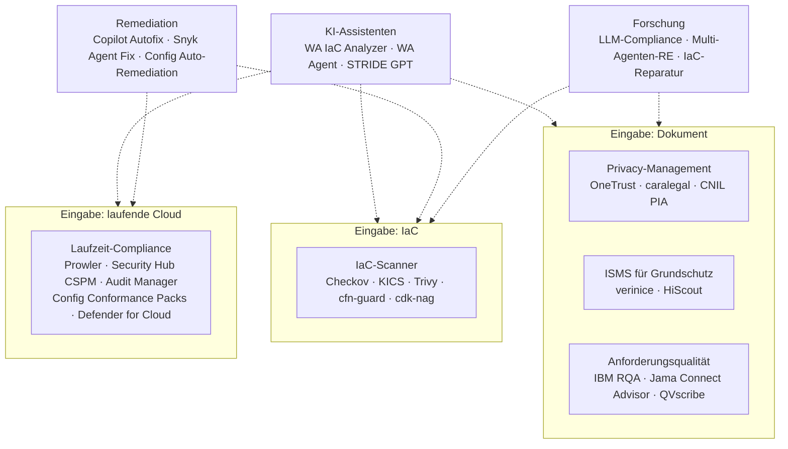
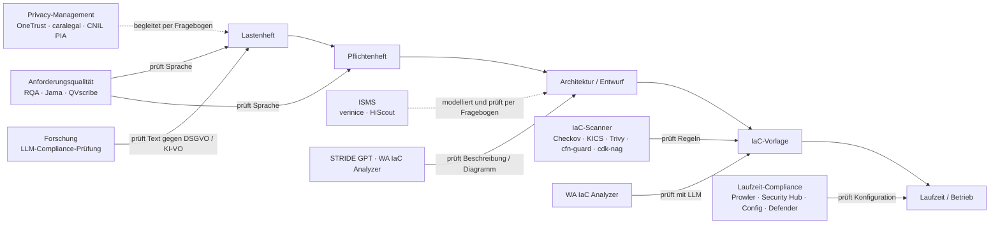
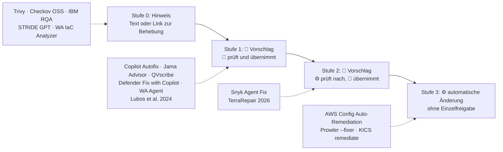
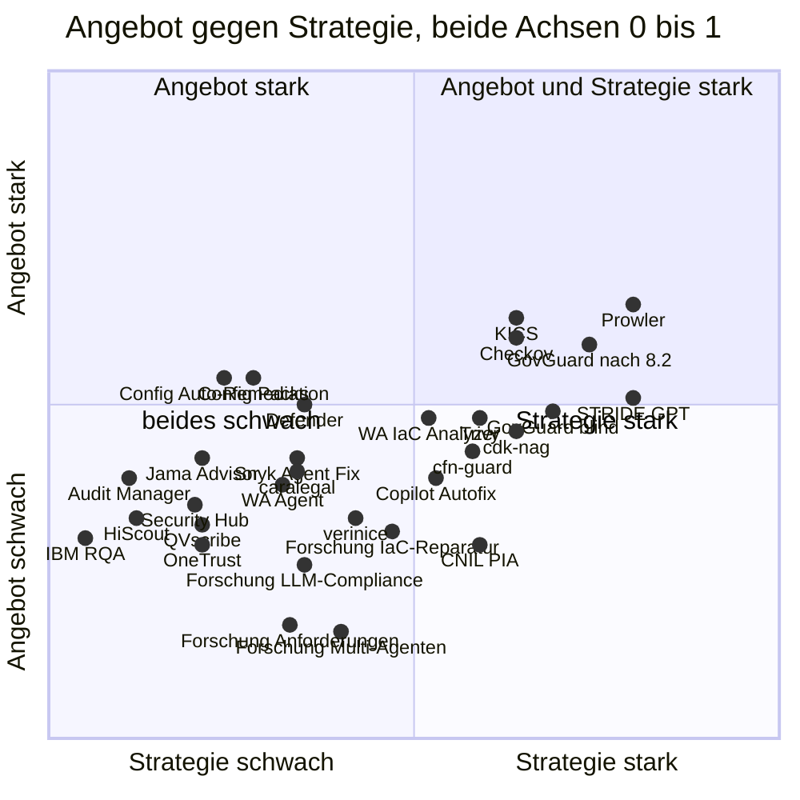

# Markt und Forschung – Audits und Remediation

Recherche für #69, **Phase 1: Sammeln** (Abschnitte 1–6), **Phase 2: Bewerten** (Abschnitte 7–8) und **Phase 3: GovGuard einordnen** (Abschnitt 9). Alle Quellen wurden am **2026-10-22** abgerufen. Quellen stehen in eckigen Klammern, das Verzeichnis steht am Ende.

> **Status:** Die Gewichte in 1.4 sind seit dem 22.10.2026 freigegeben. Abschnitt 8 bewertet alle Lösungen danach, Abschnitt 7 zeigt das Ergebnis als Quadrant. GovGuard hat ein frischer Agent getrennt und blind bewertet ([GovGuard Blindbewertung.md](GovGuard%20Blindbewertung.md)); Abschnitt 9 ordnet das Ergebnis ein und zieht die Folgerungen.

## Ziel

Der Bericht zeigt, welche Lösungen Industrie und Forschung heute anbieten für drei Aufgaben:

| Aufgabe | Eingabe | Prüfgrundlagen |
|---|---|---|
| Spec-Audit | Anforderungsdokument (Lastenheft, Pflichtenheft) | DSGVO, SDM, KI-VO |
| Architektur-Audit | Entwurf, IaC (z. B. CloudFormation), laufende Cloud | BSI IT-Grundschutz(++), C5, CIS |
| Remediation | Befund aus einem der beiden Audits | Vorschlag zur Behebung, Freigabe durch einen Menschen |

**Remediation** heißt Behebung. Gemeint ist, dass ein Werkzeug vorschlägt oder selbst ausführt, wie ein Befund beseitigt wird. **IaC** (Infrastructure as Code) heißt: Cloud-Ressourcen stehen als Textdatei im Repository, und ein Werkzeug rollt sie aus. **CloudFormation** ist das IaC-Format von AWS. **Mensch in der Schleife** (englisch *Human in the Loop*) heißt: Ein Mensch muss einen Vorschlag ansehen und freigeben, bevor er wirkt.

---

## 1. Methodik

**Zusammenfassung:** Die Methodik folgt dem Aufbau der Forrester Wave: drei Achsen, gewichtete Kriterien, eine Skala mit Ankern. Sie ist eigene Desk-Research ohne Herstellergespräche. Die Gewichte sind seit dem 22.10.2026 freigegeben (siehe 1.4).

### 1.1 Vorbild: was Forrester öffentlich über die Wave sagt

Die **Forrester Wave** ist ein Marktbericht des Analystenhauses Forrester. Er bewertet Anbieter eines Marktes nach offengelegten Kriterien und zeigt das Ergebnis in einer Grafik.

**Ursprüngliche drei Achsen (Pressemitteilung vom 22.07.2002)** [F2]:

| Achse | Wortlaut bei Forrester |
|---|---|
| Angebot (*Current Offering*) | „This dimension analyzes the strength of a company’s current solution, including product capabilities“ |
| Strategie (*Strategy*) | „This dimension evaluates the strength of a firm’s future product direction“ |
| Marktpräsenz (*Market Presence*) | „The final dimension reviews a company’s financial and market strength“ |

Zu den Gewichten schrieb Forrester damals: „the Forrester Wave findings are available to clients in an interactive spreadsheet in which users can customize weightings“ [F2].

**Heutige Methodikseite** („The Forrester Wave Methodology“) [F1]:

- Der Analyst legt die Aufnahmekriterien fest: „the analyst creates the inclusion criteria that determine which vendors to include in the evaluation.“ Die Kriterien sollen „differentiating, rather than exhaustive“ sein.
- Der Analyst gewichtet: Er nutzt die gesammelten Informationen, um jeden Anbieter auf Skalen zu bewerten und „weight criteria according to importance“. Für jedes Kriterium schreibt er eine Erklärung der Skala („creates scale explanations for each criterion“).
- Datenquellen sind ein Fragebogen, Strategie-Briefings und Demos („Holds executive strategy briefings and demonstrations“) sowie Referenzkunden.
- **Änderung ab 01.07.2024:** „Customer feedback will replace market presence on the graphic.“ Die Grafik zeigt drei Gruppen, „Leader, Strong Performer, and Contender“, die zu einem „3-point scoring rubric“ passen. Die Werte dieser Skala nennt die Seite nicht.
- Forrester bewertet auch ohne Mitwirkung des Anbieters: „Forrester reserves the right to evaluate products and services, regardless of vendor participation.“

**Folgerung für diesen Bericht:** Kundenfeedback kann eine Desk-Research nicht erheben. Darum bleibt hier die ältere dritte Achse **Marktpräsenz**, gemessen an öffentlichen Ersatzgrößen (siehe 1.4).

### 1.2 Abgrenzung und Interessenkonflikt

- **Keine Forrester- oder Gartner-Bewertung.** Dieser Bericht übernimmt nur den Aufbau. Er stammt weder von Forrester noch von Gartner und zitiert keine ihrer Bewertungen.
- **Desk-Research ohne Herstellergespräche.** Desk-Research heißt: Auswertung öffentlich zugänglicher Quellen am Schreibtisch, ohne Interviews, Demos oder Fragebögen an Anbieter.
- **Interessenkonflikt offengelegt.** Der Auftraggeber entwickelt GovGuard, ein Werkzeug im selben Feld. Deshalb kommt GovGuard in den Abschnitten 1 bis 8 nicht vor. Ein frischer Agent hat es blind nach denselben Kriterien bewertet, ohne die Ergebnisse der anderen zu kennen. GovGuard ist mit Unterstützung von Claude gebaut, und auch dieser Bericht stammt von Claude; das ist ein zweiter Interessenkonflikt.

### 1.3 Aufnahmekriterien

Eine Lösung kommt in den Bericht, wenn **alle** Punkte erfüllt sind:

| Nr. | Kriterium |
|---|---|
| E1 | Sie prüft mindestens eine Stufe des V-Modells (Lastenheft, Pflichtenheft, Architektur, IaC, Laufzeit) gegen ein Regelwerk zu Datenschutz, Informationssicherheit oder KI, **oder** sie schlägt eine Remediation für solche Befunde vor. |
| E2 | Es gibt eine öffentliche Primärquelle: Herstellerdoku, Preisliste, Code-Repository oder Paper. |
| E3 | Sie ist aktiv: Release oder Doku-Update in den letzten 24 Monaten. Abgekündigte Lösungen bleiben drin, wenn sie im Issue genannt sind, und werden markiert. |
| E4 | Nur Forschung: Paper ab 2020 bei arXiv, ACM, IEEE, Springer oder einer RE-Konferenz zu LLM-Compliance-Prüfung, Multi-Agenten im Requirements Engineering oder LLM-Reparatur von IaC. |

**Ausgeschlossen** sind reine Beratungsleistungen und Werkzeuge ohne öffentliche Doku. Das **V-Modell** ist ein Vorgehensmodell: Links steigt man von den Anforderungen zum Code ab, rechts prüft man stufenweise wieder hinauf. Das **Lastenheft** beschreibt, *was* der Auftraggeber will. Das **Pflichtenheft** beschreibt, *wie* der Auftragnehmer es umsetzt.

### 1.4 Bewertungskriterien und Gewichtsvorschlag

> **Freigegeben am 22.10.2026** durch den Nutzer, unverändert wie vorgeschlagen.

**Achsengewichte (nur falls ein Gesamtwert gebraucht wird):**

| Achse | Gewicht | Begründung |
|---|---|---|
| Angebot | **50 %** | Was ein Werkzeug heute prüft und belegt, entscheidet über den Nutzen im Audit. |
| Strategie | **30 %** | Normen ändern sich (Grundschutz++, KI-VO); ein Werkzeug ohne Weiterentwicklung veraltet schnell. |
| Marktpräsenz | **20 %** | Verbreitung senkt das Risiko für Behörden, ist aber nur über Ersatzgrößen messbar. |

Wie bei Forrester ergibt sich die Grafik aus Angebot (senkrecht) und Strategie (waagrecht); Marktpräsenz wird als Punktgröße gezeigt, nicht in die Position eingerechnet.

**Angebot (Kriterien innerhalb der Achse):**

| Nr. | Kriterium | Gewicht | Begründung |
|---|---|---|---|
| A1 | Normabdeckung DE/EU (DSGVO, SDM, KI-VO, Grundschutz(++), C5, CIS) | 20 % | Kern der Aufgabe; deutsche Normen sind im Markt selten. |
| A2 | Eingabebreite entlang des V-Modells (Dokument, Architektur, IaC, Laufzeit) | 15 % | Je früher geprüft wird, desto billiger ist die Korrektur. |
| A3 | Belege und Nachvollziehbarkeit (Fundstelle, Regel-ID, Begründung, Wiederholbarkeit) | 20 % | Ein Audit ohne prüfbaren Beleg ist für Prüfer wertlos. |
| A4 | Remediation (Art des Vorschlags, maschinelle Nachprüfung) | 15 % | Thema der geplanten Erweiterung. |
| A5 | Mensch in der Schleife (Freigabe, Protokoll der Entscheidung) | 15 % | Pflicht bei KI-Vorschlägen im öffentlichen Sektor. |
| A6 | Datenresidenz, On-Prem, Souveränität | 15 % | Behörden brauchen EU- oder Eigenbetrieb. |

**Datenresidenz** bezeichnet den Ort, an dem Daten gespeichert und verarbeitet werden. **On-Prem** heißt: Die Software läuft auf eigener Infrastruktur statt beim Anbieter.

**Strategie:**

| Nr. | Kriterium | Gewicht | Begründung |
|---|---|---|---|
| S1 | Entwicklungsaktivität und Roadmap (Releases der letzten 12 Monate, öffentliche Pläne, z. B. Grundschutz++) | 30 % | Zeigt, ob Normänderungen nachgezogen werden. |
| S2 | KI-Strategie mit Kontrollen (Trennung von Modell und Regel, Verifikation, Abkündigungsrisiko) | 25 % | KI ohne Kontrolle erhöht das Risiko statt es zu senken. |
| S3 | Offenheit (Lizenz, Austauschformate wie SARIF, API) | 25 % | Behörden meiden Abhängigkeit von einem Anbieter. |
| S4 | Preistransparenz und Kostenmodell | 20 % | Öffentliche Vergabe braucht planbare Kosten. |

**SARIF** ist ein standardisiertes JSON-Format für Befunde aus Analysewerkzeugen.

**Marktpräsenz:**

| Nr. | Kriterium | Gewicht | Begründung |
|---|---|---|---|
| M1 | Verbreitung (veröffentlichte Kundenzahlen, GitHub-Sterne, Downloads) | 40 % | Einzige öffentlich messbare Ersatzgröße für Marktstärke. |
| M2 | Belegte Nutzung im deutschen öffentlichen Sektor (aus Werkzeug-Bericht #68) | 40 % | Zielmarkt des Vergleichs. |
| M3 | Ökosystem (Integrationen, Partner, Community) | 20 % | Erleichtert Einführung und Betrieb. |

**Forschung** hat keine Marktpräsenz. Paper werden darum nur auf Angebot (soweit anwendbar) und Strategie bewertet; M1 bis M3 sind „n. b.“ (nicht bewertbar).

### 1.5 Skala mit Ankern

Jedes Kriterium bekommt 0 bis 5 Punkte. Ist ein Kriterium nicht anwendbar, steht „n. b.“.

| Stufe | Anker (allgemein) |
|---|---|
| 0 | Nicht vorhanden oder in keiner Quelle belegt. |
| 1 | Ansatzweise; nur Herstellerangabe ohne technische Doku. |
| 2 | Teilweise; dokumentiert, aber mit großen Lücken (z. B. nur eine Norm, nur ein Format). |
| 3 | Solide; dokumentiert und für typische Fälle ausreichend. |
| 4 | Stark; dokumentiert **und** öffentlich prüfbar (offener Code, Regeldateien) oder unabhängig untersucht (Paper, Studie). |
| 5 | Herausragend; vollständig, öffentlich prüfbar und unabhängig belegt. |

**Spezifische Anker für die drei heiklen Kriterien:**

| Kriterium | 1 | 3 | 5 |
|---|---|---|---|
| A3 Belege | Befund ohne Fundstelle | Regel-ID und Ressource genannt | Fundstelle im Original plus Regeltext plus wiederholbares Ergebnis |
| A4 Remediation | allgemeiner Hinweis | konkreter Änderungsvorschlag | Vorschlag wird maschinell nachgeprüft, bevor ein Mensch ihn sieht |
| A5 Mensch in der Schleife | Änderung ohne Freigabe | Freigabe nötig, aber nicht protokolliert | Freigabe nötig und mit Person, Zeit und Begründung protokolliert |
| A6 Datenresidenz | nur USA oder unklar | EU-Region wählbar | On-Prem oder EU-Betrieb inklusive aller KI-Verarbeitung belegt |

### 1.6 Quellenregel

- **Erlaubt** sind nur Herstellerdoku, offizielle Preislisten, Code-Repositories, Studien, Vergabebekanntmachungen und Paper. Jede Aussage trägt eine Quelle mit URL; Abrufdatum ist für alle Quellen 2026-10-22.
- **Herstellerangabe:** Aussagen aus Marketing oder Produktseiten ohne technische Doku sind als *Herstellerangabe* gekennzeichnet.
- **Einschätzung:** Aussagen ohne Primärquelle sind als *Einschätzung:* gekennzeichnet.
- **Nicht gefunden:** Fehlt eine Angabe, steht „nicht gefunden“. Es wird nichts ergänzt, auch keine Preise.
- **Paper:** Bei jedem Paper steht, ob es **begutachtet** (*peer-reviewed*, also von Fachleuten vor der Veröffentlichung geprüft) oder ein **Preprint** ist. Ein Preprint ist eine Vorabveröffentlichung ohne abgeschlossene Begutachtung. „Angenommen“ heißt: laut Autoren oder Verlag zur Veröffentlichung akzeptiert.

---

## 2. Segmente im Überblick

**Zusammenfassung:** 24 Produkte und Werkzeuge in sechs Segmenten plus 20 Paper im Segment Forschung. Die Segmente trennen sich nach der Eingabe; KI-Assistenten, Remediation und Forschung liegen quer dazu.

| Segment | Lösungen | Anzahl |
|---|---|---|
| Privacy-Management | OneTrust, caralegal, CNIL PIA-Tool | 3 |
| ISMS für Grundschutz | verinice, HiScout | 2 |
| IaC-Scanner | Checkov, KICS, Trivy, cfn-guard (mit Guard Rules Registry), cdk-nag | 5 |
| Cloud-Compliance zur Laufzeit | Prowler, AWS Security Hub CSPM, AWS Audit Manager, AWS Config Conformance Packs, Microsoft Defender for Cloud | 5 |
| KI-Assistenten | AWS Well-Architected IaC Analyzer, AWS Well-Architected Agent (Preview), STRIDE GPT, IBM RQA, Jama Connect Advisor, QVscribe | 6 |
| Remediation | GitHub Copilot Autofix, Snyk Agent Fix, AWS Config Auto-Remediation | 3 |
| Forschung | 6 Paper LLM-Compliance, 4 Paper Anforderungsqualität, 4 Paper Multi-Agenten-RE, 6 Paper IaC-Reparatur | 20 |

Ein **ISMS** (Informationssicherheits-Managementsystem) ist das Regelwerk einer Organisation, mit dem sie Informationssicherheit plant, umsetzt und prüft. Ein ISMS-Werkzeug verwaltet dafür Objekte, Anforderungen und Maßnahmen.

### 2.1 Landkarte der Segmente

**Kernaussage:** Die Segmente trennen sich nach der Eingabe (Dokument, IaC, laufende Cloud). KI-Assistenten, Remediation und Forschung arbeiten quer über mehrere Eingaben.

**Legende:** Rahmen = Art der Eingabe. Kasten = Segment mit den geprüften Lösungen. Gestrichelter Pfeil = Segment arbeitet auch auf dieser Eingabe.

**Elemente:** *Privacy-Management* führt Datenschutz-Dokumentation (z. B. Datenschutz-Folgenabschätzung). *ISMS für Grundschutz* modelliert Informationsverbünde nach BSI. *Anforderungsqualität* prüft Anforderungstexte auf Sprachregeln. *IaC-Scanner* prüfen Vorlagen vor dem Ausrollen. *Laufzeit-Compliance* prüft die laufende Cloud-Konfiguration. *KI-Assistenten* nutzen Sprachmodelle für Reviews. *Remediation* erzeugt Korrekturen. *Forschung* liefert Verfahren und Messungen.

**Verbindungen:** KI-Assistenten lesen IaC (WA IaC Analyzer [K1]), die laufende Umgebung (WA Agent [K2]) und Beschreibungen oder Diagramme (STRIDE GPT [K4]). Remediation-Werkzeuge arbeiten auf Code und IaC (Copilot Autofix [M1], Snyk Agent Fix [M5]) oder auf laufenden Ressourcen (Config [L10]). Forschung untersucht Texte (z. B. Verträge nach DSGVO [R1]) und IaC [R15–R20].

### 2.2 Einordnung im V-Modell: welche Stufe prüft wer

**Kernaussage:** Normbezogene Maschinenprüfung ist ab IaC dicht besetzt. Auf Lastenheft und Pflichtenheft prüfen Produkte die Sprachqualität (INCOSE, EARS) oder begleiten per Fragebogen; eine automatische Prüfung des Anforderungstexts gegen DSGVO, SDM oder KI-VO wurde in den geprüften Quellen nur in der Forschung gefunden.

**Legende:** Kette oben = Stufen des V-Modells von links (früh) nach rechts (spät). Durchgezogener Pfeil = Werkzeug liest das Artefakt selbst und prüft es. Gestrichelter Pfeil = Werkzeug begleitet die Stufe, ein Mensch beantwortet Fragen.

**Elemente:** Die fünf Stufen sind die Prüfgegenstände aus dem Ziel. Die Kästen darunter sind Segmente aus 2.1; WA IaC Analyzer steht zweimal, weil er IaC und Architekturdiagramme liest [K1].

**Verbindungen:** RQA, Jama und QVscribe prüfen Anforderungstexte nach INCOSE- und EARS-Regeln [K5–K8]. **INCOSE** ist ein internationaler Fachverband für Systems Engineering, der Regeln für gut formulierte Anforderungen veröffentlicht. **EARS** (Easy Approach to Requirements Syntax) ist eine Satzschablone für Anforderungen. Privacy-Management-Werkzeuge führen Fragebögen (z. B. DSFA) [P2, P6, P9]. Die Forschung prüft Texte direkt gegen DSGVO [R1, R5] oder KI-VO [R4]. ISMS-Werkzeuge modellieren Informationsverbünde nach BSI-Standard 200-2 [I3, I5]. IaC-Scanner prüfen Vorlagen mit festen Regeln [C1–C10]; Laufzeit-Werkzeuge prüfen die laufende Konfiguration [L1–L15].

---

## 3. Faktenblätter

**Zusammenfassung:** Je Segment zwei Tabellen: (a) Funktionen, Technik, Prüfgrundlagen, Eingabe; (b) Belege, Remediation, Mensch in der Schleife, Datenresidenz, Kosten und Adaption. Die Spalte *Adaption DE-ÖS* (deutscher öffentlicher Sektor) übernimmt den Befund aus dem Werkzeug-Bericht #68 (`Werkzeuge der Behörden je Prozessschritt.md`); nebenbei gefundene Primärbelege stehen dabei.

**Lesart der Spalte Adaption DE-ÖS:** Die Statuswörter stammen aus #68. *Genutzt* heißt: Eine Quelle nennt eine Behörde, die das Werkzeug einsetzt. *Beschafft* heißt: Ein Auftrag ist vergeben, der Einsatz ist nicht belegt. *Angeboten* oder *empfohlen* heißt: Eine Behörde stellt das Werkzeug bereit oder rät dazu, eine Nutzung ist nicht belegt. „Kein Beleg“ heißt: #68 nennt das Werkzeug nicht. Die Quellen [Q…] stehen im Quellenverzeichnis unter *Adaption DE-ÖS*, mit denselben Nummern wie in #68.

**Kennzeichnung der Technik** (wie in der Projektkonvention): ⚙️ = feste Regeln im Code (deterministisch, gleiche Eingabe ergibt gleiches Ergebnis). 🤖 = Sprachmodell (probabilistisch). 👤 = Mensch füllt aus oder entscheidet. Ein **LLM** (Large Language Model) ist ein großes Sprachmodell, das Text erzeugt.

### 3.1 Privacy-Management

Eine **DSFA** (Datenschutz-Folgenabschätzung, englisch DPIA oder PIA) ist die Risikoprüfung, die die DSGVO für riskante Verarbeitungen verlangt. Ein **VVT** ist das Verzeichnis der Verarbeitungstätigkeiten. **TOM** sind die technischen und organisatorischen Maßnahmen.

**(a) Funktionen und Grundlagen**

| Lösung | Funktionen | Technik | Prüfgrundlagen | Eingabe |
|---|---|---|---|---|
| OneTrust | PIA/DPIA-Vorlagen, KI-Governance mit Vorlagen und Risikoeinstufung; „AI Document Scanning“ füllt Assessments aus Dokumenten, früheren Assessments und Inventaren vor [P2]; „OneTrust Copilot“ liefert Regulierungsinformationen [P2] | 👤 Fragebogen + 🤖 Vorbefüllung | DSGVO; Vorlagen 2018 nach Leitfäden von CNIL, UK ICO und dem „German Standard Data Protection Model“ (= SDM) [P3, Herstellerangabe 2018]; KI-VO, NIST AI RMF, ISO 42001 [P4, Herstellerangabe] | Fragebogen, hochgeladene Dokumente |
| caralegal | VVT, DSFA, TOMs, Betroffenenanfragen, Löschkonzepte, Vorfälle; „AI Flow“ für KI-VO (Einstufung, Register, Transparenzpflichten) [P6, P8]; KI-Assistent und Agenten [P6] | 👤 Fragebogen + 🤖 Assistent | DSGVO, KI-VO [P6, P8] | Fragebogen |
| CNIL PIA-Tool | Freies Werkzeug der französischen Aufsicht für DSFA [P9] | 👤 Fragebogen | DSGVO (DSFA) | Fragebogen |

**(b) Belege, Remediation, Betrieb, Kosten**

| Lösung | Belege / Nachvollziehbarkeit | Remediation und Mensch in der Schleife | Datenresidenz / On-Prem | Kosten und Lizenz | Adaption DE-ÖS |
|---|---|---|---|---|---|
| OneTrust | nicht gefunden | Vorbefüllung von Assessments [P2]; „human oversight is built in“, „models are not trained on customer data“ [P2, Herstellerangabe] | Azure; Umgebungen `app-de` und `app-eu` in Frankfurt mit Ausweich-Standort Berlin [P1]; On-Prem nicht gefunden | auf Anfrage („based on users and privacy asset inventory“) [P5]; proprietär | kein Beleg |
| caralegal | Versionierte Historie bei KI-Neubewertung [P8] | „Die KI bereitet vor, Sie prüfen“ (Kontext Lightway) [P8, Herstellerangabe]; Textvorschläge für Dokumente nicht gefunden | Open Telekom Cloud, Frankfurt, ISO/IEC-27001-zertifiziertes Rechenzentrum [P7]; Ort der KI-Verarbeitung nicht gefunden; On-Prem nicht gefunden | Essential ab 79 €/Monat, Professional ab 349 €/Monat, Corporate ab 749 €/Monat, Enterprise und KI-VO-Pakete auf Anfrage; KI-Assistent als Add-on ohne Preis [P7]; proprietär | kein Beleg |
| CNIL PIA-Tool | nicht gefunden | keine Remediation gefunden | Desktop-App (Electron) oder selbst betriebene Web-Version [P9] | kostenlos, GPL-3.0 [P9]; letzte Version v4.1.0 vom 02.04.2026; 298 Sterne [C11]; deutsche Übersetzung `de.json` vorhanden [C11] | **empfohlen:** Der LfDI Rheinland-Pfalz nennt die PIA-Software für die DSFA [Q22, Behördenseite]; eine Nutzung ist nicht belegt |

Die Seite der CNIL zum PIA-Tool lieferte beim Abruf HTTP 503; die Angaben stammen aus dem offiziellen Repository [P9, C11].

### 3.2 ISMS für Grundschutz

**Grundschutz++** ist die Neufassung des BSI IT-Grundschutzes. **SaaS** (Software as a Service) heißt: Der Anbieter betreibt die Software, der Kunde nutzt sie im Browser.

**(a) Funktionen und Grundlagen**

| Lösung | Funktionen | Technik | Prüfgrundlagen | Eingabe |
|---|---|---|---|---|
| verinice | ISMS-Werkzeug; Bundle mit Domänen IT-Grundschutz, BSI-Standard 200-4, NIS-2, DSGVO, IT-Grundschutz-Kompendium [I3]; Grundschutz++-Domäne als Prototyp auf der it-sa 2025 vorgestellt, „automated reports“ in Arbeit [I2] | 👤 Modellierung + ⚙️ Berichte | BSI 200-1 bis 200-4, Kompendium, NIS-2, DSGVO [I3]; ISO 27001, TISAX [I1, Herstellerangabe] | Modell des Informationsverbunds, Fragebogen |
| HiScout | GRC-Suite mit Modulen Grundschutz, ISM, Datenschutz, BCM, Auditmanagement, Geheim- und Sabotageschutz [I4] | 👤 Modellierung + ⚙️ Berichte | BSI 200-1, 200-2, 200-3; optional BCM nach 200-4 und Datenschutz nach DSGVO [I5]; Grundschutz++ nur als Vortragsthema genannt [I4] | Modell des Informationsverbunds, Fragebogen |

**(b) Belege, Remediation, Betrieb, Kosten**

| Lösung | Belege / Nachvollziehbarkeit | Remediation und Mensch in der Schleife | Datenresidenz / On-Prem | Kosten und Lizenz | Adaption DE-ÖS |
|---|---|---|---|---|---|
| verinice | nicht gefunden | keine automatische Remediation gefunden; KI-Funktionen nicht gefunden [I1, I2] | On-Prem: verinice.PRO (Classic) und verinice.onprem (neue Generation); verinice.cloud „with BSI C5 certification“ beim Hosting-Partner [I1, Herstellerangabe]; Land nicht genannt | Classic: Open Source unter AGPLv3, Vertrieb endet 31.12.2026 [I1]; verinice.cloud Grundschutz-Bundle 950,00 € (netto 798,32 €), Abrechnungszeitraum auf der Seite nicht genannt [I3] | **genutzt laut Hersteller:** fünf Bundesbehörden (BAuA, BAFA, bpb, Generalzolldirektion, PTB) [Q13], „mehr als 50 Kommunen“ [Q14], Land Berlin bis etwa 2024 [Q12]; alle drei sind Herstellerreferenzen. **Angeboten:** Datenschutzmodul für alle Berliner Landeseinrichtungen [Q12, Hersteller]; das BSI führt verinice in seiner Werkzeugliste als „reine Auflistung“ [Q1] |
| HiScout | nicht gefunden | keine automatische Remediation gefunden; KI-Funktionen nicht gefunden [I4] | Browserbasiert, Entwicklung und Support in Deutschland [I6]; Betrieb auf eigener Infrastruktur oder bei Hosting-Partnern möglich [I5] | nicht gefunden; proprietär | **genutzt:** Standardwerkzeug der bayerischen Staatsverwaltung, laut Vergabe 395381-2026 des OLG München [I7]; Datenschutzmodul im bayerischen Finanzministerium seit 01.01.2021 [Q16, Fachpresse]. **Beschafft:** ITDZ Berlin, Zuschlag am 07.07.2025 für 48 Monate [Q10, Q11]. **Angeboten:** ZeDIS auf HiScout ist laut ITZBund die Standardlösung für den IT-Grundschutz in Bundesbehörden, als SaaS [Q7, Behördenseite]; das krz hostet HiScout für Kommunen in Ostwestfalen-Lippe [Q15, Fachpresse]. Zahl der ZeDIS-Nutzer nicht gefunden |

### 3.3 IaC-Scanner

**Policy-as-Code** heißt: Prüfregeln stehen als Code im Repository und laufen automatisch. Eine **DSL** (domänenspezifische Sprache) ist eine kleine Sprache für genau einen Zweck. **Rego** ist die Regelsprache des Open Policy Agent. Ein **CIS Benchmark** ist eine Härtungsempfehlung des Center for Internet Security.

**(a) Funktionen und Grundlagen**

| Lösung | Funktionen | Technik | Prüfgrundlagen | Eingabe |
|---|---|---|---|---|
| Checkov | Statische Analyse von IaC; „more than 750 predefined policies“; eigene Regeln in Python oder YAML; Graph-Regeln über Ressourcenbeziehungen [C1] | ⚙️ | CIS, AWS Foundations Benchmark [C1]; BSI/C5 nicht gefunden | Terraform, CloudFormation (inkl. SAM), ARM, Serverless, Helm, Kubernetes, Docker [C1] |
| KICS | Abfragen („queries“) gegen IaC; anpassbar [C3] | ⚙️ | CIS AWS Foundations Benchmark v1.4.0 Level 1 und 2, CIS Kubernetes 1.6.1 (zertifiziert, laut Projekt) [C5]; BSI/C5 nicht gefunden | u. a. CloudFormation, Terraform, Kubernetes, Docker [C3] |
| Trivy | Fehlkonfigurationen in IaC; eigene Regeln in Rego [C6] | ⚙️ | Compliance-Berichte nur für `trivy image` und `trivy k8s` (z. B. `k8s-cis-1.23`) [C7]; BSI/C5 nicht gefunden | Terraform, CloudFormation, ARM, Helm, Dockerfile [C6] |
| cfn-guard | Policy-as-Code mit eigener DSL für JSON/YAML; auch ChangeSets, Terraform-Plan als JSON, AWS-Config-Einträge [C8]; Guard Rules Registry mit fertigen Regelsätzen [C9] | ⚙️ | Registry: u. a. CIS AWS Foundations v1.4, CIS Controls v8, NIST 800-53, PCI DSS, ENS (Spanien), NCSC (UK); BSI/C5 nicht gefunden; letzter Push der Registry 25.03.2024 [C9, C11] | CloudFormation, Terraform-JSON, Kubernetes u. a. [C8] |
| cdk-nag | Regelpakete („NagPacks“) für AWS CDK oder CloudFormation: AWS Solutions, HIPAA, NIST 800-53 rev 4/5, PCI DSS 3.2.1, Serverless [C10] | ⚙️ | siehe Pakete; CIS/BSI/C5 nicht gefunden | AWS CDK, CloudFormation [C10] |

**(b) Belege, Remediation, Betrieb, Kosten**

| Lösung | Belege / Nachvollziehbarkeit | Remediation und Mensch in der Schleife | Datenresidenz / On-Prem | Kosten und Lizenz | Adaption DE-ÖS |
|---|---|---|---|---|---|
| Checkov | Regel-ID je Befund; Ausgabe u. a. SARIF, JUnit, CSV [C1]; Unterdrückung im Code mit `checkov:skip=<check_id>:<Begründung>`, erscheint als `SKIPPED` [C2] | Automatische Fixes im Open-Source-Werkzeug nicht beschrieben; Prisma Cloud bietet Pull-Requests bei Drift [C1] | läuft lokal oder in CI | Apache-2.0, kostenlos; v3.3.30 vom 20.10.2026; 9.091 GitHub-Sterne [C11] | kein Beleg |
| KICS | Regel-ID je Befund; JSON-Bericht mit Feldern `remediation` und `remediation_type` [C4] | ⚙️ `kics remediate` wendet einfache einzeilige Ersetzungen an, „only available for Terraform, for now“; Auswahl einzelner Befunde mit `--include-ids` [C4] | läuft lokal oder in CI | Apache-2.0, kostenlos; v2.2.0 vom 17.09.2026; 2.724 Sterne [C11] | kein Beleg |
| Trivy | Befund mit Beschreibung und Referenzlink [C6] | nur Hinweise, keine automatische Änderung beschrieben [C6] | läuft lokal oder in CI | Apache-2.0, kostenlos; v0.76.1 vom 21.10.2026; 38.595 Sterne [C11] | kein Beleg |
| cfn-guard | Ausgabe als JSON/YAML mit `--structured` [C8] | keine; Erkennung zur Laufzeit kann laut README Remediation auslösen [C8] | läuft lokal, in CI oder als Lambda [C8] | Apache-2.0, kostenlos; 3.2.1 vom 25.08.2026; 1.392 Sterne [C11] | kein Beleg |
| cdk-nag | Bericht `policy-validation-report.json`; Ausnahmen mit `Validations.of(...).acknowledge({ id, reason })`, ab v3 je Befund einzeln [C10] | 👤 Ausnahme nur mit Begründung; keine automatische Korrektur [C10] | läuft beim `cdk synth` lokal | Apache-2.0, kostenlos; v3.0.2 vom 04.08.2026; 1.051 Sterne [C11] | kein Beleg |

### 3.4 Cloud-Compliance zur Laufzeit

**CSPM** (Cloud Security Posture Management) ist die laufende Prüfung der Cloud-Konfiguration gegen Sicherheitsregeln. Ein **Conformance Pack** ist bei AWS Config ein Paket aus Prüfregeln und optionalen Korrekturaktionen. Ein **SSM-Automation-Dokument** ist bei AWS ein ausführbares Skript, das Ressourcen ändert. **C5** ist der Cloud Computing Compliance Criteria Catalogue des BSI.

**(a) Funktionen und Grundlagen**

| Lösung | Funktionen | Technik | Prüfgrundlagen | Eingabe |
|---|---|---|---|---|
| Prowler | Cloud-Sicherheitsplattform; für AWS 662 Checks, 86 Dienste, 50 Frameworks [L1]; KI-Assistent „Lighthouse AI“ über MCP-Server [L1, L4] | ⚙️ Checks + 🤖 Assistent (Cloud) | u. a. **C5** (Datei `c5_aws.json`, Version „2025“), **GDPR** (`gdpr_aws.json`), CIS 1.4 bis 7.0, NIS2, ISO 27001:2022, ENS, SecNumCloud [L1, L2] | laufende Cloud (AWS, Azure, GCP, Kubernetes, M365, OCI, GitHub) [L1] |
| AWS Security Hub CSPM | Sicherheitsstandards mit Controls und automatischen Checks [L5] | ⚙️ | AWS FSBP, AI Security Best Practices, Resource Tagging, CIS AWS Foundations, NIST 800-53 r5, NIST 800-171 r2, PCI DSS, CRI Profile v2.2 [L5]; C5/DSGVO nicht gefunden | laufende AWS-Umgebung |
| AWS Audit Manager | Belegsammlung und Audit-Berichte (PDF) [L8] | ⚙️ | u. a. **GDPR 2016**, CIS AWS v1.2–1.4, CIS Controls v8 IG1, ISO 27001:2013, NIST, PCI, SOC 2, „AWS Generative AI Best Practices Framework v2“ [L7]; C5 nicht gefunden | API-Aufrufe, Security Hub, CloudTrail, Config Rules [L8] |
| AWS Config Conformance Packs | über 100 Vorlagen; Dashboard mit Compliance-Wert und Zeitverlauf [L8] | ⚙️ | **„Operational Best Practices for Germany C5“**: Beispiel-Zuordnung von C5-Controls zu Config-Regeln [L9]; **CIS:** Packs für CIS AWS Foundations Benchmark v1.4 Level 1 und 2 sowie CIS Controls v8 IG1 bis IG3 [L16]; DSGVO und SOC 2 ohne Pack [L8, L16] | laufende AWS-Umgebung |
| Microsoft Defender for Cloud | Regulatory-Compliance-Dashboard, Empfehlungen mit Schritten zur Behebung [L13] | ⚙️ + 🤖 Copilot (Behebung) | u. a. **EU GDPR 2016/679**, **EU AI Act**, NIS2, DORA, CIS AWS v3.0.0, ISO 27001:2022 [L13]; C5 nicht gefunden | laufende Azure-, AWS-, GCP-Umgebung [L13] |

**(b) Belege, Remediation, Betrieb, Kosten**

| Lösung | Belege / Nachvollziehbarkeit | Remediation und Mensch in der Schleife | Datenresidenz / On-Prem | Kosten und Lizenz | Adaption DE-ÖS |
|---|---|---|---|---|---|
| Prowler | Zuordnung Check → Framework-Anforderung als offene JSON-Dateien [L2] | ⚙️ `--fixer` führt hinterlegte Python-Fixer für einige Checks direkt aus; Hinweis auf Zusatzkosten bei Access Analyzer, GuardDuty, Security Hub [L3]; Cloud: „Autonomous Fixer for guided remediation“ [L4, Herstellerangabe] | Open Source selbst betreibbar (Local Server, CLI); Private Cloud auch „air-gapped“ [L4]; Region der Prowler Cloud nicht gefunden | Open Source Apache-2.0, kostenlos; Prowler Cloud 99 $ je Cloud-Konto und Monat; Private Cloud auf Anfrage [L4]; 5.45.0 vom 15.10.2026; 15.087 Sterne [C11] | kein Beleg |
| AWS Security Hub CSPM | Befund je Control und Ressource [L5]; Hinweis: „don't guarantee compliance“ [L5] | nicht geprüft (außerhalb dieser Phase) | AWS-Dienst; Endpunkt in eu-central-1 (Frankfurt) vorhanden [L17] | ressourcenbasiert; Beispielwert „$3.75 per resource unit“ für Security Risk Analytics [L6]; Einzelpreis je Check nicht gefunden | kein Beleg für den Dienst. AWS-Public-Cloud-Dienste sind über einen Rahmenvertrag von Bechtle mit dem Beschaffungsamt des BMI **beschafft** [Q40, Herstellerangabe]; einen Einsatz durch eine bestimmte Behörde belegt #68 nicht |
| AWS Audit Manager | Audit-Bericht als PDF, Evidence Finder [L8] | „Remediation of non-compliant resources: Not supported“ [L8] | AWS-Dienst; Endpunkt in eu-central-1 (Frankfurt) vorhanden [L18] | **Wartungsmodus:** seit 30.04.2026 keine Einrichtung in neuen Konten; keine neuen Frameworks [L8]; Preis nicht weiter recherchiert | kein Beleg für den Dienst. AWS-Public-Cloud-Dienste sind über einen Rahmenvertrag von Bechtle mit dem Beschaffungsamt des BMI **beschafft** [Q40, Herstellerangabe]; einen Einsatz durch eine bestimmte Behörde belegt #68 nicht |
| AWS Config Conformance Packs | Configuration Items als Beleg je Ressource; Export per Advanced Query [L8]; Hinweis: Packs sind „not designed to fully ensure compliance“ [L9] | ⚙️ manuell oder automatisch per SSM-Dokument; Wiederholungen einstellbar; **Warnung:** Auto-Remediation „can be initiated even for compliant resources“ wegen veralteter Snapshots [L11]; keine Einzelfreigabe bei Automatik beschrieben | Remediation in eu-central-1 verfügbar [L10] | 0,003 $ je Configuration Item (kontinuierlich), 0,001 $ je Regel- bzw. Pack-Auswertung (erste 100.000, US East) [L12]; SSM-Automation laut Doku separat [L11] | kein Beleg für den Dienst. AWS-Public-Cloud-Dienste sind über einen Rahmenvertrag von Bechtle mit dem Beschaffungsamt des BMI **beschafft** [Q40, Herstellerangabe]; einen Einsatz durch eine bestimmte Behörde belegt #68 nicht |
| Microsoft Defender for Cloud | Status je Control (grün, rot, grau für nicht automatisch prüfbar) [L13] | „Fix“-Schaltfläche; „Fix with Copilot“: 🤖 schlägt ggf. Skript vor, 👤 wählt „Run“; benötigt Security Compute Units [L14] | Cloud-Dienst; Region nicht geprüft | Foundational CSPM kostenlos [L15]; Preis Defender CSPM auf der Seite nicht lesbar (nicht gefunden) | kein Beleg |

### 3.5 KI-Assistenten

**RAG** (Retrieval Augmented Generation) heißt: Das Werkzeug sucht passende Textstücke aus einer Wissensbasis und gibt sie dem Sprachmodell mit. **STRIDE** ist ein Schema für Bedrohungsarten (Spoofing, Tampering, Repudiation, Information Disclosure, Denial of Service, Elevation of Privilege). **DREAD** ist ein Schema zur Risikobewertung einer Bedrohung. Ein **Inferenzprofil** legt bei Amazon Bedrock fest, in welchen Regionen ein Modellaufruf verarbeitet werden darf; `global.` erlaubt weltweit, `eu.` nur EU.

**(a) Funktionen und Grundlagen**

| Lösung | Funktionen | Technik | Prüfgrundlagen | Eingabe |
|---|---|---|---|---|
| AWS Well-Architected IaC Analyzer | Bewertung von IaC und Architekturdiagrammen gegen Well-Architected-Best-Practices; Priorisierung (Eisenhower-Matrix); Chat-Assistent; erzeugt IaC aus Diagrammen; eigene Lenses als PDF in der Wissensbasis [K1] | 🤖 LLM (Bedrock) + RAG | AWS Well-Architected Framework und Lenses; eigene Lenses möglich [K1] | CloudFormation, Terraform, CDK, Diagramme, Begleitdokumente [K1] |
| AWS Well-Architected Agent (Preview seit 01.10.2026) | Laufende Analyse der AWS-Umgebung; Empfehlungen auf Ressourcen-, Anwendungs- und Architekturebene; IaC-Reviews auf Abruf [K2, K3] | 🤖 | Well-Architected-Säulen Kosten, Sicherheit, Resilienz, Performance [K2] | laufende Umgebung, IaC [K2] |
| STRIDE GPT | Bedrohungsmodell nach STRIDE, Angriffsbäume, Gegenmaßnahmen, DREAD, Gherkin-Testfälle [K4] | 🤖 LLM | STRIDE, DREAD | App-Beschreibung, GitHub-Repo, Diagramme [K4] |
| IBM Engineering Requirements Quality Assistant (RQA) | Findet Mehrdeutigkeiten, vergibt Qualitätswerte in Echtzeit [K5]; erklärt Wert und gibt Hinweise zur Formulierung [K6] | 🤖 Watson NLP [K5] | INCOSE-Regeln oder eigene Regelsätze [K6] | Anforderungen in DOORS / DOORS Next [K5] |
| Jama Connect Advisor | Bewertet Anforderungen nach INCOSE und EARS; „Refine“ erzeugt Neufassung mit Begründung, teilt zusammengesetzte Sätze [K7] | NLP (ob LLM: nicht gefunden) [K7] | INCOSE, EARS | Anforderungen in Jama Connect |
| QVscribe | Prüft Anforderungen; „ReqWriter“ schlägt Neufassung neben dem Original vor, „with every change marked“ [K8] | nicht näher beschrieben | EARS, INCOSE, eigene Regeln und Vokabular [K8] | Word, Excel, DOORS Next, Polarion, Jama, REST-API [K8] |

**(b) Belege, Remediation, Betrieb, Kosten**

| Lösung | Belege / Nachvollziehbarkeit | Remediation und Mensch in der Schleife | Datenresidenz / On-Prem | Kosten und Lizenz | Adaption DE-ÖS |
|---|---|---|---|---|---|
| WA IaC Analyzer | Begründung und Empfehlung je Best Practice, CSV-Export [K1] | 🤖 Empfehlungen und IaC-Generierung; 👤 setzt um | Selbst im eigenen AWS-Konto ausgerollt; Standard-Modell nutzt `global.`-Profil, für Residenz empfiehlt die Doku `eu.` oder `us.` [K1]; Ausgabesprachen ohne Deutsch [K1] | MIT-0, kostenlos plus Bedrock-Kosten; „sample project, for non-production usage“; künftig „mainly for security patching“ [K1]; 501 Sterne [C11] | kein Beleg |
| WA Agent | Empfehlungen mit Trade-off- und Auswirkungsanalyse [K2] | 🤖 „ready-to-implement fixes like updated IaC code“; 👤 „review recommendations and deploy remediations“; Warnung: „thoroughly review each recommendation“ [K2] | Profile nur in US East (N. Virginia), US East (Ohio), US West (Oregon) [K2, K3] | nur mit AWS Support ab „Business+“ [K2]; Preis der Preview nicht gefunden | kein Beleg |
| STRIDE GPT | Ausgabe Markdown, JSON, SARIF, HTML; nicht belegte Code-Aussagen werden markiert [K4] | 🤖 schlägt Gegenmaßnahmen vor; 👤 bestätigt Datenflussdiagramm; Analyseplan im CLI auch automatisch freigebbar [K4] | Lokale Modelle über LM Studio möglich [K4] | MIT, kostenlos plus LLM-Kosten; v0.20.0 vom 26.09.2026; 1.145 Sterne [C11] | kein Beleg |
| IBM RQA | Wert mit Begründung je Anforderung [K6] | 🤖 Hinweise zur Verbesserung; 👤 formuliert um [K6] | nicht gefunden | **Status unklar:** IBM-Demoleitfaden: Backend „is no longer available“ [K6]; offizielle Abkündigung nicht gefunden; Preis nicht gefunden | kein Beleg. #68 fand für Werkzeuge des Anforderungsmanagements (z. B. DOORS, Polarion, Jira) keine Ausschreibung |
| Jama Connect Advisor | Werte vor und nach der Neufassung; „Each item added or refined by Jama Connect Advisor has a corresponding item version comment“ [K7] | 👤 übernimmt optional als Item, Sub-Item oder per Zwischenablage [K7] | nicht gefunden | nicht gefunden; proprietär | kein Beleg. #68 fand für Werkzeuge des Anforderungsmanagements (z. B. DOORS, Polarion, Jira) keine Ausschreibung |
| QVscribe | jede Änderung markiert [K8] | 👤 „accept, reject, or edit the changes before anything is applied“ [K8, Herstellerangabe] | „Analysis runs in QRA's cloud“, Hosting in der Region, On-Prem-Version verfügbar [K8, Herstellerangabe] | nicht gefunden; proprietär | kein Beleg. #68 fand für Werkzeuge des Anforderungsmanagements (z. B. DOORS, Polarion, Jira) keine Ausschreibung |

### 3.6 Remediation-Werkzeuge

**CodeQL** ist die Code-Analyse von GitHub, die Sicherheitsbefunde („alerts“) liefert.

**(a) Funktionen und Grundlagen**

| Lösung | Funktionen | Technik | Prüfgrundlagen | Eingabe |
|---|---|---|---|---|
| GitHub Copilot Autofix | Erzeugt Korrekturvorschläge zu CodeQL-Befunden; Prompt enthält Befund als SARIF, umgebenden Code und Hilfetext der Abfrage [M1] | 🤖 LLM auf ⚙️ CodeQL-Befund | CodeQL-Abfragen (Sicherheit) | Code in C#, C/C++, Go, Java/Kotlin, Swift, JS/TS, Python, Ruby, Rust [M1]; IaC nicht genannt |
| Snyk Agent Fix | Erzeugt „k candidate fixes“, prüft jeden Kandidaten mit der statischen Analyse, wiederholt bei Fehlschlag [M5] | 🤖 LLM + ⚙️ Nachprüfung | Regeln von Snyk Code | Code; „focuses on single-file fixes“; IaC nicht erwähnt [M5] |
| AWS Config Auto-Remediation | Verknüpft Config-Regeln mit SSM-Automation-Dokumenten; AWS liefert verwaltete Dokumente, eigene möglich [L10] | ⚙️ | je Config-Regel bzw. Conformance Pack (z. B. C5 [L9]) | laufende AWS-Ressourcen |

**(b) Belege, Remediation, Betrieb, Kosten**

| Lösung | Belege / Nachvollziehbarkeit | Remediation und Mensch in der Schleife | Datenresidenz / On-Prem | Kosten und Lizenz | Adaption DE-ÖS |
|---|---|---|---|---|---|
| Copilot Autofix | Vorschlag als Diff im Pull Request; Grenzen offengelegt: Vorschläge können „fail to remediate the underlying vulnerability or introduce new vulnerabilities“ [M1] | 👤 „explicit developer review and acceptance before being applied“ [M1] | GHE.com mit EU-Datenresidenz vorhanden [M4]; Verfügbarkeit von Autofix dort nicht gefunden | in öffentlichen Repos ohne Code Security nutzbar [M3]; sonst GitHub Code Security „$30 per month per active committer“ (Stand 03/2025) [M2] | kein Beleg |
| Snyk Agent Fix | ⚙️ Nachprüfung: „ensure the vulnerability is gone and no new ones have been introduced“ [M5] | 👤 „Human review required“ [M5] | Region SNYK-EU-01 in Frankfurt [M7]; Agent Fix in der EU-Region nicht gefunden | Free 0 $, Team ab 25 $/Monat, Enterprise auf Anfrage [M6]; welcher Plan Agent Fix enthält: nicht gefunden | kein Beleg |
| AWS Config Auto-Remediation | Ausführungsstatus je Ressource mit `describe-remediation-execution-status` [L11] | manuell (👤 löst aus) oder automatisch (⚙️ ohne Einzelfreigabe) [L11] | eu-central-1 unterstützt [L10] | SSM-Automation laut Doku zusätzlich [L11] | kein Beleg für den Dienst. AWS-Public-Cloud-Dienste sind über einen Rahmenvertrag von Bechtle mit dem Beschaffungsamt des BMI **beschafft** [Q40, Herstellerangabe]; einen Einsatz durch eine bestimmte Behörde belegt #68 nicht |

### 3.7 Forschung

**Zusammenfassung:** 20 Paper in vier Strängen. 13 sind begutachtet oder laut Verlag bzw. Autoren angenommen, 7 sind Preprints. Venue und DOI wurden über OpenAlex und die arXiv-API gegengeprüft [R21].

**(a) LLM-Compliance-Prüfung (DSGVO, KI-VO)**

| Paper | Inhalt | Technik | Grundlage / Eingabe | Status |
|---|---|---|---|---|
| Amaral, Azeem, Abualhaija, Briand 2023 [R1] | Prüft Auftragsverarbeitungsverträge (DPA) gegen „shall“-Anforderungen aus der DSGVO; an 30 echten DPAs 618 von 750 echten Verstößen gefunden, 76 Fehlalarme, Genauigkeit 84,6 %; mit begrenzter manueller Prüfung ca. 94 % | NLP | DSGVO / Vertragstext | **begutachtet**, IEEE TSE |
| Hassani, Sabetzadeh, Amyot, Liao 2024 [R2] | Plädiert für Analyse über Satzgrenzen hinweg und Entscheidungen mit Begründung; Vorab-Ergebnisse an DPAs | 🤖 LLM | DSGVO / DPA | **begutachtet**, RE 2024 (RE@Next!) |
| Abualhaija et al. 2025 [R3] | XTRAREG: LLM mit RAG extrahiert Anforderungen aus DSGVO-Quellen (Auskunft, Übertragbarkeit) | 🤖 LLM + RAG | DSGVO / Rechtstext | **begutachtet**, RE 2025 |
| Marino et al. 2025 (AIReg-Bench) [R4] | Benchmark: 120 fiktive technische Dokumentationen, von Juristen auf Verstöße gegen Artikel der KI-VO annotiert | 🤖 LLM (Bewertung) | KI-VO / technische Doku | Preprint |
| Wijesundara, Warren, Arachchilage 2025 (GDPRShield) [R5] | Liest User Stories und erzeugt DSGVO-bezogene Datenschutzbeschreibungen je Anforderung | 🤖 LLM | DSGVO / User Stories | Preprint („submitted to the euroUSEC“) |
| Watson, Bücheler, Richards 2026 [R6] | Wie Unschärfe in Vorgaben die Qualität LLM-erzeugter DSFA-Dokumente beeinflusst | 🤖 LLM | DSGVO (DSFA) / Industriedaten | Preprint |

**(b) Anforderungsqualität und Textverbesserung**

| Paper | Inhalt | Technik | Status |
|---|---|---|---|
| Lubos et al. 2024 [R7] | LLM bewertet Anforderungen nach ISO 29148 **und schlägt verbesserte Fassungen vor**; Studie mit Softwareingenieuren | 🤖 LLM | **begutachtet**, RE 2024 (RE@Next!) |
| Luitel, Hassani, Sabetzadeh 2024 [R8] | BERT schlägt Ergänzungen vor, um Unvollständigkeit in Anforderungen zu finden | 🤖 Sprachmodell (BERT) | **begutachtet**, Requirements Engineering Journal |
| Post, Fuhr 2021 (Bosch) [R9] | Fallstudie IBM RQA: „many of the rules resulted in false positives“; rein syntaktische INCOSE-Prüfungen reichen nicht für inhaltliche Eigenschaften | Fallstudie | Workshop-Beitrag, REFSQ 2021 (CEUR); Begutachtung *Einschätzung:* üblich für REFSQ-Workshops, nicht einzeln geprüft |
| Broccia et al. 2026 [R10] | Kontrolliertes Experiment, 34 Personen: LLM-Unterstützung senkte die Trefferquote bei der Inspektion von Anforderungen | Experiment | Preprint |

**(c) Multi-Agenten im Requirements Engineering**

| Paper | Inhalt | Mensch in der Schleife | Status |
|---|---|---|---|
| Jin, Jin, Chen, Wang 2024 (MARE) [R11] | Fünf Agenten (Stakeholder, Collector, Modeler, Checker, Documenter) mit gemeinsamem Arbeitsbereich | nicht beschrieben | Preprint |
| Ataei et al. 2024 (Elicitron) [R12] | Simulierte Nutzer als LLM-Agenten zur Erhebung von Anforderungen | nicht beschrieben | **begutachtet**, ASME J. Computing and Information Science in Engineering |
| Jin et al. 2025 (iReDev) [R13] | Sechs wissensgestützte Agenten; „human-in-the-loop mechanism“ | ja | Preprint |
| Tang, Li, Runkler 2026 (Agent4RE) [R14] | Selbstverbessernde Agenten; Variante mit strukturiertem menschlichem Feedback; Benchmark RE-E2E | ja (Variante) | **angenommen**, ASE@POVC (DOI 10.1145/3843779.3844634) |

**(d) LLM-Reparatur von IaC**

| Paper | Inhalt | Status |
|---|---|---|
| Low, Cheh, Chen 2024 [R15] | GPT-4 repariert gemeldete IaC-Fehlkonfigurationen; laut Abstract lösten nur 79,6 % der Fixes das Problem, 20,4 % waren halluziniert (Werte über Suchergebnis, IEEE-Seite nicht direkt lesbar) | **begutachtet**, IEEE SecDev 2024 |
| Saavedra, Ferreira, Mendes 2025 (InfraFix) [R16] | Technologieunabhängiges Reparatur-Framework für IaC | **begutachtet**, ISSTA 2025 |
| Mengistu et al. 2026 (TerraRepair) [R17] | Agent mit Werkzeugen (Provider-Schema, Scanner-Neulauf); eskaliert, statt zu raten, wenn Kontext fehlt; scanner-verifizierte Fix-Rate auf AWS von 26,6 % auf 78,4 % (Checkov) | **begutachtet**, ESEM 2026 |
| Agyekum, Santos 2026 [R18] | Iterative LLM-Reparatur verschlechtert manchmal Sicherheit: 13,8 % der Szenarien mit Regression (Standardmodus), 3,3 % im strengen Modus | **angenommen**, ESEM 2026 |
| Alsaid, Nebolisa, Abbas 2026 (TerraProbe) [R19] | Fünfstufiges Orakel gegen „deceptive fixes“, die nur den Scanner-Befund verschwinden lassen | Preprint (bei Empirical Software Engineering eingereicht) |
| Chauhan 2026 (IaC-Guard-V) [R20] | Verifikationsrahmen für LLM-erzeugte IaC-Reparaturen | **angenommen**, QRS 2026 (arXiv-Fassung vor Begutachtung) |

---

## 4. Feature-Matrix

**Kernaussage:** DSGVO ist in Privacy-Werkzeugen und einigen Laufzeit-Werkzeugen abgedeckt, C5 nur in Prowler und einem AWS-Config-Pack, IT-Grundschutz nur in ISMS-Werkzeugen. SDM erscheint nur in einer OneTrust-Mitteilung von 2018.

**Legende:** ✓ = in Primärquelle belegt. (✓) = nur Herstellerangabe oder teilweise. – = in den geprüften Quellen nicht gefunden. ⚙️/🤖/👤 wie in Abschnitt 3.

| Lösung | Technik | Dok | IaC | Lauf | DSGVO | SDM | KI-VO | Grundschutz | C5 | CIS | Remediation | Mensch-Freigabe | EU / On-Prem |
|---|---|---|---|---|---|---|---|---|---|---|---|---|---|
| OneTrust | 👤+🤖 | ✓ | – | – | ✓ | (✓) 2018 | (✓) | – | – | – | Vorbefüllung | (✓) | EU ✓ / – |
| caralegal | 👤+🤖 | ✓ | – | – | ✓ | – | ✓ | – | – | – | – | (✓) | EU ✓ / – |
| CNIL PIA | 👤 | ✓ | – | – | ✓ | – | – | – | – | – | – | – | – / ✓ |
| verinice | 👤+⚙️ | ✓ | – | – | ✓ | – | – | ✓ (Grundschutz++ Prototyp) | – | – | – | – | – / ✓ |
| HiScout | 👤+⚙️ | ✓ | – | – | ✓ | – | – | ✓ | – | – | – | – | – / ✓ |
| Checkov | ⚙️ | – | ✓ | – | – | – | – | – | – | ✓ | – | Ausnahme mit Grund | – / ✓ |
| KICS | ⚙️ | – | ✓ | – | – | – | – | – | – | ✓ | ⚙️ auto (nur Terraform) | Auswahl per ID | – / ✓ |
| Trivy | ⚙️ | – | ✓ | – | – | – | – | – | – | (✓) nur K8s | – | – | – / ✓ |
| cfn-guard | ⚙️ | – | ✓ | (✓) | – | – | – | – | – | ✓ (Registry) | – | – | – / ✓ |
| cdk-nag | ⚙️ | – | ✓ | – | – | – | – | – | – | – | – | Ausnahme mit Grund | – / ✓ |
| Prowler | ⚙️+🤖 | – | – | ✓ | ✓ | – | – | – | ✓ | ✓ | ⚙️ auto (`--fixer`) | – | – / ✓ |
| Security Hub CSPM | ⚙️ | – | – | ✓ | – | – | – | – | – | ✓ | nicht geprüft | – | eu-central-1 ✓ |
| Audit Manager | ⚙️ | – | – | ✓ | ✓ | – | – | – | – | ✓ | keine | – | eu-central-1 ✓ |
| Config Conformance Packs | ⚙️ | – | – | ✓ | – | – | – | – | ✓ | ✓ | ⚙️ manuell/auto | manuell ✓ | eu-central-1 ✓ |
| Defender for Cloud | ⚙️+🤖 | – | – | ✓ | ✓ | – | ✓ | – | – | ✓ | 🤖 Skript | ✓ (Run) | – |
| WA IaC Analyzer | 🤖 | (✓) | ✓ | – | – | – | – | – | – | – | 🤖 Empfehlung | 👤 setzt um | `eu.` wählbar / eigenes Konto |
| WA Agent | 🤖 | – | ✓ | ✓ | – | – | – | – | – | – | 🤖 IaC-Fix | ✓ | nur US-Regionen |
| STRIDE GPT | 🤖 | ✓ | – | – | – | – | – | – | – | – | 🤖 Gegenmaßnahmen | (✓) | lokal möglich |
| IBM RQA | 🤖 | ✓ | – | – | – | – | – | – | – | – | 🤖 Hinweis | 👤 | – |
| Jama Connect Advisor | NLP | ✓ | – | – | – | – | – | – | – | – | Neufassung | ✓ | – |
| QVscribe | ? | ✓ | – | – | – | – | – | – | – | – | Neufassung | ✓ | (✓) / (✓) |
| Copilot Autofix | 🤖 | – | – | – | – | – | – | – | – | – | 🤖 Code-Diff | ✓ | (✓) GHE.com EU |
| Snyk Agent Fix | 🤖+⚙️ | – | – | – | – | – | – | – | – | – | 🤖 Code-Diff + ⚙️ Prüfung | ✓ | EU-Region ✓ |
| Config Auto-Remediation | ⚙️ | – | – | ✓ | – | – | – | – | (über Pack) | (über Pack) | ⚙️ SSM | nur manuell | eu-central-1 ✓ |

Spaltennamen: *Dok* = Dokument oder Fragebogen, *Lauf* = laufende Cloud. Belege stehen in den Faktenblättern (Abschnitt 3).

---

## 5. Kostentabelle

**Kernaussage:** Die IaC-Scanner und mehrere Assistenten sind kostenlos und offen; kommerzielle Privacy- und ISMS-Produkte nennen selten Listenpreise.

| Lösung | Listenpreis | Lizenz | Quelle |
|---|---|---|---|
| OneTrust | auf Anfrage | proprietär | [P5] |
| caralegal | ab 79 / 349 / 749 € pro Monat; Enterprise und KI-VO auf Anfrage | proprietär | [P7] |
| CNIL PIA-Tool | 0 € | GPL-3.0 | [P9] |
| verinice.cloud Grundschutz-Bundle | 950,00 € (netto 798,32 €), Zeitraum nicht genannt | Classic: AGPLv3 | [I1, I3] |
| HiScout | nicht gefunden | proprietär | [I4] |
| Checkov, KICS, Trivy, cfn-guard, cdk-nag | 0 € | Apache-2.0 | [C11] |
| Prowler | Open Source 0 €; Cloud 99 $ je Cloud-Konto und Monat; Private Cloud auf Anfrage | Apache-2.0 / proprietär | [L4] |
| AWS Security Hub | ressourcenbasiert, z. B. 3,75 $ je Ressourceneinheit (Security Risk Analytics); CSPM-Einzelpreis nicht gefunden | Dienst | [L6] |
| AWS Audit Manager | für Neukunden nicht mehr verfügbar | Dienst | [L8] |
| AWS Config | 0,003 $ je Configuration Item; 0,001 $ je Regel- bzw. Pack-Auswertung (erste 100.000, US East); SSM separat | Dienst | [L11, L12] |
| Defender for Cloud | Foundational CSPM 0 $; Defender CSPM nicht gefunden | Dienst | [L15] |
| WA IaC Analyzer | 0 € plus Bedrock-Nutzung | MIT-0 | [K1] |
| WA Agent | Preview-Preis nicht gefunden; Voraussetzung Support ab Business+ | Dienst | [K2, K3] |
| STRIDE GPT | 0 € plus LLM-Nutzung | MIT | [K4] |
| IBM RQA, Jama Connect Advisor, QVscribe | nicht gefunden | proprietär | [K5–K8] |
| GitHub Copilot Autofix | öffentliche Repos ohne Code Security; sonst 30 $ je aktivem Committer und Monat (Code Security, 03/2025) | proprietär | [M2, M3] |
| Snyk | Free 0 $; Team ab 25 $/Monat; Enterprise auf Anfrage; Plan mit Agent Fix nicht gefunden | proprietär | [M6] |

---

## 6. Remediation: Ansätze im Vergleich

**Zusammenfassung:** Remediation reicht vom bloßen Hinweis bis zur automatischen Änderung ohne Einzelfreigabe. Textänderungen an Anforderungsdokumenten bieten nur Werkzeuge für Sprachqualität; eine Textänderung, die eine Lücke gegen DSGVO, SDM oder KI-VO schließt, wurde nur in der Forschung gefunden.

### 6.1 Stufen der Remediation

**Kernaussage:** Je weiter rechts, desto weniger Mensch: Die meisten 🤖-Vorschläge verlangen eine Freigabe durch 👤, automatische Änderungen ohne Einzelfreigabe kommen nur von ⚙️-Regeln.

**Legende:** Kasten oben = Stufe, von links (Mensch entscheidet alles) nach rechts (Code entscheidet). Kasten unten = Lösungen dieser Stufe. Gestrichelter Pfeil = „gehört zu“. 🤖 = Sprachmodell, ⚙️ = feste Regel, 👤 = Mensch.

**Elemente:** *Stufe 0* beschreibt die Behebung nur. *Stufe 1* liefert einen konkreten Änderungsvorschlag vom Modell, den ein Mensch übernimmt. *Stufe 2* prüft den Vorschlag vorher maschinell. *Stufe 3* ändert ohne Einzelfreigabe; Konfiguration und Regel hat ein Mensch vorab festgelegt.

**Verbindungen:** Trivy zeigt Referenzlinks [C6]; RQA gibt Hinweise zur Formulierung [K6]; STRIDE GPT und der IaC Analyzer geben Empfehlungen [K1, K4]. Copilot Autofix verlangt „explicit developer review and acceptance“ [M1]; Jama übernimmt erst auf Wunsch [K7]; QVscribe wendet erst nach „accept“ an [K8]; Defender führt ein Skript erst nach „Run“ aus [L14]; der WA Agent verlangt Review vor dem Ausrollen [K2]; Lubos et al. schlagen verbesserte Anforderungen vor [R7]. Snyk prüft jeden Kandidaten mit der statischen Analyse [M5]; TerraRepair lässt den Scanner neu laufen und eskaliert bei fehlendem Kontext [R17]. AWS Config ändert per SSM-Dokument automatisch [L11]; Prowler führt Python-Fixer aus [L3]; KICS ersetzt einzeilige Terraform-Stellen [C4].

### 6.2 Vergleichstabelle

| Ansatz | Was wird geändert | Wer schreibt | Wer prüft | Wer gibt frei | Bekannte Risiken | Beispiele |
|---|---|---|---|---|---|---|
| Hinweis | nichts | – | – | 👤 handelt selbst | Aufwand bleibt beim Menschen | Trivy [C6], RQA [K6] |
| Code-Diff aus LLM | Quellcode | 🤖 | 👤 | 👤 | „introduce new vulnerabilities“ [M1] | Copilot Autofix [M1] |
| Code-Diff mit Nachprüfung | Quellcode | 🤖 | ⚙️ Analyse, dann 👤 | 👤 | Nachprüfung findet nur, was die Regel kennt (*Einschätzung*) | Snyk Agent Fix [M5] |
| IaC-Fix aus LLM | IaC-Vorlage | 🤖 | 👤 | 👤 | 20,4 % halluzinierte Fixes [R15]; Fixes, die nur den Befund verschwinden lassen [R19]; Regression bei Iteration [R18] | WA Agent [K2], Forschung [R15–R20] |
| Regelbasierte Auto-Korrektur | laufende Ressource oder IaC-Zeile | ⚙️ | ⚙️ | 👤 vorab per Konfiguration | Auto-Remediation auch an konformen Ressourcen möglich [L11] | Config [L11], Prowler [L3], KICS [C4] |
| Neufassung einer Anforderung | Anforderungstext | 🤖 / NLP | 👤 | 👤 | Falsch-Positive bei syntaktischen Regeln [R9]; LLM-Hilfe senkte Trefferquote von Anfängern [R10] | Jama [K7], QVscribe [K8], Lubos et al. [R7] |

### 6.3 Wer schlägt Textänderungen an Anforderungsdokumenten vor?

**Produkte (Sprachqualität, kein Normbezug zu DSGVO/SDM/KI-VO):**

- **Jama Connect Advisor** erzeugt mit „Refine“ eine Neufassung samt INCOSE-/EARS-Werten und Erklärung. Der Mensch übernimmt sie optional als Item, Sub-Item oder per Zwischenablage; jede Übernahme bekommt einen Versionskommentar [K7].
- **QVscribe** zeigt die Neufassung neben dem Original mit markierten Änderungen; nichts wird angewendet, bevor der Prüfer annimmt, ablehnt oder bearbeitet [K8, Herstellerangabe]. Eigene Regeln und Vokabular sind möglich [K8].
- **IBM RQA** gab Hinweise, wie eine Formulierung zu verbessern ist, ohne selbst umzuschreiben [K6]. Der Dienst ist laut IBM-Demoleitfaden nicht mehr verfügbar [K6].

**Produkte mit Datenschutz- oder KI-VO-Bezug:**

- **OneTrust** füllt Assessments aus Dokumenten vor („AI Document Scanning“) [P2]. Das ändert den Fragebogen, nicht das Anforderungsdokument. Eine Freigabe-Funktion ist nur allgemein beschrieben („human oversight is built in“) [P2, Herstellerangabe].
- **caralegal** beschreibt KI, die „vorbereitet“, während der Mensch „prüft“ [P8, Herstellerangabe]. Textvorschläge für Anforderungsdokumente wurden nicht gefunden.

**Forschung:**

- **Lubos et al. (RE 2024)** schlagen verbesserte Anforderungen nach ISO 29148 vor und ließen sie von Softwareingenieuren prüfen [R7]. Bezug ist Qualität, nicht Datenschutz.
- **Amaral et al. (TSE 2023)** melden Verstöße gegen DSGVO-Pflichtinhalte in Verträgen; mit begrenzter manueller Prüfung steigt die Genauigkeit von 84,6 % auf ca. 94 % [R1]. Das ist eine Lückenanzeige, keine Neufassung.
- **GDPRShield (Preprint)** erzeugt zu jeder User Story eine DSGVO-bezogene Datenschutzbeschreibung [R5]. Eine Freigabe-Stufe ist im Abstract nicht beschrieben.
- **iReDev** und **Agent4RE** erzeugen ganze Spezifikationen mit Agenten und sehen menschliches Feedback vor [R13, R14]; einen Normbezug zu DSGVO, SDM oder KI-VO nennen die Abstracts nicht.

**Befund dieser Phase:** In den geprüften Quellen wurde **kein Produkt** gefunden, das eine Lücke im Lastenheft gegen DSGVO, SDM oder KI-VO erkennt **und** dazu eine Textänderung vorschlägt, die ein Mensch freigibt. Die Bausteine existieren getrennt: Neufassung mit Freigabe (Jama, QVscribe), Lückenanzeige gegen DSGVO mit manueller Nachprüfung (Amaral et al.), LLM-Vorschläge zu DSGVO je User Story (GDPRShield, Preprint). Zwei Studien mahnen zur Vorsicht bei der Freigabe: syntaktische Regeln erzeugen viele Falsch-Positive [R9], und LLM-Hilfe senkte in einem Experiment die Trefferquote menschlicher Prüfer [R10].

---

## 7. Quadrant Angebot gegen Strategie

**Zusammenfassung:** Der Quadrant zeigt die Achsenwerte aus Abschnitt 8, umgerechnet von 0–5 auf 0–1. Offene Werkzeuge mit festen Regeln liegen vorn, kommerzielle Privacy- und ISMS-Produkte hinten. Die Marktpräsenz steht in der Tabelle unter dem Diagramm, weil Mermaid keine Punktgröße kennt.

**Kernaussage:** Prowler führt auf beiden Achsen, dahinter folgen KICS und Checkov. Keine Lösung erreicht im Angebot 3,5 von 5 Punkten. Die Werkzeuge für deutsche Normen (verinice, HiScout) und die Privacy-Produkte bleiben im Angebot bei 2,0 oder darunter, weil sie nicht automatisch prüfen und öffentliche Belege fehlen.

> **GovGuard steht zweimal im Diagramm.** „blind“ ist das Ergebnis des frischen Agenten, der nur die Anker aus 1.5 kannte. „nach 8.2“ wendet die Auslegung der Zwischenstufen aus 8.2 an, nach der alle anderen Lösungen bewertet sind. Abschnitt 9.1 nennt jede Abweichung mit ihrer Regel.

**Legende**

| Zeichen | Bedeutung |
|---|---|
| senkrechte Achse | Angebot (A1–A6) geteilt durch 5 |
| waagrechte Achse | Strategie (S1–S4) geteilt durch 5 |
| Mittellinien | 0,5, das entspricht 2,5 von 5 Punkten |
| Punkt mit Produktname | eine Lösung aus Abschnitt 3.1 bis 3.6 |
| Punkt „Forschung …“ | Mittelwert der Paper eines Strangs aus 3.7 (a) bis (d); einzelne Paper stehen in 8.3 und 8.4 |
| Spalte Marktpräsenz | ersetzt die Punktgröße der Wave (M1–M3, 0–5) |

| Punkt im Diagramm | Lösung | Angebot (0–5) | Strategie (0–5) | y = Angebot ÷ 5 | x = Strategie ÷ 5 | Marktpräsenz (0–5) |
|---|---|---|---|---|---|---|
| Prowler | Prowler | 3,25 | 4,00 | 0,65 | 0,80 | 2,80 |
| KICS | KICS | 3,15 | 3,20 | 0,63 | 0,64 | 1,80 |
| Checkov | Checkov | 3,00 | 3,20 | 0,60 | 0,64 | 2,40 |
| Config Packs | AWS Config Conformance Packs | 2,70 | 1,40 | 0,54 | 0,28 | 1,00 |
| Config Auto-Remediation | AWS Config Auto-Remediation | 2,70 | 1,20 | 0,54 | 0,24 | 1,00 |
| STRIDE GPT | STRIDE GPT | 2,55 | 4,00 | 0,51 | 0,80 | 1,80 |
| Defender | Microsoft Defender for Cloud | 2,50 | 1,75 | 0,50 | 0,35 | 0,60 |
| Trivy | Trivy | 2,40 | 2,95 | 0,48 | 0,59 | 2,60 |
| WA IaC Analyzer | WA IaC Analyzer | 2,40 | 2,60 | 0,48 | 0,52 | 1,40 |
| cdk-nag | cdk-nag | 2,30 | 3,20 | 0,46 | 0,64 | 1,80 |
| cfn-guard | cfn-guard | 2,15 | 2,90 | 0,43 | 0,58 | 2,00 |
| Jama Advisor | Jama Connect Advisor | 2,10 | 1,05 | 0,42 | 0,21 | 0,40 |
| Snyk Agent Fix | Snyk Agent Fix | 2,10 | 1,70 | 0,42 | 0,34 | 0,20 |
| caralegal | caralegal | 2,00 | 1,70 | 0,40 | 0,34 | 0,00 |
| Audit Manager | AWS Audit Manager | 1,95 | 0,55 | 0,39 | 0,11 | 1,00 |
| Copilot Autofix | GitHub Copilot Autofix | 1,95 | 2,65 | 0,39 | 0,53 | 0,60 |
| WA Agent | WA Agent (Preview) | 1,90 | 1,60 | 0,38 | 0,32 | 0,40 |
| Security Hub | AWS Security Hub CSPM | 1,75 | 1,00 | 0,35 | 0,20 | 0,80 |
| verinice | verinice | 1,65 | 2,10 | 0,33 | 0,42 | 1,80 |
| HiScout | HiScout | 1,65 | 0,60 | 0,33 | 0,12 | 2,20 |
| QVscribe | QVscribe | 1,60 | 1,05 | 0,32 | 0,21 | 0,60 |
| IBM RQA | IBM RQA | 1,50 | 0,25 | 0,30 | 0,05 | 0,40 |
| OneTrust | OneTrust | 1,45 | 1,05 | 0,29 | 0,21 | 0,00 |
| CNIL PIA | CNIL PIA-Tool | 1,45 | 2,95 | 0,29 | 0,59 | 2,00 |
| Forschung LLM-Compliance | Mittelwert von 6 Papern im Strang (a) | 1,29 | 1,75 | 0,26 | 0,35 | n. b. |
| Forschung Anforderungen | Mittelwert von 4 Papern im Strang (b) | 0,85 | 1,62 | 0,17 | 0,33 | n. b. |
| Forschung Multi-Agenten | Mittelwert von 4 Papern im Strang (c) | 0,78 | 2,00 | 0,16 | 0,40 | n. b. |
| Forschung IaC-Reparatur | Mittelwert von 6 Papern im Strang (d) | 1,55 | 2,33 | 0,31 | 0,47 | n. b. |
| GovGuard blind | GovGuard, Blindbewertung | 2,45 | 3,45 | 0,49 | 0,69 | 0,20 |
| GovGuard nach 8.2 | GovGuard, Auslegung aus 8.2 | 2,95 | 3,70 | 0,59 | 0,74 | 0,20 |

**Beschreibung**

*Elemente:* Jeder Punkt ist eine Lösung mit ihrem Achsenwert aus Abschnitt 8. Die vier Forschungspunkte sind Mittelwerte; sie zeigen den Stand eines Strangs, keine einzelne Lösung.

*Lage:* Oben rechts liegen Prowler, KICS, Checkov und knapp STRIDE GPT. Sie verbinden offene Regeldateien (A3), freie Lizenz und Preis (S3, S4) und Releases seit September 2026 (S1). Oben links liegen die beiden AWS-Config-Lösungen mit C5- und CIS-Packs und konkreter Remediation; ihnen fehlen datierte Neuerungen, KI und offene Formate. Defender liegt genau auf der waagrechten Mittellinie. Unten rechts liegen die übrigen offenen Werkzeuge, Copilot Autofix und das CNIL PIA-Tool: gute Strategie, aber höchstens eine Normfamilie oder keine Remediation. Unten links liegen die kommerziellen Privacy-, ISMS- und Anforderungswerkzeuge, deren Belege, Preise und Formate öffentlich fehlen.

*Marktpräsenz:* Vorn liegen Prowler (2,80), Trivy (2,60), Checkov (2,40) und HiScout (2,20). HiScout hat die stärkste belegte Nutzung im deutschen öffentlichen Sektor (M2 = 4), aber eine deutlich schwächere Strategie als verinice (0,60 gegen 2,10). *Einschätzung:* M1 bevorzugt offene Projekte, weil GitHub-Sterne öffentlich zählbar sind und geschlossene Produkte keine Kundenzahlen veröffentlichen; die Achse misst öffentliche Belege, nicht die echte Marktstärke.

*Forschung:* Die Stränge liegen im Angebot unter 1,6, weil Paper keinen Betrieb, keine Freigabe und meist keine deutsche Norm haben. Einzelne Paper ragen heraus: TerraRepair [R17] erreicht Angebot 2,29 und Strategie 3,00, weil der Scanner jeden Fix nachprüft.

---

## 8. Bewertung je Kriterium

**Zusammenfassung:** 24 Produkte sind auf allen drei Achsen bewertet, 20 Paper auf Angebot und Strategie. Jede Zelle nennt Punkte und Beleg. Der Achsenwert ist der gewichtete Mittelwert nach 1.4; „n. b.“ fällt heraus, und die Summe wird durch die Summe der übrigen Gewichte geteilt.

### 8.1 Lesart

- **Zelle:** „3 · P1“ heißt 3 Punkte, Beleg [P1]. Eine „0“ ohne Quelle heißt: Im Faktenblatt (Spalte *FB*) steht „nicht gefunden“ oder nichts. Die Spalte *Adaption DE-ÖS* der Faktenblätter ist der Beleg für M2.
- **Herstellerangabe:** Was die Faktenblätter als *Herstellerangabe* kennzeichnen, ergibt allein höchstens 1 Punkt.
- **Rechenweg:** Gewicht × Punkte je Kriterium, dann summiert. Beispiel Prowler, Angebot: 0,20 × 4 + 0,15 × 3 + 0,20 × 4 + 0,15 × 3 + 0,15 × 1 + 0,15 × 4 = 0,80 + 0,45 + 0,80 + 0,45 + 0,15 + 0,60 = 3,25. Bei Papern wird durch die Summe der bewerteten Gewichte geteilt, im Angebot also durch 0,85.

### 8.2 Auslegung der Anker

Die Skala in 1.5 bleibt unverändert. Die Tabelle legt nur fest, wie die Zwischenstufen hier angewendet wurden, damit jede Punktzahl nachprüfbar ist.

| Kriterium | Auslegung |
|---|---|
| A1 Normen | Gezählt werden sechs Normfamilien: DSGVO, SDM, KI-VO, Grundschutz(++), C5, CIS. 1 = nur Herstellerangabe oder nur Randabdeckung; 2 = eine Familie; 3 = zwei oder drei Familien; 4 = drei Familien mit offenen Zuordnungsdateien, darunter eine deutsche Norm; 5 = zusätzlich unabhängig belegt. |
| A2 Eingabe | Stufen: Dokument, Architektur, IaC, Laufzeit. 1 = nur Quellcode oder nur Herstellerangabe; 2 = eine Stufe mit wenigen Formaten; 3 = eine Stufe mit vielen Formaten oder zwei Stufen; 4 = zwei oder mehr Stufen mit offenem Code; 5 = zusätzlich unabhängig belegt. |
| A3 Belege | Anker aus 1.5. 2 = Beschreibung oder Begründung ohne belegte Regel-ID; 4 = Regel-ID je Befund, feste Regeln und offene Regeldateien. Ein Sprachmodell gilt nicht als wiederholbar. |
| A4 Remediation | Anker aus 1.5. 2 = Empfehlung oder Gegenmaßnahme ohne konkrete Änderung; 4 = konkreter Vorschlag mit maschineller Nachprüfung, belegt nur durch Herstellerdoku oder Preprint; 5 = Nachprüfung zusätzlich offen oder begutachtet. |
| A5 Mensch | Anker aus 1.5. 0 = Werkzeug schlägt nichts vor, es gibt keinen Entscheidungsschritt; 2 = Mensch setzt Vorschläge selbst um oder Freigabe ist abschaltbar; 4 = Freigabe nötig und teilweise protokolliert. Ausnahmen mit Begründung im Code (Checkov, cdk-nag) zählen 3. |
| A6 Residenz | Anker aus 1.5. 0 = keine Angabe; 2 = EU-Region für die Plattform belegt, für die bewertete Funktion nicht; 4 = EU-Region einschließlich KI wählbar und offener Code, oder On-Prem ohne Beleg zum Ort der KI. |
| S1 Aktivität | 0 = Dienst laut Quelle nicht mehr verfügbar; 1 = keine datierte Neuerung oder Wartungsmodus; 2 = Neuerung ohne Datum oder älter als 12 Monate; 3 = Release in den letzten 12 Monaten; 4 = zusätzlich im Repository prüfbar oder öffentlicher Plan für eine Normänderung; 5 = beides. |
| S2 KI-Kontrollen | 0 = keine KI-Funktion belegt; 1 = KI ohne beschriebene Kontrolle oder nur Herstellerangabe; 2 = eine dokumentierte Kontrolle (Freigabe, Versionierung, Messung); 3 = Trennung von Modell und Regel oder mehrere Kontrollen; 4 = zusätzlich maschinelle Verifikation oder offener Code; 5 = zusätzlich unabhängig belegt. |
| S3 Offenheit | 0 = proprietär ohne belegte Formate oder API; 1 = nur PDF-Bericht; 2 = proprietär mit API oder Austauschformat, offene Lizenz mit Enddatum, oder Paper mit freiem Volltext; 3 = offene Lizenz ohne belegte Formate; 4 = offene Lizenz und offene Formate (SARIF, JSON, CSV) oder API. |
| S4 Preis | 0 = kein Preis gefunden; 1 = nur Kostenmodell oder Voraussetzung; 2 = Preise für Teile, der Kernpreis fehlt; 3 = Listenpreise für typische Pakete, Rest auf Anfrage; 4 = vollständige Listenpreise, nur Kosten Dritter (z. B. Sprachmodell) offen; 5 = kostenlos und offen lizenziert. |
| M1 Verbreitung | GitHub-Sterne laut [C11]: ab 10.000 = 5, ab 5.000 = 4, ab 1.000 = 3, darunter = 2. Kundenzahl nur als Herstellerangabe = 1. Keine Zahl = 0. |
| M2 Nutzung DE-ÖS | 1 = nur Hersteller oder Fachpresse, oder nur die Plattform beschafft; 2 = angeboten, empfohlen oder beschafft laut Behörde oder Ausschreibung; 3 = zusätzlich Einsatz bei genannten Behörden laut Hersteller; 4 = Einsatz durch Behörde oder Ausschreibung belegt; 5 = zusätzlich Standard auf mehreren Ebenen mit Nutzerzahl. |
| M3 Ökosystem | 1 = Herstellerangabe oder nur das eigene Basisprodukt; 2 = eine dokumentierte Integration oder Plattform; 3 = mehrere Integrationen oder Partner; 4 = zusätzlich offene Erweiterung (eigene Regeln, Regelsätze). |

### 8.3 Angebot

**Produkte**

| Lösung | FB | A1 (20 %) | A2 (15 %) | A3 (20 %) | A4 (15 %) | A5 (15 %) | A6 (15 %) | Rechenweg Σ Gewicht × Punkte | **Angebot** |
|---|---|---|---|---|---|---|---|---|---|
| OneTrust | 3.1 | 2 · P2 | 2 · P2 | 0 | 1 · P2 | 1 · P2 | 3 · P1 | 0,40 + 0,30 + 0,00 + 0,15 + 0,15 + 0,45 | **1,45** |
| caralegal | 3.1 | 3 · P6, P8 | 2 · P6 | 1 · P8 | 1 · P8 | 2 · P8 | 3 · P7 | 0,60 + 0,30 + 0,20 + 0,15 + 0,30 + 0,45 | **2,00** |
| CNIL PIA-Tool | 3.1 | 2 · P9 | 2 · P9 | 0 | 0 | 0 | 5 · P9 | 0,40 + 0,30 + 0,00 + 0,00 + 0,00 + 0,75 | **1,45** |
| verinice | 3.2 | 3 · I3 | 2 · I3 | 0 | 0 · I1 | 0 | 5 · I1 | 0,60 + 0,30 + 0,00 + 0,00 + 0,00 + 0,75 | **1,65** |
| HiScout | 3.2 | 3 · I5, Q7 | 2 · I5 | 0 | 0 · I4 | 0 | 5 · I5, Q7 | 0,60 + 0,30 + 0,00 + 0,00 + 0,00 + 0,75 | **1,65** |
| Checkov | 3.3 | 2 · C1 | 3 · C1 | 4 · C1, C2 | 1 · C1 | 3 · C2 | 5 · C1 | 0,40 + 0,45 + 0,80 + 0,15 + 0,45 + 0,75 | **3,00** |
| KICS | 3.3 | 2 · C5 | 3 · C3 | 4 · C4 | 3 · C4 | 2 · C4 | 5 · C3 | 0,40 + 0,45 + 0,80 + 0,45 + 0,30 + 0,75 | **3,15** |
| Trivy | 3.3 | 1 · C7 | 4 · C6, C7 | 2 · C6 | 1 · C6 | 2 · C6 | 5 · C6 | 0,20 + 0,60 + 0,40 + 0,15 + 0,30 + 0,75 | **2,40** |
| cfn-guard | 3.3 | 2 · C9 | 4 · C8 | 2 · C8 | 0 · C8 | 0 | 5 · C8 | 0,40 + 0,60 + 0,40 + 0,00 + 0,00 + 0,75 | **2,15** |
| cdk-nag | 3.3 | 0 · C10 | 2 · C10 | 4 · C10 | 0 · C10 | 3 · C10 | 5 · C10 | 0,00 + 0,30 + 0,80 + 0,00 + 0,45 + 0,75 | **2,30** |
| Prowler | 3.4 | 4 · L1, L2 | 3 · L1 | 4 · L2 | 3 · L3 | 1 · L3 | 4 · L4 | 0,80 + 0,45 + 0,80 + 0,45 + 0,15 + 0,60 | **3,25** |
| AWS Security Hub CSPM | 3.4 | 2 · L5 | 2 · L5 | 3 · L5 | 0 | 0 | 3 · L17 | 0,40 + 0,30 + 0,60 + 0,00 + 0,00 + 0,45 | **1,75** |
| AWS Audit Manager | 3.4 | 3 · L7 | 2 · L8 | 3 · L8 | 0 · L8 | 0 | 3 · L18 | 0,60 + 0,30 + 0,60 + 0,00 + 0,00 + 0,45 | **1,95** |
| AWS Config Conformance Packs | 3.4 | 3 · L9, L16 | 2 · L8 | 3 · L8 | 3 · L11 | 2 · L11 | 3 · L10 | 0,60 + 0,30 + 0,60 + 0,45 + 0,30 + 0,45 | **2,70** |
| Microsoft Defender for Cloud | 3.4 | 3 · L13 | 3 · L13 | 2 · L13 | 3 · L14 | 3 · L14 | 1 · L13 | 0,60 + 0,45 + 0,40 + 0,45 + 0,45 + 0,15 | **2,50** |
| WA IaC Analyzer | 3.5 | 0 · K1 | 4 · K1 | 3 · K1 | 2 · K1 | 2 · K1 | 4 · K1 | 0,00 + 0,60 + 0,60 + 0,30 + 0,30 + 0,60 | **2,40** |
| WA Agent (Preview) | 3.5 | 0 · K2 | 3 · K2 | 2 · K2 | 3 · K2 | 3 · K2 | 1 · K2, K3 | 0,00 + 0,45 + 0,40 + 0,45 + 0,45 + 0,15 | **1,90** |
| STRIDE GPT | 3.5 | 0 · K4 | 4 · K4 | 3 · K4 | 2 · K4 | 2 · K4 | 5 · K4 | 0,00 + 0,60 + 0,60 + 0,30 + 0,30 + 0,75 | **2,55** |
| IBM RQA | 3.5 | 0 · K6 | 2 · K5 | 3 · K6 | 2 · K6 | 2 · K6 | 0 | 0,00 + 0,30 + 0,60 + 0,30 + 0,30 + 0,00 | **1,50** |
| Jama Connect Advisor | 3.5 | 0 · K7 | 2 · K7 | 3 · K7 | 4 · K7 | 4 · K7 | 0 | 0,00 + 0,30 + 0,60 + 0,60 + 0,60 + 0,00 | **2,10** |
| QVscribe | 3.5 | 0 · K8 | 3 · K8 | 2 · K8 | 3 · K8 | 1 · K8 | 1 · K8 | 0,00 + 0,45 + 0,40 + 0,45 + 0,15 + 0,15 | **1,60** |
| GitHub Copilot Autofix | 3.6 | 0 · M1 | 1 · M1 | 3 · M1 | 3 · M1 | 3 · M1 | 2 · M4 | 0,00 + 0,15 + 0,60 + 0,45 + 0,45 + 0,30 | **1,95** |
| Snyk Agent Fix | 3.6 | 0 · M5 | 1 · M5 | 3 · M5 | 4 · M5 | 3 · M5 | 2 · M7 | 0,00 + 0,15 + 0,60 + 0,60 + 0,45 + 0,30 | **2,10** |
| AWS Config Auto-Remediation | 3.6 | 3 · L9, L16 | 2 · L10 | 3 · L11 | 3 · L10, L11 | 2 · L11 | 3 · L10 | 0,60 + 0,30 + 0,60 + 0,45 + 0,30 + 0,45 | **2,70** |

**Forschung** (A6 n. b., weil ein Paper keinen Betrieb hat)

| Lösung | FB | A1 (20 %) | A2 (15 %) | A3 (20 %) | A4 (15 %) | A5 (15 %) | A6 (15 %) | Rechenweg Σ Gewicht × Punkte | **Angebot** |
|---|---|---|---|---|---|---|---|---|---|
| Amaral et al. 2023 (a) | 3.7 | 2 · R1 | 2 · R1 | 3 · R1 | 0 | 2 · R1 | n. b. | (0,40 + 0,30 + 0,60 + 0,00 + 0,30 + n. b.) ÷ 0,85 | **1,88** |
| Hassani et al. 2024 (a) | 3.7 | 2 · R2 | 2 · R2 | 2 · R2 | 0 | 0 | n. b. | (0,40 + 0,30 + 0,40 + 0,00 + 0,00 + n. b.) ÷ 0,85 | **1,29** |
| Abualhaija et al. 2025 (a) | 3.7 | 2 · R3 | 1 · R3 | 0 | 0 | 0 | n. b. | (0,40 + 0,15 + 0,00 + 0,00 + 0,00 + n. b.) ÷ 0,85 | **0,65** |
| AIReg-Bench 2025 (a) | 3.7 | 2 · R4 | 2 · R4 | 2 · R4 | 0 | 0 | n. b. | (0,40 + 0,30 + 0,40 + 0,00 + 0,00 + n. b.) ÷ 0,85 | **1,29** |
| GDPRShield 2025 (a) | 3.7 | 2 · R5 | 2 · R5 | 2 · R5 | 3 · R5 | 0 | n. b. | (0,40 + 0,30 + 0,40 + 0,45 + 0,00 + n. b.) ÷ 0,85 | **1,82** |
| Watson et al. 2026 (a) | 3.7 | 2 · R6 | 2 · R6 | 0 | 0 | 0 | n. b. | (0,40 + 0,30 + 0,00 + 0,00 + 0,00 + n. b.) ÷ 0,85 | **0,82** |
| Lubos et al. 2024 (b) | 3.7 | 0 | 2 · R7 | 3 · R7 | 3 · R7 | 2 · R7 | n. b. | (0,00 + 0,30 + 0,60 + 0,45 + 0,30 + n. b.) ÷ 0,85 | **1,94** |
| Luitel et al. 2024 (b) | 3.7 | 0 | 2 · R8 | 1 · R8 | 1 · R8 | 0 | n. b. | (0,00 + 0,30 + 0,20 + 0,15 + 0,00 + n. b.) ÷ 0,85 | **0,76** |
| Post, Fuhr 2021 (b) | 3.7 | 0 | 2 · R9 | 0 | 0 | 0 | n. b. | (0,00 + 0,30 + 0,00 + 0,00 + 0,00 + n. b.) ÷ 0,85 | **0,35** |
| Broccia et al. 2026 (b) | 3.7 | 0 | 2 · R10 | 0 | 0 | 0 | n. b. | (0,00 + 0,30 + 0,00 + 0,00 + 0,00 + n. b.) ÷ 0,85 | **0,35** |
| MARE 2024 (c) | 3.7 | 0 | 2 · R11 | 0 | 0 | 0 | n. b. | (0,00 + 0,30 + 0,00 + 0,00 + 0,00 + n. b.) ÷ 0,85 | **0,35** |
| Elicitron 2024 (c) | 3.7 | 0 | 2 · R12 | 0 | 0 | 0 | n. b. | (0,00 + 0,30 + 0,00 + 0,00 + 0,00 + n. b.) ÷ 0,85 | **0,35** |
| iReDev 2025 (c) | 3.7 | 0 | 2 · R13 | 0 | 0 | 3 · R13 | n. b. | (0,00 + 0,30 + 0,00 + 0,00 + 0,45 + n. b.) ÷ 0,85 | **0,88** |
| Agent4RE 2026 (c) | 3.7 | 0 | 2 · R14 | 2 · R14 | 2 · R14 | 2 · R14 | n. b. | (0,00 + 0,30 + 0,40 + 0,30 + 0,30 + n. b.) ÷ 0,85 | **1,53** |
| Low et al. 2024 (d) | 3.7 | 0 | 2 · R15 | 2 · R15 | 3 · R15 | 0 | n. b. | (0,00 + 0,30 + 0,40 + 0,45 + 0,00 + n. b.) ÷ 0,85 | **1,35** |
| InfraFix 2025 (d) | 3.7 | 0 | 3 · R16 | 0 | 3 · R16 | 0 | n. b. | (0,00 + 0,45 + 0,00 + 0,45 + 0,00 + n. b.) ÷ 0,85 | **1,06** |
| TerraRepair 2026 (d) | 3.7 | 0 | 2 · R17 | 3 · R17 | 5 · R17 | 2 · R17 | n. b. | (0,00 + 0,30 + 0,60 + 0,75 + 0,30 + n. b.) ÷ 0,85 | **2,29** |
| Agyekum, Santos 2026 (d) | 3.7 | 0 | 2 · R18 | 0 | 3 · R18 | 0 | n. b. | (0,00 + 0,30 + 0,00 + 0,45 + 0,00 + n. b.) ÷ 0,85 | **0,88** |
| TerraProbe 2026 (d) | 3.7 | 0 | 2 · R19 | 3 · R19 | 4 · R19 | 0 | n. b. | (0,00 + 0,30 + 0,60 + 0,60 + 0,00 + n. b.) ÷ 0,85 | **1,76** |
| IaC-Guard-V 2026 (d) | 3.7 | 0 | 2 · R20 | 3 · R20 | 5 · R20 | 0 | n. b. | (0,00 + 0,30 + 0,60 + 0,75 + 0,00 + n. b.) ÷ 0,85 | **1,94** |

### 8.4 Strategie

**Produkte**

| Lösung | FB | S1 (30 %) | S2 (25 %) | S3 (25 %) | S4 (20 %) | Rechenweg Σ Gewicht × Punkte | **Strategie** |
|---|---|---|---|---|---|---|---|
| OneTrust | 3.1 | 2 · P2 | 1 · P2 | 0 | 1 · P5 | 0,60 + 0,25 + 0,00 + 0,20 | **1,05** |
| caralegal | 3.1 | 2 · P6, P8 | 2 · P8 | 0 | 3 · P7 | 0,60 + 0,50 + 0,00 + 0,60 | **1,70** |
| CNIL PIA-Tool | 3.1 | 4 · C11 | 0 | 3 · P9 | 5 · P9 | 1,20 + 0,00 + 0,75 + 1,00 | **2,95** |
| verinice | 3.2 | 4 · I2 | 0 · I1 | 2 · I1 | 2 · I3 | 1,20 + 0,00 + 0,50 + 0,40 | **2,10** |
| HiScout | 3.2 | 2 · I4 | 0 · I4 | 0 | 0 | 0,60 + 0,00 + 0,00 + 0,00 | **0,60** |
| Checkov | 3.3 | 4 · C11 | 0 | 4 · C1, C11 | 5 · C11 | 1,20 + 0,00 + 1,00 + 1,00 | **3,20** |
| KICS | 3.3 | 4 · C11 | 0 | 4 · C4, C11 | 5 · C11 | 1,20 + 0,00 + 1,00 + 1,00 | **3,20** |
| Trivy | 3.3 | 4 · C11 | 0 | 3 · C11 | 5 · C11 | 1,20 + 0,00 + 0,75 + 1,00 | **2,95** |
| cfn-guard | 3.3 | 3 · C9, C11 | 0 | 4 · C8, C11 | 5 · C11 | 0,90 + 0,00 + 1,00 + 1,00 | **2,90** |
| cdk-nag | 3.3 | 4 · C11 | 0 | 4 · C10, C11 | 5 · C11 | 1,20 + 0,00 + 1,00 + 1,00 | **3,20** |
| Prowler | 3.4 | 4 · C11 | 4 · L1, L4 | 4 · L1, L2 | 4 · L4 | 1,20 + 1,00 + 1,00 + 0,80 | **4,00** |
| AWS Security Hub CSPM | 3.4 | 2 · L5 | 0 | 0 | 2 · L6 | 0,60 + 0,00 + 0,00 + 0,40 | **1,00** |
| AWS Audit Manager | 3.4 | 1 · L8 | 0 | 1 · L8 | 0 | 0,30 + 0,00 + 0,25 + 0,00 | **0,55** |
| AWS Config Conformance Packs | 3.4 | 1 · L8 | 0 | 2 · L8, L11 | 3 · L12 | 0,30 + 0,00 + 0,50 + 0,60 | **1,40** |
| Microsoft Defender for Cloud | 3.4 | 2 · L13 | 3 · L14 | 0 | 2 · L15 | 0,60 + 0,75 + 0,00 + 0,40 | **1,75** |
| WA IaC Analyzer | 3.5 | 1 · K1 | 2 · K1 | 4 · K1, C11 | 4 · K1 | 0,30 + 0,50 + 1,00 + 0,80 | **2,60** |
| WA Agent (Preview) | 3.5 | 3 · K3 | 2 · K2 | 0 | 1 · K2 | 0,90 + 0,50 + 0,00 + 0,20 | **1,60** |
| STRIDE GPT | 3.5 | 4 · C11 | 4 · K4 | 4 · K4 | 4 · K4 | 1,20 + 1,00 + 1,00 + 0,80 | **4,00** |
| IBM RQA | 3.5 | 0 · K6 | 1 · K5, R9 | 0 | 0 | 0,00 + 0,25 + 0,00 + 0,00 | **0,25** |
| Jama Connect Advisor | 3.5 | 1 · K7 | 3 · K7 | 0 | 0 | 0,30 + 0,75 + 0,00 + 0,00 | **1,05** |
| QVscribe | 3.5 | 1 · K8 | 1 · K8 | 2 · K8 | 0 | 0,30 + 0,25 + 0,50 + 0,00 | **1,05** |
| GitHub Copilot Autofix | 3.6 | 2 · M1, M2 | 3 · M1 | 2 · M1 | 4 · M2, M3 | 0,60 + 0,75 + 0,50 + 0,80 | **2,65** |
| Snyk Agent Fix | 3.6 | 1 · M5 | 4 · M5 | 0 | 2 · M6 | 0,30 + 1,00 + 0,00 + 0,40 | **1,70** |
| AWS Config Auto-Remediation | 3.6 | 1 · L10 | 0 | 2 · L11 | 2 · L11 | 0,30 + 0,00 + 0,50 + 0,40 | **1,20** |

**Forschung** (S1 und S4 n. b., weil ein Paper weder Releases noch Preise hat)

| Lösung | FB | S1 (30 %) | S2 (25 %) | S3 (25 %) | S4 (20 %) | Rechenweg Σ Gewicht × Punkte | **Strategie** |
|---|---|---|---|---|---|---|---|
| Amaral et al. 2023 (a) | 3.7 | n. b. | 2 · R1 | 2 · R1 | n. b. | (n. b. + 0,50 + 0,50 + n. b.) ÷ 0,50 | **2,00** |
| Hassani et al. 2024 (a) | 3.7 | n. b. | 2 · R2 | 2 · R2 | n. b. | (n. b. + 0,50 + 0,50 + n. b.) ÷ 0,50 | **2,00** |
| Abualhaija et al. 2025 (a) | 3.7 | n. b. | 2 · R3 | 0 | n. b. | (n. b. + 0,50 + 0,00 + n. b.) ÷ 0,50 | **1,00** |
| AIReg-Bench 2025 (a) | 3.7 | n. b. | 2 · R4 | 2 · R4 | n. b. | (n. b. + 0,50 + 0,50 + n. b.) ÷ 0,50 | **2,00** |
| GDPRShield 2025 (a) | 3.7 | n. b. | 1 · R5 | 2 · R5 | n. b. | (n. b. + 0,25 + 0,50 + n. b.) ÷ 0,50 | **1,50** |
| Watson et al. 2026 (a) | 3.7 | n. b. | 2 · R6 | 2 · R6 | n. b. | (n. b. + 0,50 + 0,50 + n. b.) ÷ 0,50 | **2,00** |
| Lubos et al. 2024 (b) | 3.7 | n. b. | 2 · R7 | 2 · R7 | n. b. | (n. b. + 0,50 + 0,50 + n. b.) ÷ 0,50 | **2,00** |
| Luitel et al. 2024 (b) | 3.7 | n. b. | 1 · R8 | 0 | n. b. | (n. b. + 0,25 + 0,00 + n. b.) ÷ 0,50 | **0,50** |
| Post, Fuhr 2021 (b) | 3.7 | n. b. | 2 · R9 | 2 · R9 | n. b. | (n. b. + 0,50 + 0,50 + n. b.) ÷ 0,50 | **2,00** |
| Broccia et al. 2026 (b) | 3.7 | n. b. | 2 · R10 | 2 · R10 | n. b. | (n. b. + 0,50 + 0,50 + n. b.) ÷ 0,50 | **2,00** |
| MARE 2024 (c) | 3.7 | n. b. | 2 · R11 | 2 · R11 | n. b. | (n. b. + 0,50 + 0,50 + n. b.) ÷ 0,50 | **2,00** |
| Elicitron 2024 (c) | 3.7 | n. b. | 1 · R12 | 2 · R12 | n. b. | (n. b. + 0,25 + 0,50 + n. b.) ÷ 0,50 | **1,50** |
| iReDev 2025 (c) | 3.7 | n. b. | 2 · R13 | 2 · R13 | n. b. | (n. b. + 0,50 + 0,50 + n. b.) ÷ 0,50 | **2,00** |
| Agent4RE 2026 (c) | 3.7 | n. b. | 3 · R14 | 2 · R14 | n. b. | (n. b. + 0,75 + 0,50 + n. b.) ÷ 0,50 | **2,50** |
| Low et al. 2024 (d) | 3.7 | n. b. | 2 · R15 | 0 | n. b. | (n. b. + 0,50 + 0,00 + n. b.) ÷ 0,50 | **1,00** |
| InfraFix 2025 (d) | 3.7 | n. b. | 1 · R16 | 2 · R16 | n. b. | (n. b. + 0,25 + 0,50 + n. b.) ÷ 0,50 | **1,50** |
| TerraRepair 2026 (d) | 3.7 | n. b. | 4 · R17 | 2 · R17 | n. b. | (n. b. + 1,00 + 0,50 + n. b.) ÷ 0,50 | **3,00** |
| Agyekum, Santos 2026 (d) | 3.7 | n. b. | 3 · R18 | 2 · R18 | n. b. | (n. b. + 0,75 + 0,50 + n. b.) ÷ 0,50 | **2,50** |
| TerraProbe 2026 (d) | 3.7 | n. b. | 4 · R19 | 2 · R19 | n. b. | (n. b. + 1,00 + 0,50 + n. b.) ÷ 0,50 | **3,00** |
| IaC-Guard-V 2026 (d) | 3.7 | n. b. | 4 · R20 | 2 · R20 | n. b. | (n. b. + 1,00 + 0,50 + n. b.) ÷ 0,50 | **3,00** |

### 8.5 Marktpräsenz

Forschung hat keine Marktpräsenz (M1–M3 n. b., siehe 1.4) und fehlt deshalb hier.

**Produkte**

| Lösung | FB | M1 (40 %) | M2 (40 %) | M3 (20 %) | Rechenweg Σ Gewicht × Punkte | **Marktpräsenz** |
|---|---|---|---|---|---|---|
| OneTrust | 3.1 | 0 | 0 | 0 | 0,00 + 0,00 + 0,00 | **0,00** |
| caralegal | 3.1 | 0 | 0 | 0 | 0,00 + 0,00 + 0,00 | **0,00** |
| CNIL PIA-Tool | 3.1 | 2 · C11 | 2 · Q22 | 2 · C11 | 0,80 + 0,80 + 0,40 | **2,00** |
| verinice | 3.2 | 1 · Q14 | 3 · Q1, Q12–Q14 | 1 · I1 | 0,40 + 1,20 + 0,20 | **1,80** |
| HiScout | 3.2 | 0 | 4 · I7, Q7, Q10, Q11, Q16 | 3 · I5, Q7, Q15 | 0,00 + 1,60 + 0,60 | **2,20** |
| Checkov | 3.3 | 4 · C11 | 0 | 4 · C1 | 1,60 + 0,00 + 0,80 | **2,40** |
| KICS | 3.3 | 3 · C11 | 0 | 3 · C3 | 1,20 + 0,00 + 0,60 | **1,80** |
| Trivy | 3.3 | 5 · C11 | 0 | 3 · C6 | 2,00 + 0,00 + 0,60 | **2,60** |
| cfn-guard | 3.3 | 3 · C11 | 0 | 4 · C8, C9 | 1,20 + 0,00 + 0,80 | **2,00** |
| cdk-nag | 3.3 | 3 · C11 | 0 | 3 · C10 | 1,20 + 0,00 + 0,60 | **1,80** |
| Prowler | 3.4 | 5 · C11 | 0 | 4 · L1 | 2,00 + 0,00 + 0,80 | **2,80** |
| AWS Security Hub CSPM | 3.4 | 0 | 1 · Q40 | 2 · L8 | 0,00 + 0,40 + 0,40 | **0,80** |
| AWS Audit Manager | 3.4 | 0 | 1 · Q40 | 3 · L8 | 0,00 + 0,40 + 0,60 | **1,00** |
| AWS Config Conformance Packs | 3.4 | 0 | 1 · Q40 | 3 · L8, L10 | 0,00 + 0,40 + 0,60 | **1,00** |
| Microsoft Defender for Cloud | 3.4 | 0 | 0 | 3 · L13, L14 | 0,00 + 0,00 + 0,60 | **0,60** |
| WA IaC Analyzer | 3.5 | 2 · C11 | 0 | 3 · K1 | 0,80 + 0,00 + 0,60 | **1,40** |
| WA Agent (Preview) | 3.5 | 0 | 0 | 2 · K2 | 0,00 + 0,00 + 0,40 | **0,40** |
| STRIDE GPT | 3.5 | 3 · C11 | 0 | 3 · K4 | 1,20 + 0,00 + 0,60 | **1,80** |
| IBM RQA | 3.5 | 0 | 0 | 2 · K5 | 0,00 + 0,00 + 0,40 | **0,40** |
| Jama Connect Advisor | 3.5 | 0 | 0 | 2 · K7 | 0,00 + 0,00 + 0,40 | **0,40** |
| QVscribe | 3.5 | 0 | 0 | 3 · K8 | 0,00 + 0,00 + 0,60 | **0,60** |
| GitHub Copilot Autofix | 3.6 | 0 | 0 | 3 · M1 | 0,00 + 0,00 + 0,60 | **0,60** |
| Snyk Agent Fix | 3.6 | 0 | 0 | 1 · M5 | 0,00 + 0,00 + 0,20 | **0,20** |
| AWS Config Auto-Remediation | 3.6 | 0 | 1 · Q40 | 3 · L10 | 0,00 + 0,40 + 0,60 | **1,00** |

### 8.6 Begründung auffälliger Werte

| Lösung, Kriterium | Wert | Begründung |
|---|---|---|
| cfn-guard, S1 | 3 statt 4 | Das Werkzeug hat ein Release vom 25.08.2026, die Guard Rules Registry mit den CIS-Regelsätzen aber keinen Push seit 25.03.2024 [C9, C11]. Normänderungen werden dort nicht nachgezogen. |
| WA IaC Analyzer, S1 | 1 | Die Doku kündigt an, das Projekt künftig „mainly for security patching“ zu pflegen [K1]; das gilt als Wartungsmodus. |
| IBM RQA, S1 | 0 | Laut IBM-Demoleitfaden ist das Backend „no longer available“ [K6]. |
| Jama Connect Advisor, A4 | 4 | Die Neufassung wird vor der Übernahme erneut nach INCOSE und EARS bewertet („Werte vor und nach“) [K7]; das zählt als maschinelle Nachprüfung, belegt nur in Herstellerdoku. |
| Snyk Agent Fix, A4 | 4 statt 5 | Jeder Kandidat wird mit der statischen Analyse nachgeprüft [M5]. Das erfüllt den Anker 5, ist aber nur in Herstellerdoku belegt und nicht offen oder unabhängig untersucht. |
| TerraRepair und IaC-Guard-V, A4 | 5 | Maschinelle Nachprüfung jedes Fixes, begutachtet bzw. angenommen [R17, R20]. TerraProbe erhält 4, weil es ein Preprint ist [R19]. |
| Microsoft Defender for Cloud, A6 | 1 | Cloud-Dienst, Region im Faktenblatt nicht geprüft; „unklar“ nach Anker 1 [L13]. |
| AWS-Dienste, M2 | 1 | Nur die AWS-Plattform ist per Rahmenvertrag beschafft, belegt durch eine Herstellermeldung [Q40]. Der WA Agent erhält 0, weil er nur in US-Regionen läuft [K2, K3]. |
| verinice, M2 | 3 | Das BSI listet verinice [Q1]; der Einsatz bei Bund, Berlin und über 50 Kommunen ist nur durch Herstellerreferenzen belegt [Q12–Q14]. |
| HiScout, M2 | 4 statt 5 | Einsatz in Bayern per Ausschreibung belegt [I7], Standardlösung des Bundes [Q7], Zuschlag in Berlin [Q11]. Eine Nutzerzahl fehlt. |
| KI-freie Werkzeuge, S2 | 0 | Checkov, KICS, Trivy, cfn-guard, cdk-nag, AWS Config, Security Hub, Audit Manager, verinice, HiScout und das CNIL PIA-Tool haben in den Quellen keine KI-Funktion; nach 1.5 gibt es ohne Beleg 0 Punkte. |

---

## 9. GovGuard im Vergleich

**Zusammenfassung:** GovGuard liegt im Angebot im Mittelfeld (2,45 blind, 2,95 nach 8.2) und in der Strategie hinter Prowler und STRIDE GPT. Die Alleinstellung ist die Kombination aus Spec-Audit gegen DSGVO, SDM und KI-VO und Architektur-Audit gegen Grundschutz++ in einem Werkzeug. Die größten Lücken sind Datenresidenz, Freigabe-Protokoll und Marktpräsenz.

### 9.1 Zwei Bewertungen: blind und nach 8.2

Der frische Agent kannte nur die Skala aus 1.5. Die Bewertung der anderen Lösungen hat in 8.2 Zwischenstufen festgelegt, die er nicht sehen durfte. Damit der Vergleich fair ist, sind hier beide Werte gezeigt. Die Abweichungen ergeben sich mechanisch aus den Regeln in 8.2; die Belege stammen unverändert aus der Blindbewertung.

| Kriterium | blind | nach 8.2 | Regel aus 8.2 | Beleg aus der Blindbewertung |
|---|---|---|---|---|
| A1 Normen | 3 | **4** | „4 = drei Familien mit offenen Zuordnungsdateien, darunter eine deutsche Norm“ | sieben Regelquellen als offene JSON-Dateien, darunter Grundschutz++, C5 und SDM |
| A2 Eingabe | 3 | **4** | „4 = zwei oder mehr Stufen mit offenem Code“ | Dokument, Architektur und IaC (CloudFormation) |
| A5 Mensch | 1 | **2** | „2 = Mensch setzt Vorschläge selbst um“ | GovGuard ändert nichts selbst; ein Protokoll fehlt |
| S3 Offenheit | 3 | **4** | „4 = offene Lizenz und offene Formate (SARIF, JSON, CSV) oder API“ | MIT-Lizenz, Report als JSON |
| M1 Verbreitung | 0 | 0 | wörtlich „darunter = 2“ für unter 1.000 Sterne | 0 Sterne; *Einschätzung:* Die Regel meint Projekte mit messbarer Nutzung, 0 Sterne zählt darum als 0 |

Alle übrigen Werte sind gleich. Ergebnis nach 8.2: **Angebot 2,95** (0,80 + 0,60 + 0,80 + 0,30 + 0,30 + 0,15), **Strategie 3,70** (0,90 + 1,00 + 1,00 + 0,80), **Marktpräsenz 0,20**.

**Empfindlichkeit:** Würde S2 bei Werkzeugen ohne KI als „n. b.“ statt 0 zählen (siehe 8.6), kämen Checkov, KICS und cdk-nag in der Strategie auf 4,27, Trivy auf 3,93 und cfn-guard auf 3,87. GovGuard läge dann auch nach 8.2 hinter fünf IaC-Scannern. Der Vorsprung in der Strategie hängt also an dieser Regel.

### 9.2 Alleinstellung

| Merkmal | GovGuard | Andere Lösungen in diesem Bericht |
|---|---|---|
| Anforderungsdokument gegen DSGVO, SDM und KI-VO prüfen | ja, mit Beleg je Zeile | nur Forschung (Amaral et al. [R1], GDPRShield [R5]); Produkte prüfen Sprachqualität (Jama [K7], QVscribe [K8]) oder führen Fragebögen (OneTrust [P2], caralegal [P8]) |
| Grundschutz++ an IaC prüfen | ja, 39 Prüfregeln | nicht gefunden (Abschnitt 10); IaC- und Laufzeit-Werkzeuge kennen nur C5 (Prowler [L2], AWS Config [L9]) |
| SDM als Prüfgrundlage | ja, drei Bausteine | in keinem aktuellen Werkzeug gefunden (Abschnitt 10) |
| Spec- und Architektur-Audit in einem Werkzeug | ja | keine Lösung prüft Lastenheft und IaC; der WA IaC Analyzer liest Architektur und IaC, aber ohne Bezug zu DE/EU-Normen (A1 = 0) [K1] (Abschnitt 2.2) |
| Zitat vom Code ausgeschnitten statt vom Modell geschrieben | ja (ADR 0017) | Sprachmodell-Werkzeuge nennen keinen solchen Mechanismus in den Quellen (*Einschätzung*) |

### 9.3 Lücken

- **Datenresidenz (A6 = 1):** Der Demo-Stand verarbeitet Eingaben in den USA. Alle offenen IaC-Scanner laufen lokal (A6 = 5), verinice und HiScout on-prem.
- **Mensch in der Schleife (A5):** Es gibt weder eine Freigabe noch ein Protokoll. Jama versioniert jede Übernahme [K7]. Das Audit-Ereignis (`AuditEvent`) ist bei GovGuard nur als Datenmodell vorhanden.
- **Wiederholbarkeit (A3):** Bis zu 30 % der Prüfregeln wechseln zwischen Läufen den Status. Feste Regeln wie bei Checkov, KICS und Prowler liefern immer dasselbe.
- **Marktpräsenz (0,20):** Es gibt keine Nutzer und keine Integrationen. HiScout erreicht 2,20 allein durch belegte Nutzung im Bund und in Bayern und Berlin ([Q7], [I7], [Q11]).

### 9.4 Folgerungen für die Remediation-Erweiterung

Die geplante Erweiterung schlägt für eine Lücke im Lastenheft eine Textänderung vor, die ein Mensch freigibt. Ein Produkt, das das gegen DSGVO, SDM oder KI-VO leistet, wurde nicht gefunden (6.3). Die Bausteine gibt es aber getrennt:

| Baustein | Wer macht es schon | Was GovGuard übernehmen kann |
|---|---|---|
| Neufassung neben dem Original, erst nach Annahme wirksam | QVscribe [K8], Jama [K7] | gleiche Bedienung: Vorschlag, Annehmen, Ablehnen, Bearbeiten |
| Vorschlag maschinell nachprüfen, bevor ein Mensch ihn sieht | Snyk Agent Fix [M5], TerraRepair [R17] | den geänderten Text erneut gegen **dieselbe Prüfregel** auditieren (Stufe 2 in 6.1, Anker 5 bei A4) |
| Übernahme protokollieren | Jama, Versionskommentar [K7] | das vorhandene Audit-Ereignis (`AuditEvent`) mit Person, Zeit und Begründung schreiben (Anker 5 bei A5) |

**Wo GovGuard anders wäre (*Einschätzung*):** Die Prüfregel mit Normanker liegt schon vor. Die Nachprüfung kann deshalb dieselbe Regel nutzen wie der Befund, statt eines allgemeinen Qualitätsmaßes wie bei Jama und QVscribe.

**Risiken aus der Forschung:**
- Ein Fix kann den Befund nur verschwinden lassen, ohne das Problem zu lösen [R19]. Beim Text hieße das: Der Vorschlag wiederholt die Schlüsselwörter der Regel, ohne eine echte Pflicht festzulegen (*Einschätzung*).
- LLM-Hilfe senkte in einem Experiment die Trefferquote menschlicher Prüfer [R10]. Die Freigabe darf darum nicht nur ein Klick auf „Annehmen“ sein.
- 20,4 % halluzinierte Fixes bei IaC [R15] (schwacher Beleg, siehe Abschnitt 10). Das spricht für die Nachprüfung vor der Freigabe.

---

## 10. Nicht gefunden und schwache Belege

**Nicht gefunden:**

- **SDM** als Prüfgrundlage in einem aktuellen Werkzeug; nur OneTrust nannte 2018 das „German Standard Data Protection Model“ als Grundlage seiner Vorlagen [P3].
- **BSI IT-Grundschutz oder Grundschutz++** in IaC-Scannern und Laufzeit-Werkzeugen. Dort gibt es nur **C5** (Prowler [L2], AWS-Config-Pack [L9]).
- **Preise:** OneTrust, HiScout, Defender CSPM, Security Hub CSPM je Check, IBM RQA, Jama Connect Advisor, QVscribe, WA Agent (Preview), Plan mit Snyk Agent Fix.
- **KI-Verarbeitungsort** bei caralegal, OneTrust, Snyk Agent Fix (EU-Region) und Copilot Autofix (GHE.com).
- **Offizielle Abkündigung** von IBM RQA (nur indirekter Beleg [K6]).
- **Paper „IacFix“** (DOI 10.1145/3832783.3834509): Die ACM-Seite war nicht lesbar; das Paper wurde deshalb nicht aufgenommen.
- **CNIL-Seite** zum PIA-Tool: HTTP 503 beim Abruf; Ersatz durch das offizielle Repository.

**Die drei schwächsten Belege:**

1. **Low, Cheh, Chen 2024 [R15]:** Die Werte 79,6 % und 20,4 % stammen aus einem Suchergebnis, das das IEEE-Abstract zitiert; die IEEE-Seite selbst war leer.
2. **IBM RQA nicht mehr verfügbar [K6]:** nur ein Satz in einem IBM-Demoleitfaden, keine offizielle Mitteilung.
3. **OneTrust und SDM [P3]:** Pressemitteilung von 2018; ob die heutigen Vorlagen das SDM noch nutzen, ist offen.

---

## Quellenverzeichnis

Alle Quellen abgerufen am **2026-10-22**.

**Methodik**

- [F1] Forrester: The Forrester Wave Methodology. https://www.forrester.com/policies/forrester-wave-methodology/
- [F2] Forrester: Forrester Research Introduces The Forrester Wave (Pressemitteilung, 22.07.2002). https://www.forrester.com/press-newsroom/forrester-research-introduces-the-forrester-wave153/

**Privacy-Management**

- [P1] OneTrust: About OneTrust Hosting Options, Locations, and Backup. https://my.onetrust.com/articles/en_US/Knowledge/UUID-21f6bff2-1b12-8c67-e8b0-d852e36f37af
- [P2] OneTrust: OneTrust Unveils the Future of Privacy in the Age of AI (23.04.2025). https://www.onetrust.com/news/onetrust-unveils-the-future-of-privacy-in-the-age-of-ai/
- [P3] OneTrust: EU Regulator Guidance-Based Privacy Templates for GDPR Compliance (07.05.2018). https://www.onetrust.com/news/onetrust-announces-eu-regulator-guidance-based-privacy-templates-gdpr-compliance/
- [P4] OneTrust: AI Governance. https://www.onetrust.com/solutions/ai-governance/
- [P5] OneTrust: Pricing and Packaging. https://www.onetrust.com/pricing/
- [P6] caralegal: Startseite. https://www.caralegal.eu/
- [P7] caralegal: Preise. https://caralegal.eu/preise
- [P8] caralegal: KI-Governance. https://caralegal.eu/ki-governance/
- [P9] CNIL / LINC: PIA (Repository). https://github.com/LINCnil/pia

**ISMS für Grundschutz**

- [I1] verinice: Products – Details. https://verinice.com/en/products/details
- [I2] verinice-Newsletter Dezember 2025 (17.12.2025). https://lists.sernet.de/mailman3/hyperkitty/list/verinice-newsletter@lists.sernet.de/2025/12
- [I3] verinice.cloud: Bundle Grundschutz. https://account.eu.verinice.cloud/en/Bundle/Grundschutz
- [I4] HiScout: Startseite. https://www.hiscout.com/
- [I5] HiScout: ZeDIS. https://www.hiscout.com/zedis/
- [I6] HiScout: Plattform – Technologie. https://www.hiscout.com/plattform/technologie/
- [I7] TED, Bekanntmachung 395381-2026, OLG München: Unterstützung und Beratung bei der Erstellung bzw. Aktualisierung von IT-Sicherheitskonzepten (veröffentlicht 10.06.2026). https://ted.europa.eu/de/notice/395381-2026/pdf

**IaC-Scanner**

- [C1] Checkov: What is Checkov. https://www.checkov.io/1.Welcome/What%20is%20Checkov.html
- [C2] Checkov: Suppressing and Skipping Policies. https://www.checkov.io/2.Basics/Suppressing%20and%20Skipping%20Policies.html
- [C3] KICS: Dokumentation. https://docs.kics.io/latest/
- [C4] KICS: Auto Remediation. https://github.com/Checkmarx/kics/blob/master/docs/kics_auto_remediation.md
- [C5] KICS: CIS Certifications. https://github.com/Checkmarx/kics/blob/master/docs/certifications-cis.md
- [C6] Trivy: Misconfiguration Scanning. https://trivy.dev/latest/docs/scanner/misconfiguration/
- [C7] Trivy: Compliance. https://trivy.dev/latest/docs/compliance/compliance/
- [C8] AWS: CloudFormation Guard (README). https://github.com/aws-cloudformation/cloudformation-guard
- [C9] AWS: Guard Rules Registry (README). https://github.com/aws-cloudformation/aws-guard-rules-registry
- [C10] cdklabs: cdk-nag (README). https://github.com/cdklabs/cdk-nag
- [C11] GitHub REST API, Repository- und Release-Metadaten (Lizenz, Sterne, letzte Version, letzter Push) für bridgecrewio/checkov, Checkmarx/kics, aquasecurity/trivy, aws-cloudformation/cloudformation-guard, aws-cloudformation/aws-guard-rules-registry, cdklabs/cdk-nag, prowler-cloud/prowler, mrwadams/stride-gpt, aws-samples/well-architected-iac-analyzer, LINCnil/pia. https://api.github.com/repos/

**Cloud-Compliance zur Laufzeit**

- [L1] Prowler: README. https://github.com/prowler-cloud/prowler
- [L2] Prowler: Compliance-Frameworks AWS (u. a. `c5_aws.json`, `gdpr_aws.json`). https://github.com/prowler-cloud/prowler/tree/master/prowler/compliance/aws
- [L3] Prowler: Fixers (Remediations). https://github.com/prowler-cloud/prowler/blob/master/docs/user-guide/cli/tutorials/fixer.mdx
- [L4] Prowler: Pricing. https://prowler.com/pricing
- [L5] AWS: Standards reference for Security Hub CSPM. https://docs.aws.amazon.com/securityhub/latest/userguide/standards-reference.html
- [L6] AWS: Security Hub Pricing. https://aws.amazon.com/security-hub/pricing/
- [L7] AWS: Supported frameworks in AWS Audit Manager. https://docs.aws.amazon.com/audit-manager/latest/userguide/framework-overviews.html
- [L8] AWS: AWS Audit Manager availability change. https://docs.aws.amazon.com/audit-manager/latest/userguide/audit-manager-availability-change.html
- [L9] AWS: Operational Best Practices for Germany C5. https://docs.aws.amazon.com/config/latest/developerguide/operational-best-practices-for-germany-c5.html
- [L10] AWS: Remediating Noncompliant Resources with AWS Config. https://docs.aws.amazon.com/config/latest/developerguide/remediation.html
- [L11] AWS: Setting Up Auto Remediation for AWS Config. https://docs.aws.amazon.com/config/latest/developerguide/setup-autoremediation.html
- [L12] AWS: AWS Config Pricing. https://aws.amazon.com/config/pricing/
- [L13] Microsoft: Regulatory compliance in Defender for Cloud. https://learn.microsoft.com/en-us/azure/defender-for-cloud/concept-regulatory-compliance-standards
- [L14] Microsoft: Remediate recommendations with Microsoft Security Copilot. https://learn.microsoft.com/en-us/azure/defender-for-cloud/remediate-with-copilot
- [L15] Microsoft: Defender for Cloud pricing. https://azure.microsoft.com/en-us/pricing/details/defender-for-cloud/
- [L16] AWS: Conformance Pack Sample Templates for AWS Config (Nachrecherche Phase 2). https://docs.aws.amazon.com/config/latest/developerguide/conformancepack-sample-templates.html
- [L17] AWS: AWS Security Hub endpoints and quotas (Nachrecherche Phase 2). https://docs.aws.amazon.com/general/latest/gr/sechub.html
- [L18] AWS: AWS Audit Manager endpoints and quotas (Nachrecherche Phase 2). https://docs.aws.amazon.com/general/latest/gr/audit-manager.html

**KI-Assistenten**

- [K1] AWS Samples: Well-Architected IaC Analyzer (README). https://github.com/aws-samples/well-architected-iac-analyzer
- [K2] AWS: What is AWS Well-Architected Agent (preview)? https://docs.aws.amazon.com/wellarchitected/latest/userguide/agent.html
- [K3] AWS: What's New – AWS Well-Architected Agent (01.10.2026). https://aws.amazon.com/about-aws/whats-new/2026/10/aws-well-architected-agent/
- [K4] STRIDE GPT (Repository). https://github.com/mrwadams/stride-gpt
- [K5] IBM: Overview of IBM Engineering Requirements Quality Assistant. https://www.ibm.com/docs/en/erqa?topic=assistant-overview
- [K6] IBM: ELM Level 3 Demonstration Guide – Requirements Quality Assistant. https://ibm.github.io/SalesEnablement-ELMhealthcare-L3/Part%204/01%20RQA/
- [K7] Jama Software: Rewrite a requirements statement (Jama Connect Advisor). https://help.jamasoftware.com/ah/en/jama-connect-advisor-/rewrite-a-requirements-statement.html
- [K8] QRA: QVscribe. https://qracorp.com/qvscribe/

**Remediation**

- [M1] GitHub: Responsible use of Copilot Autofix for code scanning. https://docs.github.com/en/code-security/code-scanning/managing-code-scanning-alerts/responsible-use-autofix-code-scanning
- [M2] GitHub Changelog: Introducing GitHub Secret Protection and GitHub Code Security (04.03.2025). https://github.blog/changelog/2025-03-04-introducing-github-secret-protection-and-github-code-security/
- [M3] GitHub: About GitHub Advanced Security. https://docs.github.com/en/get-started/learning-about-github/about-github-advanced-security
- [M4] GitHub: About GitHub Enterprise Cloud with data residency. https://docs.github.com/en/enterprise-cloud@latest/admin/data-residency/about-github-enterprise-cloud-with-data-residency
- [M5] Snyk: Fix code vulnerabilities automatically (Snyk Agent Fix). https://docs.snyk.io/scan-with-snyk/snyk-code/manage-code-vulnerabilities/fix-code-vulnerabilities-automatically
- [M6] Snyk: Plans. https://snyk.io/plans/
- [M7] Snyk: Regional hosting and data residency. https://docs.snyk.io/snyk-data-and-governance/regional-hosting-and-data-residency

**Forschung**

- [R1] O. Amaral, M. I. Azeem, S. Abualhaija, L. Briand: NLP-Based Automated Compliance Checking of Data Processing Agreements Against GDPR. IEEE TSE, 2023. https://doi.org/10.1109/TSE.2023.3288901 · https://arxiv.org/abs/2209.09722
- [R2] S. Hassani, M. Sabetzadeh, D. Amyot, J. Liao: Rethinking Legal Compliance Automation: Opportunities with Large Language Models. RE 2024. https://doi.org/10.1109/RE59067.2024.00051 · https://arxiv.org/abs/2404.14356
- [R3] S. Abualhaija, M. Ceci, N. Sannier, D. Bianculli, S. Lannier, M. Siclari: LLM-assisted Extraction of Regulatory Requirements: A Case Study on the GDPR. RE 2025. https://doi.org/10.1109/RE63999.2025.00023 · https://conf.researchr.org/details/RE-2025/RE-2025-Research-Papers/12/LLM-assisted-Extraction-of-Regulatory-Requirements-A-Case-Study-on-the-GDPR
- [R4] B. Marino et al.: AIReg-Bench: Benchmarking Language Models That Assess AI Regulation Compliance. Preprint, 2025. https://arxiv.org/abs/2510.01474
- [R5] T. Wijesundara, M. Warren, N. Arachchilage: GDPRShield: AI-Powered GDPR Support for Software Developers in Small and Medium-Sized Enterprises. Preprint, 2025. https://arxiv.org/abs/2505.12640
- [R6] A. Watson, M. Bücheler, G. Richards: From Regulation to Implementation: A Critical Evaluation of LLM-Assisted Regulatory Compliance in Industry. Preprint, 2026. https://arxiv.org/abs/2608.21317
- [R7] S. Lubos et al.: Leveraging LLMs for the Quality Assurance of Software Requirements. RE 2024. https://doi.org/10.1109/RE59067.2024.00046 · https://arxiv.org/abs/2408.10886
- [R8] D. Luitel, S. Hassani, M. Sabetzadeh: Improving requirements completeness: automated assistance through large language models. Requirements Engineering Journal, 2024. https://doi.org/10.1007/s00766-024-00416-3
- [R9] A. Post, T. Fuhr: Case study: How well can IBM's "Requirements Quality Assistant" review automotive requirements? Joint Proceedings of REFSQ-2021 Workshops, CEUR Vol-2857. https://ceur-ws.org/Vol-2857/nlp4re8.pdf
- [R10] G. Broccia et al.: Human-AI Collaboration in Requirements Engineering: Evidence of the Negative Effect of LLMs on Requirements Inspection. Preprint, 2026. https://arxiv.org/abs/2608.21298
- [R11] D. Jin, Z. Jin, X. Chen, C. Wang: MARE: Multi-Agents Collaboration Framework for Requirements Engineering. Preprint, 2024. https://arxiv.org/abs/2405.03256
- [R12] M. Ataei et al.: Elicitron: A Large Language Model Agent-Based Simulation Framework for Design Requirements Elicitation. J. Computing and Information Science in Engineering, 2024. https://doi.org/10.1115/1.4067388 · https://arxiv.org/abs/2404.16045
- [R13] D. Jin et al.: iReDev: A Knowledge-Driven Multi-Agent Framework for Intelligent Requirements Development. Preprint, 2025. https://arxiv.org/abs/2507.13081
- [R14] Y. Tang, L. Li, T. Runkler: Agent4RE: A Self-Refining Multi-agent Framework for End-to-End Software Requirements Engineering and Benchmarking. ASE@POVC, 2026. https://doi.org/10.1145/3843779.3844634 · https://arxiv.org/abs/2610.10628
- [R15] E. Low, C. Cheh, B. Chen: Repairing Infrastructure-as-Code using Large Language Models. IEEE SecDev 2024. https://doi.org/10.1109/SecDev61143.2024.00008 · https://ieeexplore.ieee.org/document/10734039
- [R16] N. Saavedra, J. F. Ferreira, A. Mendes: InfraFix: Technology-Agnostic Repair of Infrastructure as Code. ISSTA 2025. https://doi.org/10.1145/3713081.3731735 · https://arxiv.org/abs/2503.17220
- [R17] M. M. Mengistu, J. Di Rocco, P. T. Nguyen, D. Di Ruscio: TerraRepair: A Tool-Grounded LLM Agent for Infrastructure-as-Code Repair. ESEM 2026. https://doi.org/10.4230/LIPIcs.ESEM.2026.68 · https://arxiv.org/abs/2607.11390
- [R18] B. Agyekum, F. Santos: Does Fixing Break Security? An Empirical Study of Security Degradation in Iterative LLM-Driven Infrastructure-as-Code Repair. ESEM 2026 (angenommen). https://arxiv.org/abs/2608.13404
- [R19] M. Alsaid, C. Nebolisa, F. Abbas: TerraProbe: A Layered-Oracle Framework for Detecting Deceptive Fixes in LLM-Assisted Terraform. Preprint, 2026. https://arxiv.org/abs/2606.26590
- [R20] L. Chauhan: IaC-Guard-V: A Verification Framework for LLM-Generated Infrastructure-as-Code Repairs. QRS 2026 (angenommen). https://arxiv.org/abs/2609.28488
- [R21] Gegenprüfung von Venue und DOI: OpenAlex API (https://api.openalex.org/works) und arXiv API (https://export.arxiv.org/api/query).

**Adaption DE-ÖS** (übernommen aus dem Werkzeug-Bericht #68, `Werkzeuge der Behörden je Prozessschritt.md`, dort mit derselben Nummer; Art: A = Ausschreibung, B = Behörde, H = Hersteller, F = Fachpresse)

- [Q1] BSI: IT-Grundschutz-Tools (Liste), Art B. https://www.bsi.bund.de/DE/Themen/Unternehmen-und-Organisationen/Standards-und-Zertifizierung/IT-Grundschutz/IT-Grundschutz-Kompendium/Alternative-IT-Grundschutztools/IT-Grundschutztools.html
- [Q7] ITZBund: Zentraler Dienst für Informationssicherheit (ZeDIS), Art B. https://www.itzbund.de/DE/itloesungen/standardloesungen/zedis/zedis.html
- [Q10] TED 110470-2025: ITDZ Berlin, „RV ISMS-GRC-Tool“, Auftragsbekanntmachung, 19.02.2025, Art A. https://ted.europa.eu/de/notice/110470-2025/pdf
- [Q11] TED 445026-2025: ITDZ Berlin, Zuschlag an HiScout GmbH am 07.07.2025, Art A. https://ted.europa.eu/de/notice/445026-2025/pdf
- [Q12] SerNet: „Land Berlin verlängert verinice-Rahmenvertrag“, 27.08.2020, Art H. https://verinice.com/en/news/detail/land-berlin-verlaengert-verinice-rahmenvertrag-en
- [Q13] SerNet: verinice-Referenzen Bundesbehörden, Art H. https://verinice.com/en/solutions/references/federal-authorities
- [Q14] SerNet: verinice-Referenzen Kommunen, Art H. https://verinice.com/en/solutions/references/municipalities
- [Q15] it-daily: „krz und HiScout unterstützen Kommunen bei der IT-Sicherheit“, 02.10.2023, Art F. https://www.it-daily.net/?p=79916
- [Q16] it-daily: „Freistaat Bayern erweitert HiScout GRC Software um Datenschutz“, 28.01.2021, Art F. https://www.it-daily.net/?p=21909
- [Q22] LfDI Rheinland-Pfalz: Datenschutz-Folgenabschätzung, Art B. https://www.datenschutz.rlp.de/themen/datenschutz-folgenabschaetzung
- [Q40] Bechtle: „Bechtle schließt Rahmenvertrag für Public Cloud mit dem Beschaffungsamt des BMI“, 12.12.2024, Art H. https://www.bechtle.com/ueber-bechtle/presse/pressemeldungen/2024/bechtle-schliesst-rahmenvertrag-fuer-public-cloud-mit-dem-beschaffungsamt-des-bmi
