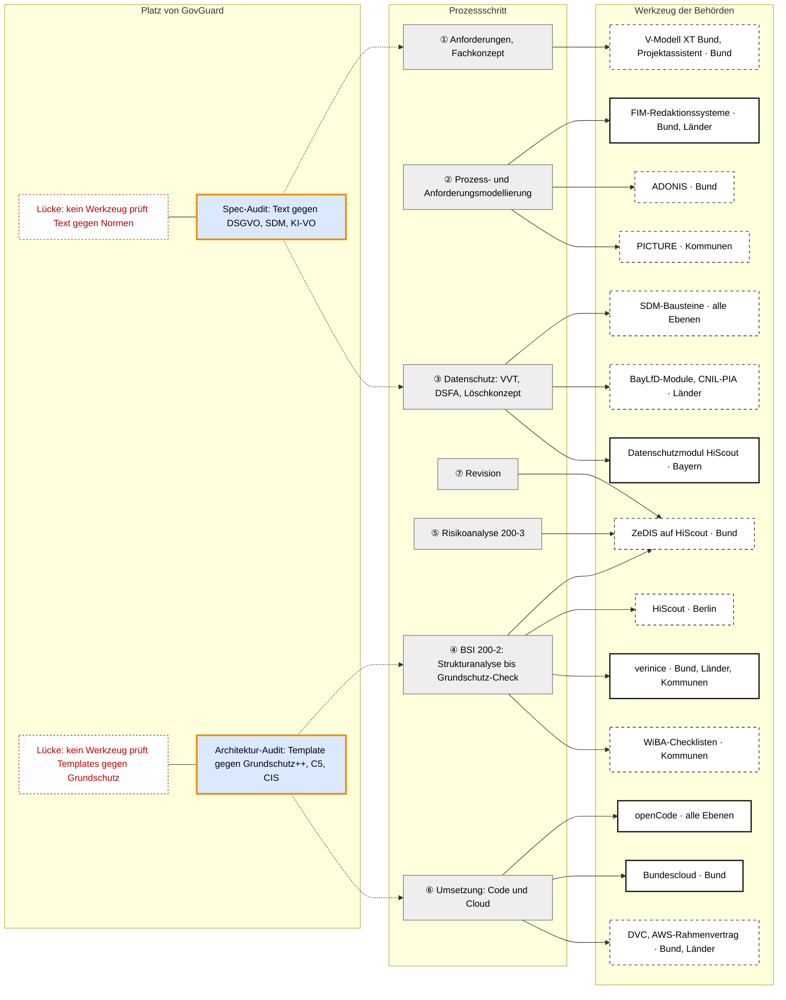

# Werkzeuge der Behörden je Prozessschritt

Research zu Issue #68, Kriterium „Werkzeuge der Behörden je Prozessschritt“. Die Spalte „Status“ wird in #69 (Marktvergleich) für „Adaption im deutschen öffentlichen Sektor“ wiederverwendet. Stand: 2026-10-22.

## Ziel

Das Dokument zeigt, welche Werkzeuge Bund, Länder und Kommunen heute in den Schritten von der Anforderung bis zur Revision nutzen. Es zeigt außerdem, wo neben diesen Werkzeugen Platz für GovGuard ist.

Die Normen selbst und die Abdeckungstabelle gehören nicht hierher, ebenso wenig die Bewertung im Marktvergleich (#69).

## Methode

1. **Gerüst:** Die Prozessschritte folgen dem V-Modell XT Bund, dem Datenschutz nach DSGVO und dem BSI-Ablauf nach Standard 200-2 und 200-3.
2. **Suche:** Je Schritt wurden Behördenseiten, EU-Ausschreibungen (TED), Beschlüsse des IT-Planungsrats, Bundestagsdrucksachen und Herstellerseiten durchsucht.
3. **Einordnung:** Jede Nutzung bekommt einen Status und eine Belegart (siehe Quellenregel).

## Quellenregel

Jede Aussage hat eine Quelle `[Qn]` mit URL im Quellenverzeichnis; alle Abrufe am 2026-10-22. Eine Aussage ohne Primärquelle steht als „*Einschätzung:*“ im Text.

**Status einer Nutzung**

| Status | Bedeutung |
|---|---|
| genutzt | Eine Quelle nennt eine Behörde, die das Werkzeug einsetzt, oder Nutzungszahlen. |
| beschafft | Eine Ausschreibung ist vergeben oder ein Rahmenvertrag geschlossen; der Einsatz selbst ist nicht belegt. |
| angeboten | Eine Behörde oder ein IT-Dienstleister stellt das Werkzeug bereit; eine Nutzung ist nicht belegt. |
| empfohlen | Ein Gremium oder eine Aufsichtsbehörde empfiehlt das Werkzeug oder die Methode. |

**Art des Belegs**

| Kürzel | Art | Gewicht |
|---|---|---|
| A | Ausschreibung oder Zuschlag (TED) | hoch |
| B | Behördenseite, Beschluss, Bundestags- oder Landtagsdrucksache | hoch |
| H | Herstellerreferenz mit genannter Behörde | mittel; der Hersteller hat ein Eigeninteresse |
| F | Fachpresse, meist auf Grundlage einer Herstellermeldung | niedrig; nur als Ergänzung |

Ein **Rahmenvertrag** ist ein Vertrag, aus dem Behörden später Leistungen abrufen können, ohne selbst neu auszuschreiben. **TED** (Tenders Electronic Daily) ist das Portal der EU, in dem öffentliche Aufträge oberhalb der EU-Schwellenwerte bekannt gemacht werden.

---

## 1 Kernaussage

Für das Dokumentieren gibt es auf allen Ebenen etablierte Werkzeuge. Zum Grundschutz sind das Werkzeuge für ein Informationssicherheits-Managementsystem (ISMS), im Datenschutz Formulare und Module, bei den Prozessen Modellierungswerkzeuge.

Ein Werkzeug, das ein Fachkonzept oder ein Cloud-Template automatisch gegen DSGVO, SDM oder Grundschutz prüft, ist in keinem Schritt belegt. Dort steht GovGuard als Prüfassistent neben den vorhandenen Werkzeugen, nicht an ihrer Stelle.

## 2 Prozessschritte als Gerüst

Ein **Lastenheft** beschreibt, was der Auftraggeber fachlich will; in der Verwaltung heißt es oft Fachkonzept. Ein **ISMS** (Informationssicherheits-Managementsystem) ist die Gesamtheit aus Regeln, Rollen und Dokumenten, mit der eine Behörde ihre Informationssicherheit steuert.

| Nr. | Schritt | Was entsteht | Ebene der Vorgabe |
|---|---|---|---|
| ① | Anforderungen und Fachkonzept | Lastenheft, Fachkonzept | V-Modell XT Bund (Bund), sonst hauseigen |
| ② | Prozess- und Anforderungsmodellierung | Prozessmodelle, Datenfelder, Schnittstellen | FIM, XÖV (alle Ebenen) |
| ③ | Datenschutz | Verzeichnis von Verarbeitungstätigkeiten (VVT), Datenschutz-Folgenabschätzung (DSFA), Löschkonzept | DSGVO, SDM |
| ④ | BSI-Ablauf nach 200-2 | Strukturanalyse, Schutzbedarfsfeststellung, Modellierung, IT-Grundschutz-Check | BSI 200-2, ab 2027 Grundschutz++ |
| ⑤ | Risikoanalyse | Risikobewertung für hohen Schutzbedarf | BSI 200-3 |
| ⑥ | Umsetzung: Entwicklung und Betrieb | Quellcode, Cloud-Konfiguration, Templates | Plattformen des Bundes und der Länder |
| ⑦ | Revision | Prüfbericht, Maßnahmenplan | BSI 200-2, Zertifizierung |

Das **VVT** ist die Liste aller Verarbeitungen personenbezogener Daten einer Stelle nach Art. 30 DSGVO. Die **DSFA** ist die Risikoprüfung nach Art. 35 DSGVO für Verarbeitungen mit hohem Risiko. Ein **Löschkonzept** legt fest, wann welche Daten gelöscht werden.

Die **Strukturanalyse** erfasst Anwendungen, Systeme und Räume. Die **Schutzbedarfsfeststellung** bewertet, wie schwer ein Schaden bei Verlust von Vertraulichkeit, Integrität oder Verfügbarkeit wöge. Die **Modellierung** ordnet jedem Zielobjekt die passenden Bausteine zu, und der **IT-Grundschutz-Check** vergleicht Soll und Ist.

## 3 Werkzeuge je Schritt im Überblick

**Kernaussage:** Für jeden Schritt außer dem Löschkonzept gibt es ein belegtes oder angebotenes Werkzeug; GovGuard setzt an den Schritten ① ③ und ⑥ an, wo nur dokumentiert, aber nicht automatisch gegen Normen geprüft wird.

**Legende**

| Zeichen | Bedeutung |
|---|---|
| grauer Kasten | Prozessschritt |
| weiß, durchgezogen | Werkzeug, dessen Einsatz bei einer Behörde belegt ist (Status „genutzt“) |
| weiß, gestrichelt | Werkzeug, das angeboten, empfohlen oder beschafft ist, ohne Beleg für den Einsatz |
| blau mit orangem Rand | GovGuard: Ablauf, den Code führt und in dem er das Sprachmodell fragt |
| rot gestrichelt | Lücke; *Einschätzung*, weil das Fehlen eines Werkzeugs nicht belegbar ist |
| durchgezogener Pfeil | Schritt wird mit diesem Werkzeug bearbeitet |
| gepunkteter Pfeil | GovGuard prüft das Ergebnis dieses Schritts |

**Beschreibung**

*Elemente:* Die linke Spalte zeigt die sieben Schritte aus Kapitel 2. Die mittlere Spalte zeigt je Schritt die wichtigsten Werkzeuge mit Ebene; Einzelheiten und Belege stehen in Kapitel 4. Die rechte Spalte zeigt die beiden Audit-Arten von GovGuard und die zwei Lücken aus Kapitel 5.

*Verbindungen:* Ein durchgezogener Pfeil verbindet einen Schritt mit dem Werkzeug, in dem Behörden ihn dokumentieren. Das Spec-Audit prüft die Texte aus Schritt ① und die Datenschutzangaben, die in Schritt ③ einfließen. Das Architektur-Audit prüft Templates aus Schritt ⑥; seine Befunde können als Vorarbeit in den Grundschutz-Check aus Schritt ④ eingehen (*Einschätzung*). Schritt ⑤ zeigt nur auf ZeDIS, weil nur dort Risikoabschätzungen ausdrücklich genannt sind [Q8]. Für Schritt ⑦ ist kein eigenes Werkzeug belegt; der Pfeil auf ZeDIS ist eine *Einschätzung*, gestützt auf die dort genannten Maßnahmenpläne [Q8].

---

## 4 Werkzeuge je Schritt mit Belegen

### 4.1 Tabelle

| Schritt | Werkzeug | Ebene | Status | Beleg | Art |
|---|---|---|---|---|---|
| ① | V-Modell XT Bund mit Projektassistent und Editor | Bund | angeboten | ITZBund betreut das Modell; Projektassistent und Editor sind kostenlose Open-Source-Werkzeuge [Q31] | B |
| ①, ④ | Checkliste Schutzbedarfsfeststellung und Informationssicherheits-Navigator zum V-Modell XT Bund 2.3 | Bund | angeboten | ITZBund-Dokumente; die Schutzbedarfsfeststellung stützt sich auf das Lastenheft [Q32], [Q33] | B |
| ① | Werkzeug für Anforderungsmanagement (z. B. DOORS, Polarion, Jira) | – | nicht gefunden | keine Ausschreibung gefunden | – |
| ② | FIM-Redaktionssysteme; Austauschformate XZuFi, XDatenfelder, XProzess | Bund, Länder; Kommunen über die Länder | genutzt | FITKO: FIM ist Produkt des IT-Planungsrats und wird in OZG-Projekten eingesetzt; Bund und alle Länder haben Zugang [Q24] | B |
| ② | FIM-BPMN für Stammprozesse | Bund, Länder | empfohlen | FIM-Fachkonzept Prozesse, Version 1.01 [Q25] | B |
| ② | XGenerator, XRepository (XÖV) | alle Ebenen | angeboten | KoSIT [Q26] | B |
| ② | ADONIS mit Methode MODULO | Bund | beschafft | BVA: „das neue einheitliche Prozessmanagement-Werkzeug des Bundes“, Rahmenvertrag; MODULO seit Juni 2024 über das Kaufhaus des Bundes [Q27], [Q28] | B |
| ② | PICTURE-Prozessplattform | Kommunen in Hessen | angeboten | ekom21: Ex-ante-Bekanntmachung einer Direktvergabe an PICTURE GmbH für eine Rahmenvereinbarung, 25.04.2025 [Q29] | A |
| ② | PICTURE-Prozessplattform | Kommunen in Sachsen-Anhalt | genutzt (Pilot) | Landesweiter Proof of Concept 2026 mit KITU, PICTURE GmbH und Kommunen [Q30] | B |
| ② | ARIS | – | nicht gefunden | keine Ausschreibung und keine Behördenseite gefunden | – |
| ③ | Standard-Datenschutzmodell (SDM) mit Bausteinkatalog | alle Ebenen | empfohlen | IT-Planungsrat, Beschluss 2020/06 [Q19]; DSK, Version 3.1a [Q18] | B |
| ③ | DSFA-Module (Word, Excel, PDF) | Land Bayern, öffentliche Stellen | angeboten | Bayerischer Landesbeauftragter für den Datenschutz [Q20] | B |
| ③ | Musterformulare der DSK für das VVT | alle Ebenen | angeboten | BayLDA-Pressemitteilung vom 14.02.2018 [Q21] | B |
| ③ | CNIL PIA-Software | Land Rheinland-Pfalz (Hinweis) | empfohlen | LfDI Rheinland-Pfalz nennt das Open-Source-Werkzeug [Q22]; CNIL-Seite nicht abrufbar [Q23] | B |
| ③ | HiScout, Modul Datenschutz (VVT, DSFA) | Land Bayern | genutzt | Staatsministerium der Finanzen und für Heimat als Lizenznehmer seit 01.01.2021 [Q16] | F |
| ③ | verinice, Datenschutzmodul | Land Berlin | angeboten | SerNet-Meldung 2020: nutzbar in allen Berliner Landeseinrichtungen [Q12] | H |
| ③ | Werkzeug für Löschkonzepte | – | nicht gefunden | nur Methode: SDM-Baustein 60 „Löschen und Vernichten“ [Q18] | – |
| ④ ⑤ ⑦ | ZeDIS (Zentraler Dienst für Informationssicherheit) auf HiScout GRC Suite | Bund | angeboten | ITZBund: Standardlösung für den IT-Grundschutz in Bundesbehörden, als SaaS [Q7]; Hersteller nennt Schutzbedarf, Risiko, Maßnahmenplan [Q8] | B, H |
| ④ | HiScout als ISMS-GRC-Werkzeug | Land Berlin | beschafft | ITDZ Berlin: Zuschlag an HiScout GmbH am 07.07.2025, bekannt gemacht am 09.07.2025, 48 Monate [Q10], [Q11] | A |
| ④ | verinice | Land Berlin | genutzt (bis etwa 2024) | Vertragsverlängerung um vier Jahre, Meldung vom 27.08.2020 [Q12] | H |
| ④ | verinice | Bund: BAuA, BAFA, bpb, Generalzolldirektion, PTB | genutzt | Referenzseite des Herstellers, ohne Datum [Q13] | H |
| ④ | verinice | Kommunen: u. a. Kreis Lippe, Stadt Nürnberg, LRA Mittelsachsen; „mehr als 50 Kommunen“ | genutzt | Referenzseite des Herstellers, ohne Datum [Q14] | H |
| ④ | HiScout über das krz | Kommunen in Ostwestfalen-Lippe | angeboten | krz hostet HiScout für seine Kunden, 02.10.2023 [Q15] | F |
| ④ | WiBA: Checklisten, Excel-Werkzeug, Webtool | Kommunen | angeboten | BSI [Q6] | B |
| ④ | Liste von über 60 IT-Grundschutz-Werkzeugen, darunter HiScout und verinice | alle Ebenen | angeboten | BSI: „reine Auflistung“, Qualität nicht geprüft [Q1] | B |
| ④ | Grundschutz++ als OSCAL-Katalog; Stand-der-Technik-Viewer | alle Ebenen | empfohlen | BSI empfiehlt langfristig die werkzeuggestützte Umsetzung [Q3]; Kataloge auf GitHub [Q5] | B |
| ⑥ | openCode (Code-Plattform mit Badge-Programm) | alle Ebenen | genutzt | Bundesregierung: mehr als 10.800 Nutzende in über 5.500 Projekten [Q35]; BSI und ZenDiS: automatisierte Sicherheitsprüfungen [Q36] | B |
| ⑥ | Bundescloud | Bund | genutzt | ITZBund betreibt sie an drei Standorten [Q39] | B |
| ⑥ | Deutsche Verwaltungscloud (DVC) | Bund, Länder, Kommunen | angeboten | IT-Planungsrat: Produkt seit April 2025, 65 DVC-konforme Cloud-Dienste bestellbar [Q37], [Q38] | B |
| ⑥ | AWS über Bechtle | Bund | beschafft | Rahmenvertrag mit dem Beschaffungsamt des BMI, bis 235 Mio. Euro, 48 Monate [Q40] | H |
| ⑥ | Cloud von Dataport über die DVC | Länder | nicht verifiziert | Dataport-Seiten am 22.10.2026 nicht erreichbar | – |
| (Arbeitsplatz) | openDesk | Bund | genutzt | 8.475 Lizenzen im Produktivbetrieb, Stand April 2026 [Q35] | B |

### 4.2 ISMS-Werkzeuge für Grundschutz (Schritte ④ ⑤ ⑦)

Das frühere kostenlose Werkzeug des BSI hieß GSTOOL. *Einschätzung:* Laut Fachpresse endete sein Support Ende 2016; das ITZBund wählte als Ersatz für den Bund die GRC Suite von HiScout, weil sie GSTOOL-Daten übernehmen kann [Q9]. Eine BSI-Seite zum Ende des GSTOOL wurde nicht gefunden.

Das BSI selbst bietet kein eigenes Werkzeug mehr an. Es führt eine Liste von über 60 Werkzeugen und betont, dass es sich um eine „reine Auflistung“ handelt und weder Programmqualität noch korrekte Umsetzung geprüft werden [Q1].

Für **Grundschutz++** stellt das BSI die Anforderungen maschinenlesbar bereit, damit Werkzeuge sie verarbeiten können [Q2], [Q4]. Das Format heißt **OSCAL** (Open Security Controls Assessment Language). Es ist ein Standard des US-amerikanischen NIST, um Sicherheitsanforderungen als JSON oder XML zu beschreiben. Der Methodik-Leitfaden schreibt: „Langfristig empfehlen wir die toolgestützte Umsetzung“ [Q3, S. 7]. Laut BSI arbeiten „zahlreiche Hersteller von IT-Grundschutz-Tools“ an der Einbindung [Q5]. Eine Ebene für maschinenlesbare Prüfergebnisse (Assessment Layer) ist erst „für zukünftige“ Artefakte vorgesehen [Q5].

| Ebene | Werkzeug | Stärke des Belegs |
|---|---|---|
| Bund | ZeDIS (HiScout) als Standardlösung des ITZBund | Behördenseite; Zahl der Nutzerbehörden nicht gefunden |
| Bund | verinice bei fünf genannten Bundesbehörden | nur Herstellerreferenz |
| Land | Berlin: verinice bis etwa 2024, seit Juli 2025 Rahmenvertrag mit HiScout | Zuschlag in TED |
| Kommune | verinice (über 50 Kommunen laut Hersteller), HiScout über das krz, WiBA vom BSI | Hersteller, Fachpresse, BSI |

### 4.3 Datenschutz (Schritt ③)

Das **Standard-Datenschutzmodell (SDM)** ist die gemeinsame Prüfmethode der deutschen Datenschutzaufsichtsbehörden. Es übersetzt die DSGVO in sechs Gewährleistungsziele, die übergreifende Datenminimierung und einen Katalog von Bausteinen mit Referenzmaßnahmen [Q17], [Q18]. Der IT-Planungsrat empfiehlt seinen Mitgliedern seit dem 25.03.2020, das SDM anzuwenden [Q19].

Das SDM ist eine Methode, kein Programm. Die Werkzeuge der Aufsichtsbehörden sind Formulare: Musterformulare der DSK für das VVT [Q21] und DSFA-Module des BayLfD als Word- oder Excel-Vorlagen mit fiktiven Beispielen [Q20]. Als Software nennt der LfDI Rheinland-Pfalz die PIA-Software der französischen Aufsicht CNIL [Q22]. PIA steht für Privacy Impact Assessment, die englische Bezeichnung der DSFA.

Software für VVT und DSFA ist auf Landesebene nur als Modul der ISMS-Werkzeuge belegt: HiScout in Bayern [Q16] und verinice in Berlin [Q12]. Ein Werkzeug für das Löschkonzept wurde nicht gefunden.

### 4.4 Anforderungs- und Prozessmodellierung (Schritte ① ②)

**FIM** (Föderales Informationsmanagement) beschreibt Verwaltungsleistungen einheitlich in drei Bausteinen: Leistungen, Datenfelder und Prozesse [Q24]. Prozesse werden in einer eingeschränkten Form von BPMN 2.0 modelliert [Q25]. BPMN (Business Process Model and Notation) ist eine genormte grafische Sprache für Abläufe.

**XÖV** steht für „XML in der öffentlichen Verwaltung“. Es ist der Rahmen der KoSIT für Datenaustausch-Standards; ihr XGenerator prüft ein XÖV-Fachmodell automatisch gegen die Regeln dieses Rahmens [Q26]. Das ist die einzige belegte automatische Prüfung gegen einen Standard in diesem Research, betrifft aber Datenmodelle, nicht Datenschutz oder Sicherheit.

Für die Modellierung hat der Bund ADONIS per Rahmenvertrag eingeführt [Q27]. Bei Kommunen ist PICTURE belegt: Hessen bereitet eine Rahmenvereinbarung über die ekom21 vor [Q29], Sachsen-Anhalt erprobt die Plattform 2026 landesweit [Q30]. Für ARIS wurde kein Beleg im deutschen öffentlichen Sektor gefunden.

Für Lastenhefte gibt es im Bund das V-Modell XT Bund mit Projektassistent [Q31]. Die ITZBund-Checkliste zeigt die Schnittstelle zu GovGuard: Die Schutzbedarfsfeststellung beruht auf dem Lastenheft und wird im Interview oder Workshop erhoben, nicht automatisch geprüft [Q32].

### 4.5 Plattformen für Entwicklung und Betrieb (Schritt ⑥)

**openCode** ist die Code-Plattform der Verwaltung, betrieben vom ZenDiS (Zentrum für Digitale Souveränität der Öffentlichen Verwaltung) im Auftrag des BMDS [Q34]. Ihr Badge-Programm leitet Gütesiegel für Sicherheit, Wartung und Nachnutzung automatisch aus dem Code ab [Q36]. Eine Prüfung von Cloud-Templates gegen Grundschutz erwähnt die BSI-Meldung nicht.

Die **Deutsche Verwaltungscloud (DVC)** ist ein Katalog von Cloud-Diensten öffentlicher IT-Dienstleister, kein eigenes Rechenzentrum. Kunde kann nur ein öffentlicher Auftraggeber nach § 99 GWB sein [Q37]. Im März 2026 waren 65 DVC-konforme Dienste bestellbar; die Betriebsplattform entsteht mit IONOS und STACKIT [Q38].

Für GovGuard wichtig: Der Bund hat über das Beschaffungsamt des BMI einen Rahmenvertrag für Public-Cloud-Dienste mit Bechtle und AWS geschlossen, umgesetzt mit dem ITZBund [Q40]. *Einschätzung:* Damit sind CloudFormation-Templates in der Bundesverwaltung möglich; eine Nutzung durch eine bestimmte Behörde ist nicht belegt, und die TED-Bekanntmachung wurde nicht gefunden.

---

## 5 Lücke für GovGuard

*Einschätzung* für alle drei Punkte, weil sich das Fehlen eines Werkzeugs nicht belegen lässt; die Belege zeigen nur, was die vorhandenen Werkzeuge tun.

| Schritt | Was heute geschieht | Was fehlt | Platz von GovGuard |
|---|---|---|---|
| ① Fachkonzept, Lastenheft | Vorlagen aus dem V-Modell XT Bund; Schutzbedarf im Interview aus dem Lastenheft [Q31], [Q32] | eine automatische Prüfung des Textes gegen DSGVO, SDM und KI-VO | Spec-Audit als Vorprüfung, bevor DSFA und Schutzbedarfsfeststellung beginnen |
| ③ VVT, DSFA | Formulare und Module zum Ausfüllen [Q16], [Q20], [Q22] | ein Abgleich, ob das Fachkonzept die Angaben für VVT und DSFA überhaupt enthält | Spec-Audit; die Zuordnung Prüfregel → Folgedokument aus #68 gruppiert die Lücken |
| ⑥ Cloud-Templates | Code-Siegel auf openCode [Q36]; ISMS-Werkzeuge dokumentieren den Grundschutz-Check von Hand [Q7] | eine Prüfung von Infrastruktur-Code gegen Grundschutz++ und C5 vor dem Deployment | Architektur-Audit; Befunde als Vorarbeit für den Grundschutz-Check |

GovGuard ersetzt kein ISMS-Werkzeug. Strukturanalyse, Modellierung, Risikoanalyse und Revision bleiben in ZeDIS, HiScout oder verinice.

*Einschätzung:* Weil Grundschutz++ als OSCAL vorliegt und das BSI eine Ebene für Prüfergebnisse plant [Q5], könnte GovGuard seine Befunde später in diesem Format an ein ISMS-Werkzeug übergeben.

## 6 Grenzen und nicht Gefundenes

- **Nicht gefunden:** eine BSI-Seite zum Ende des GSTOOL; ein eigenes BSI-Werkzeug für Grundschutz++; die Zahl der Nutzerbehörden von ZeDIS; Nutzung von ARIS in deutschen Behörden; Ausschreibungen für Werkzeuge des Anforderungsmanagements; ein Werkzeug für Löschkonzepte; ein eigenes Werkzeug für die Revision; VVT-Software kommunaler Rechenzentren; die TED-Bekanntmachung zum AWS-Rahmenvertrag; die Nummer des ADONIS-Rahmenvertrags.
- **Nicht abrufbar am 2026-10-22:** Seiten von Dataport (Verbindung abgelehnt) und der CNIL (HTTP 503).
- **Herstellerlastig:** Die Nutzung von verinice im Bund und in Kommunen ist nur durch Referenzseiten des Herstellers belegt, die von HiScout in Bayern nur durch Fachpresse.

---

## Quellenverzeichnis

Alle Quellen abgerufen am 2026-10-22.

| Nr. | Quelle | Art | URL |
|---|---|---|---|
| Q1 | BSI: IT-Grundschutz-Tools (Liste) | B | https://www.bsi.bund.de/DE/Themen/Unternehmen-und-Organisationen/Standards-und-Zertifizierung/IT-Grundschutz/IT-Grundschutz-Kompendium/Alternative-IT-Grundschutztools/IT-Grundschutztools.html |
| Q2 | BSI: Grundschutz++, Meilensteinplan, Stand Oktober 2026 | B | https://www.bsi.bund.de/DE/Themen/Unternehmen-und-Organisationen/Standards-und-Zertifizierung/Grundschutz-in-der-Informationssicherheit/Grundschutz-Plus-Plus/grundschutz-plus-plus_node.html |
| Q3 | BSI: Leitfaden zur Methodik Grundschutz++, 16.03.2026 | B | https://www.bsi.bund.de/SharedDocs/Downloads/DE/BSI/Grundschutz/sonstiges/Methodik_Grundschutz_PlusPlus.pdf?__blob=publicationFile&v=12 |
| Q4 | BSI: Meldung „Stand-der-Technik-Bibliothek auf GitHub“, 30.09.2025 | B | https://www.bsi.bund.de/DE/Service-Navi/Presse/Alle-Meldungen-News/Meldungen/Stand-der-Technik-Bibliothek_250930.html |
| Q5 | BSI: Stand-der-Technik-Bibliothek, README und `documentation/OSCAL.md` | B | https://github.com/BSI-Bund/Stand-der-Technik-Bibliothek |
| Q6 | BSI: WiBA – Weg in die Basis-Absicherung | B | https://www.bsi.bund.de/DE/Themen/Unternehmen-und-Organisationen/Standards-und-Zertifizierung/IT-Grundschutz/WIBA/Weg_in_die_Basis_Absicherung_WiBA_node.html |
| Q7 | ITZBund: Zentraler Dienst für Informationssicherheit (ZeDIS) | B | https://www.itzbund.de/DE/itloesungen/standardloesungen/zedis/zedis.html |
| Q8 | HiScout: „ZeDIS: einheitliches Grundschutz-Tool für die Bundesverwaltung“, 14.01.2025 | H | https://www.hiscout.com/zedis-grundschutz-tool-bundesverwaltung/ |
| Q9 | eGovernment: „ITZBund vereinheitlicht IT-Grundschutz mit SaaS-Lösung“, 15.01.2025 | F | https://www.egovernment.de/itzbund-vereinheitlicht-it-grundschutz-mit-saas-loesung-a-013dc1f95ef76ee4b8320777a14d80e5/ |
| Q10 | TED 110470-2025: ITDZ Berlin, „RV ISMS-GRC-Tool“, Auftragsbekanntmachung, 19.02.2025 | A | https://ted.europa.eu/de/notice/110470-2025/pdf |
| Q11 | TED 445026-2025: ITDZ Berlin, Zuschlag an HiScout GmbH am 07.07.2025 (bekannt gemacht 09.07.2025) | A | https://ted.europa.eu/de/notice/445026-2025/pdf |
| Q12 | SerNet: „Land Berlin verlängert verinice-Rahmenvertrag“, 27.08.2020 | H | https://verinice.com/en/news/detail/land-berlin-verlaengert-verinice-rahmenvertrag-en |
| Q13 | SerNet: verinice-Referenzen Bundesbehörden | H | https://verinice.com/en/solutions/references/federal-authorities |
| Q14 | SerNet: verinice-Referenzen Kommunen | H | https://verinice.com/en/solutions/references/municipalities |
| Q15 | it-daily: „krz und HiScout unterstützen Kommunen bei der IT-Sicherheit“, 02.10.2023 | F | https://www.it-daily.net/?p=79916 |
| Q16 | it-daily: „Freistaat Bayern erweitert HiScout GRC Software um Datenschutz“, 28.01.2021 | F | https://www.it-daily.net/?p=21909 |
| Q17 | ULD Schleswig-Holstein: Das Standard-Datenschutzmodell | B | https://www.datenschutzzentrum.de/sdm/ |
| Q18 | LfDI Mecklenburg-Vorpommern: SDM V3.1a und Bausteinkatalog | B | https://www.datenschutz-mv.de/datenschutz/datenschutzmodell/ |
| Q19 | IT-Planungsrat: Beschluss 2020/06 „Standard-Datenschutzmodell“, 25.03.2020 | B | https://www.it-planungsrat.de/beschluss/beschluss-2020-06 |
| Q20 | BayLfD: Einführung zu den DSFA-Werkzeugen in Modulform, Stand 01.05.2022 | B | https://www.datenschutz-bayern.de/dsfa/DSFA-Modulhinweise.pdf |
| Q21 | BayLDA: Pressemitteilung „Muster für Verzeichnis von Verarbeitungstätigkeiten“, 14.02.2018 | B | https://www.lda.bayern.de/media/pm2018_04.pdf |
| Q22 | LfDI Rheinland-Pfalz: Datenschutz-Folgenabschätzung | B | https://www.datenschutz.rlp.de/themen/datenschutz-folgenabschaetzung |
| Q23 | CNIL: Outil PIA (am Abrufdatum HTTP 503, nicht ausgewertet) | B | https://www.cnil.fr/fr/outil-pia-telechargez-et-installez-le-logiciel-de-la-cnil |
| Q24 | FITKO: Produkt FIM | B | https://www.fitko.de/produktmanagement/fim |
| Q25 | FIM-Baustein Prozesse, Fachkonzept, Version 1.01, 31.07.2020 | B | https://www.fimportal.de/assets/prozesse_fachkonzept.pdf?version=2 |
| Q26 | KoSIT: XÖV und XÖV-Produkte | B | https://www.xoev.de/ und https://docs.xoev.de/ |
| Q27 | BVA: Prozessmanagement-Tools des Bundes (ADONIS, MODULO), Stand 04.09.2025 | B | https://www.bva.bund.de/DE/Services/Behoerden/Beratung/BZB/Themenwelten/Prozesse/Prozessmanagement/ADONIS_MODULO/ADONIS_MODULO_node.html |
| Q28 | BVA: Standards und Empfehlungen für ein bundeseinheitliches Prozessmanagement | B | https://www.bva.bund.de/DE/Services/Behoerden/Beratung/BZB/Themenwelten/Prozesse/Prozessmanagement/PMT/PMT_node.html |
| Q29 | TED 266671-2025: ekom21, Vorankündigung Direktvergabe Prozessplattform (PICTURE GmbH), 25.04.2025 | A | https://ted.europa.eu/de/notice/266671-2025/pdf |
| Q30 | Land Sachsen-Anhalt: OZG-Sprechstunde „Proof of Concept – Einsatz kommunales Prozessmanagement-Tool“ | B | https://ozg.sachsen-anhalt.de/fileadmin/Bibliothek/Politik_und_Verwaltung/MF/OZG/Bilder/Veranstaltungen/OZG-Sprechstunden/71.OZG-Sprechstunde_PoC_PM-Tool_barrierefrei.pdf |
| Q31 | ITZBund: V-Modell XT | B | https://www.itzbund.de/DE/Produkte/V-Modell-XT/v-modell-xt_node.html |
| Q32 | ITZBund: Checkliste für das Interview zur Schutzbedarfsfeststellung (V-Modell XT Bund 2.3) | B | https://www.itzbund.de/SharedDocs/Downloads/DE/digitalemission/trendstechnologien/IT-Security_Checkliste_Schutzbedarfsfeststellung.pdf?__blob=publicationFile&v=2 |
| Q33 | ITZBund: Informationssicherheits-Navigator (V-Modell XT Bund 2.3) | B | https://www.itzbund.de/SharedDocs/Downloads/DE/digitalemission/trendstechnologien/IT-Security_Informationssicherheits-Navigator.pdf?__blob=publicationFile&v=2 |
| Q34 | ZenDiS: openCode | B | https://opencode.de/de |
| Q35 | Deutscher Bundestag: Drucksache 21/5502, Antwort der Bundesregierung zum ZenDiS, 22.04.2026 | B | https://dserver.bundestag.de/btd/21/055/2105502.pdf |
| Q36 | BSI: Pressemitteilung „BSI und ZenDiS veröffentlichen Strategie für die automatisierte Absicherung von Softwarelieferketten“, 10.04.2025 | B | https://www.bsi.bund.de/DE/Service-Navi/Presse/Pressemitteilungen/Presse2025/250410_ZenDiS_sichere_Lieferketten.html |
| Q37 | IT-Planungsrat: Beschluss 2024/42, Produktbeschreibung „Deutsche Verwaltungscloud“, 13.08.2024 | B | https://it-planungsrat.de/fileadmin/beschluesse/2024/Beschluss_2024-42_Verwaltungscloud_DVC_Produktbeschreibung.pdf |
| Q38 | IT-Planungsrat, Fachkongress 2026: „Deep Dive DVC“ (FITKO, govdigital), 18./19.03.2026 | B | https://www.it-planungsrat.de/fileadmin/it-planungsrat/der-it-planungsrat/fachkongress/fachkongress_2026/pr%C3%A4sentationen/Tag1_Deep_Dive_DVC_Beutell.pdf |
| Q39 | Deutscher Bundestag: Drucksache 20/12727, Antwort der Bundesregierung zur Bundescloud, 27.08.2024 | B | https://dserver.bundestag.de/btd/20/127/2012727.pdf |
| Q40 | Bechtle: „Bechtle schließt Rahmenvertrag für Public Cloud mit dem Beschaffungsamt des BMI“, 12.12.2024 | H | https://www.bechtle.com/ueber-bechtle/presse/pressemeldungen/2024/bechtle-schliesst-rahmenvertrag-fuer-public-cloud-mit-dem-beschaffungsamt-des-bmi |
